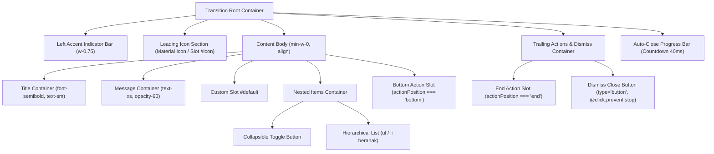

# Alert Component

## 01. Overview

Alert adalah komponen banner notifikasi inline berbasis Vue 3 dan Tailwind CSS untuk aplikasi Laravel Inertia. Komponen ini dirancang untuk menampilkan pesan kontekstual, umpan balik operasional (sukses, error, peringatan), status validasi form, atau pengumuman penting langsung di dalam alur tata letak halaman.

### Fungsi Utama
* Memberikan umpan balik status transaksi atau perubahan data secara langsung di atas form atau tabel.
* Menyampaikan informasi pemeliharaan sistem atau pemberitahuan penting dalam alur baca halaman.
* Menyajikan ringkasan kegagalan validasi input pengguna sebelum form dikirimkan kembali.

### Kapan Digunakan
* Menampilkan konfirmasi keberhasilan setelah submit form tanpa memindahkan posisi user ke halaman lain.
* Memberikan peringatan bahwa akun belum diverifikasi atau masa berlaku sesi akan berakhir.
* Menampilkan pesan error spesifik yang membutuhkan perhatian langsung sebelum melanjutkan tugas.

### Karakteristik Penting
* **Inline Document Flow**: Berada di dalam hierarki dokumen, bukan floating overlay seperti Toast atau Modal.
* **Dual Visibility Control**: Mendukung kontrol dua arah reaktif via `v-model` maupun kontrol statis via prop `show`.
* **Perataan Teks Fleksibel (Alignment)**: Mendukung perataan teks `left`, `center`, `right`, dan `justify` untuk judul, deskripsi, maupun list.
* **Teks Beranak Hierarkis (Nested Items)**: Mendukung penyajian daftar pesan bersarang hingga sub-level dengan opsi bullets (`disc`, `decimal`, `none`) serta toggle lipat/ekspansi (`collapsible`).
* **Fleksibilitas Posisi Aksi**: Tombol aksi dapat diletakkan di sisi kanan (`end`) atau di bawah teks (`bottom`).
* **Auto-Close & Progress Countdown Bar**: Mendukung penutupan otomatis berjangka waktu (ms) dengan indikator visual progress bar yang otomatis menjeda (*pause*) saat kursor mouse di-hover atau elemen di dalamnya menerima fokus keyboard.
* **Aksesibilitas Terintegrasi**: Mengatur atribut WAI-ARIA `role` dan `aria-live` secara dinamis sesuai tingkat keparahan pesan.
* **Mode Gelap Penuh**: Seluruh varian dan status warna telah teroptimasi untuk kontras visual Tailwind CSS `dark:`.

---

## 02. Preview

> [!TIP]
> Pengujian visual dan showcase interaktif entitas ini tersedia secara native pada portal pratinjau aplikasi:
>
> <a href="/preview/alert" target="_self" style="display: inline-flex; align-items: center; gap: 6px; padding: 6px 14px; border-radius: 8px; font-weight: 600; text-decoration: none; margin-top: 8px; background-color: var(--vp-c-brand-1, #4f46e5); color: #ffffff;">Buka Live Preview Komponen Alert</a>

---

## 03. Usage

Konsep penggunaan komponen Alert dalam hierarki antarmuka:

```text
Alert
├── Form Feedback (Validasi input, pesan peringatan kolom)
├── Action Confirmation (Sukses simpan, gagal hapus, status antrean)
├── System Status (Mode maintenance, jaringan offline, sinkronisasi)
├── Account State (Verifikasi email, kuota hampir habis, profil belum lengkap)
├── Nested Guidance List (Panduan langkah bertingkat, detail syarat dokumen)
└── Laravel Inertia Flash Message (Session flash handler)
```

### Perbandingan dengan Komponen Lain
* Gunakan **Alert** jika pesan harus tetap berada di dalam alur konten dokumen sampai diselesaikan atau ditutup.
* Gunakan **Toast** jika pesan bersifat sementara dan tidak boleh menggeser susunan elemen halaman.
* Gunakan **Modal** jika user wajib mengambil keputusan kritis sebelum diperbolehkan melakukan tindakan lain.

---

## 04. Anatomy

Struktur hierarki internal elemen di dalam `Alert.vue`:



### Deskripsi Elemen Internal:
1. **Transition Root Container**: Pembungkus terluar dengan animasi fade dan slide, membawa atribut dinamis `role="alert|status"` serta `aria-live="assertive|polite"`.
2. **Left Accent Indicator Bar**: Garis aksen vertikal tipis hairline presisi (`w-0.75` / 3px) di tepi kiri kontainer.
3. **Leading Icon Section**: Area ikon semantik dengan Google Material Symbols atau kustom slot `#icon` berskala proporsional.
4. **Content Body**: Area konten teks fleksibel (`min-w-0`) dengan dukungan perataan (`align`) dan tipografi bebas margin liar default peramban.
5. **Nested Items Container**: Daftar teks beranak hierarkis hingga sub-level dengan opsi toggle lipat (`collapsible`).
6. **Trailing Actions & Dismiss**: Area tombol aksi sisi kanan dan tombol dismiss silang mikro dengan isolasi event (`.prevent.stop`).
7. **Auto-Close Progress Bar**: Bilah waktu mundur interaktif di dasar alert dengan jeda otomatis saat kursor berada di atas alert (*hover/focus*).

---

## 05. Variants

Komponen menyediakan 4 varian gaya visual (`variant` atau `style`) yang dapat disesuaikan dengan kebutuhan konteks UI:

| Varian | Prop Value | Deskripsi Tampilan | Kasus Penggunaan yang Direkomendasikan |
| :--- | :--- | :--- | :--- |
| **Soft** | `'soft'` *(default)* | Latar belakang berwarna pastel dengan transparansi 90%, border halus, dan teks kontras tinggi. | Standar formulir, notifikasi tabel, dan kartu informasi umum. |
| **Solid** | `'solid'` | Latar belakang warna penuh pekat dengan teks putih tebal dan aksen semi-transparan. | Peringatan darurat, error sistem fatal, dan pengumuman prioritas tinggi. |
| **Outline** | `'outline'` | Latar belakang putih/transparan dengan border aksen berwarna solid dan teks bertema. | Antarmuka bergaya minimalis, struk pembayaran, dan panel ringkasan. |
| **Pill** | `'pill'` | Gaya kapsul membulat penuh (`!rounded-full`) dengan aksen ring kontras tinggi. | Pemberitahuan kompak, pill status bar, atau pengumuman satu baris. |

### Pilihan Aksen Warna (`color` / `type`)

Mendukung 8 warna baku paten tema dan alias status semantik:
* `indigo` *(default)*: Aksen ungu-kebiruan standar antarmuka.
* `primary`: Aksen warna brand aplikasi utama.
* `emerald` / `success`: Warna hijau sukses dengan ikon `check_circle`.
* `amber` / `warning`: Warna kuning-oranye peringatan dengan ikon `warning`.
* `rose` / `error` / `danger`: Warna merah galat kritis dengan ikon `error`.
* `cyan` / `info`: Warna biru cerah informasi dengan ikon `info`.
* `purple`: Aksen ungu kreatif dengan ikon `auto_awesome`.
* `dark` / `neutral`: Aksen abu-abu gelap dengan ikon `notifications`.

---

## 06. Sizes

Komponen menyediakan 5 skala proporsional (`size`):

| Ukuran | Prop Value | Padding & Gap | Ukuran Teks | Ukuran Ikon | Kapan Digunakan |
| :--- | :--- | :--- | :--- | :--- | :--- |
| **Extra Small** | `'xs'` | `p-2.5 gap-2` | `text-xs` | `16px` | Area mikro, modal sempit, atau sel detail tabel data. |
| **Small** | `'sm'` | `p-3 gap-2.5` | `text-xs` | `18px` | Ruang terbatas, kolom formulir sekunder, atau inline filter. |
| **Medium** | `'md'` *(default)* | `p-4 gap-3.5` | `text-sm` | `20px` | Standar formulir web, kartu ringkasan, dan layout dashboard. |
| **Large** | `'lg'` | `p-5 gap-4` | `text-base` | `22px` | Banner peringatan utama halaman dan area pengumuman transaksional. |
| **Extra Large** | `'xl'` | `p-6 gap-5` | `text-lg` | `26px` | Hero banner landing page atau pengumuman sistem skala penuh. |

---

## 07. States

| State | Kondisi Pemicu | Respon Komponen |
| :--- | :--- | :--- |
| **Enter (Animasi Muncul)** | Komponen dimount atau visibilitas berubah menjadi `true`. | Animasi transisi fade-in dan pergeseran vertikal halus dari atas (`opacity-0 -translate-y-2` menuju `opacity-100 translate-y-0`). |
| **Active / Visible** | Alert sedang tampil di layar. | Komponen menerima event interaksi, countdown timer berjalan jika `autoClose > 0`. |
| **Hovered (Mouse Hover)** | Kursor pengguna berada di atas area Alert. | Jika `autoClose` aktif, timer dan animasi progress bar otomatis dijeda (*pause*) agar pengguna dapat membaca pesan dengan tenang. |
| **Focused (Keyboard Focus)** | Elemen interaktif di dalam alert menerima fokus keyboard. | Timer `autoClose` dijeda untuk mencegah hilangnya elemen saat sedang dioperasikan via keyboard (kepatuhan WCAG 2.2.2). |
| **Dismissing / Exit** | Pengguna menekan tombol tutup atau durasi `autoClose` habis. | Timer dibersihkan, event `@dismiss` dan `@close` dipancarkan, disusul transisi fade-out ke bawah (`opacity-0 translate-y-2`). |

---

## 08. Props / Attributes

Daftar lengkap konfigurasi prop yang didukung oleh `Alert.vue`:

| Prop | Tipe Data | Default | Pilihan Nilai | Keterangan |
| :--- | :--- | :--- | :--- | :--- |
| `modelValue` | `Boolean` | `undefined` | `true`, `false` | Kontrol dua arah reaktif via `v-model`. Mengesampingkan prop `show` bila diisi. |
| `show` | `Boolean` | `true` | `true`, `false` | Fallback kontrol visibilitas satu arah jika `v-model` tidak digunakan. |
| `design` | `String` | `'default'` | `'default'`, `'minimal'`, `'bordered'`, `'floating'`, `'modern'` | Arsitektur dan tata letak kontainer alert. |
| `color` | `String` | `undefined` | `'indigo'`, `'primary'`, `'emerald'`, `'purple'`, `'amber'`, `'rose'`, `'cyan'`, `'dark'`, `'success'`, `'warning'`, `'error'`, `'danger'`, `'info'`, `'neutral'` | Palet aksen warna semantik alert. |
| `type` | `String` | `undefined` | `'success'`, `'warning'`, `'error'`, `'danger'`, `'info'`, `'neutral'` | Alias semantik untuk menentukan warna dan ikon bawaan. |
| `variant` | `String` | `'soft'` | `'soft'`, `'solid'`, `'outline'`, `'pill'` | Gaya visual presentasi permukaan alert. |
| `style` | `String` | `undefined` | `'soft'`, `'solid'`, `'outline'`, `'pill'` | Alias parameter gaya visual permukaan. |
| `radius` | `String` | `'xl'` | `'none'`, `'sm'`, `'md'`, `'lg'`, `'xl'`, `'2xl'`, `'full'` | Skala kelengkungan sudut kontainer alert. |
| `size` | `String` | `'md'` | `'xs'`, `'sm'`, `'md'`, `'lg'`, `'xl'` | Skala dimensi padding, font, gap, dan ikon. |
| `align` | `String` | `'left'` | `'left'`, `'center'`, `'right'`, `'justify'` | Perataan tipografi pesan judul, deskripsi, dan daftar beranak. |
| `title` | `String` | `''` | Teks bebas | Judul tebal penjelas notifikasi. |
| `message` | `String` | `''` | Teks bebas | Deskripsi atau pesan ringkas alert. |
| `items` | `Array` | `[]` | `Array<string \| { text: string, children?: any[] }>` | Daftar pesan bertingkat/beranak (nested list) terstruktur. |
| `listType` | `String` | `'disc'` | `'disc'`, `'decimal'`, `'none'` | Tipe bullet marker daftar teks beranak. |
| `collapsible` | `Boolean` | `false` | `true`, `false` | Mengaktifkan tombol toggle untuk melipat atau menampilkan rincian pesan beranak. |
| `defaultExpanded` | `Boolean` | `true` | `true`, `false` | Status awal keterbukaan rincian saat `collapsible` diaktifkan. |
| `actionPosition` | `String` | `'end'` | `'end'`, `'bottom'` | Posisi slot tombol aksi (sisi kanan sejajar tombol dismiss atau di bawah teks). |
| `dismissible` | `Boolean` | `false` | `true`, `false` | Menampilkan tombol silang (X) untuk menutup alert secara manual. |
| `dismissLabel` | `String` | `'Tutup notifikasi'` | Teks bebas | Label aksesibilitas (`aria-label` & `title`) pada tombol dismiss. |
| `autoClose` | `Number` | `0` | Angka (milidetik) | Durasi penutupan otomatis dalam ms (`0` = tidak otomatis tutup). Bersifat reaktif. |
| `icon` | `String` | `''` | Nama Material Icon / `'none'` | Nama ikon kustom Google Material Symbols. Nilai `'none'` menyembunyikan ikon. |
| `iconSize` | `String` | `'md'` | `'xs'`, `'sm'`, `'md'`, `'lg'`, `'xl'` | Ukuran skala font dan proporsi ikon Material Symbols. |
| `iconStyle` | `String` | `'plain'` | `'plain'`, `'subtle'`, `'circle'`, `'square'` | Gaya kontainer latar belakang ikon (tanpa latar, subtle, lingkaran, atau kotak). |
| `iconPosition` | `String` | `'start'` | `'start'`, `'center'` | Penyelarasan vertikal ikon: sejajar baris judul (`start`) atau tengah kontainer (`center`). |
| `iconColor` | `String` | `''` | Palet tema / class warna | Aksen warna independen kustom untuk ikon (menimpa warna bawaan tema alert). |
| `showIcon` | `Boolean` | `true` | `true`, `false` | Mengontrol apakah area ikon di sebelah kiri ditampilkan. |
| `showIndicator` | `Boolean` | `true` | `true`, `false` | Mengontrol apakah garis aksen indikator vertikal di tepi kiri ditampilkan. |
| `isLog` | `Boolean` | `false` | `true`, `false` | Mengaktifkan logging telemetri internal dan pemancaran event `@log`. |

---

## 09. Slots

| Slot Name | Scope Props | Deskripsi |
| :--- | :--- | :--- |
| `default` | — | Konten kustom di dalam badan alert (paragraf tambahan, bullet points validasi, link dokumentasi). |
| `action` | `{ dismiss: Function }` | Area tombol aksi kustom di sisi kanan atau bawah. Menyediakan fungsi `dismiss` untuk menutup alert melalui aksi pengguna. |
| `icon` | `{ icon, size, style }` | Menggantikan seluruh elemen ikon kiri dengan ikon SVG atau komponen ikon pihak ketiga dengan scope status ikon saat ini. |

---

## 10. Events / Interactions

| Event Name | Parameter | Deskripsi |
| :--- | :--- | :--- |
| `@update:modelValue` | `(value: boolean)` | Dipancarkan saat status visibilitas berubah (sinkronisasi dua arah `v-model`). |
| `@update:show` | `(value: boolean)` | Dipancarkan saat status visibilitas berubah (sinkronisasi prop `show`). |
| `@dismiss` | — | Dipancarkan saat alert ditutup oleh user melalui tombol silang atau auto-close. |
| `@close` | — | Dipancarkan saat transisi penutupan alert dimulai. |
| `@open` | — | Dipancarkan saat alert pertama kali muncul di layar. |
| `@toggle:collapse` | `(isExpanded: boolean)` | Dipancarkan saat status ekspansi rincian teks beranak berubah via tombol toggle. |
| `@log` | `(payload: object)` | Dipancarkan saat terjadi aktivitas telemetri jika `isLog` bernilai `true`. |

---

## 11. Code Example

### 1. Penggunaan Dasar (Basic Alert)

```vue
<script setup>
import Alert from '@/Components/Pack/Alert.vue';
</script>

<template>
  <Alert
    type="info"
    title="Pemberitahuan Sistem"
    message="Pembaruan data laporan harian akan dilakukan otomatis setiap pukul 24:00 WIB."
  />
</template>
```

### 2. Pilihan Varian dan Ukuran

```vue
<template>
  <!-- Varian Soft Ukuran Kecil -->
  <Alert
    type="success"
    variant="soft"
    size="sm"
    title="Data Tersimpan"
    message="Perubahan profil pengguna berhasil diperbarui."
  />

  <!-- Varian Solid Ukuran Menengah -->
  <Alert
    type="error"
    variant="solid"
    size="md"
    title="Koneksi Terputus"
    message="Tidak dapat menjangkau server pusat. Silakan periksa jaringan Anda."
    dismissible
  />

  <!-- Varian Outline Ukuran Besar -->
  <Alert
    type="warning"
    variant="outline"
    size="lg"
    title="Perhatian Khusus"
    message="Masa aktif paket langganan Anda tersisa 3 hari lagi."
    dismissible
  />
</template>
```

### 3. Kontrol Reaktif `v-model` dengan Auto-Close

```vue
<script setup>
import { ref } from 'vue';
import Alert from '@/Components/Pack/Alert.vue';

const isNoticeVisible = ref(true);

const handleAlertDismiss = () => {
    console.log('Alert telah ditutup oleh pengguna atau timer.');
};
</script>

<template>
  <button 
    @click="isNoticeVisible = true"
    class="px-4 py-2 bg-blue-600 text-white rounded-lg text-sm cursor-pointer"
  >
    Tampilkan Kembali Alert
  </button>

  <Alert
    v-model="isNoticeVisible"
    type="neutral"
    variant="soft"
    title="Sinkronisasi Otomatis"
    message="Data sedang diunduh ke penyimpanan lokal. Pesan ini akan tertutup dalam 5 detik."
    :auto-close="5000"
    dismissible
    @dismiss="handleAlertDismiss"
  />
</template>
```

### 4. Kustomisasi Slot Ikon dan Slot Aksi

```vue
<script setup>
import Alert from '@/Components/Pack/Alert.vue';

const resendVerificationEmail = () => {
    // Logika kirim ulang email
};
</script>

<template>
  <Alert
    type="warning"
    variant="soft"
    title="Email Belum Terverifikasi"
    dismissible
  >
    <p>Akun Anda memiliki akses terbatas sebelum proses verifikasi email diselesaikan.</p>

    <!-- Slot Aksi Kustom dengan Parameter dismiss -->
    <template #action="{ dismiss }">
      <button
        type="button"
        @click="resendVerificationEmail(); dismiss();"
        class="text-xs font-semibold px-2.5 py-1.5 rounded-md border border-amber-300 dark:border-amber-700 hover:bg-amber-100 dark:hover:bg-amber-900/60 transition cursor-pointer"
      >
        Kirim Ulang
      </button>
    </template>
  </Alert>
</template>
```

### 5. Teks Beranak Hierarkis (Nested Items) & Collapsible

```vue
<script setup>
import { ref } from 'vue';
import Alert from '@/Components/Pack/Alert.vue';

const validationItems = ref([
    {
        text: 'Kelengkapan Dokumen Identitas',
        children: [
            'Nomor Induk Kependudukan (NIK) valid 16 digit',
            {
                text: 'Lampiran Berkas Pendukung',
                children: ['Swafoto KTP dengan resolusi tajam', 'Surat kuasa asli bermeterai'],
            },
        ],
    },
    {
        text: 'Pengecekan Kuota Transaksi Harian',
        children: ['Maksimal Rp 50.000.000 per akun terverifikasi'],
    },
]);

const handleCollapseToggle = (isExpanded) => {
    console.log('Status rincian diubah:', isExpanded ? 'Terbuka' : 'Tertutup');
};
</script>

<template>
  <Alert
    type="warning"
    variant="soft"
    title="Validasi Formulir Pembukaan Rekening"
    message="Beberapa berkas persyaratan belum memenuhi standar kelayakan sistem:"
    :items="validationItems"
    list-type="disc"
    :collapsible="true"
    :default-expanded="true"
    @toggle:collapse="handleCollapseToggle"
  />
</template>
```

### 6. Perataan Teks (Alignment) & Posisi Tombol Aksi di Bawah

```vue
<script setup>
import Alert from '@/Components/Pack/Alert.vue';
import ButtonSubmit from '@/Components/Pack/ButtonSubmit.vue';

const handleRefresh = () => {
    window.location.reload();
};
</script>

<template>
  <!-- Alert dengan Teks Rata Tengah (Center Alignment) dan Tombol Aksi di Bawah -->
  <Alert
    type="info"
    variant="soft"
    align="center"
    action-position="bottom"
    title="Sinkronisasi Sesi Cloud Berhasil"
    message="Seluruh berkas lokal Anda telah dicadangkan secara aman ke server cadangan pusat."
  >
    <template #action>
      <div class="flex items-center gap-2">
        <ButtonSubmit size="xs" variant="primary" @click="handleRefresh">
          Muat Ulang Halaman
        </ButtonSubmit>
      </div>
    </template>
  </Alert>
</template>
```

### 7. Kustomisasi Ikon (Ukuran, Gaya Kontainer, Posisi, dan Warna)

```vue
<script setup>
import Alert from '@/Components/Pack/Alert.vue';
</script>

<template>
  <!-- Ikon dengan Gaya Lingkaran (Circle) dan Ukuran Large -->
  <Alert
    color="emerald"
    variant="soft"
    icon="verified"
    icon-size="lg"
    icon-style="circle"
    icon-position="center"
    title="Sertifikat Keamanan Aktif"
    message="Enkripsi SSL/TLS 256-bit telah terpasang dan diverifikasi secara valid."
  />

  <!-- Ikon dengan Gaya Kotak Halus (Subtle) dan Aksen Warna Override Rose -->
  <Alert
    color="dark"
    variant="outline"
    icon="security"
    icon-size="md"
    icon-style="subtle"
    icon-color="rose"
    title="Pencegahan Akses Ilegal"
    message="Sistem mendeteksi 3 kali kegagalan input sandi berturut-turut."
  />
</template>
```

---

## 12. Result / Behavior

Diagram alur interaksi dan siklus hidup komponen:

```text
[Mount / Trigger v-model=true]
           ↓
[Animasi Fade-in Masuk (opacity-0 -> opacity-100)]
           ↓
[WAI-ARIA Role Diumumkan ke Screen Reader (alert / status)]
           ↓
[Apakah autoClose > 0?]
   ├── YA  ──→ Mulai countdown progress bar (step 40ms)
   │               │
   │               ├── [User Hover Mouse / Fokus Keyboard] ──→ Jeda Timer (Paused)
   │               └── [Kursor Keluar / Blur Keyboard]    ──→ Lanjutkan Timer
   │               └── [Waktu Habis] ──→ Pemicu Dismiss Otomatis
   │
   └── TIDAK ──→ Menunggu aksi klik tombol silang (X) atau slot action
           ↓
[Aksi Dismiss Dieksekusi]
           ↓
[Pembersihan Timer (clearTimers)]
           ↓
[Emit Event: @update:modelValue(false), @dismiss, @close]
           ↓
[Animasi Fade-out Keluar (opacity-100 -> opacity-0)]
           ↓
[Unmounted dari DOM]
```

---

## 13. Customization

### Mengubah Margin atau Menambahkan Class Tambahan
Karena atribut class jatuh langsung (*fallthrough*) ke elemen kontainer di dalam transisi, utilitas Tailwind tambahan dapat diberikan secara langsung:

```vue
<Alert
  type="info"
  title="Catatan Penting"
  message="Simpan nomor referensi transaksi Anda."
  class="my-6 shadow-md rounded-3xl"
/>
```

### Menyembunyikan Ikon
Jika ingin tampilan teks murni tanpa ikon di sebelah kiri:

```vue
<Alert
  type="info"
  :show-icon="false"
  title="Informasi Singkat"
  message="Teks notifikasi tanpa ikon sebelah kiri."
/>
```

Atau menggunakan prop `icon="none"`:

```vue
<Alert
  type="info"
  icon="none"
  title="Informasi Singkat"
  message="Teks notifikasi tanpa ikon sebelah kiri."
/>
```

---

## 14. Accessibility

Komponen `Alert.vue` telah dirancang mengikuti standar aksesibilitas W3C WAI-ARIA dan WCAG 2.2:

* **Penetapan WAI-ARIA Role Dinamis**:
  * Tipe `error` dan `warning` menerapkan `role="alert"` dan `aria-live="assertive"` agar teknologi pembaca layar (screen reader) segera mengumumkan pesan penting/kritis kepada pengguna.
  * Tipe `info`, `success`, dan `neutral` menerapkan `role="status"` dan `aria-live="polite"` agar pesan diumumkan tanpa menginterupsi pembacaan elemen yang sedang aktif.
* **Kepatuhan WCAG 2.2.2 (Pause on Focus & Hover)**:
  * Fitur `autoClose` secara otomatis dijeda saat menerima event `@focusin` atau `@mouseenter`, memastikan pengguna keyboard dan pembaca layar tidak kehilangan pesan saat sedang berinteraksi di dalam alert.
* **Navigasi Keyboard**:
  * Tombol dismiss silang dilengkapi atribut `aria-label="Tutup notifikasi"` dan `title="Tutup"`.
  * Tombol memiliki ring fokus visual yang jelas (`focus-visible:ring-2 focus-visible:ring-current/40`) saat diakses via tombol Tab.
* **Hierarki Tipografi & Stabilitas Layout**:
  * Judul dan pesan teks menggunakan kontainer semantik dengan utilitas margin terukur (`mb-0.5`, zero uncontrolled margin) guna mencegah pergeseran layout mendadak akibat margin vertikal bawaan tag browser.

---

## 15. Responsive Behavior

* **Mobile Viewport (< 640px)**:
  * Flexbox menggunakan `items-start` dengan ikon dan tombol dismiss tetap mempertahankan proporsi (`shrink-0`).
  * Badan teks dilengkapi `min-w-0` sehingga teks panjang akan otomatis membungkus (*word break / wrap*) tanpa memicu horizontal scrollbar.
  * Ukuran font proporsional (`text-xs` hingga `text-sm`) memastikan kenyamanan membaca di layar kecil.
* **Desktop Viewport (>= 640px)**:
  * Tombol aksi di sisi kanan (`slot #action`) sejajar rapi dengan tombol dismiss di sisi kanan secara vertikal (`self-center`).

---

## 16. Do / Don't

| Panduan Do (Direkomendasikan) | Panduan Don't (Dilarang / Hindari) |
| :--- | :--- |
| **Gunakan tipe status yang sesuai**: Gunakan `error` hanya untuk kegagalan nyata, `warning` untuk hal berisiko, dan `success` untuk konfirmasi positif. | **Jangan gunakan warna ambigu**: Jangan menggunakan `type="error"` untuk pesan konfirmasi atau sekadar tips panduan. |
| **Sediakan tombol dismiss**: Selalu aktifkan `dismissible` bila `autoClose` tidak diatur, agar pengguna dapat membersihkan layar mereka. | **Jangan menumpuk terlalu banyak alert**: Hindari menampilkan lebih dari 2 alert bersamaan di satu halaman karena dapat memicu information overload. |
| **Gunakan judul singkat dan jelas**: Tuliskan pokok masalah pada `title` dan rincian langkah pada `message`. | **Jangan memasukkan form kompleks di dalam Alert**: Jangan menaruh input text atau checkbox panjang di dalam slot alert; gunakan kartu terpisah atau modal. |
| **Gunakan Toast untuk feedback instan aksi**: Jika aksi dilakukan via tombol mengambang atau tabel panjang, utamakan Toast Notification. | **Jangan gunakan Alert untuk pesan yang mengambang**: Komponen ini tidak memiliki posisi absolute/fixed. |

---

## 17. Examples / Recipes

### Resep 1: Ringkasan Validasi Form Inertia (Error Summary)

```vue
<script setup>
import { useForm } from '@inertiajs/vue3';
import Alert from '@/Components/Pack/Alert.vue';

const form = useForm({
    name: '',
    email: '',
    password: '',
});
</script>

<template>
  <form @submit.prevent="form.post('/register')">
    <!-- Tampilkan Alert jika terdapat error pada form -->
    <Alert
      v-if="form.hasErrors"
      type="error"
      variant="soft"
      title="Periksa Kembali Isian Anda"
      dismissible
    >
      <ul class="list-disc list-inside mt-1 space-y-0.5">
        <li v-for="(errorMsg, fieldName) in form.errors" :key="fieldName">
          {{ errorMsg }}
        </li>
      </ul>
    </Alert>

    <!-- Field Input Form -->
    <div class="mt-4">
      <label class="block text-sm font-medium">Nama Lengkap</label>
      <input v-model="form.name" type="text" class="w-full mt-1 border rounded-lg p-2" />
    </div>

    <button type="submit" class="mt-4 px-4 py-2 bg-blue-600 text-white rounded-lg text-sm cursor-pointer">
      Daftar Sekarang
    </button>
  </form>
</template>
```

### Resep 2: Global Laravel Inertia Session Flash Banner

```vue
<script setup>
import { usePage } from '@inertiajs/vue3';
import Alert from '@/Components/Pack/Alert.vue';

const page = usePage();
</script>

<template>
  <!-- Menangkap flash session dari backend Laravel Controller -->
  <!-- return back()->with('alert', ['type' => 'success', 'title' => 'Berhasil', 'message' => 'Data disimpan.']); -->
  <div v-if="page.props.flash?.alert" class="mb-4">
    <Alert
      :type="page.props.flash.alert.type || 'info'"
      :variant="page.props.flash.alert.variant || 'soft'"
      :title="page.props.flash.alert.title"
      :message="page.props.flash.alert.message"
      :auto-close="page.props.flash.alert.autoClose || 5000"
      dismissible
    />
  </div>
</template>
```

### Resep 3: Alert Peringatan Kuota dengan Tombol Upgrade Cepat

```vue
<script setup>
import Alert from '@/Components/Pack/Alert.vue';
import { router } from '@inertiajs/vue3';

const goToUpgrade = () => {
    router.visit('/billing/upgrade');
};
</script>

<template>
  <Alert
    type="warning"
    variant="outline"
    title="Kapasitas Penyimpanan Hampir Penuh (92%)"
    message="Tersisa 800 MB ruang penyimpanan gratis pada organisasi Anda."
  >
    <template #action>
      <button
        type="button"
        @click="goToUpgrade"
        class="text-xs font-semibold px-3 py-1.5 rounded-lg bg-amber-500 hover:bg-amber-600 text-white transition cursor-pointer"
      >
        Upgrade Paket
      </button>
    </template>
  </Alert>
</template>
```

---

## 18. Related Components

| Komponen | Fungsi | Kapan Digunakan |
| :--- | :--- | :--- |
| [Toast](/components/toast) | Notifikasi pop-up mengambang (*floating*) | Feedback aksi sementara yang tidak boleh menggeser layout halaman |
| [Modal](/components/modal) | Dialog pemblokir alur kerja (*blocking overlay*) | Konfirmasi tindakan berisiko tinggi yang membutuhkan keputusan eksplisit user |
| [Badge](/components/badge) | Label penanda status ringkas | Indikator status inline di samping teks, judul kolom, atau baris tabel |

---

## 19. Notes / Limitations

* **Dependensi Font Ikon**: Komponen mengasumsikan font **Google Material Symbols Outlined** telah dimuat secara global di aplikasi. Jika font tidak tersedia, gunakan slot `#icon` untuk menyisipkan SVG atau ikon kustom.
* **Inline Document Flow**: Alert berada di dalam alur DOM normal -- kemunculan dan penutupannya akan menggeser elemen sekitar. Gunakan Toast untuk notifikasi mengambang tanpa pergeseran layout.
* **Pembersihan Timer Otomatis**: Seluruh `setInterval` dan `setTimeout` yang digunakan fitur auto-close dibersihkan secara otomatis saat komponen di-unmount, mencegah *memory leak* pada navigasi SPA.
* **Aksesibilitas**: Atribut `role` dan `aria-live` di-set dinamis berdasarkan `type` -- tipe `error`/`warning` menggunakan `role="alert"` + `aria-live="assertive"`, tipe lain menggunakan `role="status"` + `aria-live="polite"`.