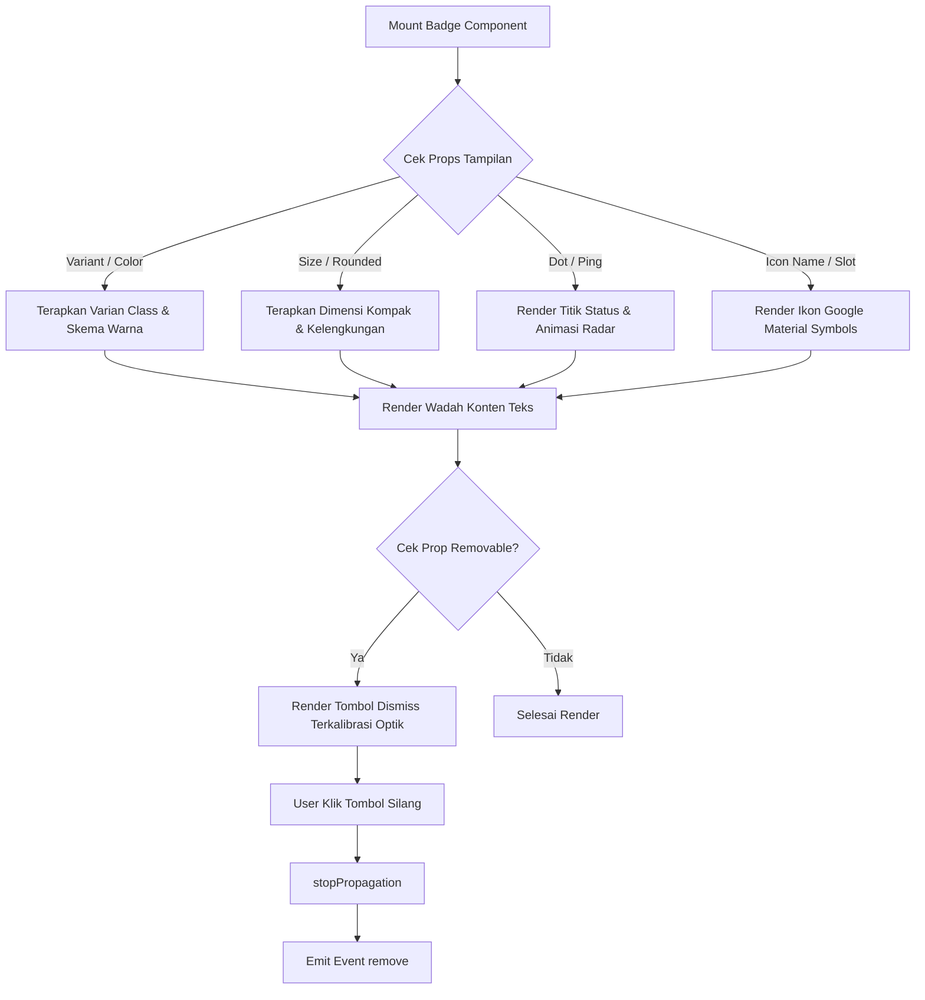

# Badge Component

Komponen penanda status mikro dan label ringkas (Status Pill & Micro Badge) yang dirancang untuk menandai status entitas, peran pengguna (user role), taksonomi kategori, serta tag filter pencarian interaktif. Komponen ini dirancang dengan prinsip desain minimalis kompak, true center alignment, dan rasio proporsional ikon terhadap tinggi huruf sesuai standar arsitektur Laravel Pack UI.

---

## 01. Overview

`Badge.vue` adalah komponen antarmuka visual mikro berkinerja tinggi untuk menyajikan informasi status tanpa memakan ruang vertikal antarmuka.

### 1.1 Apa Entitas Ini
Komponen Vue 3 berbasis Composition API (`packages/laravel-pack-ui/resources/js/Components/Pack/Badge.vue`) yang menghasilkan elemen penanda ringkas terstandarisasi dengan integrasi penuh Tailwind CSS v4 dan Google Material Symbols.

### 1.2 Fungsi Utama
- Menandai status data rekaman pada tabel (misal: aktif, nonaktif, tertunda, sukses, gagal).
- Menyediakan tag filter pencarian interaktif dengan tombol penutupan mikro (`removable`).
- Menampilkan indikator denyut realtime (`ping`) untuk proses komputasi yang sedang berlangsung.
- Menyajikan hierarki visual dengan 4 varian gaya dan 8 palet semantik.

### 1.3 Kapan Digunakan
- Di dalam kolom tabel data untuk menampilkan status operasional tanpa membesarkan tinggi baris (`py-0.5`).
- Pada kartu profil pengguna untuk menampilkan lencana peran (Admin, Member, Superuser).
- Pada baris bilah filter pencarian untuk merepresentasikan kriteria yang sedang diterapkan.
- Pada header antarmuka untuk indikator ketersediaan koneksi realtime (WebSocket / Database Sync).

### 1.4 Karakteristik Penting
- **Zero Uncontrolled Margin**: Bebas margin luar bawaan (`m-0`), sehingga peletakan spasi sepenuhnya dikendalikan oleh kontainer induk.
- **True Center Alignment**: Menggunakan `leading-none inline-flex items-center justify-center` pada teks, titik dot, dan ikon font sehingga sumbu horizontal selalu berimpit simetris.
- **Rasio Optik Presisi (Optical Balance)**: Ikon dismiss close disesuaikan pada rasio 80-85% cap-height huruf (`text-[8.5px]` hingga `text-[11.5px]`), didukung clearance celah kontainer (`gap-1.5` / `gap-2`) serta penyeimbang margin negatif (`-mr-0.5` / `-mr-1`) agar simetris terhadap padding tepi badge.

---

## 02. Preview

> [!TIP]
> Pengujian visual dan showcase interaktif entitas ini tersedia secara native pada portal pratinjau aplikasi:
>
> <a href="/preview/badge" target="_self" style="display: inline-flex; align-items: center; gap: 6px; padding: 6px 14px; border-radius: 8px; font-weight: 600; text-decoration: none; margin-top: 8px; background-color: var(--vp-c-brand-1, #4f46e5); color: #ffffff;">Buka Live Preview Komponen Badge &rarr;</a>

---

## 03. Usage

### Pohon Konsep Penggunaan

```text
Badge
├── Status Indication
│   ├── Static State (Aktif, Nonaktif, Draft, Arsip)
│   └── Live Realtime State (Live Streaming, Syncing, Background Queue)
├── Taxonomy & Metadata
│   ├── User Role / Permission (Admin, Editor, Member)
│   └── Category Tag (Berita, Tutorial, Pengumuman)
└── Interactive Filtering
    ├── Removable Filter Tag (Pencarian, Multi-Select)
    └── Clickable Quick Filter (Trigger Aksi / Navigasi)
```

### Matriks Kapan Digunakan vs Dihindari

| Kasus Penggunaan | Gunakan Badge | Hindari (Gunakan Alternatif) |
|---|---|---|
| Penanda status 1 kata pada tabel | Ya (`variant="soft"`) | Jangan gunakan Alert atau Banner besar |
| Chip filter yang dapat dihapus | Ya (`removable`) | Gunakan TagInput jika membutuhkan input ketik langsung |
| Pesan peringatan formulir panjang | Tidak | Gunakan Alert / ToastNotification |
| Tombol aksi utama formulir | Tidak | Gunakan ButtonSubmit |

---

## 04. Anatomy

### Diagram Hierarki Elemen

```text
Badge Shell Container (<component :is="as">)
│
├── Status Dot Wrapper (relative inline-flex)
│   ├── Ping Ring (animate-ping absolute)
│   └── Solid Dot (relative inline-flex rounded-full)
│
├── Leading Icon Slot / Element (material-symbols-outlined shrink-0)
│
├── Content Text Wrapper (truncate leading-none)
│   └── Default Slot (<slot />)
│
└── Removable Close Action Button (<button type="button">)
    └── Dismiss Icon (material-symbols-outlined leading-none)
```

### Diagram Alur Interaksi Komponen



---

## 05. Variants

Mendukung 4 variasi visual untuk disesuaikan dengan tingkat kepentingan informasi:

| Varian | Kelas Dasar | Deskripsi Visual | Rekomendasi Kasus |
|---|---|---|---|
| `soft` (default) | `bg-*-50 text-*-700 border-*-200/80` | Latar pastel dengan kontras teks sejuk dan border tipis | Status transaksi tabel data, role pengguna |
| `solid` | `bg-*-600 text-white border-transparent` | Warna latar tebal pekat dengan teks putih kontras tinggi | Peringatan kritis, badge diskon, status bahaya |
| `outline` | `bg-transparent text-*-600 border-*-300` | Latar transparan dengan garis tepi berpresisi | Tag taksonomi kategori, atribut sekunder |
| `dot` | `bg-transparent border-0 px-0 py-0` | Teks bersih tanpa bingkai berlatar, hanya bertumpu pada titik warna | Monitoring status server realtime |

---

## 06. Sizes & Optical Scale

Komponen ini dirancang dengan dimensi mikro ramping agar tidak memakan ruang vertikal baris antarmuka, dengan rasio optik dan jarak celah (gap) yang diperhitungkan secara matematis terhadap proporsi huruf.

### Tabel Skala Ukuran & Dimensi Mikro

| Size | Ukuran Font | Padding | Gap Spacing | Rasio Ikon Leading | Rasio Ikon Dismiss | Dimensi Tombol Dismiss | Dimensi Status Dot |
|---|---|---|---|---|---|---|---|
| `xs` | `text-[10px]` | `px-1.5 py-0.5` | `gap-1.5` (6px) | `text-[10.5px]` (1:1) | `text-[8.5px]` (85% cap-height) | `w-3 h-3 -mr-0.5` | `w-1.5 h-1.5` |
| `sm` | `text-[11px]` | `px-2 py-0.5` | `gap-1.5` (6px) | `text-[11.5px]` (1:1) | `text-[9.5px]` (85% cap-height) | `w-3.5 h-3.5 -mr-0.5` | `w-1.5 h-1.5` |
| `md` (default) | `text-xs` (12px) | `px-2.5 py-0.5` | `gap-1.5` (6px) | `text-[13px]` (1:1) | `text-[10px]` (83% cap-height) | `w-3.5 h-3.5 -mr-0.5` | `w-1.5 h-1.5` |
| `lg` | `text-sm` (14px) | `px-3 py-1` | `gap-2` (8px) | `text-[15px]` (1:1) | `text-[11.5px]` (82% cap-height) | `w-4 h-4 -mr-1` | `w-2 h-2` |

### Analisis Disparitas Bounding Box vs Cap-Height Huruf
- **Tinggi Huruf Kapital (Cap-Height)**: Huruf alfabet Latin memiliki tinggi kapital rata-rata 65% - 70% dari total kotak font (em-box), dan tinggi huruf kecil (x-height) sebesar 45% - 50%.
- **Bounding Box Ikon Font**: Glif font ikon (seperti Google Material Symbols) mengisi 75% - 85% area bounding box dengan goresan pekat. Jika ukuran ikon dipaksa sama persis dengan ukuran font teks pada tombol close mikro, ikon silang akan terlihat jauh lebih gemuk dan mendominasi badge.
- **Rasio Ikon Dismiss Mikro (80% - 85% Cap-Height)**:
  - Tombol penutupan mikro (`removable`) menggunakan ukuran glif 80% - 85% dari ukuran font teks (`text-[8.5px]` pada xs hingga `text-[11.5px]` pada lg).
  - Dibungkus dalam wadah melingkar presisi (`w-3 h-3` hingga `w-4 h-4` dengan `rounded-full`) sehingga silang penutup terlihat seimbang dengan tinggi visual teks.
- **Rasio Ikon Leading Semantik (1:1 Scale)**:
  - Ikon semantik di sisi kiri (seperti `verified`, `shield`, `bolt`, `folder`) memiliki bentuk garis terbuka.
  - Menggunakan rasio 1:1 terhadap ukuran font teks (`text-[10.5px]` pada xs, `text-[11.5px]` pada sm, `text-[13px]` pada md, `text-[15px]` pada lg) agar glif tampak jelas terbaca tanpa manipulasi skala berlebih.

### Perhitungan Jarak Celah Teks & Ikon (Gap & Clearance: Anti-Menempel)
- **Larangan Jarak Dempet**: Dilarang keras menggunakan jarak `gap-0.5` (2px) atau `gap-1` (4px) yang membuat ikon dan teks terlihat bertumpukan dan sesak dibaca.
- **Standar Gap Elemen Mikro**:
  - Ukuran `xs`, `sm`, dan `md` wajib menggunakan jarak minimal `gap-1.5` (6px / `0.375rem`).
  - Ukuran `lg` menggunakan jarak `gap-2` (8px / `0.5rem`).
- **Optical Balancing Sisi Kanan (Dismiss Button)**:
  - Saat prop `removable` aktif, tombol silang ditempatkan di paling kanan badge.
  - Untuk menyeimbangkan padding kanan badge (`px-1.5` hingga `px-3`), tombol dismiss diberi margin negatif mikro (`-mr-0.5` pada xs/sm/md dan `-mr-1` pada lg) sehingga jarak tepi kiri dan tepi kanan badge tetap simetris secara optik.

### Prinsip True Center Alignment (Rata Tengah Sumbu Simetris)
- Seluruh elemen internal badge (titik status, leading icon, teks label, dan tombol dismiss) berada pada satu sumbu horizontal tengah yang tepat berimpit (`True Center Alignment`).
- Menggunakan `leading-none select-none shrink-0 flex items-center justify-center` pada ikon Material Symbols dan `leading-none inline-flex items-center` pada teks label untuk mengeliminasi margin baseline asimetris bawaan browser font engine.

### Kelengkungan Sudut (`rounded`)
- `full`: Bentuk kapsul melingkar penuh (pill style - default).
- `lg`: Sudut membulat modern (`rounded-lg`).
- `md`: Sudut membulat standar (`rounded-md`).
- `sm`: Sudut membulat mikro (`rounded-xs`).
- `none`: Sudut siku persegi murni (`rounded-none`).

---

## 07. States

| State | Representasi Visual | Perilaku & Pemicu |
|---|---|---|
| **Normal** | Sesuai konfigurasi varian dan warna yang dipilih | Statis menampilkan teks label. |
| **Hovered (Clickable)** | Opasitas kontainer turun ke 85% | Terjadi saat `clickable: true` dan kursor berada di atas badge. |
| **Active (Clickable)** | Efek sentuh mikro `scale-95` | Memberi sensasi taktil saat pengguna menekan badge. |
| **Live Pulsing** | Gelombang lingkaran berkedip membesar secara terus-menerus | Dipicu saat prop `ping: true`. |
| **Dismiss Hover** | Latar tombol silang menggelap lembut | Kursor diarahkan ke tombol penutupan (x). |

---

## 08. Props / Parameters

| Prop | Tipe Data | Nilai Default | Wajib | Deskripsi & Validasi |
|---|---|---|---|---|
| `variant` | `String` | `'soft'` | Tidak | Gaya visual: `'soft'`, `'solid'`, `'outline'`, `'dot'`. |
| `color` | `String` | `'primary'` | Tidak | Skema semantik: `'primary'`, `'success'`, `'danger'`, `'warning'`, `'info'`, `'purple'`, `'indigo'`, `'neutral'`. (Mendukung alias Tailwind seperti `blue`, `emerald`, `rose`, `amber`, `sky`, `violet`, `slate`). |
| `size` | `String` | `'md'` | Tidak | Skala ukuran: `'xs'`, `'sm'`, `'md'`, `'lg'`. |
| `rounded` | `String` | `'full'` | Tidak | Kelengkungan sudut: `'none'`, `'sm'`, `'md'`, `'lg'`, `'xl'`, `'full'`. |
| `dot` | `Boolean` | `false` | Tidak | Menampilkan titik lingkaran status di sisi kiri teks. |
| `ping` | `Boolean` | `false` | Tidak | Menambahkan animasi gelombang denyut radar pada titik status. |
| `icon` | `String` | `''` | Tidak | Nama ikon Google Material Symbols di sisi kiri teks. |
| `removable` | `Boolean` | `false` | Tidak | Menampilkan tombol silang dismiss di sisi kanan teks. |
| `removeLabel` | `String` | `'Hapus badge'` | Tidak | Teks deskripsi aksesibilitas (`aria-label`) untuk pembaca layar. |
| `clickable` | `Boolean` | `false` | Tidak | Mengaktifkan pointer kursor dan transisi sentuh klik. |
| `as` | `String` | `'span'` | Tidak | Tag elemen HTML yang dirender (`span`, `button`, `div`, `a`). |

---

## 09. Slots

| Nama Slot | Tipe Slot | Deskripsi |
|---|---|---|
| `default` | Standard | Konten teks utama di dalam badge. Otomatis dibungkus dengan pemotongan teks rapi (`truncate`). |
| `icon` | Named | Injeksi kustom untuk elemen ikon atau ilustrasi mikro di sisi kiri teks label. |

---

## 10. Events / Interactions

| Nama Event | Payload Tipe | Kondisi Pemicu | Deskripsi |
|---|---|---|---|
| `@click` | `MouseEvent` | Badge diklik saat `clickable: true` | Meneruskan interaksi klik pengguna ke penangan induk. |
| `@remove` | `MouseEvent` | Tombol icon silang (x) diklik | Dipancarkan saat tombol dismiss diklik. Otomatis mengisolasi event dari kontainer induk (`stopPropagation`). |

---

## 11. Code Example

### 1. Penggunaan Dasar (Basic Example)
```vue
<script setup>
import Badge from '@/Components/Pack/Badge.vue';
</script>

<template>
  <div class="flex items-center gap-2">
    <Badge color="success">Aktif</Badge>
    <Badge color="warning">Tertunda</Badge>
    <Badge color="danger">Dibatalkan</Badge>
  </div>
</template>
```

### 2. Penggunaan Menengah: Realtime Server Status (Intermediate Example)
```vue
<script setup>
import Badge from '@/Components/Pack/Badge.vue';

defineProps({
  isConnected: Boolean,
  lastPingMs: Number,
});
</script>

<template>
  <div class="flex items-center gap-3">
    <Badge
      v-if="isConnected"
      variant="soft"
      color="success"
      dot
      ping
    >
      Terhubung ({{ lastPingMs }}ms)
    </Badge>
    <Badge
      v-else
      variant="solid"
      color="danger"
      icon="cloud_off"
    >
      Koneksi Terputus
    </Badge>
  </div>
</template>
```

### 3. Penggunaan Lanjutan: Filter Chip Interaktif (Advanced Example)
```vue
<script setup>
import { ref } from 'vue';
import Badge from '@/Components/Pack/Badge.vue';

const activeFilters = ref([
  { id: 1, label: 'Kategori: Elektronik' },
  { id: 2, label: 'Status: Tersedia' },
  { id: 3, label: 'Diskon > 20%' },
]);

const handleRemove = (id) => {
  activeFilters.value = activeFilters.value.filter(item => item.id !== id);
};

const handleReset = () => {
  activeFilters.value = [
    { id: 1, label: 'Kategori: Elektronik' },
    { id: 2, label: 'Status: Tersedia' },
    { id: 3, label: 'Diskon > 20%' },
  ];
};
</script>

<template>
  <div class="space-y-2">
    <div class="flex items-center gap-1.5 flex-wrap">
      <Badge
        v-for="filter in activeFilters"
        :key="filter.id"
        variant="soft"
        color="primary"
        removable
        :remove-label="`Hapus filter ${filter.label}`"
        @remove="handleRemove(filter.id)"
      >
        {{ filter.label }}
      </Badge>

      <button
        v-if="activeFilters.length === 0"
        type="button"
        @click="handleReset"
        class="text-xs text-blue-600 hover:underline cursor-pointer"
      >
        Pulihkan Filter
      </button>
    </div>
  </div>
</template>
```

---

## 12. Result / Behavior

- **Stop Propagation Otomatis**: Mengklik tombol dismiss (`@remove`) secara otomatis memanggil `event.stopPropagation()` sehingga tidak akan memicu event `@click` dari kontainer badge jika badge bersifat `clickable`.
- **Normalisasi Warna Semantik**: Pengembang dapat menggunakan nama warna umum Tailwind CSS (seperti `blue`, `emerald`, `rose`, `amber`, `sky`, `violet`, `slate`) dan komponen akan otomatis memetakan ke tema semantik inti.
- **Pencegahan Pergeseran Tata Letak (Layout Shift)**: Kontainer teks dibungkus dengan kelas `truncate` dan `leading-none` untuk mencegah teks bertumpuk atau merusak tinggi baris tabel saat panjang label bertambah.

---

## 13. Customization

### Kustomisasi Sebagai Elemen Tombol HTML
```vue
<Badge
  as="button"
  clickable
  color="indigo"
  variant="soft"
  icon="tune"
  class="shadow-xs hover:border-indigo-400"
  @click="openFilterDrawer"
>
  Konfigurasi
</Badge>
```

### Kustomisasi Slot Ikon Kustom
```vue
<Badge color="purple" variant="outline">
  <template #icon>
    <svg class="w-3 h-3 text-purple-600 shrink-0" viewBox="0 0 24 24" fill="currentColor">
      <path d="M12 2L2 7l10 5 10-5-10-5zM2 17l10 5 10-5M2 12l10 5 10-5"/>
    </svg>
  </template>
  Arsitektur Microservice
</Badge>
```

---

## 14. Accessibility (a11y)

- **Screen Reader Labeling**: Tombol dismiss selalu dilengkapi atribut `aria-label` yang dapat disesuaikan melalui prop `removeLabel`.
- **Keyboard Navigation**: Ketika `clickable: true` atau tombol dismiss dirender, elemen dapat difokuskan menggunakan tombol `Tab` dan diaktivasi menggunakan tombol `Enter` atau `Space`.
- **Seleksi Teks Nyaman**: Ikon Google Material Symbols menerapkan `select-none` agar pengguna dapat menyalin teks badge tanpa ikut menyalin nama glif ikon mentah.
- **Kontras Warna WCAG AA**: Seluruh 8 palet warna semantik (varian soft, solid, dan outline) diuji memenuhi standar kontras minimal 4.5:1 terhadap latar belakang kartu.

---

## 15. Responsive Behavior

- Di dalam kontainer sempit, teks badge otomatis terpotong dengan elipsis (`truncate`) sehingga tidak merusak lebar sel tabel.
- Menggunakan display `inline-flex` yang memungkinkan badge mengalir secara alami (`flex-wrap`) pada bilah filter responsif perangkat mobile.

---

## 16. Do / Don't

### Rekomendasi (Do):
- Gunakan `variant="soft"` untuk status pada tabel data karena memberikan keterbacaan tinggi tanpa menimbulkan kelelahan visual.
- Gunakan `dot` dengan `ping` secara selektif hanya untuk proses yang benar-benar memerlukan perhatian realtime pengguna.
- Berikan label ringkas (1-3 kata) di dalam badge agar informasi langsung tersampaikan dalam sekali pandang.

### Larangan (Don't):
- Jangan menyematkan teks kalimat panjang ke dalam badge; gunakan Alert atau Callout jika membutuhkan deskripsi panjang.
- Jangan menggunakan kombinasi `ping` pada seluruh baris tabel secara bersamaan karena animasi serentak akan mengganggu fokus pengguna.
- Jangan menambahkan margin luar manual (`my-4`, `mx-2`) pada badge; biarkan kontainer pembungkus mengatur jarak melalui flex gap.

---

## 17. Examples / Recipes

### Resep 1: Kolom Status Transaksi Tabel
```vue
<template>
  <Badge
    :variant="statusVariant"
    :color="statusColor"
    :icon="statusIcon"
    size="sm"
  >
    {{ order.status_label }}
  </Badge>
</template>

<script setup>
import { computed } from 'vue';
import Badge from '@/Components/Pack/Badge.vue';

const props = defineProps({ order: Object });

const statusColor = computed(() => {
  const map = {
    paid: 'success',
    pending: 'warning',
    cancelled: 'danger',
    refunded: 'neutral',
  };
  return map[props.order.status] || 'neutral';
});

const statusIcon = computed(() => {
  const map = {
    paid: 'check_circle',
    pending: 'schedule',
    cancelled: 'cancel',
  };
  return map[props.order.status] || '';
});

const statusVariant = computed(() => (props.order.status === 'cancelled' ? 'outline' : 'soft'));
</script>
```

---

## 18. Related Items

```text
Badge
├── Komponen Pendukung
│   ├── Avatar.vue (Menampilkan badge counter atau status di atas foto profil)
│   ├── TagInput.vue (Input formulir yang mengelola kumpulan chip tag)
│   └── ButtonSubmit.vue (Tombol aksi utama formulir)
└── Komponen Terkait
    ├── Alert.vue (Pesan notifikasi berbasis kartu dengan ikon dan penjelasan)
    └── ToastNotification.vue (Notifikasi mengambang dengan durasi otomatis)
```

---

## 19. Notes / Limitations

- **Dependensi Ikon Font**: Fitur prop `icon` membutuhkan pemuatan font Google Material Symbols Outlined di dalam file layout induk atau file `custom.css`.
- **Elemen Mikro Non-Blok**: `Badge.vue` adalah elemen mikro inline (`inline-flex`). Komponen ini tidak dirancang sebagai pembungkus layout blok penuh (full-width block card).
- **Target Sentuh Mobile**: Pada ukuran `xs` dan `sm`, area klik tombol dismiss berada pada kisaran 12-14px. Jika digunakan untuk interaksi sentuh mobile intensif, pertahankan ukuran minimal `md` atau `lg`.
