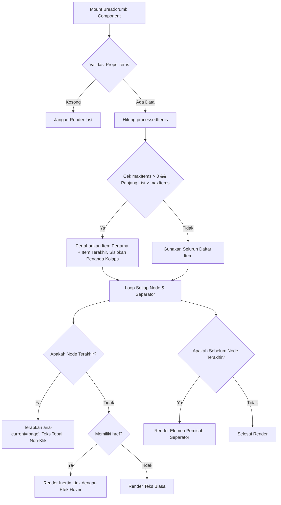

# Breadcrumb Component

Komponen penunjuk jalur navigasi (*breadcrumb navigation*) yang responsif dan terintegrasi penuh dengan Inertia.js Link. Komponen ini dirancang dengan prinsip perataan sumbu tengah simetris (*true center alignment*), rasio optik proporsional antara ukuran font dan ikon Material Symbols, serta jarak celah (*clearance gap*) anti-menempel sesuai standar arsitektur Laravel Pack UI.

---

## 01. Overview

`Breadcrumb.vue` adalah komponen penunjuk hierarki lokasi halaman yang membantu pengguna memahami posisi mereka dalam struktur aplikasi bertingkat serta menyediakan akses navigasi mundur (*ancestral navigation*) secara efisien.

### 1.1 Apa Entitas Ini
Komponen Vue 3 berbasis Composition API (`packages/laravel-pack-ui/resources/js/Components/Pack/Breadcrumb.vue`) yang merender struktur semantik HTML5 `<nav>` dan `<ol>` dengan integrasi penuh Tailwind CSS v4, Google Material Symbols, dan Inertia.js `Link`.

### 1.2 Fungsi Utama
- Menampilkan jejak rekam hierarki halaman dari beranda (*root*) hingga halaman aktif (*current page*).
- Menyediakan tautan navigasi instan antar tingkat hierarki tanpa *full page reload*.
- Menangani perapihan otomatis jalur direktori yang terlalu panjang melalui mekanisme *auto-collapse* (`maxItems`).
- Mengakomodasi variasi pemisah visual (*separator*), baik berupa glif ikon Material Symbols maupun karakter teks standar.
- Menjaga proporsi ukuran ikon dan jarak teks agar seimbang secara optik (*optical balance*) di seluruh ukuran.

### 1.3 Kapan Digunakan
- Pada header halaman aplikasi multi-level (misal: Dasbor > Pengaturan > Keamanan > Sesi Aktif).
- Pada katalog e-commerce bertingkat (misal: Beranda > Elektronik > Laptop > Aksesoris).
- Pada sistem penjelajah berkas (*file manager*) atau penyimpanan dokumen berbasis hierarki folder.
- Pada antarmuka alur transaksi bertahap (*multi-step stepper*) sebagai indikator riwayat langkah.

### 1.4 Karakteristik Penting
- **Zero Uncontrolled Margin**: Bebas margin luar bawaan (`m-0`), sehingga peletakan spasi vertikal dan horizontal sepenuhnya dikendalikan oleh kontainer induk.
- **True Center Alignment**: Menggunakan `leading-none select-none shrink-0 flex items-center justify-center` pada ikon dan `leading-none inline-flex items-center` pada teks untuk mengeliminasi deviasi *baseline* bawaan browser font engine.
- **Rasio Optik Proporsional (1:1 Optical Balance)**: Ikon awalan disetarakan dengan proporsi visual huruf kapital, sedangkan pemisah (*separator*) dikalibrasi lebih ramping agar tidak mendominasi keterbacaan teks hierarki.
- **Anti-Menempel Spacing**: Jarak antar segmen dan pemisah menerapkan flex gap terukur (`gap-1.5` pada `sm`, `gap-1.5 sm:gap-2` pada `md`, dan `gap-2 sm:gap-2.5` pada `lg`) tanpa menggunakan margin manual yang tidak beraturan.

---

## 02. Preview

> [!TIP]
> Pengujian visual dan showcase interaktif entitas ini tersedia secara native pada portal pratinjau aplikasi:
>
> <a href="/preview/breadcrumb" target="_self" style="display: inline-flex; align-items: center; gap: 6px; padding: 6px 14px; border-radius: 8px; font-weight: 600; text-decoration: none; margin-top: 8px; background-color: var(--vp-c-brand-1, #4f46e5); color: #ffffff;">Buka Live Preview Komponen Breadcrumb &rarr;</a>

---

## 03. Usage

### Pohon Konsep Penggunaan

```text
Breadcrumb
├── Hierarchy Navigation
│   ├── Shallow Path (2-3 tingkat: Beranda > Profil)
│   ├── Deep Path (4+ tingkat: Penyimpanan > Dokumen > Keuangan > 2026 > Q1)
│   └── Auto-Collapsed Path (Meringkas jalur tengah dengan penanda ...)
├── Node Presentation
│   ├── Icon Only Home (Minimalis ruang dengan tooltip)
│   ├── Home with Text Label (Informatif penuh)
│   └── Semantic Category Icons (Ikon khusus tiap entitas)
└── Separator Styles
    ├── Material Symbol Icon (chevron_right, arrow_forward_ios, navigate_next)
    └── Text Character (/ atau >)
```

### Matriks Kapan Digunakan vs Dihindari

| Kasus Penggunaan | Gunakan Breadcrumb | Hindari (Gunakan Alternatif) |
|---|---|---|
| Menavigasi struktur hirarki bertingkat (3 level atau lebih) | Ya | Jangan gunakan tombol back browser tunggal |
| Menampilkan alur form berurutan yang harus diselesaikan bertahap | Tidak | Gunakan Stepper / Wizard |
| Navigasi antar tab independen pada halaman yang sama | Tidak | Gunakan Tabs |
| Penunjuk halaman aktif pada daftar berpaginasi panjang | Tidak | Gunakan Pagination |

---

## 04. Anatomy

### Diagram Hierarki Elemen

```text
<nav aria-label="Breadcrumb" class="select-none">
└── <ol class="inline-flex items-center flex-wrap ...">
    ├── <li class="inline-flex items-center leading-none"> (Item Node 1 - Beranda)
    │   └── <Link :href="..."> (atau <span>)
    │       ├── Icon Wrapper (<span class="... w-4.5 h-4.5">)
    │       │   └── Material Symbol (<span class="material-symbols-outlined ...">)
    │       └── Text Label (<span class="leading-none inline-flex items-center truncate">)
    │
    ├── <li class="inline-flex items-center justify-center shrink-0" aria-hidden="true"> (Separator 1)
    │   └── Material Symbol / Character Text
    │
    ├── <li class="inline-flex items-center leading-none"> (Item Node 2 - Terkolaps / Reguler)
    │   └── Ellipsis Badge (<span class="...">&hellip;</span>) jika terkolaps
    │
    ├── <li class="inline-flex items-center justify-center shrink-0" aria-hidden="true"> (Separator 2)
    │
    └── <li class="inline-flex items-center leading-none"> (Item Node Terakhir - Aktif)
        └── <span aria-current="page" class="font-semibold text-slate-900 ...">
```

### Diagram Alur Render Komponen



---

## 05. Variants

Mendukung variasi gaya pemisah hierarki dan representasi node:

| Varian | Konfigurasi | Deskripsi Visual | Rekomendasi Kasus |
|---|---|---|---|
| `Chevron Separator` (default) | `separator="chevron_right"` | Ikon panah bersudut halus dari Material Symbols | Aplikasi web modern, antarmuka dasbor standar |
| `Arrow Separator` | `separator="arrow_forward_ios"` | Ikon panah ramping bergaya iOS / macOS | Tata letak bernuansa minimalis presisi tinggi |
| `Slash Separator` | `separator="/"` | Karakter garis miring klasik berbobot normal | Penjelajah berkas, terminal cloud, URL simulator |
| `Angle Separator` | `separator=">"` | Karakter matematika lebih besar berbobot seimbang | Antarmuka dokumentasi teks atau artikel teknis |
| `Semantic Icons` | Item memiliki properti `icon` | Setiap node memiliki ikon tematik di sisi kiri teks | Menu navigasi e-commerce bertingkat dengan kategori visual |
| `Home Label` | `show-home-label="true"` | Menampilkan teks 'Beranda' di samping ikon rumah | Tata letak desktop lebar yang membutuhkan kejelasan label |

---

## 06. Sizes & Optical Scale

Breadcrumb dirancang dengan 3 tingkatan ukuran proporsional. Seluruh ukuran font, dimensi wadah ikon, glif pemisah, dan jarak celah dihitung untuk menjamin keterbacaan optimal tanpa mengorbankan ruang vertikal antarmuka.

### Tabel Skala Ukuran & Dimensi Mikro

| Size | Ukuran Font Teks | Gap Antar Elemen (`ol`) | Gap Ikon-Teks (`itemGap`) | Rasio Ikon Leading | Dimensi Wadah Ikon | Ukuran Ikon Separator | Ukuran Teks Separator | Dimensi Ellipsis |
|---|---|---|---|---|---|---|---|---|
| `sm` | `text-xs` (11-12px) | `gap-1.5` (6px) | `gap-1.5` (6px) | `text-[14px]` (1:1) | `w-4 h-4` | `text-[13px]` | `text-[11px]` | `h-5 px-1 text-[11px]` |
| `md` (default) | `text-xs sm:text-sm` (12-14px) | `gap-1.5 sm:gap-2` (6-8px) | `gap-1.5 sm:gap-2` (6-8px) | `text-[16px]` (1:1) | `w-4.5 h-4.5` | `text-[15px]` | `text-xs` (12px) | `h-6 px-1.5 text-xs` |
| `lg` | `text-sm sm:text-base` (14-16px) | `gap-2 sm:gap-2.5` (8-10px) | `gap-2 sm:gap-2.5` (8-10px) | `text-[18px]` (1:1) | `w-5 h-5` | `text-[17px]` | `text-sm` (14px) | `h-7 px-2 text-sm` |

### Analisis Disparitas Bounding Box vs Cap-Height Huruf
- **Tinggi Huruf Kapital (Cap-Height)**: Huruf alfabet Latin memiliki tinggi kapital rata-rata 65% - 70% dari kotak em-box font.
- **Rasio Ikon Leading Semantik (1:1 Optical Balance)**:
  - Ikon semantik di sisi kiri teks (seperti `home`, `inventory_2`, `devices`, `folder`) memiliki garis luar terbuka.
  - Untuk ukuran `sm` (font 12px), ikon disetel ke `text-[14px]`.
  - Untuk ukuran `md` (font 12-14px), ikon disetel ke `text-[16px]`.
  - Untuk ukuran `lg` (font 14-16px), ikon disetel ke `text-[18px]`.
  - Rasio ini menghasilkan bobot visual yang tepat setara dengan tinggi kapital dan ascender huruf Latin.
- **Kalibrasi Glif Ikon Separator**:
  - Glif pemisah panah (`chevron_right` atau `arrow_forward_ios`) disetel 1px - 2px lebih kecil dari ikon leading (`text-[13px]` pada sm, `text-[15px]` pada md, `text-[17px]` pada lg).
  - Skala ini mencegah ikon pemisah tampak mendominasi teks atau menciptakan ilusi garis pemutus yang terlalu tebal.

### Perhitungan Jarak Celah Teks & Ikon (Gap & Clearance: Anti-Menempel)
- **Larangan Jarak Dempet**: Dilarang keras menggunakan jarak `gap-0.5` (2px) atau `gap-1` (4px) yang membuat ikon pemisah dan teks saling bertumpukan.
- **Standar Gap Konsisten**:
  - Jarak horizontal antar node dan pemisah pada kontainer `<ol>` disetarakan dengan jarak internal antara ikon dan teks label (`itemGap`).
  - Hal ini menghasilkan spasi simetris seragam: `[Node 1] -- 6px -- [Separator] -- 6px -- [Node 2]`.

### Prinsip True Center Alignment (Rata Tengah Sumbu Simetris)
- Ikon Google Material Symbols dan teks label berada pada satu garis sumbu horizontal tengah yang tepat berimpit (*True Center Alignment*).
- Diterapkan kelas `leading-none select-none shrink-0 flex items-center justify-center` pada setiap ikon, dan `leading-none inline-flex items-center` pada teks label untuk meniadakan pergeseran baseline bawaan font engine peramban.

---

## 07. States

| State | Representasi Visual | Perilaku & Pemicu |
|---|---|---|
| **Default Link** | Teks abu-abu netral (`text-slate-500 dark:text-slate-400`) | Node leluhur yang memiliki URL tautan (`href`) sebelum diinteraksi. |
| **Hovered Link** | Teks biru kontras (`hover:text-blue-600 dark:hover:text-blue-400`) | Kursor berada di atas node tautan aktif. |
| **Active / Current** | Teks pekat tebal (`text-slate-900 dark:text-white font-semibold cursor-default`) | Node segmen terakhir penanda halaman yang sedang dibuka (`aria-current="page"`). |
| **Collapsed Ellipsis** | Lencana abu-abu lembut (`bg-slate-100 dark:bg-slate-800/80 text-slate-400 cursor-default`) | Meringkas segmen hierarki tengah saat jumlah node melebihi batas `maxItems`. |

---

## 08. Props / Parameters / Attributes

| Prop | Tipe Data | Nilai Default | Wajib | Deskripsi & Validasi |
|---|---|---|---|---|
| `items` | `Array` | `[]` | Ya | Daftar objek node navigasi: `[{ label, href, icon, active }]`. |
| `size` | `String` | `'md'` | Tidak | Skala ukuran proporsional: `'sm'`, `'md'`, `'lg'`. |
| `separator` | `String` | `'chevron_right'` | Tidak | Karakter pemisah teks (misal `'/'`, `'>'`) atau nama ikon Google Material Symbols. |
| `homeIcon` | `String` | `'home'` | Tidak | Nama ikon Google Material Symbols untuk node pertama. |
| `showHome` | `Boolean` | `true` | Tidak | Menampilkan ikon rumah pada node pembuka pertama. |
| `showHomeLabel` | `Boolean` | `false` | Tidak | Menampilkan teks label di samping ikon rumah. |
| `maxItems` | `Number` | `0` | Tidak | Batas maksimum item sebelum auto-collapse aktif (`0` = tampilkan seluruh item). |

### Antarmuka Objek Item (`items`)

```typescript
interface BreadcrumbItem {
    label: string;       // Label teks segmen hierarki
    href?: string;       // URL tujuan Inertia (opsional, jika tidak ada menjadi teks statis)
    icon?: string;       // Nama ikon Google Material Symbols (opsional)
    active?: boolean;    // Menandai halaman aktif saat ini (opsional)
    external?: boolean;  // Menandai URL eksternal (opsional)
}
```

---

## 09. Slots / Content

| Nama Slot | Tipe Slot | Parameter Terbuka (Scoped Props) | Deskripsi |
|---|---|---|---|
| `item` | Scoped | `{ item: Object, index: Number, isLast: Boolean }` | Mengganti render bawaan node segmen tertentu (misal untuk menyematkan Badge status atau Dropdown). |
| `separator` | Standard | - | Mengganti render elemen pemisah bawaan antar segmen hierarki. |

---

## 10. Events / Interactions / Returns

### Tabel Event Emit

| Nama Event | Payload Tipe | Kondisi Pemicu | Deskripsi |
|---|---|---|---|
| `@click` | `Object (item)` | Pengguna mengklik salah satu entri item breadcrumb yang tidak aktif | Memancarkan objek data item navigasi yang dipilih ke penangan induk. |

### Perilaku Interaksi Antarmuka

| Interaksi | Target Elemen | Perilaku & Efek Samping |
|---|---|---|
| **Klik Node Tautan** | Node dengan properti `href` | Memicu navigasi perutean Inertia.js (`Link visit`) atau emisi klik tanpa muat ulang halaman penuh (*SPA transition*). |
| **Klik Node Aktif** | Node terakhir atau `active: true` | Tidak memicu navigasi (`cursor-default`), mencegah pengiriman request berulang ke halaman yang sama. |
| **Hover Node Tautan** | Node dengan properti `href` | Transisi warna teks menjadi biru dengan durasi `duration-150`. |

---

## 11. Code Example

### 1. Penggunaan Dasar (Basic Example)
```vue
<script setup>
import Breadcrumb from '@/Components/Pack/Breadcrumb.vue';

const breadcrumbs = [
  { label: 'Beranda', href: '/' },
  { label: 'Katalog Produk', href: '/products' },
  { label: 'Kursi Ergonomis', active: true },
];
</script>

<template>
  <Breadcrumb :items="breadcrumbs" />
</template>
```

### 2. Penggunaan Menengah: Ikon Semantik & Auto-Collapse (Intermediate Example)
```vue
<script setup>
import Breadcrumb from '@/Components/Pack/Breadcrumb.vue';

const fileStoragePath = [
  { label: 'Penyimpanan Utama', href: '/storage', icon: 'hard_drive' },
  { label: 'Proyek Klien', href: '/storage/clients', icon: 'folder' },
  { label: 'PT Teknologi Mandiri', href: '/storage/clients/tech', icon: 'folder_open' },
  { label: 'Dokumen Legal', href: '/storage/clients/tech/legal', icon: 'folder' },
  { label: 'Kontrak 2026.pdf', active: true, icon: 'description' },
];
</script>

<template>
  <Breadcrumb
    :items="fileStoragePath"
    size="sm"
    separator="arrow_forward_ios"
    :max-items="3"
    show-home-label
  />
</template>
```

### 3. Penggunaan Lanjutan: Kustomisasi Slot dengan Komponen Badge (Advanced Example)
```vue
<script setup>
import Breadcrumb from '@/Components/Pack/Breadcrumb.vue';
import Badge from '@/Components/Pack/Badge.vue';

const navigationItems = [
  { label: 'Dasbor', href: '/dashboard' },
  { label: 'Manajemen Pesanan', href: '/orders' },
  { label: 'Invoice #INV-2026-089', active: true },
];
</script>

<template>
  <div class="flex items-center justify-between py-3 border-b border-slate-200 dark:border-slate-800">
    <Breadcrumb :items="navigationItems" show-home-label>
      <template #item="{ item, isLast }">
        <div v-if="isLast" class="inline-flex items-center gap-2">
          <span class="font-semibold text-slate-900 dark:text-white">{{ item.label }}</span>
          <Badge size="xs" variant="soft" color="success">Terbayar</Badge>
        </div>
      </template>
    </Breadcrumb>
  </div>
</template>
```

---

## 12. Result / Behavior

- **Pencegahan Siklus Navigasi Mandiri**: Item dengan `active: true` atau item pada posisi indeks terakhir secara otomatis tidak dibungkus dengan komponen `Link`, melainkan dirender sebagai elemen `<span>` statis dengan kursor default.
- **Penanganan Aksesibilitas Node Beranda Ikon-Saja**: Ketika `showHome: true` dan `showHomeLabel: false`, komponen menyisipkan teks `sr-only` dengan isi label item atau kata "Beranda" sehingga pengguna pembaca layar tetap mendapatkan konteks navigasi yang jelas.
- **Perapihan Jalur Ekstrem**: Jika jumlah item melebihi prop `maxItems`, komponen mempertahankan item pertama (beranda) dan n-1 item terakhir, lalu memadatkan item perantara menjadi satu token elipsis `...` tunggal.

---

## 13. Customization

### Kustomisasi Separator Kustom
```vue
<Breadcrumb :items="items" separator="/">
  <template #separator>
    <span class="text-slate-300 dark:text-slate-700 font-light select-none">/</span>
  </template>
</Breadcrumb>
```

### Kustomisasi Ukuran Ringkas untuk Bilah Alat (Toolbar)
```vue
<Breadcrumb
  size="sm"
  :items="items"
  class="bg-slate-50 dark:bg-slate-900/40 p-2 rounded-lg border border-slate-200/80 dark:border-slate-800"
/>
```

---

## 14. Accessibility (a11y)

- **WAI-ARIA Landmark Structure**: Menggunakan tag semantik `<nav>` dengan atribut eksplisit `aria-label="Breadcrumb"`.
- **Hierarchical List Semantics**: Struktur jejak tautan menggunakan elemen daftar terurut `<ol>` dan `<li>` sehingga mesin pembaca layar (*screen reader*) dapat mengumumkan total segmen jalur dan posisi saat ini kepada pengguna.
- **Active Page Announcement**: Segmen aktif terakhir selalu dilengkapi atribut `aria-current="page"` untuk memberitahukan bahwa segmen tersebut adalah lokasi dokumen aktif.
- **Penyembunyian Elemen Dekoratif**: Seluruh pemisah (*separator*) dilengkapi atribut `aria-hidden="true"` agar pembaca layar tidak membaca nama glif ikon atau karakter pemisah secara berulang.
- **Screen Reader Support untuk Node Ikon**: Node beranda yang hanya berupa ikon dilengkapi dengan label teks tersembunyi visual (`<span class="sr-only">Beranda</span>`).

---

## 15. Responsive Behavior

- **Natural Multi-Line Wrap**: Menerapkan kelas `flex-wrap` pada elemen `<ol>` yang memungkinkan jejak navigasi mengalir turun ke baris berikutnya secara rapi pada layar ponsel sempit tanpa menyebabkan luapan horizontal (*horizontal scrollbar*).
- **Pemotongan Teks Panjang (Truncation)**: Setiap teks label dilengkapi utilitas `truncate` untuk mencegah teks label yang sangat panjang merusak keselarasan layout kontainer induk.
- **Skala Font Adaptif pada Ukuran md**: Ukuran default `md` menggunakan transisi `text-xs sm:text-sm` dan `gap-1.5 sm:gap-2` untuk kepadatan informasi ideal pada perangkat mobile dan kenyamanan baca pada desktop.

---

## 16. Do / Don't

### Rekomendasi (Do):
- Selalu tempatkan Breadcrumb di bagian atas area konten utama, tepat di bawah bilah navigasi utama atau header halaman.
- Gunakan `size="sm"` saat menyematkan breadcrumb di dalam modal dialog atau toolbar tabel data yang padat.
- Manfaatkan prop `maxItems` untuk jalur direktori atau hierarki taksonomi yang berpotensi memiliki kedalaman lebih dari 4 tingkat.

### Larangan (Don't):
- Jangan menyematkan seluruh isi judul artikel panjang ke dalam segmen terakhir breadcrumb; perpendek label menjadi ringkasan 2-4 kata.
- Jangan menggunakan breadcrumb sebagai pengganti menu navigasi utama aplikasi.
- Jangan menambahkan margin luar manual (`my-4`, `mx-2`) pada elemen root komponen; serahkan pengaturan spasi pada kontainer pembungkus.

---

## 17. Examples / Recipes

### Resep 1: Navigasi E-Commerce Multi-Kategori
```vue
<script setup>
import Breadcrumb from '@/Components/Pack/Breadcrumb.vue';

defineProps({
  category: Object,
  product: Object,
});
</script>

<template>
  <div class="mb-4">
    <Breadcrumb
      :items="[
        { label: 'Toko', href: '/shop', icon: 'storefront' },
        { label: category.name, href: `/category/${category.slug}` },
        { label: product.name, active: true },
      ]"
      separator="chevron_right"
      show-home-label
    />
  </div>
</template>
```

### Resep 2: File Manager Path Explorer dengan Auto-Collapse
```vue
<script setup>
import { computed } from 'vue';
import Breadcrumb from '@/Components/Pack/Breadcrumb.vue';

const props = defineProps({
  currentPath: Array, // Array of { id, name }
});

const breadcrumbItems = computed(() => {
  return [
    { label: 'Root', href: '/files', icon: 'cloud' },
    ...props.currentPath.map((folder, idx) => ({
      label: folder.name,
      href: `/files/folder/${folder.id}`,
      active: idx === props.currentPath.length - 1,
    })),
  ];
});
</script>

<template>
  <div class="p-3 bg-white dark:bg-slate-900 border border-slate-200 dark:border-slate-800 rounded-xl">
    <Breadcrumb
      :items="breadcrumbItems"
      size="sm"
      separator="/"
      :max-items="4"
    />
  </div>
</template>
```

---

## 18. Related Items

```text
Breadcrumb
├── Komponen Pendukung
│   ├── Badge.vue (Menampilkan tag status pada node aktif)
│   └── Dropdown.vue (Dapat diintegrasikan pada node terkolaps ...)
└── Komponen Navigasi Alternatif
    ├── Tabs.vue (Navigasi horizontal antar tampilan dalam satu level halaman)
    ├── Stepper.vue (Indikator progres langkah alur formulir berurutan)
    └── Pagination.vue (Navigasi pembagian data tabel bertingkat)
```

---

## 19. Notes / Limitations

- **Dependensi Google Material Symbols**: Fitur ikon bawaan (`chevron_right`, `arrow_forward_ios`, `home`, dll.) memerlukan pemuatan font Google Material Symbols Outlined pada berkas tata letak aplikasi induk (`app.blade.php` atau file CSS terkait).
- **Perutean Inertia.js**: Komponen secara bawaan mengimpor `Link` dari `@inertiajs/vue3`. Pastikan aplikasi berjalan di dalam ekosistem Inertia.js untuk navigasi SPA instan.
- **Penanganan Jalur Kosong**: Jika prop `items` bernilai array kosong (`[]`), komponen tidak merender elemen anak di dalam `<ol>` untuk mencegah ruang kosong yang tidak perlu.
