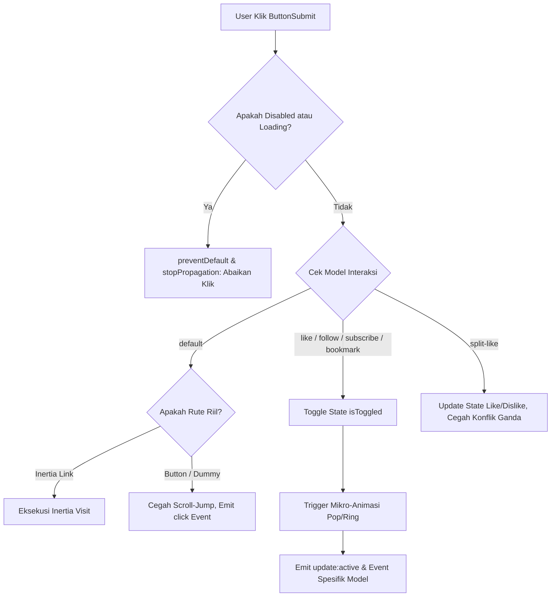

# ButtonSubmit Component

Komponen tombol aksi komprehensif yang dirancang untuk pengiriman formulir (*form submission*), navigasi instan Inertia.js, penanganan status asinkron (*async loading state*), serta model interaksi keterlibatan pengguna (*social & engagement models*) seperti Like, Follow, Subscribe, Bookmark, dan Split-Like. Komponen ini dirancang dengan prinsip perataan sumbu tengah simetris (*true center alignment*), rasio optik proporsional antara ikon Material Symbols dan teks huruf, serta jarak celah (*clearance gap*) anti-menempel sesuai standar arsitektur Laravel Pack UI.

---

## 01. Overview

`ButtonSubmit.vue` adalah elemen pemicu aksi utama dan sekunder serbaguna yang menggabungkan fleksibilitas tag tombol HTML standar (`<button>`), tautan perutean Inertia (`Link`), dan anchor tag (`<a>`) dalam satu kontrak properti yang konsisten.

### 1.1 Apa Entitas Ini
Komponen Vue 3 berbasis Composition API (`packages/laravel-pack-ui/resources/js/Components/Pack/ButtonSubmit.vue`) yang merender elemen pemicu aksi dengan integrasi penuh Tailwind CSS v4, Google Material Symbols, dan manajemen state reaktif.

### 1.2 Fungsi Utama
- Menjalankan aksi pengiriman formulir dengan pencegahan klik ganda selama proses pemrosesan asinkron (`loading="true"`).
- Menyediakan animasi pemutar (*loading spinner*) otomatis dan penggantian teks dinamis (`loadingText`).
- Menyediakan 6 model interaksi siap pakai: `default`, `like`, `subscribe`, `follow`, `split-like`, dan `bookmark`.
- Menghitung dan memformat angka engagement secara otomatis (misal `1.2k`, `1.5M`).
- Mengisolasi navigasi rute Inertia riil dari tautan dummy untuk mencegah lonjakan gulir (*anti scroll-jump*).

### 1.3 Kapan Digunakan
- Sebagai tombol submit utama pada formulir pendaftaran, login, transaksi, atau pengaturan.
- Sebagai tombol aksi sekunder (*cancel*, *reset*, *export*, *filter*).
- Pada antarmuka video atau artikel untuk interaksi Like / Dislike, Subscribe kanal, dan Bookmark.
- Pada header atau kartu profil untuk tombol Follow / Unfollow pengguna.

### 1.4 Karakteristik Penting
- **Zero Uncontrolled Margin**: Bebas margin luar bawaan (`m-0`), tata letak dikendalikan sepenuhnya oleh kontainer induk.
- **True Center Alignment**: Menggunakan `leading-none select-none shrink-0 flex items-center justify-center` pada ikon dan `leading-none inline-flex items-center` pada teks untuk mengeliminasi deviasi *baseline* vertikal.
- **Rasio Optik Ikon 1:1**: Ikon awalan/akhiran diskalakan tepat setara dengan tinggi kapital dan ascender huruf Latin (`text-[13px]` pada xs hingga `text-[18px]` pada lg).
- **Anti Scroll-Jump Protocol**: Mendeteksi tautan dummy (`href="#"`) dan secara otomatis merender `<button type="button">` aman tanpa memicu lonjakan viewport ke puncak dokumen.

---

## 02. Preview

> [!TIP]
> Pengujian visual dan showcase interaktif entitas ini tersedia secara native pada portal pratinjau aplikasi:
>
> <a href="http://localhost:8000/preview/button-submit" target="_self" style="display: inline-flex; align-items: center; gap: 6px; padding: 6px 14px; border-radius: 8px; font-weight: 600; text-decoration: none; margin-top: 8px; background-color: var(--vp-c-brand-1, #4f46e5); color: #ffffff;">Buka Live Preview Komponen ButtonSubmit &rarr;</a>

---

## 03. Usage

### Pohon Konsep Penggunaan

```text
ButtonSubmit
├── Form & Action Triggers
│   ├── Primary Submit (Simpan, Bayar, Kirim Pesan)
│   ├── Secondary Action (Batal, Filter, Unduh Laporan)
│   └── Destructive Action (Hapus Akun, Batalkan Pesanan)
├── Navigation & Routing
│   ├── Inertia SPA Visit (as="Link" :href="/dashboard")
│   └── External Link (as="a" :href="https://..." target="_blank")
└── Social & Engagement Models
    ├── Like / Favorite (Toggle jempol / hati dengan counter)
    ├── Subscribe / Follow (YouTube red button / Twitter sky button)
    ├── Segmented Split-Like (YouTube Like & Dislike pill)
    └── Bookmark / Save (Penyimpanan artikel ke koleksi)
```

### Matriks Kapan Digunakan vs Dihindari

| Kasus Penggunaan | Gunakan ButtonSubmit | Hindari (Gunakan Alternatif) |
|---|---|---|
| Tombol submit formulir atau aksi pemicu modal | Ya (`variant="primary"`) | Jangan gunakan tautan teks `<a>` biasa |
| Tautan navigasi hierarki direktori | Tidak | Gunakan Breadcrumb |
| Tombol navigasi tab antar panel tampilan | Tidak | Gunakan Tabs |
| Chip filter yang dapat dihapus | Tidak | Gunakan Badge (`removable`) |

---

## 04. Anatomy

### Diagram Hierarki Elemen

```text
<component :is="tag" :type="safeType" :disabled="isDisabled" ...>
│
├── Loading Spinner (<span class="material-symbols-outlined animate-spin ...">)
│   └── Glif progress_activity (aktif saat loading="true")
│
├── Leading Icon (<span class="material-symbols-outlined ...">)
│   └── Glif Material Symbols sisi kiri (iconPosition="left")
│
├── Content & Counter Wrapper (<span class="truncate leading-none inline-flex items-center gap-1.5">)
│   ├── Default Label / Loading Text / Slot Content
│   └── Display Counter Badge (<span class="font-mono text-xs font-bold ...">)
│
└── Trailing Icon (<span class="material-symbols-outlined ...">)
    └── Glif Material Symbols sisi kanan (iconPosition="right")
```

### Diagram Alur Eksekusi Tombol



---

## 05. Variants

Mendukung 4 kelompok variasi visual untuk mengakomodasi hierarki aksi dan estetika antarmuka:

| Kelompok | Varian | Deskripsi Visual | Rekomendasi Kasus |
|---|---|---|---|
| **Solid** | `primary`, `secondary`, `success`, `danger`, `warning` | Warna pekat tebal dengan teks putih kontras tinggi dan bayangan halus | Aksi utama formulir, tombol konfirmasi |
| **Soft Pastel** | `soft-primary`, `soft-success`, `soft-danger`, `soft-warning`, `soft-secondary` | Latar warna pastel lembut dengan teks semantik kontras dan border tipis | Aksi sekunder, tombol filter, antarmuka dasbor |
| **Bordered & Glass** | `outline`, `ghost`, `glass` | Latar transparan atau kaca blur (*backdrop-blur*) dengan garis batas halus | Tombol batal, tombol bilah alat (*toolbar*), overlay media |
| **Special & Social** | `gradient`, `youtube`, `instagram` | Gradien warna dinamis atau palet identitas platform media sosial | Tombol langganan, tombol kampanye promosi khusus |

---

## 06. Sizes & Optical Scale

ButtonSubmit dirancang dengan dimensi mikro ramping agar tidak memakan ruang vertikal berlebih, dengan rasio optik font-ke-ikon dan jarak celah (*clearance gap*) yang diperhitungkan secara matematis.

### Tabel Skala Ukuran & Dimensi Mikro

| Size | Ukuran Font Teks | Padding Horizontal & Vertikal | Gap Spacing | Ukuran Ikon | Tinggi Minimum (`min-h`) | Rekomendasi Kasus |
|---|---|---|---|---|---|---|
| `xs` | `text-[11px]` (11px) | `px-2.5 py-1` (kotak: `w-7 h-7`) | `gap-1.5` (6px) | `text-[13px]` (1:1) | `28px` | Baris tabel data padat, tag aksi mikro |
| `sm` | `text-xs` (12px) | `px-3 py-1.5` (kotak: `w-8.5 h-8.5`) | `gap-1.5` (6px) | `text-[14px]` (1:1) | `34px` | Bilah filter, kartu kecil, modal kompak |
| `md` (default) | `text-xs sm:text-sm` (12-14px) | `px-3.5 py-2` (kotak: `w-9.5 h-9.5`) | `gap-2` (8px) | `text-[16px]` (1:1) | `38px` | Tombol formulir standar aplikasi |
| `lg` | `text-sm font-bold` (14-16px) | `px-4.5 py-2.5` (kotak: `w-11 h-11`) | `gap-2.5` (10px) | `text-[18px]` (1:1) | `44px` | Hero banner, Call to Action (CTA) utama |
| `icon` | `text-sm font-semibold` | `p-0` (bujursangkar) | - | `text-[18px]` (terpusat) | `w-9.5 h-9.5` (38px) | Tombol ikon mandiri (*favorite*, *share*) |

### Analisis Disparitas Bounding Box vs Cap-Height Huruf
- **Tinggi Huruf Kapital (Cap-Height)**: Huruf alfabet Latin memiliki tinggi kapital rata-rata 65% - 70% dari kotak em-box font.
- **Rasio Ikon Semantik (1:1 Optical Balance)**:
  - Ikon tombol memiliki bentuk garis luar terbuka (`save`, `send`, `add`, `favorite`).
  - Untuk ukuran `xs` (font 11px), ikon disetel ke `text-[13px]`.
  - Untuk ukuran `sm` (font 12px), ikon disetel ke `text-[14px]`.
  - Untuk ukuran `md` (font 12-14px), ikon disetel ke `text-[16px]`.
  - Untuk ukuran `lg` (font 14-16px), ikon disetel ke `text-[18px]`.
  - Skala ini menghasilkan keseimbangan optik sempurna di mana ikon dan huruf kapital terlihat memiliki tinggi visual yang setara tanpa ikon terlihat membesar atau mendominasi tombol.

### Perhitungan Jarak Celah Teks & Ikon (Gap & Clearance: Anti-Menempel)
- **Larangan Jarak Dempet**: Dilarang keras menggunakan jarak `gap-0.5` (2px) atau `gap-1` (4px) yang membuat ikon dan teks label saling menempel sesak.
- **Standar Gap Elemen**:
  - Ukuran `xs` dan `sm` wajib menggunakan minimal `gap-1.5` (6px).
  - Ukuran `md` menggunakan `gap-2` (8px).
  - Ukuran `lg` menggunakan `gap-2.5` (10px).

### Prinsip True Center Alignment (Rata Tengah Sumbu Simetris)
- Ikon Google Material Symbols dan teks label berada pada satu garis sumbu horizontal tengah yang tepat berimpit (*True Center Alignment*).
- Diterapkan utilitas `leading-none select-none shrink-0 flex items-center justify-center` pada setiap ikon, dan `leading-none inline-flex items-center` pada teks label untuk meniadakan deviasi baseline bawaan font engine peramban.

---

## 07. States

| State | Representasi Visual | Perilaku & Pemicu |
|---|---|---|
| **Default** | Sesuai konfigurasi varian dan warna | Statis siap menerima interaksi kursor. |
| **Hover** | Warna latar menggelap lembut atau opasitas naik | Kursor pengguna berada di atas area tombol. |
| **Active / Pressed** | Efek sentuh mikro `scale-95` | Pengguna menekan tombol fisik atau klik mouse. |
| **Loading** | Ikon berubah menjadi pemutar berputar (*spin*) | Dipicu saat prop `loading="true"`, interaksi klik otomatis dikunci. |
| **Disabled** | Opasitas turun ke 60% (`opacity-60 cursor-not-allowed`) | Dipicu saat prop `disabled="true"`, event pointer dinonaktifkan. |
| **Toggled Active** | Warna tombol berubah, ikon terisi (`FILL 1`), counter bertambah | Terjadi pada model interaksi (`like`, `subscribe`, `follow`, `bookmark`). |

---

## 08. Props / Parameters / Attributes

| Prop | Tipe Data | Nilai Default | Wajib | Deskripsi & Validasi |
|---|---|---|---|---|
| `variant` | `String` | `'primary'` | Tidak | Varian visual: `'primary'`, `'secondary'`, `'success'`, `'danger'`, `'warning'`, `'outline'`, `'ghost'`, `'soft'`, `'soft-primary'`, `'soft-success'`, `'soft-danger'`, `'soft-warning'`, `'soft-secondary'`, `'gradient'`, `'glass'`, `'youtube'`, `'instagram'`. |
| `size` | `String` | `'md'` | Tidak | Skala ukuran: `'xs'`, `'sm'`, `'md'`, `'lg'`, `'icon'`. Tombol murni ikon tanpa teks otomatis berukuran bujursangkar proporsional. |
| `as` | `String` | `'button'` | Tidak | Tag elemen perender: `'button'`, `'Link'`, `'a'`. Jika `href` diisi URL valid, otomatis teresolusi ke `'Link'` atau `'a'`. |
| `href` | `String` | `null` | Tidak | URL tujuan. Otomatis menentukan apakah Link Inertia atau anchor HTML biasa. URL dummy dialihkan aman ke tombol. |
| `type` | `String` | `'submit'` | Tidak | Tipe atribut HTML button: `'submit'`, `'button'`, `'reset'`. |
| `icon` | `String` | `''` | Tidak | Nama ikon Google Material Symbols. |
| `iconPosition` | `String` | `'left'` | Tidak | Posisi ikon: `'left'` (awalan) atau `'right'` (akhiran). Spinner loading otomatis mengikuti posisi ini. |
| `loading` | `Boolean` | `false` | Tidak | Menampilkan spinner pemroses dan mengunci interaksi klik. |
| `loadingText` | `String` | `''` | Tidak | Teks pengganti yang tampil saat status pemuatan aktif. |
| `disabled` | `Boolean` | `false` | Tidak | Menonaktifkan interaksi tombol. |
| `fullWidth` | `Boolean` | `false` | Tidak | Merentangkan tombol ke lebar kontainer 100% menggunakan flex display. |
| `pill` | `Boolean` | `false` | Tidak | Memaksa bentuk kelengkungan kapsul penuh (*pill shape*). |
| `rounded` | `String` | `'default'` | Tidak | Radius sudut: `'default'`, `'none'`, `'sm'`, `'md'`, `'lg'`, `'xl'`, `'2xl'`, `'3xl'`, `'full'`. Default menggunakan radius ramping (`rounded-md` pada xs/sm, `rounded-lg` pada md, `rounded-xl` pada lg). |
| `model` | `String` | `'default'` | Tidak | Model interaktif: `'default'`, `'like'`, `'subscribe'`, `'follow'`, `'split-like'`, `'bookmark'`. |
| `modelValue` | `Boolean` | `undefined` | Tidak | Binding reaktif standar Vue 3 `v-model` untuk status aktif/toggled. |
| `active` | `Boolean` | `false` | Tidak | Status aktif/toggle alternatif (`v-model:active`). |
| `activeLabel` | `String` | `''` | Tidak | Label teks dinamis yang tampil saat tombol dalam status aktif. |
| `activeIcon` | `String` | `''` | Tidak | Ikon Material Symbols kustom yang tampil saat tombol dalam status aktif. |
| `activeVariant` | `String` | `''` | Tidak | Varian visual alternatif saat tombol berada dalam status aktif (misal switch dari `outline` ke `primary`). |
| `count` | `Number\|String` | `null` | Tidak | Angka penghitung (otomatis disingkat `1.2k`, `1.5M`). Ditampilkan dalam badge kontras berproporsi font rapi. |
| `showCount` | `Boolean` | `true` | Tidak | Menentukan apakah angka penghitung ditampilkan atau disembunyikan. |
| `disliked` | `Boolean` | `false` | Tidak | Status dislike khusus model `split-like` (`v-model:disliked`). |
| `colorTheme` | `String` | `'default'` | Tidak | Tema warna gradien/glow: `'default'`, `'primary'`, `'indigo'`, `'emerald'`, `'purple'`, `'amber'`, `'rose'`, `'cyan'`, `'dark'`. Otomatis beradaptasi dengan varian semantik jika bernilai default. |
| `glow` | `Boolean` | `false` | Tidak | Menambahkan bayangan cahaya aksen (*glow halo effect*) terkoordinasi dengan tema warna. |
| `social` | `String` | `'none'` | Tidak | Preset styling platform sosial: `'none'`, `'youtube'`, `'instagram'`. |
| `preserveScroll`| `Boolean` | `true` | Tidak | Menjaga posisi scroll halaman pada tautan Inertia (`Link`). |
| `preserveState` | `Boolean` | `true` | Tidak | Mempertahankan state komponen pada navigasi Inertia (`Link`). |

---

## 09. Slots / Content

| Nama Slot | Tipe Slot | Deskripsi |
|---|---|---|
| `default` | Standard | Konten teks utama atau elemen kustom di dalam tombol. |

---

## 10. Events / Interactions / Returns

| Nama Event | Payload Tipe | Kondisi Pemicu | Deskripsi |
|---|---|---|---|
| `@click` | `MouseEvent` | Tombol diklik saat tidak disabled dan tidak loading | Meneruskan event klik pengguna ke penangan induk. |
| `@update:modelValue` | `Boolean` | Status aktif/toggle tombol berubah | Event sinkronisasi bawaan Vue 3 (`v-model`). |
| `@update:active` | `Boolean` | Status aktif model interaktif berubah | Event sinkronisasi dua arah eksplisit (`v-model:active`). |
| `@update:disliked` | `Boolean` | Status dislike pada model `split-like` berubah | Event sinkronisasi dua arah dislike (`v-model:disliked`). |
| `@toggle` | `Boolean` | Status beralih pada model interaktif | Event pembantu saat status berganti. |
| `@like` | `Boolean` | Model `like` atau sisi like pada `split-like` diklik | Dipancarkan saat pengguna menyukai konten. |
| `@dislike` | `Boolean` | Sisi dislike pada `split-like` diklik | Dipancarkan saat pengguna tidak menyukai konten. |
| `@subscribe` | `Boolean` | Model `subscribe` diklik | Dipancarkan saat status langganan berubah. |

---

## 11. Code Example

### 1. Penggunaan Dasar Form Submit (Basic Example)
```vue
<script setup>
import ButtonSubmit from '@/Components/Pack/ButtonSubmit.vue';
</script>

<template>
  <div class="flex items-center gap-3">
    <ButtonSubmit variant="primary" icon="send">
      Kirim Pesan
    </ButtonSubmit>
    <ButtonSubmit variant="secondary">
      Batal
    </ButtonSubmit>
  </div>
</template>
```

### 2. Penggunaan Menengah: Async Loading & Loading Text (Intermediate Example)
```vue
<script setup>
import { ref } from 'vue';
import ButtonSubmit from '@/Components/Pack/ButtonSubmit.vue';

const isSubmitting = ref(false);

const handleSave = () => {
  isSubmitting.value = true;
  setTimeout(() => {
    isSubmitting.value = false;
  }, 2000);
};
</script>

<template>
  <ButtonSubmit
    variant="primary"
    icon="save"
    :loading="isSubmitting"
    loading-text="Menyimpan Perubahan..."
    @click="handleSave"
  >
    Simpan Profil
  </ButtonSubmit>
</template>
```

### 3. Penggunaan Lanjutan: YouTube Subscribe & Segmented Split-Like (Advanced Example)
```vue
<script setup>
import { ref } from 'vue';
import ButtonSubmit from '@/Components/Pack/ButtonSubmit.vue';

const isSubscribed = ref(false);
const subCount = ref(45200);

const isLiked = ref(false);
const isDisliked = ref(false);
const likeCount = ref(3800);
</script>

<template>
  <div class="flex items-center gap-3">
    <!-- YouTube Subscribe Button -->
    <ButtonSubmit
      model="subscribe"
      social="youtube"
      :active="isSubscribed"
      :count="subCount"
      @subscribe="isSubscribed = $event"
    />

    <!-- Segmented Split-Like Pill -->
    <ButtonSubmit
      model="split-like"
      :active="isLiked"
      :disliked="isDisliked"
      :count="likeCount"
      @like="isLiked = $event"
      @dislike="isDisliked = $event"
    />
  </div>
</template>
```

---

## 12. Result / Behavior

- **Pencegahan Double-Submit**: Saat prop `loading="true"`, atribut `disabled` dan `pointer-events-none` langsung aktif sehingga klik berulang dari pengguna dicegah secara mutlak.
- **Transisi Ikon ke Pemutar**: Ikon Material Symbols awal otomatis digantikan oleh glif `progress_activity` dengan animasi putar halus (`animate-spin`) tanpa mengubah dimensi tinggi fisik tombol.
- **Mikro-Animasi Sentuh**: Model `like` memicu animasi *heart pop* (`scale-125`) dan model `subscribe` memicu animasi getar lonceng (*bell ring*) saat status beralih.

---

## 13. Customization

### Kustomisasi Navigasi Inertia Preservatif
```vue
<ButtonSubmit
  as="Link"
  href="/dashboard/analytics"
  variant="soft-primary"
  icon="analytics"
  preserve-scroll
>
  Buka Analitik
</ButtonSubmit>
```

### Kustomisasi Tombol Lebar Penuh (Mobile CTA)
```vue
<ButtonSubmit
  variant="primary"
  full-width
  size="lg"
  icon="shopping_bag"
  icon-position="right"
>
  Lanjutkan ke Pembayaran
</ButtonSubmit>
```

---

## 14. Accessibility (a11y)

- **Deklarasi Tipe Tombol Aman**: Tombol bawaan selalu memiliki atribut `type` terdefinisi (`type="submit"` untuk form atau `type="button"` untuk pemicu interaktif) agar tidak memicu submit semu.
- **Atribut Status WAI-ARIA**:
  - Menyertakan atribut `aria-busy="true"` saat status loading aktif.
  - Menyertakan `aria-disabled="true"` saat tombol berstatus disabled.
- **Keyboard Navigation**: Dapat difokuskan penuh dengan tombol `Tab` dan diaktivasi menggunakan tombol `Enter` atau `Space`.
- **Focus Ring Terlihat**: Menerapkan kelas `focus-visible:ring-2 focus-visible:ring-offset-1` yang kontras untuk navigasi keyboard.

---

## 15. Responsive Behavior

- **Dukungan Full Width**: Melalui prop `fullWidth: true`, tombol membentang 100% dari lebar kontainer induk, ideal untuk antarmuka formulir seluler.
- **Touch Target Standar**: Ukuran `md` (tinggi 38px) dan `lg` (tinggi 46px) memenuhi rekomendasi area sentuh minimal perangkat mobile.
- **Pemotongan Teks Otomatis**: Label dibungkus kelas `truncate` untuk mencegah teks tombol merusak layout saat label berukuran panjang.

---

## 16. Do / Don't

### Rekomendasi (Do):
- Gunakan label tombol yang spesifik mendeskripsikan tindakan (contoh: "Simpan Perubahan", "Hapus Data").
- Selalu sertakan `loadingText` jika operasi asinkron membutuhkan waktu lebih dari 1 detik agar pengguna memahami sistem sedang memproses.
- Gunakan `variant="primary"` untuk satu aksi utama per tampilan, dan gunakan `variant="secondary"`, `soft`, atau `outline` untuk aksi pendamping.

### Larangan (Don't):
- Jangan menyematkan lebih dari satu tombol `variant="primary"` berdampingan dalam satu grup aksi.
- Jangan menggunakan `href="#"` mentah tanpa penangan event preventif pada tombol navigasi.
- Jangan menambahkan margin luar manual (`my-4`, `mx-2`) pada elemen root tombol; serahkan pengaturan spasi pada kontainer pembungkus.

---

## 17. Examples / Recipes

### Resep 1: Form Checkout dengan Loading Asinkron
```vue
<script setup>
import { ref } from 'vue';
import ButtonSubmit from '@/Components/Pack/ButtonSubmit.vue';

const isProcessing = ref(false);

const processPayment = () => {
  isProcessing.value = true;
  // Simulasi pemrosesan gateway pembayaran
  setTimeout(() => {
    isProcessing.value = false;
  }, 2500);
};
</script>

<template>
  <div class="p-6 bg-white dark:bg-slate-900 rounded-xl border border-slate-200 dark:border-slate-800 space-y-4">
    <h3 class="text-base font-bold text-slate-900 dark:text-white">Ringkasan Pembayaran</h3>
    <div class="flex items-center justify-between text-sm">
      <span class="text-slate-500">Total Tagihan</span>
      <span class="font-bold text-slate-900 dark:text-white">Rp 450.000</span>
    </div>
    <ButtonSubmit
      variant="primary"
      size="lg"
      full-width
      icon="lock"
      :loading="isProcessing"
      loading-text="Memproses Pembayaran..."
      @click="processPayment"
    >
      Bayar Sekarang
    </ButtonSubmit>
  </div>
</template>
```

### Resep 2: Kartu Konten Media Sosial dengan Like & Share
```vue
<script setup>
import { ref } from 'vue';
import ButtonSubmit from '@/Components/Pack/ButtonSubmit.vue';

const isLiked = ref(false);
const likesCount = ref(1280);
</script>

<template>
  <div class="p-4 bg-slate-50 dark:bg-slate-900/60 rounded-xl border border-slate-200/80 dark:border-slate-800 flex items-center justify-between">
    <div class="flex items-center gap-2">
      <ButtonSubmit
        model="like"
        social="instagram"
        :active="isLiked"
        :count="likesCount"
        @like="isLiked = $event"
      />
      <ButtonSubmit variant="secondary" icon="share">
        Bagikan
      </ButtonSubmit>
    </div>
    <ButtonSubmit size="icon" variant="ghost" icon="bookmark" title="Simpan ke Bookmark" />
  </div>
</template>
```

---

## 18. Related Items

```text
ButtonSubmit
├── Komponen Pendukung
│   ├── InputField.vue (Input formulir yang dikirimkan oleh ButtonSubmit)
│   ├── Modal.vue (Dialog konfirmasi aksi sebelum ButtonSubmit dieksekusi)
│   └── ToastNotification.vue (Notifikasi umpan balik setelah ButtonSubmit berhasil)
└── Komposabel Pendukung
    ├── useAutoSave.js (Penyimpanan otomatis tanpa memerlukan klik ButtonSubmit)
    └── useFormValidation.js (Validasi input sebelum tombol submit diaktifkan)
```

---

## 19. Notes / Limitations

- **Dependensi Google Material Symbols**: Fitur ikon bawaan (`save`, `send`, `progress_activity`, dll.) memerlukan pemuatan font Google Material Symbols Outlined pada berkas layout induk aplikasi.
- **Navigasi Inertia.js**: Opsi `as="Link"` mengimpor komponen `Link` dari `@inertiajs/vue3`. Pastikan aplikasi berjalan di lingkungan Laravel Inertia saat menggunakan opsi perutean ini.
- **Pencegahan Scroll Jump**: Tautan bernilai `'#'` atau `'javascript:void(0)'` secara otomatis dialihkan menjadi elemen `<button type="button">` aman untuk mencegah lonjakan gulir peramban ke posisi paling atas.