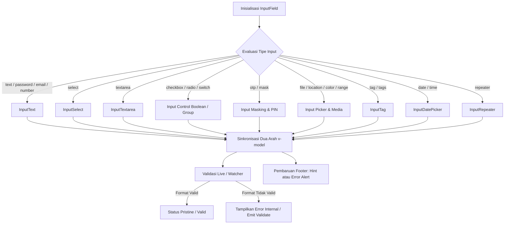

# InputField Component

Komponen input universal berbasis Vue 3 dan Tailwind CSS v4 yang mengintegrasikan lebih dari 20 tipe input kontrol ke dalam satu API yang konsisten, deklaratif, dan modular. Bertindak sebagai fasad terpadu (*smart orchestrator*) yang secara otomatis mendelegasikan rendering ke sub-komponen khusus berdasarkan prop `type`.

---

## 01. Overview

**Penjelasan Singkat**: `InputField` adalah komponen antarmuka tunggal terstandarisasi untuk menangani segala bentuk interaksi masukan formulir pada aplikasi web enterprise. Komponen ini membungkus siklus hidup input, integrasi validasi, serta sinkronisasi dua arah secara headless.

### 1.1 Apa Entitas Ini

**Vue Component** (Single File Component) yang berlokasi di [InputField.vue](file:///c:/SPEED/LARAVEL-PACK-UI/packages/laravel-pack-ui/resources/js/Components/Pack/InputField.vue) serta fasad resmi [InputFieldComponent.vue](file:///c:/SPEED/LARAVEL-PACK-UI/packages/laravel-pack-ui/resources/js/Components/Pack/InputFieldComponent.vue). `InputField` mengevaluasi prop `type` dan secara internal mendelegasikan rendering ke salah satu dari 15 sub-komponen khusus: `InputText`, `InputSelect`, `InputTextarea`, `InputRadio`, `InputCheckbox`, `InputSwitch`, `InputFile`, `InputColor`, `InputRange`, `InputDatePicker`, `InputOtp`, `InputMask`, `InputLocation`, `InputTag`, dan `InputRepeater`.

### 1.2 Fungsi Utama

- Menyediakan satu antarmuka terpadu (`v-model`, `label`, `icon`, `error`, `hint`, `size`) untuk seluruh varian input native HTML5 maupun kontrol kustom kompleks.
- Menghasilkan atribut `id` unik yang aman untuk proses rendering sisi server (SSR Hydration-Safe) melalui utilitas `useId()` Vue 3.5+.
- Menjalankan validasi instan (*live validation*) berbasis tipe data (email, URL, telepon, kekuatan kata sandi) serta mendukung validator kustom.
- Menghitung dan menampilkan jumlah karakter secara dinamis saat prop `maxlength` ditentukan.
- Mengekspos kendali terprogram seperti `focus()`, `blur()`, `clear()`, dan `validate()` ke komponen induk melalui `defineExpose()`.

### 1.3 Kapan Digunakan

- Setiap formulir aplikasi yang membutuhkan masukan data pengguna (formulir CRUD, panel penyaring data, halaman checkout, pengaturan akun).
- Skenario input terstruktur seperti NPWP, NIK, dan kartu kredit menggunakan tipe `mask`.
- Alur verifikasi identitas menggunakan kode 4-8 digit dengan tipe `otp`.
- Formulir dinamis majemuk (*repeatable form groups*) menggunakan tipe `repeater`.
- Pencarian cerdas dengan saran otomatis menggunakan tipe `search` dan prop `options`.

### 1.4 Karakteristik Penting

- **Headless Delegation**: Elemen root hanya menyusun struktur tata letak luar (label, counter, hint, error), sedangkan interaksi data diserahkan ke sub-komponen spesialis.
- **SSR Hydration-Safe**: ID elemen dijamin identik antara server render dan client hydration via `useId()`.
- **Keseimbangan Rasio Optik Ikon**: Dimensi ikon prefix/suffix dan tombol clear disesuaikan dengan tinggi huruf kapital (*cap-height*) teks melalui pengaturan `font-variation-settings`.
- **Integrasi Penuh Vue 3.5+ dan Tailwind CSS v4**: Menggunakan sintaks `<script setup>`, makro `defineModel()`, dan utilitas desain Tailwind v4 tanpa dependensi styling lawas.

---

## 02. Preview

> [!TIP]
> Pengujian visual dan showcase interaktif entitas ini tersedia secara native pada portal pratinjau aplikasi:
>
> <a href="/preview/input-field" target="_self" style="display: inline-flex; align-items: center; gap: 6px; padding: 6px 14px; border-radius: 8px; font-weight: 600; text-decoration: none; margin-top: 8px; background-color: var(--vp-c-brand-1, #4f46e5); color: #ffffff;">Buka Live Preview Komponen InputField &rarr;</a>

---

## 03. Usage

### Pohon Konsep Penggunaan

```text
InputField
├── Form Submission
│   ├── Create / Insert Record (text, email, number, select)
│   ├── Update / Edit Record (seluruh tipe input)
│   └── Multi-step Stepper Form (password, date, file)
├── Validasi & Format Terstruktur
│   ├── Nomor Identitas Pajak & Kependudukan (mask: NPWP, NIK)
│   ├── Pembayaran Kartu Kredit (mask: 9999 9999 9999 9999)
│   ├── Verifikasi Keamanan OTP (otp: 4-8 digit)
│   └── Input Finansial (number + currency="IDR")
├── Pencarian & Filter Data
│   ├── Kolom Pencarian Cepat + Saran (search + options)
│   └── Filter Kategori Multi-Tag (tags + options)
├── Formulir Dinamis
│   ├── Pengulangan Baris Form (repeater / multiple-form)
│   └── Seleksi Majemuk (checkbox / radio + options)
└── Kontrol Pengaturan Sistem
    ├── Pengalih Opsi Instan (switch)
    ├── Pemilih Warna Tema (color)
    └── Penggeser Rentang Nilai (range)
```

### Kapan Digunakan vs Kapan Dihindari

| Kondisi Kebutuhan | Rekomendasi Komponen | Alasan Arsitektural |
| :--- | :--- | :--- |
| Formulir masukan data standar & terstruktur | Gunakan `InputField` | Konsistensi validasi, label, error, dan aksesibilitas. |
| Pengeditan teks kaya dengan format HTML | Hindari `InputField` | Gunakan [RichTextEditor.vue](file:///c:/SPEED/LARAVEL-PACK-UI/packages/laravel-pack-ui/resources/js/Components/Pack/RichTextEditor.vue) untuk engine Tiptap. |
| Unggah berkas terpadu (KTP, Dokumen, Avatar) | Gunakan `InputField` (`type="file"`) atau `FileDropzone` | `InputField type="file"` mendelegasikan langsung ke engine FileDropzone (`InputFile.vue`). |
| Pengurutan atau filter tabel data server-side | Hindari `InputField` | Gunakan [FilterToolbar.vue](file:///c:/SPEED/LARAVEL-PACK-UI/packages/laravel-pack-ui/resources/js/Components/Pack/FilterToolbar.vue) yang terhubung ke composable tabel. |

### Alur Kerja Konseptual

```text
Laravel Controller → Inertia Props → Page Component → InputField → Sub-Komponen Spesialis
                                           ↑                            ↓
                                   form.errors (Server)        v-model (Two-way Binding)
```

Contoh Implementasi Sederhana:

```vue
<script setup>
import { ref } from 'vue';
import InputField from '@/Components/Pack/InputField.vue';

const username = ref('');
const password = ref('');
</script>

<template>
  <form class="space-y-3 max-w-md">
    <InputField
      v-model="username"
      type="text"
      label="Username Akun"
      placeholder="Masukkan username"
      icon="person"
      required
    />

    <InputField
      v-model="password"
      type="password"
      label="Kata Sandi"
      placeholder="Minimal 8 karakter"
      icon="lock"
      show-password-strength
      required
    />
  </form>
</template>
```

---

## 04. Anatomy

### Diagram Hierarki Tekstual

```text
InputField Component Shell
│
├── 1. Field Header Section (Dirender kondisional jika label atau slot label tersedia)
│   ├── Container Header: flex items-center justify-between gap-2 select-none
│   ├── Label Element: <label :for="inputId">
│   │   ├── Teks Label (Prop label atau Slot default: label)
│   │   └── Asterisk Penanda Wajib: <span aria-hidden="true">*</span>
│   └── Character Counter: <span class="font-mono"> (Aktif saat maxlength diatur)
│
├── 2. Control Body Section (Didelegasikan ke Sub-Komponen Spesialis)
│   ├── InputText        (type: text, email, password, number, tel, url, search, currency)
│   ├── InputSelect      (type: select)
│   ├── InputTextarea    (type: textarea)
│   ├── InputRadio       (type: radio)
│   ├── InputCheckbox    (type: checkbox)
│   ├── InputSwitch      (type: switch)
│   ├── InputFile        (type: file)
│   ├── InputColor       (type: color)
│   ├── InputRange       (type: range)
│   ├── InputDatePicker  (type: date, time, datetime-local)
│   ├── InputOtp         (type: otp)
│   ├── InputMask        (type: mask)
│   ├── InputLocation    (type: location)
│   ├── InputTag         (type: tag, tags)
│   └── InputRepeater    (type: repeater, form-repeater, multiple-form)
│
└── 3. Field Footer Section (Pesan Bantuan & Status Galat)
    ├── Hint Container: <div v-if="hint && !error"> (Slot: hint)
    └── Error Container: <div v-if="error" role="alert"> (Slot: error)
        ├── Material Icon: <span class="material-symbols-outlined">error</span>
        └── Error Text: <span class="leading-none inline-flex items-center">
```

### Diagram Alur Kontrol dan Reaktivitas



### Deskripsi Komponen Internal

| Bagian Internal | Elemen DOM / Komponen | Peran dan Tanggung Jawab |
| :--- | :--- | :--- |
| **Field Header** | `<div class="flex justify-between">` | Menyajikan label form yang terikat ke ID input dan penghitung karakter sisa. |
| **Control Body** | Sub-komponen Input terpilih | Mengelola elemen `<input>`, `<textarea>`, `<select>`, atau kontrol kustom serta event DOM native. |
| **Field Footer** | `<div role="alert">` / `<div>` | Memberikan umpan balik instan berupa teks petunjuk bantuan teknis atau peringatan galat. |

---

## 05. Variants

Pengelompokan ragam varian kontrol input melalui prop `type`:

| Kategori Varian | Nilai `type` yang Didukung | Karakteristik Perilaku |
| :--- | :--- | :--- |
| **Text Controls** | `text`, `email`, `password`, `number`, `tel`, `url`, `search` | Mendukung validasi regex langsung, tombol intip sandi, indikator kekuatan sandi, format pemecah digit telepon (chunk & pattern), dan format numerik. |
| **Pilihan Formulir** | `select`, `checkbox`, `radio`, `switch` | Menampilkan pilihan tunggal atau banyak dengan tampilan chip opsional, 3 ragam gaya dropdown select, dan 5 varian sakelar switch modern. |
| **Area Teks Luas** | `textarea` | Mendukung auto-resize tinggi baris berdasarkan panjang konten teks dan batas baris minimum/maksimum. |
| **Pemilih Nilai (Pickers)** | `date`, `time`, `datetime-local`, `color`, `range` | Dialog popover pemilih tanggal (kalender grid & presets), pemilih warna hex (3 pemicu & 2 palet), serta 4 gaya bilah geser rentang angka. |
| **Kontrol Terstruktur** | `otp`, `mask`, `currency` | Pemformatan otomatis digit kartu/NPWP (10 preset terverifikasi), navigasi auto-fokus tiap digit OTP (angka, huruf, simbol), dan pemisah ribuan Rupiah. |
| **Media & Lokasi** | `file`, `location` | Unggah berkas dokumen dengan bar progres, serta pemilih koordinat peta OpenStreetMap dan GPS. |
| **Daftar Tag & Dinamis** | `tag`, `tags`, `repeater` | Pembuat badge tag interaktif dan formulir bertingkat yang dapat ditambah, disortir, atau dihapus. |

### 5.1 Ragam Gaya Desain Khusus per Tipe (Design Styles)

Setiap kontrol interaktif modern dilengkapi prop spesifik untuk mengubah gaya desain visual tanpa mempengaruhi kontrak fungsional:

| Tipe Target | Prop Varian Gaya | Pilihan Nilai | Keterangan Gaya Desain |
| :--- | :--- | :--- | :--- |
| `switch` | `toggleStyle` | `'ios'` (default)<br>`'icon'`<br>`'labeled'`<br>`'cyber'`<br>`'inset'` | • **ios**: Pill halus minimalis Apple dengan knob melayang.<br>• **icon**: Indikator morphic ikon centang/silang saat beralih.<br>• **labeled**: Label ON/OFF tercetak langsung di dalam lintasan track.<br>• **cyber**: Sudut tegas futuristik beraksen cahaya neon.<br>• **inset**: Lintasan sakelar dengan bayangan cekung ke dalam (neumorphic inset). |
| `range` | `sliderStyle` | `'glow'` (default)<br>`'thick'`<br>`'stepper'`<br>`'minimal'` | • **glow**: Lintasan neon gradient bercahaya dengan halo handle.<br>• **thick**: Bar tebal kokoh dengan balon tooltip persentase melayang.<br>• **stepper**: Tombol presisi `[-]` dan `[+]` untuk penambahan nilai bertahap.<br>• **minimal**: Garis tipis ultra-bersih tanpa ornamen. |
| `color` | `colorTriggerStyle` | `'button'` (default)<br>`'pill'`<br>`'inline-palette'` | • **button**: Tombol swatch warna dengan kode hex tebal.<br>• **pill**: Badge pill modern dengan ikon pipet eyedropper.<br>• **inline-palette**: Titik-titik warna cepat horizontal di dalam bar formulir. |
| `color` | `colorPickerStyle` | `'palette'` (default)<br>`'slider'` | • **palette**: Palet kurasi tab tema (Brand, Vivid, Pastel, Dark) + slider hue.<br>• **slider**: Slider spektrum warna kontinu (Hue & Lightness) + tombol Eyedropper API. |
| `date`, `time`, `datetime-local` | `datePickerStyle` | `'calendar'` (default)<br>`'presets'` | • **calendar**: Grid kalender bulanan lengkap + slider 24 jam + 4 tombol aksi.<br>• **presets**: Panel pintasan cepat (Hari Ini, Besok, Lusa, Jam Kerja) + kalender. |
| `select` | `selectDropdownStyle` | `'modern'` (default)<br>`'cards'`<br>`'compact'` | • **modern**: Daftar rapi dengan badge kategori terkoordinasi & check aktif.<br>• **cards**: Pilihan kartu interaktif dengan ikon dan deskripsi subteks.<br>• **compact**: Tata letak grid 2 kolom hemat ruang untuk dataset banyak opsi. |
| `search` | `searchStyle` | `'dropdown'` (default)<br>`'spotlight'` | • **dropdown**: Menu saran inline tepat di bawah kolom pencarian.<br>• **spotlight**: Command Palette melayang di tengah layar (Cmd+K style). |

### 5.2 Arsitektur Popover Bebas Tabrakan (4 Arah)

Komponen masukan yang memiliki panel melayang (`date`, `time`, `datetime-local`, `color`, `select`) dibangun di atas composable headless `usePopover.js` yang menjamin popover tidak pernah terpotong atau tertutup kontainer:

- **Teleportasi ke `<body>`**: Elemen popover dilempar ke root body sehingga bebas dari stacking context trap (`overflow: hidden`, `z-index: 1`, dsb).
- **Koordinat Fixed Presisi**: Posisi dihitung via `getBoundingClientRect()` dan diperbarui otomatis pada event `scroll` dan `resize`.
- **4 Arah Penempatan (`placement` / `popoverPlacement`)**:
  - `'bottom'` (Default): Melayang tepat di bawah elemen input trigger.
  - `'top'`: Melayang di atas elemen input trigger.
  - `'left'`: Melayang di sebelah kiri elemen input trigger.
  - `'right'`: Melayang di sebelah kanan elemen input trigger.
- **Deteksi Tabrakan Cerdas (Auto-Flip Collision Detection)**: Jika ruang viewport pada arah yang dipilih tidak mencukupi, sistem secara otomatis membalikkan posisi ke sisi yang berlawanan.
- **Tingkat Tumpukan Tertinggi (`z-[99999]`)**: Berada di atas seluruh modal, drawer, atau kartu lainnya di halaman.
- **Penutupan Otomatis**: Mendeteksi klik di luar popover dan penekanan tombol `Escape`.

---

## 06. Sizes

Tiga skala dimensi presisi untuk menjaga keselarasan hierarki visual halaman:

| Ukuran | Tinggi Total | Ukuran Teks | Padding Kontainer | Ikon Prefix | Ikon Clear | Rekomendasi Skenario |
| :--- | :--- | :--- | :--- | :--- | :--- | :--- |
| `sm` | ~32px | `text-xs` (12px) | `px-2.5 py-1 gap-2` | 14px | 12px (`w-4 h-4`) | Tabel data kompak, filter toolbar, jendela modal kecil. |
| `md` | ~38-40px | `text-xs` / `text-sm` | `px-3 py-1.5 gap-2.5` | 15px | 13px (`w-4.5 h-4.5`) | Standar formulir entri data administratif (Default). |
| `lg` | ~44-48px | `text-sm` / `text-base` | `px-3.5 py-2.5 gap-3` | 17px | 14px (`w-5 h-5`) | Formulir hero, halaman login/registrasi, tampilan mobile. |

### Rasio Keseimbangan Optik Ikon terhadap Teks

Ikon Google Material Symbols secara bawaan mengisi 75% - 85% kotak pembungkusnya, sedangkan huruf teks hanya mengisi sekitar 65% - 70% (*cap-height*). Untuk mencegah ikon menenggelamkan teks di sebelahnya:
- **Ikon Prefix Semantik**: Diberikan rasio 1:1 terhadap ukuran font (`text-[14px]` pada `sm`, `text-[15px]` pada `md`, `text-[17px]` pada `lg`).
- **Ikon Tombol Clear / Dismiss**: Diberikan rasio 80% - 85% dari ukuran font (`text-[12px]` pada `sm`, `text-[13px]` pada `md`).
- **Konfigurasi Variasi Font**: Seluruh ikon Material Symbols dikonfigurasi dengan `font-variation-settings: 'FILL' 0, 'wght' 350, 'GRAD' 0, 'opsz' 20` agar goresan garis tetap tajam dan tidak menebal pada dimensi mikro.

---

## 07. States

| Status Entitas | Pemicu Status | Tampilan Visual |
| :--- | :--- | :--- |
| **Default (Idle)** | Komponen terpasang, belum berinteraksi | Border `border-slate-200 dark:border-slate-700/80`, placeholder warna redup. |
| **Hover** | Penunjuk kursor berada di atas input | Border bertransisi halus ke `hover:border-slate-300 dark:hover:border-slate-600`. |
| **Focused** | Pengguna mengklik atau menekan Tab ke input | Ring fokus tegas `ring-4 ring-blue-500/15`, border aksen `border-blue-600 dark:border-blue-500`. |
| **Filled** | Model terisi teks | Tombol silang reset muncul otomatis jika prop `clearable=true`. |
| **Error** | Prop `error` memiliki nilai pesan | Border merah `border-rose-500`, ring `ring-rose-500/15`, dan pesan galat dengan ikon di footer. |
| **Disabled** | Prop `disabled=true` | Kontainer transparan `opacity-60`, latar redup `bg-slate-100 dark:bg-slate-800`, kursor `not-allowed`. |
| **Readonly** | Prop `readonly=true` | Nilai terkunci dari editan, latar halus `bg-slate-50 dark:bg-slate-900/40`, kursor seleksi teks biasa. |
| **Loading** | Prop `loading=true` | Spinner animasi berputar halus di bagian trailing kanan input. |

---

## 08. Props / Parameters / Attributes

### Props Universal

| Nama Prop | Tipe Data | Nilai Default | Wajib | Keterangan & Validasi |
| :--- | :--- | :--- | :--- | :--- |
| `modelValue` | `Any` | `null` | Ya | Nilai data sinkronisasi dua arah `v-model`. |
| `type` | `String` | `'text'` | Tidak | Tipe kontrol input yang akan didelegasikan (20+ tipe didukung). |
| `label` | `String` | `''` | Tidak | Teks label yang ditampilkan di atas input. |
| `placeholder` | `String` | `''` | Tidak | Teks petunjuk saat kotak masukan masih kosong. |
| `name` | `String` | `''` | Tidak | Atribut nama input untuk identifikasi formulir HTTP. |
| `id` | `String` | `''` | Tidak | ID unik elemen (otomatis dibuat via `useId()` jika kosong). |
| `size` | `'xs' \| 'sm' \| 'md' \| 'lg' \| 'xl'` | `'md'` | Tidak | Pilihan dimensi vertikal komponen dan proporsi ikon responsif. |
| `rounded` | `'none' \| 'sm' \| 'md' \| 'lg' \| 'xl' \| '2xl' \| '3xl' \| 'full'` | `'xl'` | Tidak | Kelengkungan sudut bingkai bar dan elemen kontrol internal. |
| `popoverPlacement` / `placement` | `'bottom' \| 'top' \| 'left' \| 'right'` | `'bottom'` | Tidak | Arah penempatan panel melayang popover bebas tabrakan (date, time, color, select). |
| `popoverOffset` | `Number` | `8` | Tidak | Jarak celah pixel antara elemen trigger input dengan panel popover. |
| `required` | `Boolean` | `false` | Tidak | Menandai input wajib diisi serta memunculkan tanda bintang merah. |
| `disabled` | `Boolean` | `false` | Tidak | Menonaktifkan interaksi pengguna (kursor `not-allowed`). |
| `readonly` | `Boolean` | `false` | Tidak | Mengunci teks agar tidak dapat dimodifikasi namun tetap dapat disalin. |
| `error` | `String` | `''` | Tidak | Pesan galat validasi yang memicu gaya alert error. |
| `hint` | `String` | `''` | Tidak | Teks panduan informasi tambahan di bawah kontrol. |
| `subtext` | `String` | `''` | Tidak | Teks deskripsi baris kedua pada checkbox, radio, atau switch. |
| `icon` | `String` | `''` | Tidak | Nama ikon Material Symbols pada sisi kiri (leading). |
| `iconRight` | `String` | `''` | Tidak | Nama ikon Material Symbols pada sisi kanan (trailing). |
| `prefix` | `String` | `''` | Tidak | Teks awalan statis di dalam input (misal `Rp`, `https://`). |
| `suffix` | `String` | `''` | Tidak | Teks akhiran statis di dalam input (misal `kg`, `bulan`). |
| `clearable` | `Boolean` | `false` | Tidak | Menampilkan tombol silang Pack UI untuk mengosongkan nilai instan. |
| `loading` | `Boolean` | `false` | Tidak | Menampilkan indikator proses pemuatan pada trailing area. |
| `maxlength` | `Number \| String` | `null` | Tidak | Membatasi panjang teks dan menampilkan counter karakter. |
| `autocomplete` | `String` | `''` | Tidak | Konfigurasi bawaan peramban untuk pengisian otomatis. |

### Props Khusus Tipe Tertentu

| Nama Prop | Tipe Data | Tipe Target | Keterangan |
| :--- | :--- | :--- | :--- |
| `toggleStyle` | `'ios' \| 'icon' \| 'labeled' \| 'cyber' \| 'inset'` | `switch` | 5 ragam gaya desain sakelar switch visual modern (default: `'ios'`). |
| `sliderStyle` | `'glow' \| 'thick' \| 'stepper' \| 'minimal'` | `range` | 4 ragam gaya desain penggeser rentang slider (default: `'glow'`). |
| `colorTriggerStyle` | `'button' \| 'pill' \| 'inline-palette'` | `color` | 3 ragam tombol pemicu pemilih warna (default: `'button'`). |
| `colorPickerStyle` | `'palette' \| 'slider'` | `color` | 2 ragam menu popover pemilih warna: Palet Tab Kurasi atau Slider Spektrum Pelangi (default: `'palette'`). |
| `datePickerStyle` | `'calendar' \| 'presets'` | `date`, `time`, `datetime-local` | 2 ragam picker tanggal: Kalender grid + slider 24 jam atau Panel Pintasan Cepat (default: `'calendar'`). |
| `selectDropdownStyle` | `'modern' \| 'cards' \| 'compact'` | `select` | 3 ragam dropdown select: Modern sleek list, Interactive cards, atau Dense 2-kolom grid (default: `'modern'`). |
| `searchStyle` | `'dropdown' \| 'spotlight'` | `search` | 2 ragam antarmuka pencarian: Menu inline dropdown atau Spotlight Command-Palette melayang di tengah layar (default: `'dropdown'`). |
| `searchSuggestions` | `Boolean` | `search` | Mengaktifkan/menonaktifkan menu dropdown saran riwayat pencarian (default: `true`). |
| `preset` | `String` | `mask` | Preset pola mask siap pakai: `'npwp'`, `'npwp-16'`, `'credit-card'`, `'nik'`, `'phone-id'`, `'date-id'`, `'time-id'`, `'license-plate'`, `'postal-code'`, `'ip-address'`. |
| `mask` | `String` | `mask` | Pola masker kustom pembatas (`9` digit, `a` huruf, `*` alfanumerik). |
| `slotChar` | `String` | `mask` | Karakter placeholder pada bilah kosong format mask (default: `'_'`). |
| `emitRaw` | `Boolean` | `mask` | Mengirimkan nilai bersih tanpa karakter pemisah format ke model (default: `true`). |
| `maskUppercase` | `Boolean` | `mask` | Otomatis mengonversi karakter masukan menjadi huruf kapital besar (default: `false`). |
| `showMaskHint` | `Boolean` | `mask` | Menampilkan badge visual pembantu format masker di bawah kotak input (default: `false`). |
| `length` | `Number \| String` | `otp` | Jumlah kotak karakter bilah kode OTP / PIN (default: `6`). |
| `charType` | `'numeric' \| 'alpha' \| 'symbol' \| 'alphanumeric' \| 'any' \| 'custom'` | `otp` | Batasan karakter OTP: hanya angka, hanya huruf, simbol, alfanumerik, bebas, atau regex kustom. |
| `pattern` | `String \| RegExp` | `otp` | Pola validasi karakter kustom saat `charType='custom'`. |
| `uppercase` | `Boolean` | `otp` | Otomatis mengubah masukan huruf kecil menjadi huruf besar kapital (default: `false`). |
| `integerOnly` | `Boolean` | `otp` | Membatasi input masukan dan paste khusus digit angka 0-9 (default: `true`). |
| `masked` | `Boolean` | `otp` | Menyensor karakter kode OTP menjadi bulatan sandi dot (default: `false`). |
| `separator` | `String` | `otp` | Karakter visual pembagi di tengah slot OTP (contoh: `'-'`). |
| `separatorAfter` | `Number` | `otp` | Indeks bilah kotak tempat separator disisipkan (default: tengah). |
| `countdown` | `Number` | `otp` | Durasi hitung mundur dalam detik untuk tombol kirim ulang OTP (default: `0`). |
| `resendText` | `String` | `otp` | Teks tombol kirim ulang kode OTP (default: `'Kirim Ulang Kode OTP'`). |
| `autoFocus` | `Boolean` | `otp` | Otomatis memfokuskan kotak digit pertama saat komponen terpasang (default: `false`). |
| `telDelimiter` | `String` | `tel` | Karakter pemisah format nomor telepon (default: `'-'`). |
| `telChunkSize` | `Number \| String \| Array` | `tel` | Ukuran pemecahan digit nomor telepon (misal: `2`, `4`, atau deret `[3,4,4]`). |
| `telPattern` | `String` | `tel` | Pola masking format telepon dengan karakter `#` (misal: `'1###-2###'`). |
| `urlProtocol` | `String` | `url` | Awalan protokol otomatis yang disematkan (default: `'https://'`). |
| `urlErrorText` | `String` | `url` | Pesan galat kustom saat format URL tidak sesuai. |
| `emailErrorText` | `String` | `email` | Pesan galat kustom saat format email tidak sesuai. |
| `showPasswordToggle` | `Boolean` | `password` | Tombol intip tampilkan/sembunyikan karakter sandi (default: `true`). |
| `showPasswordStrength` | `Boolean` | `password` | Menampilkan meteran visual kekuatan kata sandi (default: `true`). |
| `passwordRules` | `Object` | `password` | Konfigurasi aturan sandi: `minLength`, `requireUppercase`, `requireNumbers`, dsb. |
| `options` | `Array` | `select`, `tag`, `search` | Daftar pilihan data array `[{ label, value, subtext, group }]`. |
| `searchable` | `Boolean \| null` | `select` | Menampilkan kotak pencarian opsi di dalam dropdown (otomatis jika opsi > 5). |
| `multiple` | `Boolean` | `select`, `file` | Mengizinkan pemilihan banyak opsi tag atau multi-unggah berkas. |
| `currency` | `Boolean \| String` | `number` | Mengaktifkan pemformatan ribuan Rupiah (misal `IDR` atau `true`). |
| `min / max / step` | `Number` | `range`, `number` | Batas nilai minimum, maksimum, dan langkah kenaikan per geseran. |
| `autoResize` | `Boolean` | `textarea` | Menyesuaikan tinggi textarea otomatis sesuai baris teks. |
| `allowCustom` | `Boolean` | `tags` | Mengizinkan pembuatan tag kustom di luar daftar pilihan. |
| `displayMode` | `'modal' \| 'inline'` | `location` | Mode tampilan pemilih peta OpenStreetMap: dialog modal atau sematan inline. |
| `showCoordinatesBadge` | `Boolean` | `location` | Menampilkan badge ringkasan koordinat latitude/longitude di bawah input. |
| `fields` | `Array` | `repeater` | Skema struktur kolom pada formulir berulang majemuk. |
| `variant` / `layout` | `'dropzone' \| 'avatar' \| 'grid' \| 'list' \| 'button' \| 'compact' \| 'banner' \| 'paste'` | `file` | 8 varian gaya tata letak visual pengunggah berkas (default: `'dropzone'`). |
| `accept` | `String` | `file` | Filter ekstensi atau tipe MIME bebas campuran (contoh: `'image/*'`, `'.pdf,.docx'`). |
| `maxSize` | `Number \| String` | `file` | Batas maksimum ukuran berkas fleksibel (contoh: `'2KB'`, `'500KB'`, `'10MB'`, `'1GB'`). |
| `maxFiles` | `Number` | `file` | Batas kuantitas maksimum berkas saat `multiple=true`. |
| `simulateUpload` | `Boolean` | `file` | Menjalankan simulasi progres pengiriman otomatis oleh sistem secara bertahap. |
| `minimal` | `Boolean` | `file` | Mode minimalis tanpa instruksi panjang, menyisakan elemen inti (sangat pas untuk avatar). |
| `hideInfo` | `Boolean` | `file` | Menyembunyikan teks spesifikasi format dan batas ukuran berkas. |
| `existingFiles` | `Array \| Object \| String` | `file` | Data berkas server yang sudah tersimpan di database untuk ditampilkan, diganti, atau dihapus. |

---

## 09. Slots / Content

Titik injeksi konten untuk memodifikasi struktur markup bawaan komponen secara deklaratif:

### Slot Universal & Layout

| Nama Slot | Tipe Slot | Parameter Terbuka (Scoped Props) | Deskripsi |
| :--- | :--- | :--- | :--- |
| `default` | Standard | -- | Konten kustom yang diteruskan ke sub-komponen. |
| `label` | Named | -- | Mengganti elemen judul label bawaan dengan komponen kustom (misal badge/tooltip). |
| `hint` | Named | -- | Mengganti area teks petunjuk bantuan di bagian footer. |
| `error` | Named | -- | Mengganti struktur tampilan pesan galat di bagian footer. |
| `prefix` | Named | -- | Mengganti atau menyisipkan elemen awalan di sisi kiri kotak kontrol. |
| `suffix` | Named | -- | Mengganti atau menyisipkan elemen akhiran di sisi kanan kotak kontrol. |

### Slot Kustomisasi Popover Developer (`date`, `time`, `color`, `select`)

| Nama Slot | Parameter Terbuka (Scoped Props) | Deskripsi |
| :--- | :--- | :--- |
| `#popover` | `{ value, close, placement, selectColor, currentColor, search, options, ... }` | **Kustomisasi antarmuka popover total oleh developer**. Memberikan kendali 100% pada tampilan dalam popover tanpa menghilangkan utilitas `usePopover` (teleportasi ke body, posisi fixed, auto-flip collision detection, dan outside-click). |
| `#popover-header` | `{ close, hex, ... }` | Menginjeksi konten atau bilah aksi kustom pada bagian paling atas panel popover (tersedia pada `color` dan `select`). |
| `#popover-footer` | `{ close, ... }` | Menginjeksi konten atau tombol aksi kustom pada bagian paling bawah panel popover (tersedia pada `date`, `color`, dan `select`). |

### Slot Kontrol Opsi (`select` & `search`)

| Nama Slot | Parameter Terbuka (Scoped Props) | Deskripsi |
| :--- | :--- | :--- |
| `#option` | `{ option, selected }` | Kustomisasi penuh tampilan baris opsi di dropdown pilihan (`select`). |
| `#selected` | `{ selected, placeholder }` | Kustomisasi tampilan tombol pemicu opsi yang sedang aktif terpilih (`select`). |
| `#header` | `{ close }` | Konten kustom di bagian atas daftar pilihan (`select`). |
| `#footer` | `{ close }` | Konten kustom di bagian bawah daftar pilihan (`select`). |
| `#empty` | -- | Kustomisasi tampilan pesan ketika tidak ada opsi yang cocok ditemukan. |

### Slot Tambahan untuk Tipe `repeater`

| Nama Slot | Parameter Terbuka (Scoped Props) | Deskripsi |
| :--- | :--- | :--- |
| `item-header` | `{ item, index, title, remove, isCollapsed }` | Mengubah tata letak bilah judul tiap kartu baris form repeater. |
| `add-button` | `{ add, canAdd, count, max, isMaxReached }` | Mengganti tombol pemicu penambahan entri baru. |
| `field-[name]` | `{ item, index, field, value, update }` | Kustomisasi tampilan input pada kolom tertentu. |

---

## 10. Events / Interactions / Returns

### Event yang Dipancarkan (Emits)

| Nama Event | Payload | Pemicu Eksekusi |
| :--- | :--- | :--- |
| `@update:modelValue` | `value: Any` | Nilai masukan mengalami perubahan data. |
| `@input` | `event: Event` | Karakter baru dimasukkan ke kotak input (native input event). |
| `@change` | `event: Event` | Nilai input kehilangan fokus atau opsi baru terkonfirmasi. |
| `@focus` | `event: FocusEvent` | Elemen kontrol menerima fokus kursor. |
| `@blur` | `event: FocusEvent` | Elemen kontrol kehilangan fokus kursor. |
| `@clear` | -- | Tombol silang reset diklik oleh pengguna. |
| `@validate` | `{ valid: Boolean, message: String }` | Evaluasi validasi internal selesai dilakukan. |
| `@complete` | `otpCode: String` | Seluruh digit pada kotak masukan OTP telah terisi penuh. |
| `@tag-add` | `tag: String` | Elemen tag baru ditambahkan ke daftar array. |
| `@tag-remove` | `tag: String` | Elemen tag dikeluarkan dari daftar array. |
| `@item-add` | `{ item: Object, index: Number }` | Baris data baru berhasil disisipkan pada form repeater. |
| `@item-remove` | `{ item: Object, index: Number }` | Baris data dikeluarkan dari form repeater. |
| `@item-duplicate` | `{ item: Object, index: Number }` | Baris data berhasil diduplikasi pada form repeater. |
| `@item-move` | `{ oldIndex: Number, newIndex: Number }` | Posisi urutan baris data dipindahkan pada form repeater. |
| `@max-reached` | -- | Batas kuantitas maksimum tag atau entri formulir tercapai. |
| `@resend` | -- | Pengguna menekan tombol kirim ulang kode OTP. |
| `@error` | `error: Any` | Proses validasi atau pengunggahan berkas mengalami galat. |
| `@cancel-upload` | -- | Pengguna membatalkan proses unggah berkas yang sedang berjalan. |
| `@delete-existing` | `file: Object \| String` | Berkas server database dihapus oleh pengguna (type="file"). |

### Metode Publik Terbuka (Exposed Methods)

Dapat diakses melalui template ref (`ref="inputRef"`):

| Nama Method | Parameter | Nilai Kembali | Deskripsi |
| :--- | :--- | :--- | :--- |
| `focus()` | -- | `void` | Mengarahkan fokus kursor ke elemen masukan aktif. |
| `blur()` | -- | `void` | Menghapus fokus kursor dari elemen masukan aktif. |
| `clear()` | -- | `void` | Mereset nilai model kembali ke keadaan kosong default. |
| `validate()` | -- | `{ valid, message }` | Menjalankan pemeriksaan validitas input secara manual. |
| `triggerPicker()` | -- | `void` | Membuka dialog pemilih berkas native sistem peramban (type="file"). |
| `removeFile(idx)` | `idx: Number` | `void` | Menghapus berkas terpilih berdasarkan indeks daftar (type="file"). |

### Properti Terhitung Publik (Exposed Properties)

| Properti | Tipe Data | Deskripsi |
| :--- | :--- | :--- |
| `inputId` | `ComputedRef<String>` | Nilai ID unik elemen yang terdaftar di DOM. |
| `controlRef` | `Ref<ComponentPublicInstance>` | Referensi langsung ke instans sub-komponen aktif. |
| `inputRef` | `ComputedRef<HTMLElement>` | Referensi langsung ke tag native `<input>`, `<textarea>`, atau `<select>`. |
| `value` | `ComputedRef<Any>` | Nilai data model aktif saat ini (bersifat hanya-baca). |
| `inputFileRef` | `Ref<ComponentPublicInstance>` | Referensi langsung ke engine `InputFile.vue` saat `type="file"`. |
| `fileInputRef` | `Ref<HTMLInputElement>` | Referensi langsung ke elemen `<input type="file">` tersembunyi. |
| `filePreviews` | `Ref<Array>` | Daftar array objek pratinjau berkas aktif (lokal maupun server). |

---

## 11. Code Example

### 1. Penggunaan Dasar (Basic Example)

```vue
<script setup>
import { ref } from 'vue';
import InputField from '@/Components/Pack/InputField.vue';

const fullname = ref('');
</script>

<template>
  <InputField
    v-model="fullname"
    label="Nama Lengkap"
    placeholder="Sesuai kartu identitas"
    icon="person"
    required
    clearable
  />
</template>
```

### 2. Penggunaan Varian / Menengah (Intermediate Example)

```vue
<script setup>
import { ref } from 'vue';
import InputField from '@/Components/Pack/InputField.vue';

const email = ref('');
const creditCard = ref('');
const salary = ref(7500000);
const language = ref('id');

const languageOptions = [
    { label: 'Bahasa Indonesia', value: 'id' },
    { label: 'English (US)', value: 'en' },
];
</script>

<template>
  <div class="space-y-3 max-w-md">
    <InputField
      v-model="email"
      type="email"
      label="Email Kantor"
      placeholder="nama@perusahaan.co.id"
      icon="mail"
      clearable
      required
    />

    <InputField
      v-model="creditCard"
      type="mask"
      mask="9999 9999 9999 9999"
      label="Nomor Kartu Kredit"
      placeholder="4111 2222 3333 4444"
      icon="credit_card"
      clearable
    />

    <InputField
      v-model="salary"
      type="number"
      currency="IDR"
      prefix="Rp"
      label="Gaji Pokok"
      placeholder="0"
    />

    <InputField
      v-model="language"
      type="select"
      label="Bahasa Pengantar"
      icon="translate"
      :options="languageOptions"
    />
  </div>
</template>
```

### 3. Penggunaan Lanjutan (Advanced / Enterprise Inertia Example)

```vue
<script setup>
import { useForm } from '@inertiajs/vue3';
import InputField from '@/Components/Pack/InputField.vue';
import ButtonSubmit from '@/Components/Pack/ButtonSubmit.vue';

const form = useForm({
    name: '',
    email: '',
    password: '',
    verification_code: '',
    skills: ['Vue.js', 'Laravel'],
});

const submitRegistration = () => {
    form.post(route('register.store'), {
        preserveScroll: true,
        onSuccess: () => form.reset('password'),
    });
};
</script>

<template>
  <form @submit.prevent="submitRegistration" class="space-y-3.5 max-w-lg p-5 bg-white dark:bg-slate-900 rounded-xl border border-slate-200 dark:border-slate-800">
    <InputField
      v-model="form.name"
      label="Nama Lengkap"
      placeholder="Tuliskan nama Anda"
      icon="badge"
      :error="form.errors.name"
      required
    />

    <InputField
      v-model="form.email"
      type="email"
      label="Alamat Email"
      placeholder="user@domain.com"
      icon="mail"
      :error="form.errors.email"
      required
    />

    <InputField
      v-model="form.password"
      type="password"
      label="Kata Sandi Akun"
      placeholder="Kombinasi minimal 8 karakter"
      icon="lock"
      show-password-strength
      :error="form.errors.password"
      required
    />

    <InputField
      v-model="form.verification_code"
      type="otp"
      :length="6"
      label="Kode Verifikasi Keamanan"
      :separator-after="3"
      separator="-"
      :error="form.errors.verification_code"
      @complete="submitRegistration"
    />

    <InputField
      v-model="form.skills"
      type="tags"
      label="Kompetensi Teknis"
      placeholder="Ketik keahlian & tekan Enter..."
      :max-tags="8"
      :error="form.errors.skills"
      clearable
    />

    <div class="pt-2">
      <ButtonSubmit
        variant="primary"
        icon="person_add"
        :loading="form.processing"
        full-width
      >
        Konfirmasi & Daftarkan Akun
      </ButtonSubmit>
    </div>
  </form>
</template>
```

---

## 12. Result / Behavior

- **Reaktivitas Model Instan**: Setiap pengetikan atau pemutasi nilai langsung memperbarui model induk secara real-time tanpa penundaan rendering.
- **Validasi Terpadu**:
  - Pada tipe `email` atau `url`, pola format diperiksa langsung saat pengetikan berlangsung dan menampilkan status validitas.
  - Pada tipe `password`, indikator kekuatan mengevaluasi kombinasi panjang, variasi huruf, angka, dan simbol.
- **Pembersihan Bersih (Clear Action)**: Mengklik ikon silang mengembalikan nilai ke format kosong primitif yang sesuai (string kosong untuk teks, array kosong untuk tag, atau nilai boolean `false` untuk switch).
- **Penanganan Galat Server**: Menerima prop `:error="form.errors.field"` dari Inertia.js untuk otomatis mewarnai border input menjadi merah pekat dan menampilkan alert error di baris footer.

---

## 13. Customization

### 13.1 Penempatan Posisi Popover 4 Arah (`popoverPlacement` / `placement`)

Komponen yang memiliki panel melayang (`date`, `time`, `datetime-local`, `color`, `select`) mendukung konfigurasi arah peletakan bebas tabrakan via prop `popover-placement` atau `placement`. Seluruh popover otomatis diteleportasikan ke `<body>` dengan koordinat `fixed` dan `z-[99999]`:

```vue
<!-- 1. Melayang di Bawah (Standar) -->
<InputField
  v-model="bookingDate"
  type="date"
  popover-placement="bottom"
  label="Tanggal Reservasi (Bawah)"
/>

<!-- 2. Melayang di Atas (Top) -->
<InputField
  v-model="themeColor"
  type="color"
  popover-placement="top"
  label="Warna Primer (Atas)"
/>

<!-- 3. Melayang di Sisi Kiri (Left) -->
<InputField
  v-model="activeRole"
  type="select"
  :options="roleOptions"
  popover-placement="left"
  label="Hak Akses (Kiri)"
/>

<!-- 4. Melayang di Sisi Kanan (Right) -->
<InputField
  v-model="shiftTime"
  type="time"
  popover-placement="right"
  label="Jam Operasional (Kanan)"
/>
```

> [!NOTE]
> Jika ruang pada arah yang dipilih terbentur oleh batas viewport layar pengguna, logika `usePopover.js` akan secara otomatis membalikkan arah panel (misalnya `top` menjadi `bottom`, atau `right` menjadi `left`) untuk mencegah elemen terpotong.

---

### 13.2 Kustomisasi Penuh Panel Popover oleh Developer (`#popover` Slot)

Developer diberikan kebebasan penuh untuk mendesain antarmuka popover mereka sendiri tanpa perlu menulis ulang penanganan posisi fixed, teleport, auto-flip batas layar, ataupun deteksi klik luar (outside click):

```vue
<template>
  <InputField
    v-model="brandColor"
    type="color"
    popover-placement="bottom"
    label="Pilih Warna Brand Perusahaan"
  >
    <!-- Kustomisasi antarmuka popover total dengan Scoped Props -->
    <template #popover="{ value, close, selectColor, currentColor }">
      <div class="p-4 space-y-3 w-72 bg-white dark:bg-slate-900 rounded-2xl shadow-2xl border border-slate-200 dark:border-slate-800">
        <div class="flex items-center justify-between pb-2 border-b border-slate-100 dark:border-slate-800">
          <span class="text-xs font-bold text-slate-800 dark:text-slate-100">Palet VIP Perusahaan</span>
          <button
            type="button"
            @click="close"
            class="text-slate-400 hover:text-slate-600 dark:hover:text-slate-200 cursor-pointer"
          >
            <span class="material-symbols-outlined text-sm">close</span>
          </button>
        </div>

        <p class="text-[11px] text-slate-500">Pilih tema status transaksi cepat:</p>
        <div class="grid grid-cols-2 gap-2">
          <button
            v-for="item in [
              { name: 'Aktif / Sukses', color: '#10B981' },
              { name: 'Menunggu', color: '#F59E0B' },
              { name: 'Peringatan', color: '#EF4444' },
              { name: 'Prioritas', color: '#8B5CF6' }
            ]"
            :key="item.color"
            type="button"
            @click="selectColor(item.color); close();"
            class="p-2 rounded-xl border border-slate-200 dark:border-slate-700 hover:border-blue-500 flex items-center gap-2 transition cursor-pointer text-left"
          >
            <span class="w-4 h-4 rounded-full shrink-0 shadow-xs" :style="{ backgroundColor: item.color }" />
            <span class="text-[11px] font-semibold text-slate-700 dark:text-slate-200">{{ item.name }}</span>
          </button>
        </div>

        <div class="pt-2 border-t border-slate-100 dark:border-slate-800 flex justify-between items-center text-[11px]">
          <span class="font-mono text-slate-400">{{ currentColor }}</span>
          <button
            type="button"
            @click="close"
            class="px-2.5 py-1 rounded-lg bg-blue-600 text-white font-semibold hover:bg-blue-700 cursor-pointer"
          >
            Selesai
          </button>
        </div>
      </div>
    </template>
  </InputField>
</template>
```

---

### 13.3 Kustomisasi Baris Opsi Dropdown Select (`#option` Slot)

```vue
<InputField
  v-model="selectedTech"
  type="select"
  :options="frameworkOptions"
  :searchable="true"
  label="Framework Pilihan"
>
  <template #option="{ option, selected }">
    <div class="flex items-center justify-between w-full py-1">
      <div class="flex items-center gap-2">
        <div class="w-7 h-7 rounded-lg bg-indigo-100 dark:bg-indigo-900/60 text-indigo-600 dark:text-indigo-300 flex items-center justify-center font-bold text-xs">
          {{ option.label.charAt(0) }}
        </div>
        <div>
          <div class="text-xs font-bold text-slate-800 dark:text-slate-200">{{ option.label }}</div>
          <div class="text-[10px] text-slate-500 dark:text-slate-400">{{ option.subtext }}</div>
        </div>
      </div>
      <Badge v-if="option.group" variant="soft" color="neutral" size="xs">
        {{ option.group }}
      </Badge>
    </div>
  </template>
</InputField>
```

---

### 13.4 Kustomisasi Gaya Desain Kontrol (Style Props)

```vue
<!-- 1. Sakelar Switch Cyberpunk Neon -->
<InputField
  v-model="isCyberMode"
  type="switch"
  toggle-style="cyber"
  label="Aktifkan Mode Performa Tinggi"
/>

<!-- 2. Slider Stepper Presisi -->
<InputField
  v-model="volumeLevel"
  type="range"
  slider-style="stepper"
  :min="0"
  :max="100"
  :step="5"
  label="Volume Audio Master"
/>

<!-- 3. Dropdown Seleksi Gaya Kartu Interaktif -->
<InputField
  v-model="userRole"
  type="select"
  select-dropdown-style="cards"
  :options="roleCards"
  label="Tingkat Akses Tim"
/>
```

---

### 13.5 Kustomisasi Kelas Tambahan melalui Prop `class`

```vue
<InputField
  v-model="searchQuery"
  label="Cari Dokumen"
  icon="search"
  class="w-full max-w-sm shadow-xs"
/>
```

---

### 13.6 Integrasi Tema Mode Gelap (Dark Mode)

`InputField` telah mendukung mode gelap secara native via varian Tailwind `dark:`. Tidak diperlukan konfigurasi JavaScript khusus. Warna latar belakang, teks, border, serta ikon otomatis menyesuaikan kontras ketika kelas `html.dark` aktif.

---

### 13.7 Kustomisasi Validator Eksternal

```vue
<InputField
  v-model="memberCode"
  label="Kode Keanggotaan"
  :validator="(val) => {
    if (!val || val.length !== 8) return 'Kode anggota harus tepat 8 karakter';
    if (!/^[A-Z0-9]+$/.test(val)) return 'Hanya karakter huruf kapital dan angka';
    return true;
  }"
/>
```

---

### 13.8 Integrasi Berkas Database / Server (`type="file"` & `existingFiles`)

`InputField` mendukung pemuatan berkas yang sudah tersimpan di database server melalui prop `:existing-files`. Berkas dapat berupa URL string sederhana atau objek terstruktur:

```vue
<script setup>
import { ref } from 'vue';
import InputField from '@/Components/Pack/InputField.vue';

// 1. Berkas dari database (bisa berupa objek atau string URL)
const storedKtp = ref({
    id: 101,
    name: 'KTP_Elektronik_Verifikasi.jpg',
    size: 1450000,
    url: 'https://cdn.perusahaan.com/uploads/ktp_101.jpg',
    uploadedAt: '2026-10-01',
});

// 2. Model file baru yang dipilih pengguna
const newUploadedFile = ref(null);

// 3. Handler saat pengguna menghapus berkas server
const handleDeleteExisting = (file) => {
    storedKtp.value = null;
    // Panggil endpoint API untuk menghapus file di server (misal: axios.delete atau router.delete)
};
</script>

<template>
  <InputField
    v-model="newUploadedFile"
    type="file"
    variant="dropzone"
    label="Dokumen Identitas KTP"
    :existing-files="storedKtp"
    accept=".pdf,image/*"
    max-size="5MB"
    @delete-existing="handleDeleteExisting"
  />
</template>
```

Karakteristik perilaku penanganan berkas server:
- **Tampilan Otomatis**: Berkas server langsung dirender dalam kartu pratinjau lengkap dengan badge status *"Tersimpan di Server"*, ukuran berkas, tombol pembesar gambar, tombol *Ganti Berkas*, dan tombol *Hapus*.
- **Aksi Ganti Berkas**: Pengguna dapat mengklik tombol *Ganti Berkas* untuk memicu dialog berkas sistem peramban. Begitu berkas baru dipilih, `v-model` menerima objek `File` baru dan kartu pratinjau langsung diperbarui dengan berkas baru tersebut.
- **Aksi Hapus Berkas**: Mengklik tombol *Hapus* pada berkas eksisting akan memancarkan event `@delete-existing` berisi objek berkas sumber, menghapus item dari pratinjau, dan mereset nilai `v-model`.

---

## 14. Accessibility (a11y)

### Navigasi Papan Ketik (Keyboard Navigation)

| Tombol | Fungsi Interaksi |
| :--- | :--- |
| `Tab` | Memindahkan fokus kursor maju ke elemen input berikutnya. |
| `Shift + Tab` | Memindahkan fokus kursor mundur ke elemen sebelumnya. |
| `Enter` | Menjalankan aksi pengiriman formulir atau menambahkan tag baru pada tipe `tags`. |
| `Escape` | Menutup daftar menu saran pencarian autocomplete pada tipe `search`. |
| `Space` | Mengubah status aktif/nonaktif pada tipe `checkbox` dan `switch`. |

### Atribut ARIA Bawaan

- Label terhubung langsung secara semantik melalui atribut `<label :for="inputId">`.
- Tanda bintang wajib menyertakan `aria-hidden="true"` agar tidak dibaca sebagai teks literal oleh screen reader.
- Pesan galat pada bagian footer dibungkus dengan atribut `role="alert"` untuk pemberitahuan otomatis ke perangkat bantu tunanetra.
- Tombol intip kata sandi dilengkapi atribut dinamis `aria-label="Tampilkan sandi"` dan `aria-label="Sembunyikan sandi"`.
- Kontras warna teks memenuhi standar rasio minimum 4.5:1 terhadap latar belakang sesuai ketentuan WCAG 2.1 Level AA.

---

## 15. Responsive Behavior

| Ukuran Viewport | Rentang Lebar Layar | Karakteristik Tata Letak |
| :--- | :--- | :--- |
| **Mobile** | `< 768px` | Elemen input meregang memenuhi lebar penuh kontainer (`w-full`). Skala font ukuran `md` diatur proporsional agar tidak memicu auto-zoom browser iOS Safari. |
| **Tablet** | `768px - 1023px` | Formulir dapat ditata menjadi 2 kolom fleksibel menggunakan sistem grid parent. |
| **Desktop** | `>= 1024px` | Kontrol form disarankan dibatasi dengan utilitas lebar maksimal (`max-w-md` atau `max-w-lg`) untuk kenyamanan jarak pandang. |

Touch target pada tombol mikro (tombol clear, toggle password) dirancang memiliki bantalan sentuh minimum 44x44px pada layar sentuh.

---

## 16. Do / Don't

### Rekomendasi (Do)

- Selalu berikan teks `label` yang deskriptif dan mencerminkan data yang diharapkan.
- Gunakan prop `placeholder` hanya untuk memberikan contoh format masukan, bukan sebagai pengganti label utama.
- Pasangkan properti `:error="form.errors[name]"` saat mengintegrasikan formulir dengan Laravel Inertia.js.
- Aktifkan `clearable` pada kolom pencarian atau input teks bertingkat untuk kemudahan koreksi cepat.
- Manfaatkan tipe khusus seperti `mask`, `otp`, atau `tags` daripada menulis logika pemformatan manual sendiri.

### Larangan (Don't)

- Jangan menggunakan tag heading bawaan (`<h5>`, `<h6>`) atau paragraf `<p>` di dalam slot kustom untuk menghindari margin default yang merusak layout.
- Dilarang menempatkan margin luar permanen (`m-*`) pada root pembungkus di luar parent layout.
- Jangan menggunakan label generik yang ambigu seperti "Input 1" atau "Field".
- Jangan menggunakan tipe `type="number"` untuk nomor handphone, nomor KTP, atau kode pos; gunakan `type="tel"` atau `type="mask"`.
- Jangan menggunakan opsi `disabled` apabila data tetap perlu dibaca dan disalin oleh pengguna; gunakan `readonly`.

---

## 17. Examples / Recipes

### Resep 1: Formulir Transaksi dengan Auto-Save Terpadu

```vue
<script setup>
import { ref } from 'vue';
import InputField from '@/Components/Pack/InputField.vue';
import ButtonSubmit from '@/Components/Pack/ButtonSubmit.vue';
import AutoSaveStatus from '@/Components/Pack/AutoSaveStatus.vue';
import { useAutoSave } from '@/Composables/Pack/useAutoSave.js';

const draftForm = ref({
    title: '',
    category: '',
    budget: 0,
});

const { isSaving, lastSaved } = useAutoSave('form-draft-key', draftForm);
</script>

<template>
  <div class="space-y-3 max-w-md">
    <AutoSaveStatus :is-saving="isSaving" :last-saved="lastSaved" />

    <InputField v-model="draftForm.title" label="Judul Pengajuan" icon="description" required />
    <InputField v-model="draftForm.budget" type="number" currency="IDR" prefix="Rp" label="Estimasi Anggaran" required />
    <ButtonSubmit variant="primary" icon="send">Kirimkan Pengajuan</ButtonSubmit>
  </div>
</template>
```

### Resep 2: Pengaturan Profil dengan Konfirmasi Modal

```vue
<script setup>
import { ref } from 'vue';
import InputField from '@/Components/Pack/InputField.vue';
import ButtonSubmit from '@/Components/Pack/ButtonSubmit.vue';
import Modal from '@/Components/Pack/Modal.vue';

const showConfirmModal = ref(false);
const userBio = ref('Pengembang aplikasi sistem web terintegrasi');
</script>

<template>
  <div class="space-y-3 max-w-md">
    <InputField v-model="userBio" type="textarea" label="Biografi Singkat" :rows="3" :maxlength="200" />
    <ButtonSubmit variant="primary" @click="showConfirmModal = true">Simpan Profil</ButtonSubmit>

    <Modal v-model="showConfirmModal" title="Konfirmasi Pembaruan">
      <div class="text-sm text-slate-600 dark:text-slate-300">
        Apakah Anda yakin ingin mempublikasikan pembaruan biografi profil Anda?
      </div>
    </Modal>
  </div>
</template>
```

### Resep 3: Unggah Berkas & Foto Profil Terpadu (type="file")

```vue
<script setup>
import { ref } from 'vue';
import InputField from '@/Components/Pack/InputField.vue';

const kycDocument = ref(null);
const existingServerDoc = ref({
    name: 'KTP_Terverifikasi.jpg',
    size: '1.45 MB',
    url: 'https://images.unsplash.com/photo-1534528741775-53994a69daeb?auto=format&fit=crop&w=400&q=80',
});

const userAvatar = ref('https://images.unsplash.com/photo-1534528741775-53994a69daeb?auto=format&fit=crop&w=400&q=80');

const removeServerKyc = () => {
    existingServerDoc.value = null;
    kycDocument.value = null;
};
</script>

<template>
  <div class="space-y-4 max-w-md">
    <!-- Mode 1: Dokumen KYC Hero Dropzone dengan Dukungan Berkas Server -->
    <InputField
      v-model="kycDocument"
      type="file"
      variant="dropzone"
      label="Unggah KTP / Dokumen Identitas"
      placeholder="Letakkan berkas identitas di sini"
      :existing-files="existingServerDoc"
      accept=".pdf,image/*"
      max-size="5MB"
      @delete-existing="removeServerKyc"
    />

    <!-- Mode 2: Foto Profil Avatar Minimal -->
    <InputField
      v-model="userAvatar"
      type="file"
      variant="avatar"
      label="Foto Profil Akun"
      :minimal="true"
      accept="image/*"
      max-size="2MB"
    />
  </div>
</template>
```

---

## 18. Related Items

Pemetaan hubungan ekosistem pendukung antarmuka:

### Sub-Komponen Internal (Tergabung)

- [InputText.vue](file:///c:/SPEED/LARAVEL-PACK-UI/packages/laravel-pack-ui/resources/js/Components/Pack/Input/InputText.vue): Kontrol masukan teks standar, email, kata sandi, numerik, dan mata uang.
- [InputSelect.vue](file:///c:/SPEED/LARAVEL-PACK-UI/packages/laravel-pack-ui/resources/js/Components/Pack/Input/InputSelect.vue): Kotak pilihan menu dropdown tunggal dan majemuk.
- [InputTextarea.vue](file:///c:/SPEED/LARAVEL-PACK-UI/packages/laravel-pack-ui/resources/js/Components/Pack/Input/InputTextarea.vue): Kotak pengetikan paragraf multi-baris dengan auto-resize.
- [InputMask.vue](file:///c:/SPEED/LARAVEL-PACK-UI/packages/laravel-pack-ui/resources/js/Components/Pack/Input/InputMask.vue): Format masukan kartu identitas dan kartu pembayaran.
- [InputOtp.vue](file:///c:/SPEED/LARAVEL-PACK-UI/packages/laravel-pack-ui/resources/js/Components/Pack/Input/InputOtp.vue): Barisan digit PIN/OTP terfragmentasi.
- [InputTag.vue](file:///c:/SPEED/LARAVEL-PACK-UI/packages/laravel-pack-ui/resources/js/Components/Pack/Input/InputTag.vue): Kotak penyusunan chips tag fleksibel.
- [InputRepeater.vue](file:///c:/SPEED/LARAVEL-PACK-UI/packages/laravel-pack-ui/resources/js/Components/Pack/Input/InputRepeater.vue): Generator formulir berulang dinamis.
- [InputFile.vue](file:///c:/SPEED/LARAVEL-PACK-UI/packages/laravel-pack-ui/resources/js/Components/Pack/Input/InputFile.vue): Engine pengunggah berkas terpadu dengan 8 varian tata letak, pratinjau lokal, dan penanganan berkas server.
- [InputLocation.vue](file:///c:/SPEED/LARAVEL-PACK-UI/packages/laravel-pack-ui/resources/js/Components/Pack/Input/InputLocation.vue): Pemilih titik lokasi peta Leaflet / OpenStreetMap.
- [InputDatePicker.vue](file:///c:/SPEED/LARAVEL-PACK-UI/packages/laravel-pack-ui/resources/js/Components/Pack/Input/InputDatePicker.vue): Pemilih kalender tanggal dan waktu.

### Komponen Pendukung Terkait

- [InputFieldComponent.vue](file:///c:/SPEED/LARAVEL-PACK-UI/packages/laravel-pack-ui/resources/js/Components/Pack/InputFieldComponent.vue): Fasad utama dan alias resmi untuk `InputField`.
- [ButtonSubmit.vue](file:///c:/SPEED/LARAVEL-PACK-UI/packages/laravel-pack-ui/resources/js/Components/Pack/ButtonSubmit.vue): Tombol pengirim data formulir dengan indikator loading.
- [AutoSaveStatus.vue](file:///c:/SPEED/LARAVEL-PACK-UI/packages/laravel-pack-ui/resources/js/Components/Pack/AutoSaveStatus.vue): Indikator visual penyimpanan data formulir otomatis.
- [Modal.vue](file:///c:/SPEED/LARAVEL-PACK-UI/packages/laravel-pack-ui/resources/js/Components/Pack/Modal.vue): Dialog konfirmasi sebelum submit data penting.
- [Badge.vue](file:///c:/SPEED/LARAVEL-PACK-UI/packages/laravel-pack-ui/resources/js/Components/Pack/Badge.vue): Label penanda status yang digunakan dalam tag input.

### Composables Terkait

- [useAutoSave.js](file:///c:/SPEED/LARAVEL-PACK-UI/packages/laravel-pack-ui/resources/js/Composables/Pack/useAutoSave.js): Pengelola penyimpanan draft masukan form ke local storage secara reaktif.
- [useFormValidation.js](file:///c:/SPEED/LARAVEL-PACK-UI/packages/laravel-pack-ui/resources/js/Composables/Pack/useFormValidation.js): Penanganan aturan validasi skema form pada client-side.
- [useMask.js](file:///c:/SPEED/LARAVEL-PACK-UI/packages/laravel-pack-ui/resources/js/Composables/Pack/useMask.js): Utilitas masking string input native.

---

## 19. Notes / Limitations

- **Dependensi Ikon Font**: Memerlukan font Google Material Symbols yang dimuat secara global pada dokumen HTML (`font-variation-settings` diatur pada level komponen).
- **Tipe Input `location`**: Memerlukan akses internet aktif untuk memuat tile peta OpenStreetMap dan API geocoding Nominatim. Tidak dapat beroperasi penuh pada jaringan offline.
- **Tipe Input `otp`**: Penempelan teks (*paste*) hanya berfungsi optimal apabila jumlah karakter yang ditempel cocok dengan prop `length` (misal 6 digit).
- **Format Mata Uang Rupiah**: Konfigurasi bawaan menggunakan pemisah ribuan titik (`.`) khas Indonesia. Gunakan prop custom formatter untuk format mata uang negara lain.
- **Kompatibilitas Runtime**: Membutuhkan lingkungan Vue versi 3.5.0 ke atas untuk mendukung pembuatan ID otomatis via `useId()`.
