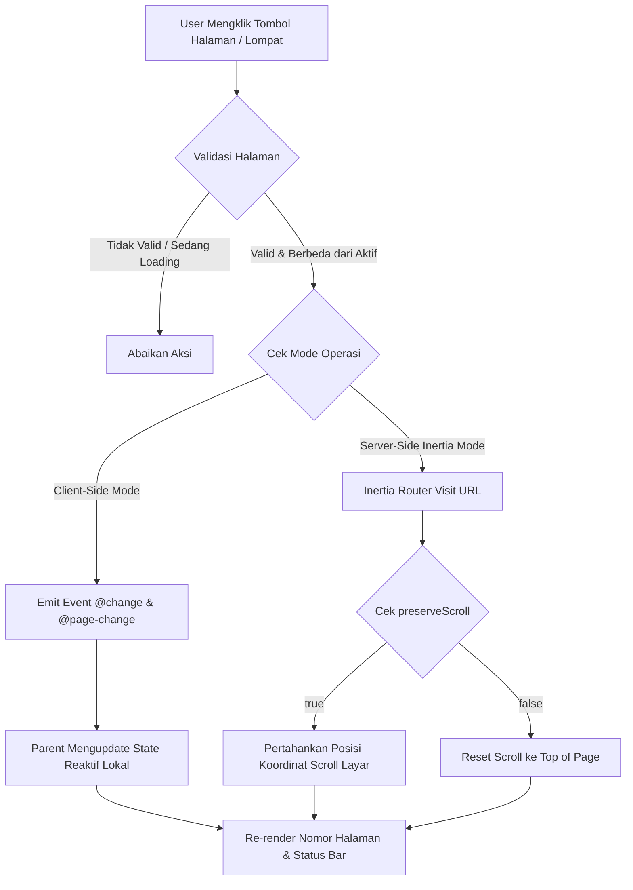

# Pagination Component

Komponen navigasi penomoran halaman (*pagination controls*) berbasis Vue 3 dan Tailwind CSS yang dirancang untuk kompatibilitas penuh dengan objek `LengthAwarePaginator` Laravel Inertia maupun pengoperasian *client-side* mandiri. Dilengkapi 5 tipe navigasi fleksibel, windowing nomor halaman kustom (*boundary* & *sibling* count), ringkasan data berbasis token teks dinamis bebas tabrakan (*zero-collision single-pass regex*), selektor batas data per halaman terintegrasi dengan input angka langsung, kotak lompat halaman (*jump-to-page*) segmented, serta preservasi posisi scroll Inertia.

---

## 01. Overview

`Pagination.vue` menyediakan antarmuka navigasi multi-halaman berkinerja tinggi yang fleksibel, adaptif, dan memenuhi standar aksesibilitas antarmuka pengguna modern.

### 1.1 Apa Entitas Ini
Komponen Vue 3 Composition API (`packages/laravel-pack-ui/resources/js/Components/Pack/Pagination.vue`) dan fasad pembungkusnya (`PaginationComponent.vue`) yang bertindak sebagai pengontrol navigasi data tabular maupun kartu katalog. Komponen ini dapat beroperasi dalam dua mode: **Server-Side Driven** (berkomunikasi mulus dengan router Laravel Inertia.js) atau **Client-Side Driven** (berbasis *event-driven reactivity* `@change`).

### 1.2 Fungsi Utama
- **5 Tipe Navigasi Fleksibel (`navType`)**:
  - `full`: Navigasi standar lengkap (tombol panah, prev/next dengan teks, dan deretan nomor halaman).
  - `arrows-only`: Navigasi super minimalis hanya berupa ikon panah (`< | >` atau `<< < > >>`), sangat pas untuk toolbar sempit atau panel atas tabel.
  - `prev-next-only`: Hanya tombol "Sebelumnya" dan "Selanjutnya", sangat ideal untuk pagination cursor-based, artikel blog, atau timeline log.
  - `numbers-only`: Hanya deretan nomor halaman tanpa tombol prev/next teks.
  - `simple`: Mode ringkas dengan kapsul indikator halaman dan mikro *progress bar* visual interaktif.
- **Windowing Nomor Halaman Kustom (`boundaryCount` & `siblingCount`)**:
  - `boundaryCount`: Menentukan kuantitas angka halaman yang muncul di ujung awal (`1..`) dan ujung akhir (`..N`).
  - `siblingCount`: Menentukan kuantitas angka halaman yang mendampingi di sisi kiri dan kanan halaman aktif.
  - Penyisipan separator elipsis (`...`) secara proporsional dan non-interaktif.
- **Ringkasan Data Dinamis Bebas Tabrakan (`infoText`)**:
  - Mendukung template string token bebas seperti `"Menampilkan :from-:to dari :total :item"` atau `"Halaman :page dari :pages (:total data)"`.
  - Menggunakan *single-pass atomic regex* yang aman tanpa risiko *substring collision* antara `:to` dan `:total` atau `:page` dan `:pages`.
- **Kustomisasi Label Objek Data (`itemName` / `item`)**:
  - Memungkinkan pengembang mengubah sebutan entitas data (misalnya: *Transaksi*, *Produk*, *Pengguna*, *Faktur*, dll) yang otomatis disisipkan ke token `:item`.
- **Selektor Batas Per-Page Bebas (`allowCustomPerPage`)**:
  - Pilihan opsi baris per halaman standar (5, 10, 25, 50, 100) ditambah kemampuan input angka bebas secara instan.
- **Segmented Jump-to-Page Box (`showJumpPage`)**:
  - Kotak kapsul modern terintegrasi dengan validasi angka halaman dan tombol aksi submit.
- **Kunci Posisi Scroll Layar (`preserveScroll`)**:
  - Mencegah layar melompat ke atas (*top of page*) saat navigasi halaman di aplikasi Laravel Inertia.js.

### 1.3 Kapan Digunakan
- Sebagai footer pengendali pada tabel data tabular perusahaan (`TableComponent`).
- Pada etalase produk e-commerce atau galeri portofolio kartu multi-halaman.
- Pada daftar histori transaksi finansial, log audit sistem, atau kotak masuk pesan.
- Pada tampilan seluler yang membutuhkan navigasi ringkas (*one-hand friendly*).

### 1.4 Karakteristik Penting
- **Inertia.js Native & Client-Side Dual Mode**: Secara otomatis mendeteksi apakah objek data berupa paginator Laravel dengan URL tautan bawaan, atau array reaktif yang dikontrol lewat emit event.
- **Zero Collision Token Engine**: Parsing template string `:total`, `:to`, `:from`, `:pages`, `:page`, `:item` dievaluasi dalam satu lintasan regex dengan batas kata (*word boundary*), menjamin token tidak saling menimpa.
- **Anti-Wrap Responsive Engine**: Tata letak cerdas yang memisahkan baris tombol dan info bar secara proporsional di smartphone tanpa membuat tombol penomoran terpotong atau pecah baris (*anti-overflow*).

---

## 02. Preview

> [!TIP]
> Pengujian visual dan showcase interaktif entitas ini tersedia secara native pada portal pratinjau aplikasi:
>
> <a href="/preview/pagination" target="_self" style="display: inline-flex; align-items: center; gap: 6px; padding: 6px 14px; border-radius: 8px; font-weight: 600; text-decoration: none; margin-top: 8px; background-color: var(--vp-c-brand-1, #4f46e5); color: #ffffff;">Buka Live Preview Komponen Pagination &rarr;</a>

---

## 03. Usage

### Pohon Konsep Penggunaan

```text
Pagination
├── Tipe Navigasi (navType)
│   ├── Lengkap (navType="full")
│   ├── Hanya Panah (navType="arrows-only")
│   ├── Hanya Sebelumnya/Selanjutnya (navType="prev-next-only")
│   ├── Hanya Nomor Halaman (navType="numbers-only")
│   └── Mode Simple / Progress (navType="simple" atau simple="true")
├── Windowing Nomor Halaman
│   ├── Angka Awal & Akhir (boundaryCount=1 / 2)
│   └── Angka Sekitar Aktif (siblingCount=1 / 2)
├── Kustomisasi Ringkasan Teks (infoText)
│   ├── Format: "Menampilkan :from-:to dari :total :item"
│   └── Label Objek Data: :item via prop item / itemName
├── Varian Bentuk (variant)
│   ├── Tombol Terpisah (variant="default")
│   ├── Segmented Group (variant="joined")
│   ├── Kapsul Bulat (variant="pills")
│   ├── Ghost Minimalis (variant="flat")
│   └── Kartu Berbingkai (variant="card")
└── Fitur Kontrol Lanjutan
    ├── Batas Per-Page Dropdown + Input Bebas (allow-custom-per-page)
    ├── Input Lompat Halaman Segmented (show-jump-page)
    └── Kunci Posisi Scroll Inertia (preserve-scroll="true")
```

### Matriks Kapan Digunakan vs Dihindari

| Kasus Penggunaan | Gunakan Pagination | Hindari (Gunakan Alternatif) |
|---|---|---|
| Tabel data enterprise dengan ratusan record | Ya (`navType="full"` + `showPerPage`) | Jangan muat semua data sekaligus tanpa paginasi |
| Toolbar sempit atau panel atas tabel | Ya (`navType="arrows-only"`) | Hindari tombol angka panjang yang berisiko wrap |
| Feed berita tak terbatas (*infinite scroll*) | Tidak | Gunakan Intersection Observer / Infinite Scroll |
| Artikel blog / dokumentasi berurutan | Ya (`navType="prev-next-only"`) | Hindari penomoran rumit untuk 2-3 halaman bacaan |
| Layar smartphone sempit | Ya (`navType="simple"` atau variant `"pills"`) | Hindari selector per-page yang terlalu lebar |

---

## 04. Anatomy

### Struktur Hierarki Visual

```text
+-----------------------------------------------------------------------------------------+
| [1] Info & Limit Bar (Kiri / Bawah di Mobile):                                          |
| Menampilkan 31 - 35 dari 142 Transaksi   | Batas: [ 10 / hal v ] [Kustom]               |
+-----------------------------------------------------------------------------------------+
| [2] Navigation Controls Bar (Kanan / Atas di Mobile - ANTI-WRAP):                       |
| [|<] [<]  [1] ... [4] [5] (6) [7] [8] ... [29]  [>] [>|]  | Hal: [ 6 ] [->]             |
+-----------------------------------------------------------------------------------------+
```

### Diagram Alur Reaktivitas Paginasi



---

## 05. Variants

| Varian | Karakter Desain | Skenario Penggunaan |
| :--- | :--- | :--- |
| `default` | Tombol individual terpisah dengan batas halus dan elevasi 2xs | **Bawaan**. Pilihan universal untuk segala jenis tabel dasbor aplikasi. |
| `joined` | Tombol-tombol menyatu menjadi satu baris segmen tunggal (*segmented control*) | Tampilan modern yang padat, cocok untuk toolbar atau header tabel. |
| `pills` | Tombol berbentuk kapsul bulat penuh (`rounded-full`) dengan aksen glow | Sangat ideal untuk aplikasi kasual, mobile-first, atau katalog kartu. |
| `flat` | Tombol minimalis (*ghost*) tanpa border default, hanya hover background | Memberikan kesan bersih pada halaman yang sudah padat elemen visual. |
| `card` | Seluruh bilah paginasi dibungkus di dalam kartu latar boks terpadu | Ditempatkan langsung sebagai footer tabel data atau kontainer mandiri. |

---

## 06. Sizes

Skala dimensi ukuran kontrol navigasi diatur melalui prop `size`:

| Ukuran (`size`) | Dimensi Tombol Navigasi | Ukuran Font Teks / Ikon | Padding Dropdown / Jump Box | Rekomendasi Kasus |
| :--- | :--- | :--- | :--- | :--- |
| `sm` | `h-7 min-w-7` (28px) | `text-xs` / `16px` | `px-2 py-1 text-xs` | Toolbar sempit, modal dialog, atau sidebar |
| `md` | `h-8.5 min-w-8.5` (34px) | `text-xs font-semibold` / `18px` | `px-2.5 py-1.5 text-xs` | **Default**. Standar tabel dasbor enterprise |
| `lg` | `h-10 min-w-10` (40px) | `text-sm font-bold` / `20px` | `px-3 py-2 text-sm` | Landing page, etalase katalog produk touch-friendly |

---

## 07. States

| Status (State) | Tampilan Visual | Perilaku Interaktif |
| :--- | :--- | :--- |
| `default` | Background putih/slate gelap dengan border halus | Siap menerima interaksi klik pengguna |
| `hover` | Background berubah halus (`bg-slate-100 dark:bg-slate-800`), skala mikro | Memberi isyarat bahwa tombol dapat diklik |
| `active` (Selected Page) | Background berwarna solid sesuai tema (`colorTheme`), teks kontras tinggi, elevasi shadow | Menandakan nomor halaman yang sedang aktif dibuka |
| `disabled` (Boundary Limit) | Teks redup (`opacity-40`), kursor `cursor-not-allowed`, event klik diblokir | Muncul pada tombol Prev di halaman 1, atau Next di halaman akhir |
| `loading` | Indikator spinner berputar mikro pada tombol lompat/per-page, interaksi dicegah | Menjaga kestabilan sistem saat request data sedang berlangsung |

---

## 08. Props / Parameters / Attributes

| Nama Prop | Tipe Data | Nilai Bawaan | Opsi / Rentang | Deskripsi |
| :--- | :--- | :--- | :--- | :--- |
| `data` | `Object` | `{}` | Paginator Object | Objek paginator bawaan Laravel (`current_page`, `last_page`, `from`, `to`, `total`, `links`). |
| `path` | `String` | `''` | URL String | URL dasar kustom untuk navigasi halaman jika tidak menggunakan links dari data paginator. |
| `navType` | `String` | `'full'` | `'full'`, `'arrows-only'`, `'prev-next-only'`, `'numbers-only'`, `'simple'` | Mode tipe elemen kontrol navigasi yang dirender. |
| `boundaryCount` | `Number` | `1` | `0` s/d `5` | Jumlah nomor halaman yang ditampilkan di ujung awal (1..) dan ujung akhir (..N). |
| `siblingCount` | `Number` | `1` | `0` s/d `5` | Jumlah nomor halaman di sisi kiri dan kanan nomor halaman aktif saat ini. |
| `infoText` | `String` | `''` | Template String | Template kustom ringkasan info (misal: `"Menampilkan :from-:to dari :total :item"`). |
| `itemName` | `String` | `'Data'` | Teks bebas | Nama entitas data yang disisipkan pada token `:item`. |
| `item` | `String` | `''` | Teks bebas | Alias singkat untuk `itemName` (misal: `:item="'Produk'"`). |
| `showingText` | `String` | `'Menampilkan'` | Teks bebas | Kata awalan pada kalimat info ringkasan bawaan. |
| `toSeparator` | `String` | `'-'` | Teks bebas | Tanda pemisah antara angka `from` dan `to`. |
| `ofText` | `String` | `'dari'` | Teks bebas | Kata penghubung sebelum angka `total`. |
| `showInfo` | `Boolean` | `true` | `true`, `false` | Menampilkan kalimat ringkasan jumlah data di sisi kiri/bawah. |
| `simple` | `Boolean` | `false` | `true`, `false` | Mengaktifkan mode ringkas (setara `navType="simple"`). |
| `clientSide` | `Boolean` | `false` | `true`, `false` | Mode client-side yang memancarkan event `@change` alih-alih navigasi Inertia visit URL. |
| `preserveScroll` | `Boolean` | `true` | `true`, `false` | Mempertahankan posisi scroll layar saat navigasi Inertia.js. |
| `preserveState` | `Boolean` | `true` | `true`, `false` | Mempertahankan state komponen Vue saat navigasi Inertia.js. |
| `colorTheme` | `String` | `'primary'` | `'primary'`, `'indigo'`, `'emerald'`, `'purple'`, `'amber'`, `'rose'`, `'cyan'`, `'dark'` | Aksen warna tombol halaman yang sedang aktif. |
| `variant` | `String` | `'default'` | `'default'`, `'joined'`, `'pills'`, `'flat'`, `'card'` | Gaya bentuk visual tombol-tombol penomoran. |
| `radius` | `String` | `'xl'` | `'none'`, `'sm'`, `'md'`, `'lg'`, `'xl'`, `'2xl'`, `'3xl'`, `'full'` | Kelengkungan sudut tombol pagination. |
| `size` | `String` | `'md'` | `'sm'`, `'md'`, `'lg'` | Skala dimensi ukuran tombol dan teks. |
| `showButtonText` | `Boolean` | `true` | `true`, `false` | Menampilkan label teks pada tombol Sebelumnya dan Selanjutnya. |
| `prevText` | `String` | `'Sebelumnya'` | Teks bebas | Teks label tombol Sebelumnya. |
| `nextText` | `String` | `'Selanjutnya'` | Teks bebas | Teks label tombol Selanjutnya. |
| `firstText` | `String` | `'Awal'` | Teks bebas | Teks label aksesibilitas tombol halaman Awal. |
| `lastText` | `String` | `'Akhir'` | Teks bebas | Teks label aksesibilitas tombol halaman Akhir. |
| `showFirstLast` | `Boolean` | `false` | `true`, `false` | Menampilkan tombol navigasi loncat langsung ke halaman Awal dan Akhir. |
| `prevIcon` | `String` | `'chevron_left'` | Material Symbol | Ikon tombol Sebelumnya. |
| `nextIcon` | `String` | `'chevron_right'` | Material Symbol | Ikon tombol Selanjutnya. |
| `firstIcon` | `String` | `'first_page'` | Material Symbol | Ikon tombol Awal. |
| `lastIcon` | `String` | `'last_page'` | Material Symbol | Ikon tombol Akhir. |
| `showPerPage` | `Boolean` | `false` | `true`, `false` | Menampilkan selector kapasitas baris per halaman. |
| `allowCustomPerPage` | `Boolean` | `true` | `true`, `false` | Menyediakan tombol toggle untuk memasukkan angka kapasitas baris bebas langsung. |
| `perPage` | `Number` | `10` | Angka positif | Nilai kapasitas baris per halaman saat ini. |
| `perPageOptions` | `Array` | `[5, 10, 25, 50, 100]` | Array angka | Daftar opsi pilihan kapasitas baris per halaman pada dropdown. |
| `showJumpPage` | `Boolean` | `false` | `true`, `false` | Menampilkan kotak input segmented untuk langsung lompat ke halaman tertentu. |
| `showJump` | `Boolean` | `false` | `true`, `false` | Alias untuk `showJumpPage`. |
| `jumpPlaceholder` | `String` | `'#'` | Teks bebas | Teks placeholder pada kotak input lompat halaman. |
| `jumpButtonText` | `String` | `'Go'` | Teks bebas | Label teks tombol submit lompat halaman. |
| `align` | `String` | `'between'` | `'between'`, `'center'`, `'start'`, `'end'` | Penataan tata letak kontainer paginasi. |
| `loading` | `Boolean` | `false` | `true`, `false` | Menampilkan status pemuatan saat pergantian halaman untuk mencegah klik ganda. |

---

## 09. Slots / Content

| Nama Slot | Lingkup Parameter (*Scoped Props*) | Deskripsi Penggunaan |
| :--- | :--- | :--- |
| `#info` | `{ from, to, total, itemName, currentPage, lastPage, formatted }` | Kustomisasi total tampilan ringkasan kalimat data di sisi kiri. |
| `#per-page` | `{ perPage, options, loading }` | Kustomisasi antarmuka pemilih kapasitas baris per halaman. |
| `#jump` | `{ currentPage, lastPage, handleJump }` | Kustomisasi tampilan kotak input lompat ke halaman tertentu. |

---

## 10. Events / Interactions / Returns

| Nama Event | Parameter Emitted | Waktu Pemicuan (Trigger Lifecycle) |
| :--- | :--- | :--- |
| `@change` | `(page: Number)` | Dipancarkan saat pengguna memilih halaman baru dalam mode `clientSide`. |
| `@page-change` | `(page: Number)` | Alias resmi untuk event pergantian halaman. |
| `@update:perPage` | `(perPage: Number)` | Dipancarkan saat kapasitas baris per halaman diubah (dropdown maupun input bebas). |
| `@per-page-change` | `(perPage: Number)` | Alias resmi untuk event pergantian kapasitas baris per halaman. |

### 10.1 Exposed Methods / Properties (Template Ref)

Komponen mengekspos API publik melalui `defineExpose` untuk kontrol interaktif via `ref`:

| Nama Method / Property | Tipe | Deskripsi |
| :--- | :--- | :--- |
| `currentPage` | `ComputedRef<Number>` | Nomor halaman yang sedang aktif saat ini. |
| `lastPage` | `ComputedRef<Number>` | Nomor halaman terakhir (total halaman). |
| `totalItems` | `ComputedRef<Number>` | Total keseluruhan item data yang dipaginasi. |
| `handlePageClick(page: Number)` | `Function` | Fungsi programatik untuk berpindah ke nomor halaman tertentu. |
| `handleJump()` | `Function` | Fungsi untuk mengeksekusi lompatan sesuai nilai input lompat halaman. |
| `handlePerPageChange(val: Number)` | `Function` | Fungsi untuk mengubah kapasitas batas baris per halaman. |

---

## 11. Code Example

### Contoh 1: Penggunaan Standar Laravel Inertia (Server-Side Driven)

```vue
<script setup>
import { Pagination } from '@/Components/Pack/PaginationComponent.vue';

defineProps({
    // Objek paginasi hasil dari Model::paginate(10) di Laravel Controller
    orders: Object,
});
</script>

<template>
    <div class="space-y-4">
        <!-- Render Tabel Pesanan -->
        <Pagination
            :data="orders"
            item="Pesanan"
            show-per-page
            allow-custom-per-page
            show-jump-page
            show-first-last
            color-theme="indigo"
            :preserve-scroll="true"
        />
    </div>
</template>
```

### Contoh 2: Tipe Navigasi Minimalis (Arrows Only & Prev-Next Only)

```vue
<!-- Hanya Panah untuk Toolbar Header Tabel -->
<Pagination
    :data="tablePaginator"
    :client-side="true"
    nav-type="arrows-only"
    size="sm"
    variant="flat"
    @change="fetchPage"
/>

<!-- Hanya Teks Sebelumnya & Selanjutnya untuk Halaman Artikel -->
<Pagination
    :data="articlePaginator"
    :client-side="true"
    nav-type="prev-next-only"
    variant="pills"
    @change="fetchPage"
/>
```

---

## 12. Result / Behavior

- **Perhitungan Windowing Cerdas**: Nomor halaman dikalkulasi secara reaktif berdasarkan formula `boundaryCount` dan `siblingCount`. Jika total halaman melebihi rentang yang dapat dirender, simbol elipsis `...` otomatis disisipkan tanpa menyebabkan tombol bergeser liar.
- **Single-Pass Token Replacement**: Format teks kustom pada `infoText` dievaluasi menggunakan pemetaan ekspresi reguler `/:(total|to|from|pages|page|item)\b/g`. Kata `:total` tidak akan pernah terpotong oleh `:to`, dan `:pages` tidak akan pernah terpotong oleh `:page`.
- **Keyboard Enter pada Jump Box**: Pengguna dapat mengetik nomor halaman lalu menekan tombol `Enter` pada keyboard untuk berpindah seketika tanpa harus menyentuh mouse.

---

## 13. Customization

### Template Ringkasan Kustom dengan Ekstensi Token Bebas

```vue
<Pagination
    :data="paginatorData"
    :client-side="true"
    item="Invoice Mitra"
    info-text="Data ke :from sampai :to (Total :total :item) - Hal :page/:pages"
/>
```

### Kustomisasi Total Elemen Info Menggunakan Slot

```vue
<Pagination :data="paginatorData" :client-side="true">
    <template #info="{ from, to, total, itemName }">
        <div class="flex items-center gap-2 text-xs text-indigo-600 dark:text-indigo-400 font-medium">
            <span class="w-2 h-2 rounded-full bg-emerald-500 animate-pulse"></span>
            Menyajikan record {{ from }} - {{ to }} dari total {{ total }} {{ itemName }} terverifikasi.
        </div>
    </template>
</Pagination>
```

---

## 14. Accessibility (a11y)

- **Semantic Navigation Landmark**: Elemen utama dibungkus dalam tag `<nav role="navigation" aria-label="Pagination">`.
- **Indikator Halaman Aktif**: Tombol nomor halaman yang sedang terbuka disematkan atribut `aria-current="page"`.
- **Tombol Boundary Non-Aktif**: Tombol panah awal/akhir saat berada di batas ekstrem memiliki atribut `aria-disabled="true"` dan `tabindex="-1"`.
- **Dukungan Keyboard Penuh**: Semua tombol dapat dijelajahi menggunakan tombol `Tab` dan dieksekusi dengan tombol `Enter` atau `Space`.
- **Simbol Elipsis Non-Interaktif**: Pemisah elipsis `...` ditandai dengan `aria-hidden="true"` agar tidak membingungkan pembaca layar (*screen reader*).

---

## 15. Responsive Behavior

- **Mobile Phone (< 640px)**:
  - Tata letak beralih vertikal elegan (`flex-col items-center gap-3`).
  - Baris tombol navigasi diposisikan di atas (`order-1`) dengan penanganan *anti-wrap*. Teks tombol panjang ("Sebelumnya" / "Selanjutnya") otomatis disingkat menjadi ikon panah intuitif (`hidden sm:inline`).
  - Bilah info data dan dropdown batas halaman tersusun rapi di bagian bawah (`order-2`).
- **Tablet (640px - 1023px)**:
  - Teks label tombol tampil utuh, kotak lompat halaman berpadu simetris.
- **Desktop (>= 1024px)**:
  - Tersusun dalam 1 baris horizontal penuh yang lega (`lg:flex-row items-center justify-between`).

---

## 16. Do / Don't

| Rekomendasi (Do) | Pantangan (Don't) |
|---|---|
| Biarkan `preserveScroll` tetap bernilai `true` (default) pada aplikasi Laravel Inertia agar layar tidak melompat ke atas. | Jangan matikan `preserveScroll` jika tabel berada di bagian tengah atau bawah halaman. |
| Gunakan `navType="arrows-only"` jika ruang horizontal sangat terbatas (seperti pada sub-toolbar atau modal). | Jangan memaksakan `navType="full"` dengan `boundaryCount="3"` pada layar ponsel sempit. |
| Berikan label entitas data yang jelas lewat prop `item` (misal: "Produk", "Pelanggan", "Faktur"). | Jangan biarkan teks ringkasan ambigu dengan membiarkan default tanpa konteks yang sesuai. |
| Pasang `loading="true"` saat parent sedang melakukan fetch data asinkron agar tidak terjadi klik ganda. | Jangan biarkan pengguna mengklik tombol nomor berkali-kali saat request sebelumnya belum selesai. |

---

## 17. Examples / Recipes

### Recipe 1: Paginasi Tabel Dasbor Enterprise
```vue
<Pagination
    :data="transactions"
    item="Transaksi"
    variant="card"
    color-theme="indigo"
    show-per-page
    allow-custom-per-page
    show-jump-page
    show-first-last
    :per-page-options="[10, 25, 50, 100]"
    :preserve-scroll="true"
/>
```

### Recipe 2: Paginasi Miniatur Mode Simple untuk Sidebar
```vue
<Pagination
    :data="sidebarNotes"
    simple
    color-theme="emerald"
    size="sm"
    :client-side="true"
    @change="loadNotesPage"
/>
```

---

## 18. Related Components

- **[TableComponent](file:///c:/SPEED/LARAVEL-PACK-UI/packages/laravel-pack-ui/doc/components/table.md)**: Komponen tabel data utama yang secara native mengintegrasikan `Pagination` pada slot footernya.
- **[ButtonSubmit](file:///c:/SPEED/LARAVEL-PACK-UI/packages/laravel-pack-ui/doc/components/button-submit.md)**: Komponen tombol serbaguna yang digunakan sebagai kontrol aksi dan navigasi.
- **[Card](file:///c:/SPEED/LARAVEL-PACK-UI/packages/laravel-pack-ui/doc/components/card.md)**: Kontainer kartu pembungkus tampilan dashboard dan galeri varian.
- **[Badge](file:///c:/SPEED/LARAVEL-PACK-UI/packages/laravel-pack-ui/doc/components/badge.md)**: Komponen lencana untuk indikator status halaman dan kuantitas total data.

---

## 19. Notes / Limitations

- **Edukasi Kunci Posisi Scroll (`preserveScroll`)**:
  Pada aplikasi SPA Laravel Inertia.js, perilaku bawaan router browser adalah mereset posisi pandang ke puncak halaman (`scrollTop = 0`). Fitur `preserveScroll` pada komponen ini secara otomatis menginjeksi opsi `{ preserveScroll: true }` ke setiap panggilan router Inertia sehingga fokus pengguna tetap berada tepat di area tabel data.
- **Paginator Kosong (0 Record)**:
  Bila objek `data.total === 0`, komponen secara otomatis menampilkan info `Menampilkan 0 - 0 dari 0 Data` dan menonaktifkan seluruh tombol navigasi tanpa melempar galat runtime JavaScript.
- **Sinkronisasi Query URL Parameter**:
  Pada mode Inertia server-side, pemilihan `perPage` kustom atau perpindahan halaman menyinkronkan parameter query URL browser (misal `?page=2&per_page=25`) secara otomatis.
