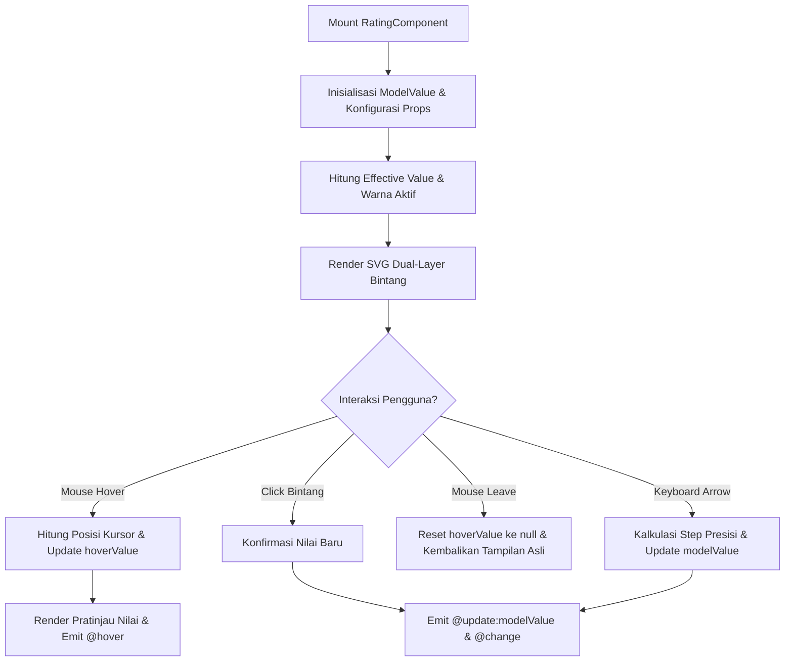

# Rating Component

Komponen penilaian bintang (*star rating*) interaktif berbasis Vue 3 dan Tailwind CSS yang mendukung presisi pecahan desimal (*fractional precision* 0.1, 0.5, 1.0, dan 'any'), umpan balik *hover* instan, kustomisasi warna penuh (HEX, Tailwind, hingga ambang batas multi-warna dinamis), format teks nilai & lokalisasi multi-bahasa (`id`, `en`, `es`, `fr`), serta integrasi formulir dua arah (`v-model`).

---

## 01. Overview

`Rating` (dan fasad resminya `RatingComponent`) dirancang untuk menyajikan evaluasi visual berbasis bintang, hati, atau ikon vektor kustom yang intuitif bagi antarmuka e-commerce, ulasan kepuasan pelanggan (CSAT/NPS), dan matriks penilaian performa karyawan:

- **Presisi Pecahan Tanpa Batas**: Mendukung pembagian nilai bulat (`1`), setengah bintang (`0.5`), desimal presisi tinggi (`0.1`), hingga kalkulasi kontinu halus (`'any'`) menggunakan teknik *SVG clipping mask*.
- **Kustomisasi Warna Penuh**: Mendukung palet tema bawaan (`amber`, `yellow`, `emerald`, `indigo`, `rose`, `purple`, `cyan`, `dark`), kode warna HEX kustom (`activeColor`, `inactiveColor`), hingga spektrum ambang batas multi-warna dinamis (`colors`) yang bertransisi otomatis dari 1★ merah ke 5★ hijau emerald.
- **Lokalisasi Bahasa & Teks Sentimen**: Mendukung lokalisasi bawaan (`locale="id" | "en" | "es" | "fr"`) dengan kamus sentimen terintegrasi, format label jumlah ulasan yang sesuai bahasa (`ulasan`, `reviews`, `reseñas`, `avis`), serta kustomisasi deskripsi berbasis Array, Object, maupun callback fungsi rumus `(val, max) => string`.
- **Kustomisasi Format Angka (`formatter`)**: Fleksibilitas penuh merombak tampilan teks numerik (misal: "4.5 / 5.0", "90%", atau "4.5 / 5 Poin Prestasi").
- **Aksesibilitas Penuh WAI-ARIA**: Mengimplementasikan `role="slider"` dengan atribut `aria-valuenow`, `aria-valuemin`, `aria-valuemax`, dan dukungan navigasi keyboard lengkap (`ArrowLeft`, `ArrowRight`, `ArrowUp`, `ArrowDown`, `Home`, `End`).
- **Integrasi Formulir Semantik**: Dilengkapi label, teks petunjuk (*hint*), pesan validasi kesalahan (*error*), dan status wajib isi (*required*).

### 1.1 Apa Entitas Ini

**Vue Component** (Single File Component) yang berlokasi di [Rating.vue](file:///c:/SPEED/LARAVEL-PACK-UI/resources/js/Components/Pack/Rating.vue) dan diekspos melalui fasad [RatingComponent.vue](file:///c:/SPEED/LARAVEL-PACK-UI/resources/js/Components/Pack/RatingComponent.vue). Komponen ini merender barisan ikon SVG vektor dengan lapisan ganda (*base background* dan *fractional fill foreground*) yang dihitung dinamis berdasarkan nilai numerik `modelValue`.

### 1.2 Fungsi Utama

- Mengumpulkan umpan balik skor kepuasan dari pengguna secara terukur, presisi, dan visual.
- Menampilkan rata-rata skor ulasan produk pada kartu katalog dalam mode *readonly*.
- Menyediakan pemetaan teks deskriptif otomatis berdasarkan rentang nilai kepuasan dalam berbagai bahasa global.
- Memungkinkan pengosongan nilai (*clearable*) saat bintang yang sedang aktif diklik kembali.
- Menyesuaikan warna bintang secara otomatis berdasarkan rentang nilai kepuasan (CSAT indicator).

### 1.3 Kapan Digunakan

- Formulir ulasan dan testimoni produk pada aplikasi e-commerce dan marketplace global.
- Survei kepuasan pelanggan berkala (CSAT, NPS, atau Customer Effort Score).
- Matriks evaluasi kinerja karyawan pada modul manajemen SDM / HR KPI.
- Kartu katalog produk, artikel ilmiah, atau konten media yang memiliki skor kurasi.

### 1.4 Karakteristik Penting

- **Double-Layer Icon Rendering**: Menggunakan tumpukan dua lapisan ikon identik; lapisan bawah berfungsi sebagai penampung kosong (*inactive*) dan lapisan atas dengan lebar *clip-path* persentase menampilkan warna aksen aktif.
- **Dynamic Threshold Color Spectrum**: Menerima objek atau array warna untuk memberikan warna bintang yang berbeda secara adaptif sesuai tingkat kepuasan pengguna.
- **Descriptive & Locale Intelligence**: Mampu menyajikan label sentimen yang relevan secara otomatis berdasarkan bahasa aplikasi yang aktif.

---

## 02. Preview

> [!TIP]
> Pengujian visual interaktif, playground konfigurasi props, dan showcase skenario produksi tersedia pada rute demo native:
>
> <a href="/demo/rating" target="_self" style="display: inline-flex; align-items: center; gap: 6px; padding: 6px 14px; border-radius: 8px; font-weight: 600; text-decoration: none; margin-top: 8px; background-color: var(--vp-c-brand-1, #4f46e5); color: #ffffff;">Buka Live Demo Komponen Rating &rarr;</a>

---

## 03. Usage

### Pohon Konsep Penggunaan

```text
Rating / RatingComponent
├── Mode Input Formulir Interaktif
│   ├── Presisi Bulat (precision="1")
│   ├── Presisi Setengah (precision="0.5")
│   ├── Presisi Desimal (precision="0.1")
│   └── Presisi Kontinu (precision="'any'")
├── Mode Tampilan Statis (Readonly)
│   ├── Katalog Produk Ringkas (size="sm", readonly)
│   └── Ringkasan Akumulasi Ulasan (count="1420", showValue)
├── Kustomisasi Warna
│   ├── Palet Tema Bawaan (color-theme="amber | emerald | indigo | rose")
│   ├── Kode Warna Heksadesimal (active-color="#059669")
│   └── Ambang Batas Multi-Warna Dinamis (:colors="['#ef4444', ..., '#10b981']")
└── Format Teks & Lokalisasi
    ├── Multi-bahasa Terintegrasi (locale="en | id | es | fr")
    ├── Pemetaan Sentimen Deskriptif (Array, Object, Function)
    └── Kustomisasi Formatter Nilai (:formatter="(val, max) => string")
```

### Kapan Digunakan vs Kapan Dihindari

| Skenario Kebutuhan | Gunakan `Rating` | Gunakan Alternatif Lain |
| :--- | :--- | :--- |
| Mengumpulkan skor kepuasan ulasan pelanggan (1 hingga 5 atau 10 bintang) | Ya | — |
| Menampilkan skor rata-rata produk dengan pecahan desimal pada katalog e-commerce | Ya (`readonly`, `precision="0.1"`) | — |
| Input nilai numerik murni tanpa representasi visual bintang (misal: jumlah stok, harga) | Tidak | Gunakan `InputField` tipe number |
| Pemilihan kategori biner ya/tidak atau setuju/tidak setuju | Tidak | Gunakan `Checkbox` atau `Toggle` |
| Pilihan rentang angka linier persentase 0-100% tanpa simbol bintang | Tidak | Gunakan `SliderComponent` atau `ProgressBar` |

### Alur Kerja Konseptual

```text
Inisialisasi Props -> Hitung Effective Value (modelValue vs hoverValue) ->
Tentukan Warna Aktif (colorTheme / activeColor / colors spectrum) ->
Render SVG Layers (Inactive Base + Foreground Percentage Clip-Path) ->
Format Output Teks (locale / descriptiveTexts / formatter) ->
Emit Events (@update:modelValue / @change / @hover)
```

### Sintaks Dasar Single File Component

```vue
<script setup>
import { ref } from 'vue';
import RatingComponent from '@/Components/Pack/RatingComponent.vue';

const productScore = ref(4.5);

function onRatingChange(val) {
    console.log('Skor ulasan dikonfirmasi:', val);
}
</script>

<template>
    <RatingComponent
        v-model="productScore"
        :max="5"
        :precision="0.5"
        color-theme="amber"
        variant="card"
        radius="xl"
        size="md"
        label="Beri Nilai Produk Ini"
        hint="Pilih jumlah bintang sesuai kepuasan Anda"
        :show-value="true"
        value-format="fraction"
        :show-descriptive="true"
        locale="id"
        :count="128"
        @change="onRatingChange"
    />
</template>
```

---

## 04. Anatomy

Struktur visual dan arsitektur hierarki `Rating` tersusun dari blok-blok pembangun berikut:

```text
+-------------------------------------------------------------------------+
| [1] Field Label & Wajib Isi (label="Kualitas Layanan" *)                |
|                                                                         |
| +---------------------------------------------------------------------+ |
| | [2] Interactive Stars Row Container (role="slider")                 | |
| |   [*]       [*]       [*]       [*]       [o]                        | |
| |  Layer 1: Inactive Base SVG Icon (custom inactiveColor / slate-200)  | |
| |  Layer 2: Colored Clip Foreground SVG (Width: 0% - 100% per star)   | |
| +---------------------------------------------------------------------+ |
|                                                                         |
| [3] Numeric Score Badge   [4] Descriptive Tag    [5] Review Count Badge |
|      "4.5 / 5.0"              "Sangat Puas"          "(128 ulasan)"     |
|                                                                         |
| [6] Hint Text / Error Message ("Klik untuk memperbarui nilai")          |
+-------------------------------------------------------------------------+
```

### Diagram Alur Reaktivitas Mermaid



### Rincian Bagian Anatomi

1. **Field Label**: Teks judul formulir di atas komponen dengan indikator bintang merah jika prop `required` bernilai `true`.
2. **Interactive Stars Row Container**: Jalur barisan ikon bintang yang menerima interaksi kursor mouse (*hover*, *click*) atau sentuhan jari.
3. **Numeric Score Badge**: Elemen tipografi pendamping yang menampilkan angka numerik skor saat ini berdasarkan prop `valueFormat` atau `formatter`.
4. **Descriptive Tag**: Label sentimen otomatis yang mencerminkan derajat kepuasan pengguna (contoh: "Sangat Buruk", "Cukup", "Sangat Puas") sesuai prop `locale` atau `descriptiveTexts`.
5. **Review Count Badge**: Teks jumlah ulasan pembeli dalam kurung yang memberikan validasi sosial (*social proof*).
6. **Hint / Error Message**: Keterangan panduan di bagian bawah atau pesan kesalahan validasi beraksen merah saat prop `error` terisi.

---

## 05. Variants

Prop `variant` mengatur wadah kontainer pembungkus komponen `Rating`:

| Varian | Karakter Tampilan | Skenario Penggunaan |
| :--- | :--- | :--- |
| `default` | Barisan bintang bersih tanpa bingkai latar belakang | Tabel katalog produk, baris list data padat, atau header ringkasan. |
| `card` | Kartu putih/gelap berbingkai halus dengan padding nyaman | Formulir formulasi ulasan produk, survei kepuasan terisolasi. |
| `pill` | Kontainer kapsul membulat penuh dengan bayangan lembut | Widget evaluasi cepat di panel samping atau laci checkout. |
| `bordered` | Bingkai bergaris batas tegas dengan sudut rounded modern | Antarmuka formulir korporat bergaya minimalis arsitektural. |

---

## 06. Sizes

### Skala Ukuran Ikon (`size`)

| Key | Ukuran Ikon SVG | Ukuran Teks Badge | Padding Touch Target | Penggunaan yang Direkomendasikan |
| :--- | :--- | :--- | :--- | :--- |
| `xs` | `w-3.5 h-3.5` (14px) | `text-[10px]` | Padat ringkas | Badge baris tabel sempit, badge status rating mikro. |
| `sm` | `w-4 h-4` (16px) | `text-xs` | Proporsional | Kartu katalog produk e-commerce grid 4 kolom. |
| `md` | `w-5 h-5` (20px) | `text-xs` | Standar 8px | Standar default input formulir ulasan umum. |
| `lg` | `w-7 h-7` (28px) | `text-sm` | Lega 10px | Modal dialog formulir evaluasi ulasan mandiri. |
| `xl` | `w-9 h-9` (36px) | `text-base` | Sentuh 12px | Survei kepuasan pelanggan layar sentuh / kiosk tablet. |

### Presisi Pecahan (`precision`)

- **`1` / `1.0`**: Nilai bulat. Bintang terisi penuh atau kosong sama sekali.
- **`0.5`**: Pembagian setengah bintang (0, 0.5, 1.0, 1.5, ..., 5.0).
- **`0.1`**: Pecahan desimal halus per sepuluh bagian (contoh: 4.3, 4.7).
- **`any`**: Perhitungan kontinu halus berdasarkan koordinat horizontal kursor di atas ikon.

---

## 07. States

| State | Indikasi Visual | Perilaku Interaktif |
| :--- | :--- | :--- |
| **Idle** | Bintang menampilkan warna terisi sesuai `modelValue` awal; lapisan tidak aktif berwarna abu-abu netral. | Komponen siap menerima interaksi kursor atau fokus keyboard. |
| **Hovering** | Bintang di bawah kursor memancarkan preview warna cerah; teks nilai angka diperbarui sementara. | Menggerakkan kursor mengubah pratinjau sementara tanpa mengubah `modelValue` permanen. |
| **Readonly** | Bintang menampilkan skor statis; kursor berbentuk panah standar (*cursor-default*). | Tidak ada reaksi visual terhadap hover atau klik; nilai tidak dapat diubah oleh pengguna. |
| **Disabled** | Seluruh komponen memudar dengan tingkat opacity 50%; kursor berbentuk tanda dilarang (*not-allowed*). | Seluruh interaksi klik dan keyboard diblokir sepenuhnya; nilai formulir tidak dipancarkan. |
| **Error** | Border kontainer berubah menjadi merah dengan pesan kesalahan di bawah bintang. | Komponen tetap interaktif untuk memungkinkan pengguna memperbaiki penilaian. |

---

## 08. Props / Parameters / Attributes

| Prop | Tipe Data | Nilai Default | Wajib | Deskripsi & Validasi |
| :--- | :--- | :--- | :--- | :--- |
| `modelValue` | `Number` | `0` | Tidak | Nilai skor rating aktif untuk pengikatan data dua arah (`v-model`). Rentang `0` hingga `max`. |
| `max` | `Number` | `5` | Tidak | Jumlah total ikon bintang atau skala skor tertinggi (misal: 5 atau 10). |
| `precision` | `Number \| String` | `0.1` | Tidak | Derajat pecahan perhitungan bintang: `1`, `0.5`, `0.1`, atau `'any'`. |
| `colorTheme` | `String` | `''` | Tidak | Palet tema bawaan: `'amber'`, `'rose'`, `'emerald'`, `'indigo'`, `'purple'`, `'cyan'`, `'dark'`. |
| `color` | `String` | `'amber'` | Tidak | Nama warna preset Tailwind atau kode warna aktif. |
| `activeColor` | `String` | `''` | Tidak | Warna kustom aktif eksplisit (kode HEX `#ff5722`, RGB, atau HSL). |
| `inactiveColor` | `String` | `''` | Tidak | Warna kustom bintang tidak aktif (kode HEX `#e2e8f0` atau class warna). |
| `colors` | `Object \| Array` | `null` | Tidak | Spektrum warna bertingkat dinamis (misal: `{ 1: '#ef4444', 3: '#eab308', 5: '#10b981' }` atau array 5 warna). |
| `variant` | `String` | `'default'` | Tidak | Gaya wadah kontainer: `'default'`, `'card'`, `'pill'`, `'bordered'`. |
| `radius` | `String` | `'xl'` | Tidak | Sudut kelengkungan kontainer: `'none'`, `'sm'`, `'md'`, `'lg'`, `'xl'`, `'2xl'`, `'full'`. |
| `icon` | `String` | `'star'` | Tidak | Nama ikon SVG bintang aktif: `'star'`, `'favorite'`, `'thumb_up'`, dll. |
| `unfilledIcon` | `String` | `''` | Tidak | Nama ikon alternatif untuk lapisan tidak aktif jika berbeda dengan `icon`. |
| `size` | `String` | `'md'` | Tidak | Skala fisik ikon dan tipografi: `'xs'`, `'sm'`, `'md'`, `'lg'`, `'xl'`. |
| `animate` | `Boolean` | `true` | Tidak | Animasi pembesaran lembut (*micro-scale*) saat kursor melayang di atas bintang. |
| `showValue` | `Boolean` | `false` | Tidak | Menampilkan teks numerik skor di samping atau di bawah barisan bintang. |
| `valueFormat` | `String` | `'fraction'` | Tidak | Format teks nilai skor: `'fraction'`, `'single'`, `'percent'`, `'descriptive'`. |
| `valuePosition` | `String` | `'right'` | Tidak | Posisi peletakan teks skor: `'right'` (horizontal) atau `'bottom'` (vertikal). |
| `showDescriptive` | `Boolean` | `false` | Tidak | Menampilkan badge teks sentimen kepuasan (misal: "Sangat Puas"). |
| `locale` | `String` | `'id'` | Tidak | Pilihan bahasa kamus bawaan: `'id'` (Indonesia), `'en'` (Inggris), `'es'` (Spanyol), `'fr'` (Prancis). |
| `descriptiveTexts` | `Object \| Array \| Function` | `null` | Tidak | Kustomisasi teks deskriptif: Objek skor-teks, Array 5 level, atau callback fungsi `(val, max) => string`. |
| `formatter` | `Function` | `null` | Tidak | Kustomisasi fungsi format teks numerik: `(val, max) => string`. |
| `count` | `Number` | `0` | Tidak | Jumlah total ulasan pembeli yang ditampilkan dalam kurung. |
| `countLabel` | `String` | `''` | Tidak | Label teks setelah angka ulasan. Jika kosong, otomatis menyesuaikan dengan `locale` aktif. |
| `label` | `String` | `''` | Tidak | Teks label formulir di atas komponen. |
| `hint` | `String` | `''` | Tidak | Teks petunjuk bantuan di bawah barisan bintang. |
| `error` | `String` | `''` | Tidak | Pesan validasi error yang mengaktifkan status visual kesalahan berbingkai merah. |
| `required` | `Boolean` | `false` | Tidak | Menampilkan indikator tanda bintang merah wajib isi pada label. |
| `responsive` | `Boolean` | `true` | Tidak | Mengaktifkan penataan tata letak responsif otomatis pada layar sempit. |
| `readonly` | `Boolean` | `false` | Tidak | Mengunci komponen dalam mode tampilan statis hanya-baca tanpa pointer hover. |
| `disabled` | `Boolean` | `false` | Tidak | Menonaktifkan seluruh interaksi dan meredupkan opacity menjadi 50%. |
| `clearable` | `Boolean` | `true` | Tidak | Memungkinkan pengosongan nilai ke 0 saat bintang aktif diklik kembali. |
| `allowHover` | `Boolean` | `true` | Tidak | Mengaktifkan pratinjau nilai real-time saat kursor melayang di atas bintang. |
| `id` | `String` | `''` | Tidak | Atribut ID DOM unik untuk elemen slider rating. |

---

## 09. Slots / Content

| Nama Slot | Tipe Slot | Parameter Terbuka (Scoped Props) | Deskripsi |
| :--- | :--- | :--- | :--- |
| `#label` | Scoped | `{ label: String }` | Kustomisasi tampilan elemen label di atas komponen. |
| `#icon` | Scoped | `{ index: Number, value: Number, active: Boolean, half: Boolean, filled: Boolean, icon: String, starFillPercent: Number, previewValue: Number, isHovered: Boolean, activeColor: String, inactiveColor: String, size: String }` | Mengambil alih render bentuk ikon SVG bintang untuk menyematkan ikon kustom atau efek animasi mikro. |
| `#value` | Scoped | `{ value: Number, formatted: String, max: Number }` | Kustomisasi tampilan teks nilai skor numerik. |
| `#descriptive` | Scoped | `{ text: String, value: Number }` | Kustomisasi tampilan lencana teks sentimen kepuasan. |
| `#suffix` | Standard | — | Konten kustom tambahan di sisi kanan deretan bintang dan nilai skor. |
| `#hint` | Scoped | `{ hint: String }` | Kustomisasi teks petunjuk bantuan di bawah barisan bintang. |
| `#error` | Scoped | `{ error: String }` | Kustomisasi pesan validasi kesalahan (*error message*). |

---

## 10. Events / Interactions / Returns

### Event yang Dipancarkan (Emits)

| Nama Event | Payload Tipe | Kondisi Pemicu | Deskripsi |
| :--- | :--- | :--- | :--- |
| `@update:modelValue` | `Number` | Nilai skor berubah via klik atau keyboard | Event sinkronisasi dua arah untuk `v-model`. |
| `@change` | `Number` | Klik bintang atau konfirmasi keyboard | Dipancarkan saat nilai skor telah dikonfirmasi oleh pengguna. |
| `@hover` | `Number \| null` | Kursor melayang di atas bintang atau keluar | Memberikan nilai estimasi sementara saat hover, atau `null` saat kursor keluar. |

### Properti & Metode yang Diekspos (`defineExpose`)

Komponen `RatingComponent` mengekspos instance internal melalui template ref:

| Properti Terbuka | Tipe Data | Deskripsi |
| :--- | :--- | :--- |
| `ratingRef` | `ComponentPublicInstance` | Referensi langsung ke komponen internal `Rating.vue`. |
| `effectiveValue` | `Number` | Nilai efektif yang sedang aktif (memperhitungkan nilai hover sementara). |
| `hoverValue` | `Number \| null` | Nilai estimasi kursor saat melayang, atau `null` saat tidak ada hover. |
| `activeColorHex` | `String` | Kode warna HEX yang sedang aktif merender bintang. |
| `inactiveColorHex` | `String` | Kode warna HEX untuk lapisan bintang tidak aktif. |
| `descriptiveText` | `String` | Teks sentimen deskriptif yang sedang dihasilkan berdasarkan nilai efektif. |
| `formattedValue` | `String` | Teks nilai numerik terformat yang ditampilkan ke pengguna. |

---

## 11. Code Example

### 1. Penggunaan Dasar (Basic Example)

Penerapan minimal dengan presisi setengah bintang untuk kartu produk:

```vue
<script setup>
import { ref } from 'vue';
import RatingComponent from '@/Components/Pack/RatingComponent.vue';

const rating = ref(4.5);
</script>

<template>
    <RatingComponent
        v-model="rating"
        :show-value="true"
    />
</template>
```

### 2. Penggunaan Menengah (Intermediate Example)

Penggunaan tema warna HEX brand perusahaan, lokalisasi bahasa Inggris, dan badge ulasan:

```vue
<script setup>
import { ref } from 'vue';
import RatingComponent from '@/Components/Pack/RatingComponent.vue';

const rating = ref(4.8);
</script>

<template>
    <RatingComponent
        v-model="rating"
        :max="5"
        :precision="0.1"
        active-color="#059669"
        inactive-color="#e2e8f0"
        variant="card"
        radius="xl"
        size="lg"
        label="Customer Review"
        locale="en"
        :show-value="true"
        value-format="descriptive"
        :show-descriptive="true"
        :count="3420"
    />
</template>
```

### 3. Penggunaan Lanjutan (Advanced / Enterprise Example)

Implementasi formulir evaluasi kepuasan pelanggan dengan spektrum multi-warna dinamis (CSAT), fungsi rumus sentimen kustom, validasi error, dan pengiriman formulir asinkron:

```vue
<script setup>
import { ref } from 'vue';
import RatingComponent from '@/Components/Pack/RatingComponent.vue';
import ButtonSubmit from '@/Components/Pack/ButtonSubmit.vue';

const rating = ref(0);
const feedback = ref('');
const errorMessage = ref('');
const isSubmitting = ref(false);

// Spektrum 5 warna dinamis (Merah -> Hijau)
const csatColors = ['#ef4444', '#f97316', '#eab308', '#84cc16', '#10b981'];

// Callback rumus sentimen kustom
const sentimentFormula = (val, max) => {
    if (val >= 4.5) return '🏆 Sangat Puas (Net Promoter)';
    if (val >= 3.5) return '⭐ Puas (Passives)';
    if (val >= 2.5) return '👍 Netral';
    if (val >= 1.0) return '⚠️ Kurang Puas (Detractor)';
    return 'Belum Dinilai';
};

function submitSurvey() {
    if (rating.value === 0) {
        errorMessage.value = 'Silakan pilih bintang penilaian kepuasan Anda.';
        return;
    }

    errorMessage.value = '';
    isSubmitting.value = true;
    setTimeout(() => {
        isSubmitting.value = false;
        alert(`Survei berhasil dikirim dengan skor: ${rating.value}/5`);
    }, 1000);
}
</script>

<template>
    <div class="p-6 max-w-lg mx-auto rounded-2xl border border-slate-200 dark:border-slate-800 bg-white dark:bg-slate-900 space-y-4">
        <h3 class="text-base font-bold text-slate-900 dark:text-white">
            Survei Kepuasan Pelanggan (CSAT)
        </h3>

        <RatingComponent
            v-model="rating"
            :max="5"
            :precision="1"
            :colors="csatColors"
            variant="card"
            size="xl"
            label="Seberapa puas Anda dengan layanan kami?"
            hint="Klik bintang dari 1 (Sangat Buruk) hingga 5 (Sangat Puas)"
            :error="errorMessage"
            :required="true"
            :show-value="true"
            :show-descriptive="true"
            :descriptive-texts="sentimentFormula"
        />

        <div>
            <label class="block text-xs font-semibold text-slate-700 dark:text-slate-300 mb-1">
                Catatan Tambahan (Opsional)
            </label>
            <textarea
                v-model="feedback"
                rows="3"
                class="w-full px-3 py-2 text-xs rounded-xl border border-slate-200 dark:border-slate-700 bg-white dark:bg-slate-800 text-slate-800 dark:text-slate-200 focus:ring-2 focus:ring-indigo-500 outline-none"
                placeholder="Tuliskan masukan Anda..."
            ></textarea>
        </div>

        <div class="flex justify-end">
            <ButtonSubmit
                variant="primary"
                size="sm"
                :loading="isSubmitting"
                @click="submitSurvey"
            >
                Kirim Evaluasi
            </ButtonSubmit>
        </div>
    </div>
</template>
```

---

## 12. Result / Behavior

1. **Perhitungan Presisi Pecahan Cepat**: Lapisan aktif menggunakan fungsi `Math.min(100, Math.max(0, (score - index) * 100))` untuk menghasilkan nilai pemotongan persentase yang sangat presisi tanpa jeda render.
2. **Restorasi Nilai Pasca-Hover**: Jika kursor melayang melintasi bintang lalu meninggalkan area komponen tanpa melakukan klik, nilai skor otomatis kembali ke `modelValue` awal secara instan.
3. **Pembersihan Nilai Dua Arah**: Jika prop `clearable="true"`, mengklik bintang yang bernilai sama dengan skor saat ini akan mengatur nilai kembali ke `0`.
4. **Navigasi Slider Aksesibel**: Menekan tombol panah kanan (`ArrowRight`) atau panah atas (`ArrowUp`) meningkatkan nilai sesuai interval prop `precision`. Tombol `Home` mengubah nilai ke `0` dan `End` mengubah nilai ke skor maksimum `max`.
5. **Penanganan Validasi Error**: Jika prop `error` diberikan, bingkai kontainer otomatis beraksen merah dengan teks bantuan yang berubah warna menjadi merah peringatan.

---

## 13. Customization

### 13.1 Kustomisasi Warna HEX & CSS (`activeColor` & `inactiveColor`)

Anda dapat menentukan warna aktif maupun warna bintang tidak aktif secara spesifik menggunakan kode HEX, RGB, atau nama warna Tailwind:

```vue
<template>
    <RatingComponent
        v-model="brandScore"
        active-color="#059669"
        inactive-color="#d1fae5"
        size="lg"
        show-value
    />
</template>
```

### 13.2 Spektrum Ambang Batas Multi-Warna Dinamis (`colors`)

Prop `colors` memungkinkan warna bintang berubah dinamis mengikuti skor kepuasan:

```vue
<script setup>
import { ref } from 'vue';
import RatingComponent from '@/Components/Pack/RatingComponent.vue';

const score = ref(3);
// Dapat berupa Array 5 warna:
const dynamicColors = ['#ef4444', '#f97316', '#eab308', '#84cc16', '#10b981'];

// Atau Objek ambang batas:
const thresholdColors = {
    1: '#ef4444',
    3: '#eab308',
    5: '#10b981',
};
</script>

<template>
    <RatingComponent
        v-model="score"
        :colors="dynamicColors"
        size="lg"
        show-value
        show-descriptive
    />
</template>
```

### 13.3 Lokalisasi Bahasa Internasional (`locale`)

Dukungan multibahasa bawaan untuk sentimen deskriptif dan label jumlah ulasan:

```vue
<template>
    <!-- Bahasa Inggris: "Excellent", "(2,450 reviews)" -->
    <RatingComponent
        v-model="score"
        locale="en"
        show-value
        value-format="descriptive"
        :count="2450"
    />

    <!-- Bahasa Spanyol: "Excelente", "(2,450 reseñas)" -->
    <RatingComponent
        v-model="score"
        locale="es"
        show-value
        value-format="descriptive"
        :count="2450"
    />
</template>
```

### 13.4 Kustomisasi Sentimen Deskriptif (`descriptiveTexts`)

Dapat dikonfigurasi melalui Array 5 tingkat, Objek skor-teks, atau callback rumus fungsi:

```vue
<script setup>
// Opsi A: Array 5 Tingkat
const arrayTexts = ['Sangat Buruk', 'Kurang', 'Cukup', 'Bagus', 'Luar Biasa'];

// Opsi B: Callback Fungsi Rumus
const customFormula = (val, max) => {
    if (val >= 4.5) return '🏆 Kelas Dunia (Tier S)';
    if (val >= 4.0) return '⭐ Sangat Baik (Tier A)';
    if (val >= 3.0) return '👍 Memadai (Tier B)';
    return '⚠️ Butuh Perbaikan (Tier C)';
};
</script>

<template>
    <RatingComponent
        v-model="score"
        :descriptive-texts="customFormula"
        show-descriptive
    />
</template>
```

### 13.5 Kustomisasi Formatter Teks Angka (`formatter`)

Mengubah format tampilan skor numerik secara bebas:

```vue
<script setup>
const formatKpi = (val, max) => `${val.toFixed(1)} / ${max} Poin Prestasi`;
</script>

<template>
    <RatingComponent
        v-model="kpiScore"
        :formatter="formatKpi"
        show-value
    />
</template>
```

---

## 14. Accessibility (a11y)

- **WAI-ARIA Slider Role Pattern**: Kontainer interaktif menerapkan `role="slider"`, `aria-valuemin="0"`, `aria-valuemax="max"`, dan `aria-valuenow="modelValue"`.
- **Keyboard Navigation Controls**:
  - `ArrowRight` / `ArrowUp`: Menaikkan nilai sebesar satu interval presisi (`precision`).
  - `ArrowLeft` / `ArrowDown`: Menurunkan nilai sebesar satu interval presisi.
  - `Home`: Menyetel nilai skor ke batas minimum (`0`).
  - `End`: Menyetel nilai skor ke batas maksimum (`max`).
- **Focus Ring Semantik**: Mempertahankan cincin fokus visual tegas saat komponen menerima navigasi tombol keyboard `Tab`.
- **Target Area Sentuh Ramah Ponsel**: Area klik antar-bintang memiliki padding minimum aman untuk memudahkan penekanan pada perangkat layar sentuh.

---

## 15. Responsive Behavior

### Tabel Adaptasi Breakpoint

| Viewport | Rentang Lebar | Perilaku Antarmuka Rating |
| :--- | :--- | :--- |
| **Mobile** | `< 640px` | Teks keterangan ulasan dan label sentimen ditata rapi secara fleksibel; disarankan menggunakan `size="sm"` atau `size="md"`. |
| **Tablet** | `640px - 1024px` | Barisan bintang berdampingan nyaman dengan teks numerik dan badge deskripsi. |
| **Desktop** | `>= 1024px` | Tata letak horizontal penuh dengan spasi optimal antara barisan bintang, badge skor, dan tombol aksi. |

- **Touch Target**: Setiap bintang pada mode layar sentuh memiliki area klik terhitung minimum 40px - 44px melalui wrapper padding untuk mencegah salah sentuh.

---

## 16. Do / Don't

| Do (Praktik Direkomendasikan) | Don't (Praktik Dihindari) |
| :--- | :--- |
| **Gunakan `precision="1"` untuk formulir survei umum**: Memudahkan pengguna awam memberikan penilaian tanpa kebingungan desimal. | **Jangan gunakan presisi desimal tanpa teks angka pendamping**: Menampilkan 4.3 bintang tanpa angka di sampingnya sulit diidentifikasi pengguna. |
| **Gunakan `readonly` pada ringkasan katalog**: Mencegah klik tidak sengaja saat pengguna sedang menjelajahi daftar produk. | **Jangan menonaktifkan `allowHover` kecuali pada layar sentuh kios**: Efek hover memberikan umpan balik konfirmasi visual yang sangat berharga. |
| **Aktifkan `showDescriptive` untuk survei kepuasan**: Memperjelas makna skor angka terhadap kualitas layanan operasional. | **Jangan memasang skala di atas 10 bintang**: Terlalu banyak bintang memadati ruang antarmuka dan menurunkan tingkat respons responden. |
| **Gunakan `locale="en"` untuk aplikasi berbahasa global**: Memastikan label ulasan otomatis bertuliskan "reviews" alih-alih bahasa Indonesia. | **Jangan menimpa warna aktif dengan warna pucat tanpa kontras memadai**: Memastikan keterbacaan bintang terhadap latar belakang. |

---

## 17. Examples / Recipes

### Recipe 1: Kartu Ringkasan Ulasan Katalog E-Commerce

```vue
<script setup>
import RatingComponent from '@/Components/Pack/RatingComponent.vue';
</script>

<template>
    <div class="flex items-center gap-2 text-xs">
        <RatingComponent
            :model-value="4.8"
            :precision="0.1"
            color-theme="amber"
            size="sm"
            :readonly="true"
            :show-value="true"
            value-format="single"
            :count="1420"
            locale="id"
        />
    </div>
</template>
```

### Recipe 2: Survei Kepuasan CSAT dengan Ambang Batas Multi-Warna

```vue
<script setup>
import { ref } from 'vue';
import RatingComponent from '@/Components/Pack/RatingComponent.vue';

const satisfaction = ref(5);
const csatColors = ['#ef4444', '#f97316', '#eab308', '#84cc16', '#10b981'];
</script>

<template>
    <RatingComponent
        v-model="satisfaction"
        :colors="csatColors"
        variant="card"
        size="lg"
        label="Kepuasan Penanganan Tiket"
        show-value
        show-descriptive
    />
</template>
```

### Recipe 3: Official Brand Identity Rating Badge

```vue
<script setup>
import { ref } from 'vue';
import RatingComponent from '@/Components/Pack/RatingComponent.vue';

const brandRating = ref(4.9);
</script>

<template>
    <RatingComponent
        v-model="brandRating"
        active-color="#059669"
        inactive-color="#d1fae5"
        variant="pill"
        size="md"
        :precision="0.1"
        :show-value="true"
        value-format="fraction"
        :count="320"
    />
</template>
```

### Recipe 4: Evaluasi Kinerja Karyawan Multi-Kriteria dengan Formula KPI

```vue
<script setup>
import { ref } from 'vue';
import RatingComponent from '@/Components/Pack/RatingComponent.vue';

const scores = ref({
    quality: 4.5,
    speed: 4.0,
    teamwork: 5.0,
});

const kpiFormatter = (val, max) => `${val.toFixed(1)} / ${max} Poin Prestasi`;
</script>

<template>
    <div class="space-y-4 p-5 border rounded-2xl bg-white dark:bg-slate-900 border-slate-200 dark:border-slate-800">
        <RatingComponent
            v-model="scores.quality"
            label="Kualitas Kode & Arsitektur"
            :precision="0.5"
            color-theme="emerald"
            :formatter="kpiFormatter"
            show-value
        />
        <RatingComponent
            v-model="scores.speed"
            label="Ketepatan Jadwal Deliveri"
            :precision="0.5"
            color-theme="indigo"
            :formatter="kpiFormatter"
            show-value
        />
        <RatingComponent
            v-model="scores.teamwork"
            label="Kolaborasi & Mentoring"
            :precision="0.5"
            color-theme="amber"
            :formatter="kpiFormatter"
            show-value
        />
    </div>
</template>
```

---

## 18. Related Items

- [Badge](file:///c:/SPEED/LARAVEL-PACK-UI/packages/laravel-pack-ui/doc/components/badge.md): Komponen lencana status untuk menampilkan kategori produk atau label verifikasi di samping skor rating.
- [ButtonSubmit](file:///c:/SPEED/LARAVEL-PACK-UI/packages/laravel-pack-ui/doc/components/button-submit.md): Tombol aksi pengiriman formulir ulasan dengan status loading asinkron.
- [Card](file:///c:/SPEED/LARAVEL-PACK-UI/packages/laravel-pack-ui/doc/components/card.md): Wadah tata letak produk yang menjadi kontainer utama komponen Rating.
- [InputField](file:///c:/SPEED/LARAVEL-PACK-UI/packages/laravel-pack-ui/doc/components/input-field.md): Bidang masukan teks untuk judul atau detail keterangan ulasan.
- [Skeleton](file:///c:/SPEED/LARAVEL-PACK-UI/packages/laravel-pack-ui/doc/components/skeleton.md): Komponen animasi placeholder pemuatan ulasan produk saat data ulasan sedang dimuat.

---

## 19. Notes / Limitations

- **Presisi Visual Koordinat Kursor**: Pada mode `precision="any"`, kalkulasi clipping mask bergantung pada metode `getBoundingClientRect()`. Pastikan komponen tidak berada di dalam kontainer dengan transformasi CSS 3D ekstrem yang dapat menggeser kalkulasi offset koordinat mouse.
- **Dukungan Dark Mode**: Warna default lapisan bintang tidak aktif (`inactiveColor`) telah dioptimasi untuk menghasilkan rasio kontras warna yang nyaman pada tema terang (`slate-200`) maupun tema gelap (`slate-700`).
- **Sinkronisasi Fasad**: Komponen `RatingComponent.vue` merupakan fasad alias resmi dari `Rating.vue`. Keduanya memiliki fungsionalitas dan dukungan props yang 100% identik.
