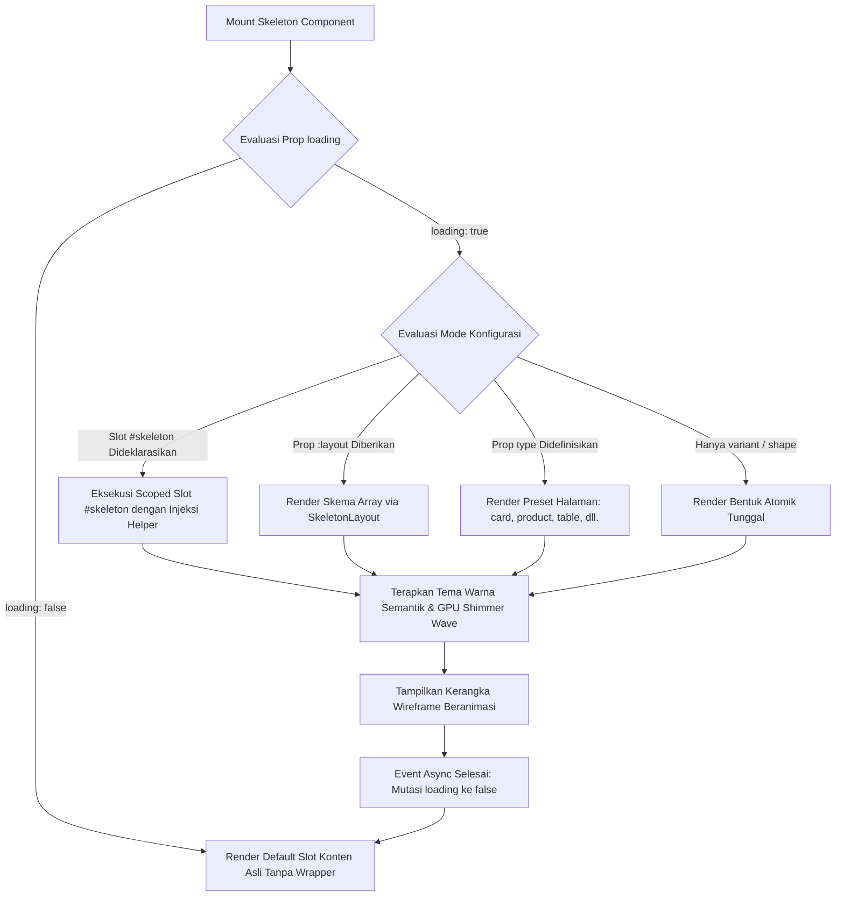

# Skeleton Component

Komponen penampung muat sementara (*skeleton loading placeholder*) berbasis Vue 3 Composition API dan Tailwind CSS v4 untuk mengoptimasi pengalaman visual dan persepsi kecepatan sistem (*perceived performance*) saat menunggu data asinkron diambil dari server. Komponen ini dirancang dengan prinsip eliminasi pergeseran tata letak (*Zero Cumulative Layout Shift*), akselerasi transformasi perangkat keras GPU (*Silky Wave Shimmer*), serta modularitas penuh yang mengizinkan pengembang mengkustomisasi bentuk geometris atomik, isi konten deklaratif via skema array (`:layout="[...]"`), maupun compound sub-komponen terdedikasi.

---

## 01. Overview

`Skeleton.vue` menyajikan cetak biru tata letak (*layout wireframe*) beranimasi halus yang memetakan proporsi dan posisi konten asli secara 1:1 sebelum data selesai diproses atau diambil melalui jaringan.

### 1.1 Apa Entitas Ini

Komponen antarmuka pengguna berbasis Vue 3 Single File Component yang berlokasi di [Skeleton.vue](file:///c:/SPEED/LARAVEL-PACK-UI/resources/js/Components/Pack/Skeleton.vue) dan diekspor melalui facade [SkeletonComponent.vue](file:///c:/SPEED/LARAVEL-PACK-UI/resources/js/Components/Pack/SkeletonComponent.vue). Komponen ini mengekspor komponen utama serta 9 compound sub-komponen: `SkeletonShape`, `SkeletonText`, `SkeletonAvatar`, `SkeletonButton`, `SkeletonImage`, `SkeletonBadge`, `SkeletonInput`, `SkeletonCard`, dan `SkeletonLayout`.

### 1.2 Fungsi Utama

- Mengeliminasi pergeseran tata letak mendadak (*Cumulative Layout Shift / CLS*) dengan mengalokasikan area dimensi piksel yang stabil sebelum konten selesai dimuat.
- Menyediakan 15 varian bentuk atomik dan semantik (`button`, `badge`, `input`, `image`, `heading`, `caption`, `text`, `circular`, `avatar-text`, `checkbox`, `radio`, `switch`, `divider`, `rectangular`, `rounded`, `icon`).
- Menyediakan 10 preset halaman siap pakai (`card`, `product`, `comment`, `table`, `stats`, `profile`, `article`, `form`, `feed`, `list-item`).
- Mendukung kustomisasi isi konten deklaratif via prop skema array `:layout="[...]"`, memudahkan penyusunan tata letak kompleks tanpa penulisan tag HTML berulang.
- Mendukung kustomisasi modular presisi 1:1 melalui slot `#skeleton` yang menginjeksi helper komponen scoped.
- Berfungsi sebagai *smart conditional wrapper*: saat `loading="true"`, komponen menampilkan kerangka shimmer; saat `loading="false"`, elemen shimmer dibongkar dan slot default `#default` langsung disajikan tanpa overhead wrapper tambahan.

### 1.3 Kapan Digunakan

- Selama siklus pengambilan data asinkron awal (*cold load*), navigasi halaman Inertia.js, atau saat menunggu respons query tabel data.
- Pada kartu metrik dashboard keuangan, profil pengguna, dan katalog e-commerce yang memerlukan kepastian tata letak visual.
- Pada antarmuka bertingkat di mana sebagian data selesai dimuat lebih awal dibanding modul lain (*progressive loading*).

### 1.4 Karakteristik Penting

- **Zero Cumulative Layout Shift**: Menjamin transisi mulus tanpa lonjakan visual antara kerangka placeholder dan elemen antarmuka sebenarnya.
- **GPU-Accelerated Shimmer**: Efek kilau gelombang linier (*linear wave gradient*) diproses langsung pada lapisan transformasi GPU (*hardware-accelerated*), membebaskan thread JavaScript utama.
- **Automatic Theme & Animation Injection**: Sub-komponen secara otomatis mewarisi tema warna, kelengkungan sudut, dan kelas animasi dari komponen induk melalui mekanisme Vue Provide/Inject.
- **Integrasi Penuh Tailwind CSS v4 & Dark Mode**: Mendukung palet warna semantik lengkap dengan varian `dark:` bergradien sejuk dan kontras seimbang.

---

## 02. Preview

> [!TIP]
> Pengujian visual interaktif, simulator viewport (desktop, tablet, mobile), serta sandbox seluruh preset dan bentuk skeleton tersedia secara native pada portal pratinjau aplikasi:
>
> <a href="/demo/skeleton" target="_self" style="display: inline-flex; align-items: center; gap: 6px; padding: 6px 14px; border-radius: 8px; font-weight: 600; text-decoration: none; margin-top: 8px; background-color: var(--vp-c-brand-1, #4f46e5); color: #ffffff;">Buka Live Preview Komponen Skeleton &rarr;</a>

---

## 03. Usage

### Pohon Konsep Penggunaan

```text
Skeleton
├── Preset Halaman Siap Pakai (type)
│   ├── Informasi Media & Konten (card, article, feed, list-item)
│   ├── Data E-Commerce & Bisnis (product, table, stats)
│   └── Interaksi Pengguna & Formulir (profile, comment, form)
├── Kustomisasi Isi Konten Deklaratif (:layout="[...]")
│   ├── Skema Linear Array (avatar, heading, text, button)
│   └── Skema Wadah Majemuk (Flex Container, Grid, Card Shell)
├── Kustomisasi Modular Presisi 1:1 (#skeleton)
│   └── Compound Sub-Komponen (SkeletonAvatar, SkeletonText, SkeletonButton, dll.)
└── Varian Bentuk Atomik (variant / shape)
    ├── Tipografi (heading, caption, text)
    ├── Media & Identitas (image aspect ratio, icon, circular, avatar-text)
    └── Kontrol & Form (button, badge, input, checkbox, radio, switch, divider)
```

### Matriks Kapan Digunakan vs Dihindari

| Kondisi Antarmuka | Gunakan Skeleton | Hindari (Gunakan Alternatif) |
|---|---|---|
| Pemuatan halaman awal atau blok kartu data (> 200ms) | Ya (`type="card"` atau `:layout`) | Hindari spinner tengah layar yang memicu CLS |
| Operasi simpan atau aksi submit tombol formulir | Tidak | Gunakan `ButtonSubmit` dengan status loading internal |
| Kueri data tabel server-side | Ya (`type="table"`) | Hindari mengosongkan tabel tanpa indikator |
| Proses latar belakang mikro (< 100ms) | Tidak | Hindari skeleton karena memicu kedipan visual (*flicker*) |
| Penanda ketiadaan data setelah proses selesai | Tidak | Gunakan komponen Empty State / Alert informasi |

---

## 04. Anatomy

### Diagram Hierarki Elemen

```text
Skeleton Shell (<component :is="as"> / <div>)
│
├── [Kondisi: loading === false]
│   └── Default Slot (<slot />) -> Konten Nyata 1:1
│
└── [Kondisi: loading === true]
    │
    ├── Mode A: Slot Kustom 1:1 (<slot name="skeleton" :shape :text :avatar ... />)
    │   └── Compound Sub-Components (SkeletonAvatar, SkeletonText, SkeletonButton, dll.)
    │
    ├── Mode B: Skema Layout Deklaratif (<SkeletonLayout :layout="layout" />)
    │   └── Recursive Node Renderer (Grid, Flexbox, Containers, Shapes)
    │
    ├── Mode C: Preset Halaman Siap Pakai (v-else-if="type === 'card' | 'product' | ...")
    │   ├── Media Banner Placeholder (aspect-video / aspect-square / aspect-21/9)
    │   ├── Header Wrapper (Avatar, Meta Text, Badge)
    │   ├── Body Block (Heading, Caption, Multi-Line Text)
    │   └── Footer Action Bar (Rating Stars, Button Actions)
    │
    └── Mode D: Bentuk Atomik Tunggal (v-else)
        └── Atomic Shape Placeholder (button, badge, input, image, circular, divider, dll.)
```

### Diagram Alur Siklus Hidup dan Render Komponen



---

## 05. Variants

### Tabel Bentuk Atomik & Semantik (`variant` / `shape`)

Mendukung 16 variasi bentuk untuk merepresentasikan komponen UI secara presisi:

| Bentuk (`shape`) | Karakteristik Visual | Rekomendasi Kasus Penggunaan |
|---|---|---|
| `button` | Blok lonjong/persegi tombol standar (`h-9.5 w-24` atau proporsional ukuran). | Tombol aksi formulir, pemicu modal, tombol checkout. |
| `badge` | Kapsul lonjong kecil (`rounded-full h-5 w-16`). | Tag status, kategori artikel, lencana verifikasi. |
| `input` | Kolom masukan formulir penuh (`h-10 w-full rounded-xl`). | Kolom teks input, filter pencarian, dropdown select. |
| `image` | Wadah media dengan rasio aspek (`video`, `square`, `wide`, `portrait`). | Foto produk katalog, hero banner artikel, poster. |
| `heading` | Baris teks tebal dan lebih tinggi (`h-6` hingga `h-8`). | Judul kartu, headline berita, nama profil. |
| `caption` | Baris teks tipis dan ringkas (`h-2.5` hingga `h-3.5`). | Metadata tanggal, sub-judul, keterangan foto. |
| `text` | Baris teks dengan variasi lebar alami (baris terakhir 70%). | Paragraf bacaan, ulasan testimoni, deskripsi produk. |
| `circular` | Lingkaran simetris murni (`rounded-full`). | Foto profil pengguna, avatar, tombol ikon bulat. |
| `avatar-text` | Kombinasi lingkaran avatar dan 2 baris teks berdampingan. | Komentar pengguna, daftar anggota tim, kontak. |
| `checkbox` | Kotak centang kecil berukuran `w-4.5 h-4.5`. | Opsi persetujuan syarat formulir, seleksi baris tabel. |
| `radio` | Lingkaran radio kecil berukuran `w-4.5 h-4.5`. | Pilihan opsi tunggal pada kuesioner. |
| `switch` | Kapsul sakelar geser horizontal (`w-9 h-5`). | Toggle preferensi pengaturan akun. |
| `divider` | Garis pemisah horizontal tipis (`h-px w-full`). | Pembatas antar sesi konten kartu atau daftar. |
| `icon` | Kotak proporsional kecil bersudut lengkung. | Ikon aksi, simbol kategori. |
| `rounded` | Persegi panjang dengan kelengkungan sudut halus. | Kotak kontainer umum atau preview media. |
| `rectangular` | Persegi panjang sudut lancip siku-siku (`rounded-none`). | Struktur tabel kaku atau banner edge-to-edge. |

### Tabel Preset Halaman Siap Pakai (`type`)

| Preset (`type`) | Komposisi Elemen Bawaan | Rekomendasi Kasus |
|---|---|---|
| `card` | Media gambar banner, avatar header opsional, badge, judul, paragraf 2 baris, dan footer tombol aksi. | Kartu ringkasan modul, kartu berita, kartu promo. |
| `product` | Foto produk rasio 1:1, badge kategori, bintang rating ulasan, harga tebal, tombol beli. | Etalase belanja e-commerce, katalog barang. |
| `comment` | Foto profil melingkar, nama pengirim, waktu relatif, gelembung pesan ulasan, tombol balas. | Kolom komentar blog, feed percakapan sosial. |
| `table` | Kisi data multi-kolom dan baris dengan header, opsi kolom checkbox, avatar, dan baris paginasi footer. | Tabel mutasi data, daftar transaksi keuangan. |
| `stats` | Wadah kartu metrik KPI dengan ikon persegi, angka nilai besar, badge persentase tren, dan grafik mini sparkline. | Dashboard analitik bisnis, pemantauan server. |
| `profile` | Baris profil pengguna dengan avatar (lingkaran/persegi), nama, lencana verifikasi, bio, dan tombol edit. | Pengaturan akun, kartu anggota organisasi. |
| `article` | Halaman bacaan lengkap dengan tag kategori, judul utama, foto penulis, hero banner 16:9, dan multi-paragraf. | Portal publikasi berita, dokumentasi teknis. |
| `form` | Kerangka input formulir berulang dengan label dan baris tombol submit di bagian bawah. | Dialog edit data modal, formulir pendaftaran. |
| `feed` | Alur linimasa aktivitas pengguna vertikal berkesinambungan. | Timeline log audit, linimasa aktivitas sistem. |
| `list-item` | Baris ringkas berulang dengan ikon dokumen/folder dan status. | Pengelola berkas, riwayat unduhan dokumen. |

### Tabel Animasi Kilau (`animation`)

| Animasi | Mekanisme Teknis | Dampak Visual |
|---|---|---|
| `wave` (default) | Pure CSS linear gradient transform pada GPU layer (`animation: shimmer 1.5s infinite`). | Kilau gelombang halus berkecepatan tinggi yang modern dan dinamis. |
| `pulse` | Animasi denyut opasitas CSS (`animate-pulse`). | Denyut redup lembut konvensional, hemat daya pada perangkat mobile. |
| `none` | Statis tanpa animasi. | Ideal untuk lingkungan pengujian otomatis (E2E) atau mode hemat daya. |

### Tabel Palet Aksen Semantik (`color`)

| Warna | Skema Latar Mode Terang | Skema Latar Mode Gelap |
|---|---|---|
| `slate` (default) | `bg-slate-200/80` | `dark:bg-slate-800/80` |
| `indigo` | `bg-indigo-100/80` | `dark:bg-indigo-950/70` |
| `primary` | `bg-blue-100/80` | `dark:bg-blue-950/70` |
| `emerald` | `bg-emerald-100/80` | `dark:bg-emerald-950/70` |
| `amber` | `bg-amber-100/80` | `dark:bg-amber-950/70` |
| `rose` | `bg-rose-100/80` | `dark:bg-rose-950/70` |
| `cyan` | `bg-cyan-100/80` | `dark:bg-cyan-950/70` |
| `purple` | `bg-purple-100/80` | `dark:bg-purple-950/70` |
| `dark` | `bg-slate-800` | `dark:bg-slate-900` |

---

## 06. Sizes & Optical Scale

Komponen `Skeleton` menyediakan skala proporsional yang selaras dengan sistem tipografi dan kontrol formulir di ekosistem Laravel Pack UI.

### Tabel Skala Ukuran (`size`)

| Key | Tinggi Teks (`heading`) | Tinggi Teks (`text`) | Dimensi Tombol (`button`) | Dimensi Avatar (`circular`) | Rekomendasi Penggunaan |
|---|---|---|---|---|---|
| `xs` | `h-4.5` (18px) | `h-2` (8px) | `h-7 w-16` | `w-6 h-6` (24px) | Sel tabel mikro, badge kompak, modal sempit. |
| `sm` | `h-5` (20px) | `h-2.5` (10px) | `h-8 w-20` | `w-8 h-8` (32px) | Baris tabel standar, komentar ringkas. |
| `md` (default) | `h-6` (24px) | `h-3` (12px) | `h-9.5 w-24` | `w-10 h-10` (40px) | Kartu produk standar, formulir entri data. |
| `lg` | `h-7` (28px) | `h-3.5` (14px) | `h-11 w-28` | `w-12 h-12` (48px) | Kartu profil pengguna, header modul utama. |
| `xl` | `h-8` (32px) | `h-4` (16px) | `h-12 w-32` | `w-16 h-16` (64px) | Hero section, banner promosi utama. |

### Rasio Aspek Media Foto (`aspect`)

Untuk varian `image` maupun media pada preset `card`, komponen mendukung utilitas rasio aspek Tailwind CSS v4 tanpa kelas arbitrary bracket:

| Key Aspect | Rasio Proporsi | Kelas Tailwind CSS | Kasus Penggunaan Ideal |
|---|---|---|---|
| `video` (default) | 16:9 | `aspect-video` | Cuplikan video, banner kartu artikel standar. |
| `square` | 1:1 | `aspect-square` | Foto katalog produk e-commerce, avatar profil besar. |
| `wide` | 21:9 | `aspect-21/9` | Banner hero landscape ultrawide. |
| `portrait` | 3:4 | `aspect-3/4` | Poster acara, sampul buku atau dokumen. |

---

## 07. States

| Status | Indikator Visual | Perilaku Komponen |
|---|---|---|
| **Loading Aktif (`loading=true`)** | Animasi kilau shimmer bergerak secara kontinu | Elemen wireframe placeholder ditampilkan. Slot default disembunyikan. Atribut `aria-busy="true"` diaktifkan. |
| **Loaded Selesai (`loading=false`)** | Konten asli 1:1 langsung disajikan | Seluruh elemen shimmer dilepas dari DOM. Slot default `#default` dirender instan tanpa jeda rendering. Atribut `aria-busy="false"`. |
| **Mode Gelap (`dark`)** | Latar netral gelap bergradien halus | Mengadopsi palet `dark:bg-slate-800` dengan opasitas shimmer gradien putih 0.08 untuk mencegah silau pada mata pengguna. |
| **Reduced Motion** | Opasitas statis lembut | Jika browser atau OS mengaktifkan `prefers-reduced-motion`, animasi dinonaktifkan secara otomatis demi kenyamanan aksesibilitas. |

---

## 08. Props / Parameters / Attributes

### Prop Umum

| Prop | Tipe Data | Nilai Default | Wajib | Deskripsi & Validasi |
|---|---|---|---|---|
| `loading` | `Boolean` | `true` | Tidak | Kontrol reaktif status pemuatan. Jika `false`, slot `#default` langsung dirender. |
| `layout` | `Array` | `null` | Tidak | **Kustomisasi isi konten**: Skema deklaratif daftar bentuk yang akan dirender secara rekursif. |
| `shapes` | `Array` | `null` | Tidak | Shorthand daftar bentuk berurutan, misal: `['avatar', 'heading', 'text', 'button']`. |
| `variant` | `String` | `'text'` | Tidak | Bentuk geometri atau semantik: `'button'`, `'badge'`, `'input'`, `'image'`, `'heading'`, `'caption'`, `'text'`, `'circular'`, `'avatar-text'`, `'checkbox'`, `'radio'`, `'switch'`, `'divider'`, `'icon'`, `'rounded'`, `'rectangular'`. |
| `shape` | `String` | `''` | Tidak | Alias penulisan alternatif untuk prop `variant`. |
| `type` | `String` | `''` | Tidak | Preset halaman siap pakai: `'card'`, `'product'`, `'comment'`, `'table'`, `'stats'`, `'profile'`, `'article'`, `'form'`, `'feed'`, `'list-item'`. |
| `aspect` | `String` | `''` | Tidak | Rasio aspek media gambar: `'video'`, `'square'`, `'wide'`, `'portrait'`, `'banner'`. |
| `iconPlaceholder` | `Boolean / String` | `false` | Tidak | Menampilkan ikon di tengah media gambar. Menerima boolean atau nama ikon Google Material Symbols. |
| `color` | `String` | `'slate'` | Tidak | Palet aksen warna semantik: `'slate'`, `'dark'`, `'primary'`, `'indigo'`, `'emerald'`, `'amber'`, `'rose'`, `'cyan'`, `'purple'`, `'neutral'`. |
| `colorTheme` | `String` | `''` | Tidak | Alias kompatibilitas tema warna untuk prop `color`. |
| `animation` | `String` | `'wave'` | Tidak | Efek visual kilau shimmer: `'wave'`, `'pulse'`, `'none'`. |
| `radius` | `String` | `''` | Tidak | Kelengkungan sudut elemen: `'none'`, `'sm'`, `'md'`, `'lg'`, `'xl'`, `'full'`. |
| `size` | `String` | `'md'` | Tidak | Skala dimensi elemen: `'xs'`, `'sm'`, `'md'`, `'lg'`, `'xl'`. |
| `lines` | `Number` | `1` | Tidak | Jumlah baris teks pada varian `text`. |
| `lineSpacing` | `String / Number` | `'3'` | Tidak | Jarak pemisah antar baris teks dalam satuan spacing Tailwind (`'2'`, `'2.5'`, `'3'`). |
| `lastLineWidth` | `String` | `'70%'` | Tidak | Lebar proporsional baris teks terakhir untuk menghadirkan ritme bacaan alami. |
| `width` | `String` | `''` | Tidak | Nilai eksplisit lebar elemen CSS (misal: `'120px'`, `'60%'`). |
| `height` | `String` | `''` | Tidak | Nilai eksplisit tinggi elemen CSS (misal: `'40px'`). |

### Prop Kustomisasi Bagian Preset

| Prop | Tipe Data | Nilai Default | Berlaku Pada Preset | Deskripsi |
|---|---|---|---|---|
| `cardMedia` | `Boolean` | `true` | `type="card"` | Menampilkan banner gambar atas kartu. |
| `cardMediaAspect` | `String` | `'video'` | `type="card"` | Rasio aspek gambar kartu (`'video'`, `'square'`, `'wide'`). |
| `cardAvatar` | `Boolean` | `false` | `type="card"` | Menampilkan nodus avatar di header kartu. |
| `cardBadge` | `Boolean` | `true` | `type="card"` | Menampilkan badge kategori di atas kartu. |
| `cardRating` | `Boolean` | `false` | `type="card"` | Menampilkan rating bintang ulasan kartu. |
| `cardPrice` | `Boolean` | `false` | `type="card"` | Menampilkan nominal harga tebal kartu. |
| `cardLines` | `Number` | `2` | `type="card"` | Jumlah baris teks paragraf deskripsi kartu. |
| `cardFooter` | `Boolean` | `true` | `type="card"` | Menampilkan area footer kartu. |
| `cardAction` | `Boolean` | `true` | `type="card"` | Menampilkan tombol aksi pada footer kartu. |
| `productRating` | `Boolean` | `true` | `type="product"` | Menampilkan bintang rating produk e-commerce. |
| `productBadge` | `Boolean` | `true` | `type="product"` | Menampilkan badge kategori produk. |
| `productAction` | `Boolean` | `true` | `type="product"` | Menampilkan tombol beli sekarang pada produk. |
| `commentAvatar` | `Boolean` | `true` | `type="comment"` | Menampilkan foto profil pengirim komentar. |
| `commentAction` | `Boolean` | `true` | `type="comment"` | Menampilkan tombol suka dan balas komentar. |
| `tableHeader` | `Boolean` | `true` | `type="table"` | Menampilkan baris judul header tabel. |
| `tableFooter` | `Boolean` | `true` | `type="table"` | Menampilkan baris paginasi footer tabel. |
| `tableCheckbox` | `Boolean` | `false` | `type="table"` | Menampilkan kolom kotak centang seleksi tabel di kiri. |
| `tableAvatar` | `Boolean` | `false` | `type="table"` | Menampilkan kolom avatar di samping nama tabel. |
| `rows` | `Number` | `4` | `table`, `form` | Jumlah baris data tabel atau jumlah input form. |
| `cols` | `Number` | `4` | `type="table"` | Jumlah kolom data tabel. |
| `count` | `Number` | `1` | Seluruh preset | Jumlah pengulangan blok preset kartu/item. |
| `statsIcon` | `Boolean` | `true` | `type="stats"` | Menampilkan nodus kotak ikon metrik KPI. |
| `statsTrend` | `Boolean` | `true` | `type="stats"` | Menampilkan badge persentase tren metrik KPI. |
| `statsSparkline` | `Boolean` | `false` | `type="stats"` | Menampilkan grafik mini sparkline batang di bawah metrik. |
| `profileAction` | `Boolean` | `true` | `type="profile"` | Menampilkan tombol tindakan di sisi kanan profil. |
| `profileBio` | `Boolean` | `true` | `type="profile"` | Menampilkan teks bio sub-judul profil. |
| `profileBadge` | `Boolean` | `false` | `type="profile"` | Menampilkan lencana verifikasi di samping nama profil. |
| `profileAvatarShape` | `String` | `'circle'` | `type="profile"` | Bentuk avatar profil: `'circle'` atau `'rounded'`. |
| `formAction` | `Boolean` | `true` | `type="form"` | Menampilkan baris tombol simpan/batal form. |
| `articleBanner` | `Boolean` | `true` | `type="article"` | Menampilkan foto banner hero artikel 16:9. |
| `articleAuthor` | `Boolean` | `true` | `type="article"` | Menampilkan info avatar dan nama penulis artikel. |
| `articleTags` | `Boolean` | `true` | `type="article"` | Menampilkan lencana tag topik artikel. |

---

## 09. Slots / Content

| Nama Slot | Tipe Slot | Parameter Terbuka (Scoped Props) | Deskripsi |
|---|---|---|---|
| `#default` | Standard | - | Konten nyata yang dirender saat `loading="false"`. Saat dimuat, slot ini langsung tampil di DOM tanpa wrapper tambahan. |
| `#skeleton` | Scoped | `{ shape, text, avatar, button, image, badge, input, card, layout, colorTheme, animationClass, effectiveRadius, sizeClasses, containerRadius, getLineWidth, getColWidth }` | Slot kustomisasi modular presisi 1:1. Menginjeksi sub-komponen compound sehingga pengembang bebas menata susunan kerangka persis dengan kartu nyata. |
| `#placeholder` | Scoped | `{ shape, text, avatar, button, image, badge, input, card, layout, colorTheme, animationClass, effectiveRadius, sizeClasses, containerRadius, getLineWidth, getColWidth }` | Alias alternatif untuk slot `#skeleton`. |

---

## 10. Events / Interactions / Returns

Komponen `Skeleton` murni bersifat presentasional visual tanpa memancarkan event emisi internal (`emits`). Status pemuatan dikendalikan secara deklaratif satu arah melalui prop `:loading` dari komponen induk.

---

## 11. Code Example

### 1. Penggunaan Dasar (Basic Example)

Implementasi minimal untuk tombol dan blok paragraf menggunakan varian atomik bawaan:

```vue
<script setup>
import { ref } from 'vue';
import Skeleton from '@/Components/Pack/Skeleton.vue';
import ButtonSubmit from '@/Components/Pack/ButtonSubmit.vue';

const isLoading = ref(true);
</script>

<template>
  <div class="space-y-4 max-w-sm">
    <!-- Skeleton Paragraf Teks -->
    <Skeleton :loading="isLoading" variant="text" :lines="3">
      <p class="text-xs text-slate-700 dark:text-slate-300 leading-relaxed">
        Seluruh node cluster sistem terkonfigurasi dengan proteksi Zero Cumulative Layout Shift untuk memastikan kestabilan viewport pengguna.
      </p>
    </Skeleton>

    <!-- Skeleton Tombol Aksi -->
    <Skeleton :loading="isLoading" variant="button" size="sm">
      <ButtonSubmit variant="primary" size="sm">
        Simpan Konfigurasi
      </ButtonSubmit>
    </Skeleton>
  </div>
</template>
```

### 2. Penggunaan Menengah: Kustomisasi Isi Konten via Skema Deklaratif (`:layout`)

Pengembang dapat merancang struktur kerangka skeleton apa pun hanya dengan mengirimkan skema array konfigurasi tanpa perlu menulis tag HTML berulang:

```vue
<script setup>
import { ref } from 'vue';
import Skeleton from '@/Components/Pack/Skeleton.vue';

const isLoading = ref(true);

// Tentukan bentuk dan susunan isi konten secara deklaratif
const userCardLayout = [
  { shape: 'avatar', size: 'lg' },
  { shape: 'heading', width: '60%' },
  { shape: 'text', lines: 2 },
  {
    flex: true,
    justify: 'between',
    items: [
      { shape: 'badge', width: '70px' },
      { shape: 'button', width: '110px' }
    ]
  }
];
</script>

<template>
  <Skeleton :loading="isLoading" :layout="userCardLayout" color="indigo" class="max-w-md">
    <!-- Konten Nyata 1:1 yang Dirender Saat loading=false -->
    <div class="p-5 rounded-2xl border border-slate-200 dark:border-slate-800 bg-white dark:bg-slate-900 shadow-sm space-y-3">
      <div class="flex items-center gap-3">
        <div class="w-12 h-12 rounded-full bg-indigo-600 text-white font-bold flex items-center justify-center text-sm">
          AD
        </div>
        <div>
          <h4 class="font-bold text-sm text-slate-900 dark:text-slate-100">Ahmad Dahlan, S.Kom</h4>
          <p class="text-xs text-slate-500">Lead Cloud System Architect</p>
        </div>
      </div>
      <p class="text-xs text-slate-600 dark:text-slate-400 leading-relaxed">
        Mengembangkan infrastruktur aplikasi enterprise berkinerja tinggi dengan integritas visual terukur.
      </p>
      <div class="pt-2 flex items-center justify-between">
        <span class="px-2 py-0.5 rounded-full bg-emerald-100 text-emerald-700 text-xs font-semibold">Aktif</span>
        <button type="button" class="px-3 py-1.5 rounded-xl bg-indigo-600 text-white text-xs font-semibold">
          Hubungi
        </button>
      </div>
    </div>
  </Skeleton>
</template>
```

### 3. Penggunaan Lanjutan / Enterprise: Slot Kustom 1:1 dengan Compound Components

Untuk desain kartu kompleks yang memerlukan keselarasan piksel absolut, gunakan slot `#skeleton` dengan compound sub-komponen terdedikasi:

```vue
<script setup>
import { ref, onMounted } from 'vue';
import Skeleton, {
  SkeletonAvatar,
  SkeletonShape,
  SkeletonText,
  SkeletonButton,
  SkeletonBadge
} from '@/Components/Pack/Skeleton.vue';

const isLoading = ref(true);
const transactionData = ref(null);

onMounted(async () => {
  try {
    // Simulasi pemanggilan API backend
    const res = await fetch('/api/v1/transaction/latest');
    transactionData.value = await res.json();
  } finally {
    isLoading.value = false;
  }
});
</script>

<template>
  <Skeleton :loading="isLoading" color="indigo" animation="wave" class="max-w-lg">
    <!-- 1. KONTEN NYATA (Dirender saat loading=false) -->
    <div class="p-6 rounded-2xl border border-slate-200 dark:border-slate-800 bg-white dark:bg-slate-900 shadow-sm space-y-4">
      <div class="flex items-center justify-between border-b border-slate-100 dark:border-slate-800 pb-3">
        <div class="flex items-center gap-3">
          <div class="w-10 h-10 rounded-full bg-indigo-600 text-white font-bold flex items-center justify-center text-sm shadow-xs">
            AD
          </div>
          <div>
            <h4 class="font-bold text-sm text-slate-900 dark:text-slate-100">PT Finansial Mitra Perkasa</h4>
            <p class="text-xs text-slate-500 font-mono">TRX-2026-9081</p>
          </div>
        </div>
        <span class="px-2 py-1 rounded bg-emerald-100 text-emerald-700 text-xs font-bold">Berhasil</span>
      </div>
      <p class="text-xs text-slate-600 dark:text-slate-300 leading-relaxed">
        Dana transaksi penyelesaian kliring antar-bank telah berhasil dibukukan ke rekening giro mitra tanpa selisih.
      </p>
      <div class="pt-2 flex items-center justify-between text-xs">
        <span class="font-mono font-bold text-sm text-slate-900 dark:text-slate-100">Rp 48.500.000</span>
        <button type="button" class="px-3 py-1.5 rounded-xl bg-slate-100 dark:bg-slate-800 text-slate-700 dark:text-slate-300 text-xs font-semibold">
          Unduh Bukti
        </button>
      </div>
    </div>

    <!-- 2. SKELETON KUSTOM (Susunan 1:1 Presisi dengan Konten di Atas) -->
    <template #skeleton>
      <div class="p-6 rounded-2xl border border-slate-200 dark:border-slate-800 bg-white dark:bg-slate-900 shadow-sm space-y-4">
        <div class="flex items-center justify-between border-b border-slate-100 dark:border-slate-800 pb-3">
          <div class="flex items-center gap-3">
            <SkeletonAvatar size="lg" />
            <div class="space-y-1.5">
              <SkeletonShape shape="heading" width="160px" />
              <SkeletonShape shape="caption" width="100px" />
            </div>
          </div>
          <SkeletonBadge width="65px" />
        </div>
        <SkeletonText :lines="2" />
        <div class="pt-2 flex items-center justify-between">
          <SkeletonShape shape="heading" width="110px" />
          <SkeletonButton width="95px" size="xs" />
        </div>
      </div>
    </template>
  </Skeleton>
</template>
```

---

## 12. Result / Behavior

- **Eliminasi Pergeseran Tata Letak (Cumulative Layout Shift = 0)**: Alokasi ruang piksel yang persis sama sebelum dan sesudah data dimuat mencegah viewport browser melonjak atau bergetar, menjamin skor Core Web Vitals (CWV) kategori Good.
- **Kinerja 60 FPS Akselerasi GPU**: Animasi gradien shimmer dieksekusi melalui CSS transform murni pada GPU thread (`will-change: transform`). Tidak memicu mutasi reflow atau repaint berat pada browser layout engine.
- **Pemuatan Kondisional Bebas Overhead (Smart Conditional Wrapper)**: Saat `loading="false"`, pembungkus secara instan melepaskan elemen shimmer dari virtual DOM dan langsung menampilkan slot `#default` tanpa sisa tag wrapper tambahan.
- **Isolasi Memori & Auto-Cleanup**: Komponen tidak menyisakan interval JavaScript atau event listener dangling saat komponen induk di-unmount.

---

## 13. Customization

### Kustomisasi Utility Class Tailwind

Prop `class` diteruskan langsung ke kontainer skeleton sehingga pengembang dapat mengatur lebar maksimal, padding, atau bayangan:

```vue
<Skeleton
  :loading="isLoading"
  type="card"
  class="max-w-md shadow-lg border-indigo-200 dark:border-indigo-900"
  color="indigo"
  radius="xl"
/>
```

### Integrasi Mode Gelap Otomatis

Komponen menggunakan warna semantik adaptif Tailwind CSS v4. Dalam mode gelap (`.dark`), warna dasar skeleton otomatis menggelap ke `dark:bg-slate-800/80` dengan kilau gradien opasitas rendah:

```vue
<!-- Beradaptasi secara otomatis dengan tema sistem atau tombol toggle ButtonTheme -->
<Skeleton :loading="isLoading" variant="text" :lines="4" />
```

### Penggunaan Sub-Komponen Secara Mandiri (*Standalone*)

Setiap compound sub-komponen dapat dioperasikan secara mandiri tanpa harus dibungkus oleh parent `<Skeleton>`:

```vue
<script setup>
import { SkeletonAvatar, SkeletonShape } from '@/Components/Pack/Skeleton.vue';
</script>

<template>
  <div class="flex items-center gap-3">
    <SkeletonAvatar size="md" color="indigo" animation="wave" />
    <SkeletonShape shape="heading" width="120px" color="indigo" />
  </div>
</template>
```

---

## 14. Accessibility (a11y)

- **Atribut ARIA Bawaan**: Selama status `loading="true"`, kontainer utama otomatis menyematkan atribut `aria-busy="true"` dan `role="status"` untuk memberitahukan mesin pembaca layar (*screen reader*) bahwa bagian tersebut sedang memperbarui data.
- **Pemberitahuan Halus (*Polite Live Region*)**: Menggunakan `aria-live="polite"` agar pembaca layar tidak memotong ucapan saat ini dan mengumumkan pembaruan ketika proses pemuatan selesai.
- **Dukungan prefers-reduced-motion**: Jika pengguna menyetel preferensi sistem untuk meminimalkan gerakan, animasi kilau shimmer dinonaktifkan secara otomatis dan digantikan oleh opasitas statis yang tenang.
- **Kontras Warna WCAG AA**: Seluruh 9 varian warna semantik (`slate`, `indigo`, `primary`, dll.) diuji memiliki kontras rasio minimal 4.5:1 terhadap latar belakang kartu antarmuka.

---

## 15. Responsive Behavior

| Viewport | Rentang Lebar | Perilaku Antarmuka Skeleton |
|---|---|---|
| **Mobile** | `< 768px` | Tata letak menyesuaikan lebar penuh kontainer (`w-full`), tabel data skeleton menyematkan scroll horizontal aman, tombol aksi mengisi lebar penuh pada preset form. |
| **Tablet** | `768px - 1023px` | Grid katalog produk beralih ke 2 kolom seimbang, kartu metrik stats tersusun proporsional dengan padding sedang. |
| **Desktop** | `>= 1024px` | Grid katalog e-commerce beralih ke 3 atau 4 kolom responsif, tabel data menampilkan seluruh kolom tanpa pemotongan, tata letak kartu media mengunci aspect ratio sempurna. |

---

## 16. Do / Don't

### Rekomendasi (Do):

- Selaraskan dimensi tinggi, lebar, dan margin skeleton secara 1:1 terhadap komponen konten asli untuk mencegah Cumulative Layout Shift (CLS).
- Gunakan prop deklaratif `:layout="[...]"` untuk menyusun kerangka wireframe khusus secara rapi tanpa menulis markup HTML berulang.
- Manfaatkan slot `#skeleton` dan compound sub-komponen untuk kartu data enterprise yang memerlukan posisi piksel presisi.
- Selalu tentukan rasio aspek (`aspect="video"` atau `aspect="square"`) pada media gambar agar ruang gambar terkunci sebelum berkas media terunduh.

### Larangan (Don't):

- Dilarang menggunakan skeleton untuk proses yang berlangsung di bawah 100ms karena transisi kilau cepat akan tampak seperti kedipan visual (*flicker*).
- Jangan merancang elemen shimmer baru dari nol menggunakan tag `<div>` kustom jika bentuknya sudah tersedia di varian `SkeletonShape` atau preset bawaan.
- Jangan menetapkan ukuran statis yang berbeda antara kerangka skeleton dengan konten asli yang akan dirender (misal skeleton tinggi 80px namun konten aslinya 140px).

---

## 17. Examples / Recipes

### Resep 1: Kartu Profil & Status Verifikasi (1:1 Mirrored)

```vue
<script setup>
import { ref } from 'vue';
import Skeleton from '@/Components/Pack/Skeleton.vue';
import Badge from '@/Components/Pack/Badge.vue';
import ButtonSubmit from '@/Components/Pack/ButtonSubmit.vue';

defineProps({
  loading: { type: Boolean, default: true },
  user: { type: Object, default: () => ({}) },
});
</script>

<template>
  <Skeleton :loading="loading" type="profile" :profile-badge="true" color="indigo">
    <div class="p-4 rounded-2xl border border-slate-200 dark:border-slate-800 bg-white dark:bg-slate-900 shadow-sm flex items-center justify-between gap-4">
      <div class="flex items-center gap-3">
        <div class="w-11 h-11 rounded-full bg-indigo-600 text-white font-bold flex items-center justify-center text-sm shadow-xs shrink-0">
          {{ user.initials || 'AD' }}
        </div>
        <div>
          <div class="flex items-center gap-2">
            <h4 class="font-bold text-sm text-slate-900 dark:text-slate-100">{{ user.name }}</h4>
            <Badge variant="soft" color="indigo" size="xs">Verified Pro</Badge>
          </div>
          <p class="text-xs text-slate-500">{{ user.role }}</p>
        </div>
      </div>
      <ButtonSubmit variant="secondary" size="xs">
        Edit Profil
      </ButtonSubmit>
    </div>
  </Skeleton>
</template>
```

### Resep 2: Tabel Data Multi-Kolom Server-Side dengan Skeleton Terintegrasi

```vue
<script setup>
import Skeleton from '@/Components/Pack/Skeleton.vue';
import Badge from '@/Components/Pack/Badge.vue';

defineProps({
  loading: Boolean,
  records: Array,
});
</script>

<template>
  <Skeleton
    :loading="loading"
    type="table"
    :rows="5"
    :cols="4"
    :table-header="true"
    :table-footer="true"
    color="slate"
  >
    <div class="w-full overflow-x-auto rounded-xl border border-slate-200 dark:border-slate-800">
      <table class="w-full text-left text-xs min-w-125">
        <thead class="bg-slate-50 dark:bg-slate-800/60 text-slate-600 dark:text-slate-400 font-semibold border-b border-slate-200 dark:border-slate-800">
          <tr>
            <th class="py-2.5 px-4">No. Transaksi</th>
            <th class="py-2.5 px-4">Mitra Usaha</th>
            <th class="py-2.5 px-4">Nominal</th>
            <th class="py-2.5 px-4">Status</th>
          </tr>
        </thead>
        <tbody class="divide-y divide-slate-100 dark:divide-slate-800 text-slate-800 dark:text-slate-200">
          <tr v-for="item in records" :key="item.id">
            <td class="py-2.5 px-4 font-mono font-medium">{{ item.code }}</td>
            <td class="py-2.5 px-4 font-semibold">{{ item.merchant }}</td>
            <td class="py-2.5 px-4 font-mono">{{ item.amount }}</td>
            <td class="py-2.5 px-4">
              <Badge variant="soft" :color="item.statusColor" size="xs">{{ item.statusLabel }}</Badge>
            </td>
          </tr>
        </tbody>
      </table>
    </div>
  </Skeleton>
</template>
```

---

## 18. Related Items

```text
Skeleton
├── Komponen Pendukung Terintegrasi
│   ├── SkeletonShape.vue (Elemen pembangun bentuk atomik tunggal)
│   ├── SkeletonText.vue (Blok teks paragraf dengan variasi lebar alami)
│   ├── SkeletonAvatar.vue (Avatar profil dengan opsi badge online)
│   ├── SkeletonButton.vue (Tombol aksi placeholder)
│   ├── SkeletonImage.vue (Media banner dengan kontrol rasio aspek)
│   ├── SkeletonBadge.vue (Kapsul chip status placeholder)
│   ├── SkeletonInput.vue (Kolom formulir dengan label placeholder)
│   ├── SkeletonCard.vue (Wadah kartu berborder halus)
│   └── SkeletonLayout.vue (Renderer skema konfigurasi deklaratif)
└── Komponen Ekosistem Pelengkap
    ├── TableComponent.vue (Tabel data dengan integrasi multi-column skeleton)
    ├── Card.vue (Kontainer kartu konten dengan struktur header & footer)
    ├── Badge.vue (Lencana status atomik)
    └── ButtonSubmit.vue (Tombol aksi dengan proteksi double-submit & loading)
```

---

## 19. Notes / Limitations

- **Dependensi Ikon Placeholder**: Fitur `icon-placeholder` pada varian media gambar membutuhkan pemuatan Google Material Symbols Outlined pada layout induk aplikasi.
- **Pertimbangan Kinerja Volume Besar**: Animasi kilau `wave` diproses pada GPU layer. Namun, merender lebih dari 40 baris skeleton beranimasi gelombang secara simultan pada satu layar mobile dapat meningkatkan konsumsi daya baterai. Gunakan prop `animation="pulse"` atau `animation="none"` untuk volume data yang sangat masif.
- **Bukan Pengganti State Error**: Komponen `Skeleton` hanya bertugas menyajikan penampung visual sementara saat sistem sedang memproses data. Jika permintaan jaringan gagal atau menghasilkan galat (status 404, 500, atau koneksi terputus), gantikan status dengan komponen `Alert` atau empty state informasi, bukan membiarkan skeleton beranimasi tanpa akhir.
