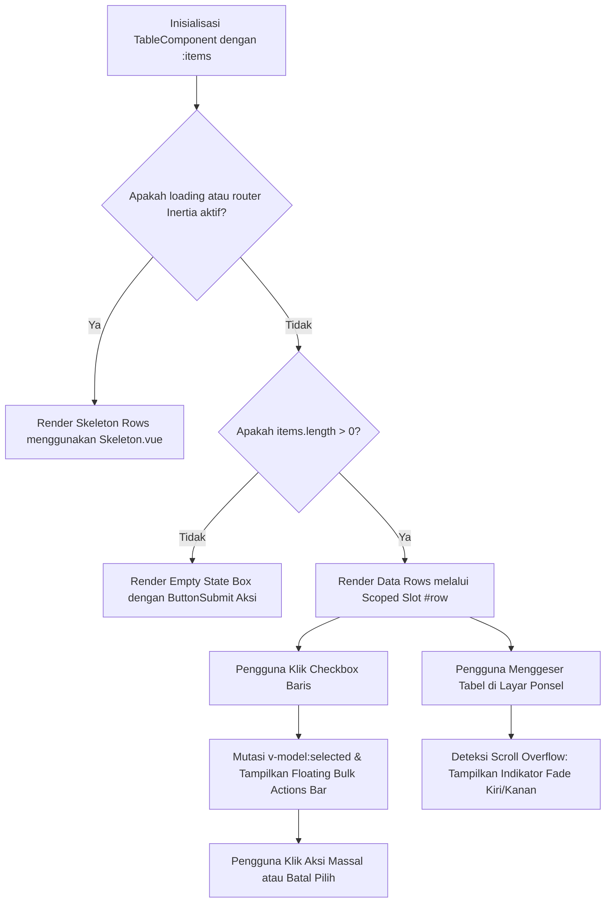

# TableComponent

Komponen pembungkus tabel data enterprise (*data table wrapper*) berbasis Vue 3 dan Tailwind CSS v4. Mengintegrasikan secara penuh komponen atomik Pack UI (`Badge.vue`, `ButtonSubmit.vue`, `Skeleton.vue`, `InputField.vue`, dan `Pagination.vue`), mendukung seleksi baris multi-item dengan floating bulk actions bar, sticky first column, indikator gradasi gulir horizontal responsif, serta ekspor data CSV instan.

---

## 01. Overview

`TableComponent.vue` mempermudah penyajian data terstruktur dalam aplikasi Laravel Inertia.js dengan tata letak adaptif di desktop, tablet, maupun ponsel:
- Terintegrasi penuh dengan komponen internal Pack UI: `<Badge.vue />` untuk status counter & label, `<ButtonSubmit.vue />` untuk tombol aksi, dan `<Skeleton.vue />` untuk animasi loading multi-kolom adaptif.
- Membantu visualisasi seleksi baris dengan custom checkbox modern bergaya Pack UI yang selaras dengan palet tema warna aktif.
- Menyediakan skeleton loader otomatis saat transisi navigasi router Inertia.js atau saat filter data diperbarui.
- Seleksi baris multi-item terintegrasi dengan floating action bar di bawah header tabel untuk mengeksekusi aksi massal.
- Kemampuan pembekuan kolom pertama (`stickyFirstColumn`) dan sticky header (`stickyHeader`) saat tabel digulir.
- Indikator gradasi gulir horizontal visual (`scrollIndicator`) di sisi kiri dan kanan tabel saat data meluap keluar layar ponsel.
- Fungsi ekspor data CSV bawaan melalui method programatis `exportToCsv`.

### 1.1 Apa Entitas Ini
Komponen antarmuka pengguna Vue 3 berbasis Composition API (`packages/laravel-pack-ui/resources/js/Components/Pack/TableComponent.vue`) yang berfungsi sebagai kontainer tabel data kaya fitur untuk ekosistem aplikasi enterprise Laravel.

### 1.2 Fungsi Utama
- Membungkus tabel data HTML semantik dengan padding adaptif, border, dan bayangan konsisten.
- Mengelola state seleksi baris (single select, multi-select, select all, indeterminate).
- Menyediakan slot `#toolbar` untuk pencarian dan filter, serta slot `#footer` untuk komponen `<Pagination.vue />`.
- Mengotomatiskan transisi skeleton loading saat data berubah atau saat request Inertia berjalan.
- Menyediakan fungsi ekspor data CSV client-side instan.

### 1.3 Kapan Digunakan
- Pada halaman master data (pengguna, transaksi, inventori produk, faktur, log sistem).
- Pada halaman pelaporan keuangan dan analitik yang membutuhkan fitur ekspor CSV dan seleksi massal.
- Pada modal dialog atau tab panel (menggunakan mode `borderless`).

### 1.4 Karakteristik Penting
- **Komposisi Komponen Pack UI**: Menggunakan `<Badge.vue />`, `<ButtonSubmit.vue />`, dan `<Skeleton.vue />` secara internal tanpa tag HTML native yang kaku.
- **Responsif Multi-Device**: Scroll horizontal mulus di ponsel dengan indikator overflow gradasi dan sticky column.
- **Smart Click Exclusion**: Event `@row-click` secara cerdas mengabaikan klik pada tombol internal, link, dan checkbox.

---

## 02. Preview

> [!TIP]
> Pengujian visual dan showcase interaktif entitas ini tersedia secara native pada portal pratinjau aplikasi:
>
> <a href="http://localhost:8000/preview/table" target="_self" style="display: inline-flex; align-items: center; gap: 6px; padding: 6px 14px; border-radius: 8px; font-weight: 600; text-decoration: none; margin-top: 8px; background-color: var(--vp-c-brand-1, #4f46e5); color: #ffffff;">Buka Live Preview Komponen TableComponent &rarr;</a>

---

## 03. Usage

### Pohon Konsep Penggunaan

```text
TableComponent
├── Master Data Management
│   ├── Standard Card Table (Border, Rounded 2xl, Shadow 2xs)
│   ├── Selectable Multi-Row (Floating Bulk Actions Bar)
│   └── Filterable & Searchable (Toolbar Slot + InputField)
├── Embedded Sub-Tables
│   ├── Borderless Mode (Untuk Modal Dialog & Tab Panels)
│   └── Compact Size (Padding Rapat untuk Audit Trail / SKU)
└── Reporting & Export
    ├── CSV Export Integration (Programmatic exportToCsv)
    └── Pagination Integration (Footer Slot + Pagination.vue)
```

### Matriks Kapan Digunakan vs Dihindari

| Skenario Antarmuka | Gunakan TableComponent | Alternatif yang Tepat |
|---|---|---|
| Menampilkan data tabular terstruktur (> 3 kolom) | Ya | Hindari card grid untuk data tabel padat |
| Seleksi massal (hapus banyak, ubah status) | Ya (`selectable`) | Form Repeater |
| Menampilkan daftar produk e-commerce visual | Tidak | Gunakan ProductGallery.vue atau Card.vue |
| Navigasi langkah demi langkah | Tidak | Gunakan Stepper.vue |

---

## 04. Anatomy

### Diagram Hierarki Elemen

```text
TableComponent Shell (w-full bg-white dark:bg-slate-900 rounded-2xl overflow-hidden)
│
├── Title Header Area (Title, Subtitle, Material Icon)
│
├── Toolbar Slot (#toolbar: InputField Search, Select Filter, ButtonSubmit Export)
│
├── Bulk Actions Floating Bar (Transition Slide-Down)
│   ├── Badge Counter Selected (<Badge.vue variant="solid" />)
│   ├── Button Cancel (<ButtonSubmit variant="ghost" icon="close" />)
│   └── Custom Bulk Action Buttons Slot (#bulk-actions)
│
├── Table Scroll Wrapper (relative w-full overflow-x-auto)
│   ├── Left & Right Overflow Fade Gradients (pointer-events-none)
│   └── <table>
│       ├── <thead> (Sticky Header & Custom Checkbox Select All)
│       ├── <tbody> (Skeleton Loading via <Skeleton.vue> atau Data Rows)
│       └── Empty State (Material Icon, Empty Title, <ButtonSubmit emptyAction />)
│
└── Footer Slot (#footer: <Pagination.vue /> & Data Summary)
```

### Diagram Alur Kerja Reaktivitas (Mermaid)



---

## 05. Variants

| Varian / Mode | Konfigurasi | Karakteristik Visual & Kasus Penggunaan |
|---|---|---|
| **Standard Card** | Default (`borderless="false"`) | Memiliki bingkai border luar, sudut `rounded-2xl`, dan shadow lembut untuk modul halaman utama. |
| **Borderless** | `:borderless="true"` | Menghilangkan border kontainer luar dan bayangan; ideal disematkan di dalam Tab panel atau Modal dialog. |
| **Zebra Striped** | `:striped="true"` | Baris data berselang-seling latar belakang abu-abu terang; sangat nyaman untuk membaca tabel berbaris panjang. |
| **Compact Padding** | `size="sm"` atau `:compact="true"` | Padding sel rapat dan font 12px untuk log audit, riwayat mutasi transaksi, atau gudang SKU. |

---

## 06. Sizes & Dimensions

### Skala Kepadatan (`size`)

| Size Key | Padding Sel Data (`td`) | Padding Header (`th`) | Ukuran Teks | Rekomendasi Kasus |
|---|---|---|---|---|
| `sm` | `px-3.5 py-2.5` | `px-3.5 py-2.5` | `text-xs` (12px) | Audit log, widget sidebar, invoice ringkas |
| `md` (default) | `px-4 sm:px-5 py-3.5` | `px-4 sm:px-5 py-3` | `text-xs sm:text-sm` (13-14px) | Standar aplikasi dashboard enterprise |
| `lg` | `px-6 py-4.5` | `px-6 py-4` | `text-sm sm:text-base` (14-16px) | Layar tablet besar, presentasi data penting |

### Kelengkungan Sudut (`radius`) & Bayangan (`shadow`)
- `radius`: `'none'`, `'sm'`, `'md'`, `'lg'`, `'xl'`, `'2xl'` (default), `'3xl'`.
- `shadow`: `'none'`, `'2xs'` (default), `'xs'`, `'sm'`, `'md'`.

---

## 07. States

| Status | Indikasi Visual & DOM | Perilaku Interaksi |
|---|---|---|
| **Normal / Loaded** | Baris data dirender utuh sesuai slot `#row` | Siap menerima interaksi klik baris, tombol aksi, atau seleksi. |
| **Loading / Skeleton** | Animasi pulse memanfaatkan komponen `<Skeleton.vue />` | Ditampilkan saat data berganti atau saat transisi Inertia router. |
| **Row Hovered** | Latar belakang baris berubah warna soft tint tema | Memberikan umpan balik fokus baris yang sedang disorot kursor. |
| **Row Selected** | Latar baris mendapatkan highlight semantik dan font medium | Baris tercatat dalam array `v-model:selected`. |
| **Empty State** | Box icon inbox dengan judul dan tombol `<ButtonSubmit>` | Mencegah layar blank saat pencarian tidak menemukan hasil. |
| **Scroll Overflow** | Indikator gradasi kiri/kanan muncul otomatis | Memberi tahu pengguna ponsel bahwa tabel dapat digeser horizontal. |

---

## 08. Props / Parameters / Attributes

| Prop | Tipe Data | Default | Deskripsi |
|---|---|---|---|
| `items` | `Array` | `[]` | Array data baris yang akan dirender. |
| `title` | `String` | `''` | Judul teks otomatis di header atas. |
| `subtitle` | `String` | `''` | Subjudul / deskripsi di bawah judul tabel. |
| `icon` | `String` | `''` | Nama icon Material Symbols untuk header. |
| `color` | `String` | `'primary'` | Palet warna tema: `'primary'`, `'indigo'`, `'emerald'`, `'purple'`, `'amber'`, `'rose'`, `'cyan'`, `'dark'`. |
| `radius` | `String` | `'2xl'` | Kelengkungan sudut kontainer. |
| `size` | `String` | `'md'` | Kepadatan baris tabel: `'sm'`, `'md'`, `'lg'`. |
| `shadow` | `String` | `'2xs'` | Intensitas bayangan luar kontainer. |
| `loading` | `Boolean` | `false` | Kontrol manual state skeleton loader. |
| `autoLoading` | `Boolean` | `true` | Otomatis memicu skeleton saat data `items` berganti. |
| `autoLoadingDuration` | `Number` | `300` | Durasi tampil skeleton otomatis dalam milidetik (ms). |
| `watchInertia` | `Boolean` | `true` | Tangkap event navigasi router Inertia untuk memicu loading. |
| `skeletonRows` | `Number` | `5` | Jumlah baris skeleton yang ditampilkan. |
| `skeletonCols` | `Number` | `4` | Jumlah kolom skeleton yang ditampilkan. |
| `selectable` | `Boolean` | `false` | Menampilkan kolom checkbox pemilihan baris. |
| `selected` | `Array` | `[]` | Array item terpilih (`v-model:selected`). |
| `itemKey` | `String` | `'id'` | Kunci pengenal unik data (cth: `'id'`, `'uuid'`). |
| `clickableRows` | `Boolean` | `false` | Mengaktifkan kursor pointer pada baris data. |
| `hoverable` | `Boolean` | `true` | Efek highlight warna saat baris di-hover. |
| `striped` | `Boolean` | `false` | Baris belang-belang warna berselang-seling. |
| `borderless` | `Boolean` | `false` | Menghilangkan border kontainer dan shadow. |
| `compact` | `Boolean` | `false` | Mode kerapatan padding baris rapat (*compact padding*). |
| `responsive` | `Boolean` | `true` | Mengaktifkan kontainer scroll wrapper horizontal responsif. |
| `stickyHeader` | `Boolean` | `false` | Membekukan `<thead>` di posisi atas saat scroll vertikal. |
| `stickyFirstColumn` | `Boolean` | `false` | Membekukan kolom pertama saat scroll horizontal. |
| `maxHeight` | `String \| Number` | `null` | Batas tinggi maksimal tabel untuk scroll vertikal mandiri. |
| `scrollIndicator` | `Boolean` | `true` | Menampilkan indikator gradasi fade di tepian overflow. |
| `emptyTitle` | `String` | `'Tidak Ada Data'` | Judul tampilan ketika data kosong. |
| `emptyMessage` | `String` | `'Belum ada data...'` | Pesan deskripsi tampilan kosong. |
| `emptyIcon` | `String` | `'inbox'` | Icon Material Symbols tampilan kosong. |
| `emptyActionText` | `String` | `''` | Teks tombol aksi di dalam tampilan kosong. |
| `emptyActionIcon` | `String` | `'refresh'` | Icon Material Symbols untuk tombol aksi tampilan kosong. |
| `colspan` | `Number \| String` | `null` | Kustomisasi jumlah kolom manual untuk sel empty state (otomatis terdeteksi 100% jika `null`). |
| `pagination` | `Object` | `null` | Objek paginator Laravel atau konfigurasi pagination client-side. |
| `paginationProps` | `Object` | `{}` | Objek properti tambahan yang diteruskan ke komponen Pagination internal. |

---

## 09. Slots / Content

| Slot Name | Scope Props | Deskripsi |
|---|---|---|
| `#title` | — | Kustomisasi penuh area judul header kartu. |
| `#toolbar` | `{ startLoading, stopLoading, isLoading, exportCsv, selected, count }` | Bilah atas tabel (pencarian, filter dropdown, tombol aksi). |
| `#bulk-actions` | `{ selected, count, clearSelection }` | Bilah tindakan massal saat baris dicentang. |
| `#headers` | — | Tempat elemen `<th>` untuk nama-nama kolom tabel. |
| `#row` | `{ item, index, selected }` | Scoped slot untuk merender elemen `<td>` per baris data. |
| `#skeleton` | `{ rows, cols, color, size }` | Kustomisasi tampilan penuh area `<tbody>` animasi skeleton loading. |
| `#skeleton-row` | `{ rowIndex, cols, color, size }` | Kustomisasi sel kolom `<td>` di dalam setiap baris skeleton tanpa menulis ulang pembungkus `<tr>`. |
| `#empty` | `{ title, message, icon, actionText, actionIcon }` | Kustomisasi tampilan penuh saat data kosong (terpusat presisi horizontal). |
| `#empty-icon` | `{ icon }` | Kustomisasi wadah/ikon empty state. |
| `#empty-title` | `{ title }` | Kustomisasi teks judul pesan kosong. |
| `#empty-message` | `{ message }` | Kustomisasi paragraf deskripsi pesan kosong. |
| `#empty-action` | `{ actionText, actionIcon }` | Kustomisasi tombol tindakan di dalam empty state. |
| `#footer` | `{ pagination }` | Area bawah kartu untuk komponen `<Pagination.vue />` atau ringkasan data. |

---

## 10. Events / Interactions / Returns

| Event Name | Payload | Deskripsi |
|---|---|---|
| `@row-click` | `{ item, index }` | Dipancarkan saat baris diklik (mengabaikan klik pada input/tombol internal). |
| `@update:loading` | `isLoading: Boolean` | Dipancarkan saat status loading berubah (`v-model:loading`). |
| `@update:selected` | `selectedItems: Array` | Dipancarkan saat daftar seleksi baris berubah (`v-model:selected`). |
| `@select` | `{ item, selected: Boolean }` | Dipancarkan saat status centang sebuah baris berubah. |
| `@select-all` | `selectedItems: Array` | Dipancarkan saat checkbox select all di-toggle. |
| `@empty-action` | — | Dipancarkan saat tombol aksi pada empty state diklik. |
| `@page-change` | `page: Number` | Dipancarkan saat nomor halaman pada pagination berubah. |
| `@update:perPage` | `perPage: Number` | Dipancarkan saat jumlah baris per halaman dimutasi (`v-model:perPage`). |
| `@per-page-change` | `perPage: Number` | Dipancarkan saat pengguna mengubah opsi jumlah baris per halaman. |

---

## 11. Programmatic API (Exposed Methods)

Dapat diakses melalui template ref komponen (`const tableRef = ref(null)`):

| Method / Property | Parameter | Return | Deskripsi |
|---|---|---|---|
| `startLoading()` | — | `void` | Memicu animasi skeleton loading secara manual. |
| `stopLoading()` | — | `void` | Menghentikan animasi skeleton loading secara manual. |
| `exportToCsv(filename)` | `filename: String` (opsional) | `void` | Mengunduh dataset tabel aktif sebagai file CSV di sisi klien. |
| `clearSelection()` | — | `void` | Mengosongkan seluruh baris data yang sedang terpilih. |
| `toggleSelectAll()` | — | `void` | Memilih semua atau membatalkan seluruh pilihan baris. |
| `scrollLeft()` | — | `void` | Menggeser posisi scroll horizontal ke arah kiri secara halus. |
| `scrollRight()` | — | `void` | Menggeser posisi scroll horizontal ke arah kanan secara halus. |
| `checkScroll()` | — | `void` | Mengevaluasi ulang posisi dan status visibilitas indikator gradasi overflow. |
| `isLoading` | — | `Ref<Boolean>` | Properti reaktif boolean status loading saat ini. |

---

## 12. Code Example

### 1. Penggunaan Dasar (Basic Example)
```vue
<script setup>
import { ref } from 'vue';
import TableComponent from '@/Components/Pack/TableComponent.vue';
import Badge from '@/Components/Pack/Badge.vue';
import ButtonSubmit from '@/Components/Pack/ButtonSubmit.vue';

const products = ref([
    { id: 'PRD-01', name: 'Gateway API Pro', category: 'Payment API', price: 'Rp 750.000', status: 'Aktif' },
    { id: 'PRD-02', name: 'Webhook Realtime', category: 'Integration', price: 'Rp 250.000', status: 'Aktif' },
]);
</script>

<template>
    <TableComponent
        :items="products"
        title="Katalog Layanan API"
        subtitle="Daftar paket integrasi gateway pembayaran"
        icon="storefront"
        color="primary"
    >
        <template #headers>
            <th class="px-5 py-3.5">Kode</th>
            <th class="px-5 py-3.5">Nama Layanan</th>
            <th class="px-5 py-3.5">Kategori</th>
            <th class="px-5 py-3.5">Harga</th>
            <th class="px-5 py-3.5 text-center">Status</th>
            <th class="px-5 py-3.5 text-right">Aksi</th>
        </template>

        <template #row="{ item }">
            <td class="px-5 py-4 font-mono font-medium text-slate-500">{{ item.id }}</td>
            <td class="px-5 py-4 font-semibold text-slate-900 dark:text-white">{{ item.name }}</td>
            <td class="px-5 py-4">{{ item.category }}</td>
            <td class="px-5 py-4 font-bold">{{ item.price }}</td>
            <td class="px-5 py-4 text-center">
                <Badge color="emerald" size="xs" variant="soft">{{ item.status }}</Badge>
            </td>
            <td class="px-5 py-4 text-right">
                <ButtonSubmit size="xs" variant="ghost" icon="edit">Edit</ButtonSubmit>
            </td>
        </template>
    </TableComponent>
</template>
```

### 2. Penggunaan Menengah (Intermediate Example - Toolbar & Pagination)
```vue
<script setup>
import { ref, computed } from 'vue';
import TableComponent from '@/Components/Pack/TableComponent.vue';
import InputField from '@/Components/Pack/InputField.vue';
import ButtonSubmit from '@/Components/Pack/ButtonSubmit.vue';
import Pagination from '@/Components/Pack/Pagination.vue';
import Badge from '@/Components/Pack/Badge.vue';

const searchQuery = ref('');
const currentPage = ref(1);
const perPage = ref(5);
const tableRef = ref(null);

const rawData = ref([
    { id: '#INV-01', customer: 'PT Digital Inovasi', amount: 'Rp 12.000.000', status: 'Lunas' },
    { id: '#INV-02', customer: 'CV Mega Solusi', amount: 'Rp 8.500.000', status: 'Pending' },
]);

const paginationData = computed(() => ({
    current_page: currentPage.value,
    last_page: 1,
    total: rawData.value.length,
    from: 1,
    to: rawData.value.length,
}));
</script>

<template>
    <TableComponent
        ref="tableRef"
        :items="rawData"
        title="Daftar Faktur Pembayaran"
        color="indigo"
    >
        <template #toolbar>
            <div class="flex items-center justify-between w-full flex-wrap gap-2.5">
                <div class="w-64">
                    <InputField v-model="searchQuery" type="search" placeholder="Cari faktur..." size="sm" />
                </div>
                <ButtonSubmit size="sm" variant="outline" icon="download" @click="tableRef?.exportToCsv('faktur.csv')">
                    Ekspor CSV
                </ButtonSubmit>
            </div>
        </template>

        <template #headers>
            <th class="px-5 py-3.5">No Faktur</th>
            <th class="px-5 py-3.5">Pelanggan</th>
            <th class="px-5 py-3.5">Nominal</th>
            <th class="px-5 py-3.5 text-center">Status</th>
        </template>

        <template #row="{ item }">
            <td class="px-5 py-4 font-mono font-bold">{{ item.id }}</td>
            <td class="px-5 py-4">{{ item.customer }}</td>
            <td class="px-5 py-4 font-bold">{{ item.amount }}</td>
            <td class="px-5 py-4 text-center">
                <Badge :color="item.status === 'Lunas' ? 'emerald' : 'amber'" size="xs" variant="soft">{{ item.status }}</Badge>
            </td>
        </template>

        <template #footer>
            <Pagination :data="paginationData" :client-side="true" color-theme="indigo" size="sm" @change="currentPage = $event" />
        </template>
    </TableComponent>
</template>
```

### 3. Penggunaan Lanjutan (Advanced Enterprise Example - Multi-Select Bulk Actions)
```vue
<script setup>
import { ref } from 'vue';
import TableComponent from '@/Components/Pack/TableComponent.vue';
import ButtonSubmit from '@/Components/Pack/ButtonSubmit.vue';
import Badge from '@/Components/Pack/Badge.vue';

const selectedUsers = ref([]);
const users = ref([
    { id: 1, name: 'Budi Santoso', email: 'budi@domain.com', role: 'Administrator', status: 'Aktif' },
    { id: 2, name: 'Siti Aminah', email: 'siti@domain.com', role: 'Finance', status: 'Aktif' },
]);

const handleBulkDelete = (clearSelection) => {
    users.value = users.value.filter((u) => !selectedUsers.value.includes(u.id));
    clearSelection();
};
</script>

<template>
    <TableComponent
        :items="users"
        title="Manajemen Hak Akses Pengguna"
        icon="group"
        color="purple"
        selectable
        v-model:selected="selectedUsers"
        item-key="id"
        hoverable
    >
        <template #bulk-actions="{ count, clearSelection }">
            <ButtonSubmit
                size="xs"
                variant="solid"
                color="rose"
                icon="delete"
                @click="handleBulkDelete(clearSelection)"
            >
                Hapus {{ count }} Pengguna
            </ButtonSubmit>
        </template>

        <template #headers>
            <th class="px-5 py-3.5">Nama Lengkap</th>
            <th class="px-5 py-3.5">Alamat Email</th>
            <th class="px-5 py-3.5">Peran</th>
            <th class="px-5 py-3.5 text-center">Status</th>
        </template>

        <template #row="{ item }">
            <td class="px-5 py-4 font-semibold text-slate-900 dark:text-white">{{ item.name }}</td>
            <td class="px-5 py-4 text-slate-500">{{ item.email }}</td>
            <td class="px-5 py-4">{{ item.role }}</td>
            <td class="px-5 py-4 text-center">
                <Badge color="emerald" size="xs" variant="soft">{{ item.status }}</Badge>
            </td>
        </template>
    </TableComponent>
</template>
```

---

## 12. Result / Behavior

- **Auto Skeleton on Navigate**: Saat `watchInertia` bernilai `true`, setiap kali router Inertia mengeksekusi request (`router.on('start')`), tabel secara otomatis menampilkan skeleton loading sampai request tuntas (`router.on('finish')`).
- **Indeterminate Checkbox Pack UI**: Checkbox di header kolom secara otomatis menerapkan status indeterminate (garis minus) jika sebagian data baris dipilih, dan status checked (centang) jika seluruh baris terpilih, dengan checkmark icon Google Material Symbols.
- **Smart Row Click Exclusion**: Event `@row-click` secara otomatis mengabaikan event target yang berasal dari tombol, link, input checkbox, select, atau textarea, sehingga interaksi kontrol internal baris tidak saling bertabrakan.

---

## 13. Customization

### Ekspor CSV Programatis
Gunakan method yang di-expose via template ref:
```vue
<script setup>
import { ref } from 'vue';
import TableComponent from '@/Components/Pack/TableComponent.vue';
import ButtonSubmit from '@/Components/Pack/ButtonSubmit.vue';

const tableRef = ref(null);
const downloadReport = () => {
    tableRef.value?.exportToCsv('laporan-bulanan.csv');
};
</script>

<template>
    <TableComponent ref="tableRef" :items="dataset" />
    <ButtonSubmit size="sm" variant="outline" @click="downloadReport">Unduh CSV</ButtonSubmit>
</template>
```

### Kustomisasi Pesan Kosong (Empty State)

#### 1. Melalui Props Cepat
```vue
<TableComponent
    :items="invoices"
    empty-title="Tidak Ada Transaksi"
    empty-message="Tidak ditemukan riwayat transaksi pembayaran pada periode ini."
    empty-icon="receipt_long"
    empty-action-text="Reset Filter"
    empty-action-icon="restart_alt"
    @empty-action="resetFilters"
/>
```

#### 2. Melalui Scoped Slots Granular
```vue
<TableComponent :items="invoices">
    <template #empty-icon>
        <div class="w-16 h-16 rounded-2xl bg-amber-50 text-amber-600 flex items-center justify-center mb-3">
            <span class="material-symbols-outlined text-3xl">sentiment_dissatisfied</span>
        </div>
    </template>

    <template #empty-title="{ title }">
        <h3 class="text-base font-bold text-slate-800">{{ title }}</h3>
    </template>

    <template #empty-action="{ actionText, actionIcon }">
        <ButtonSubmit color="indigo" size="sm" :icon="actionIcon" @click="handleCreate">
            {{ actionText || 'Buat Data Baru' }}
        </ButtonSubmit>
    </template>
</TableComponent>
```

### Kustomisasi Animasi Loading (Skeleton State)

#### 1. Melalui Props Cepat
```vue
<TableComponent
    :items="invoices"
    :loading="isLoading"
    :skeleton-rows="8"
    :skeleton-cols="6"
    color="indigo"
    size="sm"
/>
```

#### 2. Kustomisasi Sel Kolom per Baris via Scoped Slot `#skeleton-row`
```vue
<TableComponent :items="invoices" :loading="isLoading" :skeleton-rows="5">
    <template #skeleton-row="{ rowIndex, color }">
        <td class="px-5 py-4">
            <Skeleton variant="rounded" width="w-20" height="h-4" :color="color" />
        </td>
        <td class="px-5 py-4">
            <div class="flex items-center gap-2.5">
                <Skeleton variant="circular" width="w-8" height="h-8" :color="color" />
                <div class="space-y-1">
                    <Skeleton variant="text" width="w-32" height="h-3" :color="color" />
                    <Skeleton variant="text" width="w-20" height="h-2.5" :color="color" />
                </div>
            </div>
        </td>
        <td class="px-5 py-4">
            <Skeleton variant="rounded" width="w-24" height="h-5" :color="color" />
        </td>
        <td class="px-5 py-4 text-right">
            <Skeleton variant="rounded" width="w-16" height="h-4" :color="color" />
        </td>
    </template>
</TableComponent>
```

#### 3. Kustomisasi Penuh Seluruh Area Loading via Slot `#skeleton`
```vue
<TableComponent :items="invoices" :loading="isLoading">
    <template #skeleton="{ rows, color }">
        <tr v-for="r in rows" :key="r" class="bg-white dark:bg-slate-900 animate-pulse">
            <td colspan="5" class="px-6 py-6 text-center">
                <div class="flex items-center justify-center gap-3">
                    <Skeleton variant="circular" width="w-5" height="h-5" :color="color" />
                    <Skeleton variant="text" width="w-48" height="h-4" :color="color" />
                </div>
            </td>
        </tr>
    </template>
</TableComponent>
```

---

## 13. Accessibility (a11y)

- **Labeling Khusus Checkbox**: Checkbox *Select All* dan Checkbox baris memiliki atribut `aria-label` yang deskriptif dan input `sr-only` yang ramah screen reader.
- **Heading Semantik**: Header kolom menggunakan elemen `<th>` semantik dengan teks terstruktur dan scope yang benar.
- **Motion Reduction**: Animasi skeleton loader multi-kolom menghormati preferensi `prefers-reduced-motion`.

---

## 14. Responsive Behavior

### Tabel Breakpoint

| Viewport | Rentang Lebar | Perilaku Antarmuka TableComponent |
|---|---|---|
| **Mobile** | `< 768px` | Kontainer tabel membentang full width dengan `overflow-x-auto`. Toolbar menyusun bilah pencarian dan filter secara vertikal tumpuk (`flex-col`). Indikator gradasi kiri/kanan muncul otomatis saat data melebar. |
| **Tablet** | `768px - 1023px` | Toolbar dan footer tertata berdampingan secara fleksibel. Kolom pertama dapat dibekukan (`stickyFirstColumn`) dengan batas bayangan tegas. |
| **Desktop** | `>= 1024px` | Tampilan tabel kartu utuh dengan elevasi hover 3D, baris aksi bulk mengambang mulus, dan pagination berjarak proporsional. |

---

## 15. Do / Don't

| Rekomendasi (Do) | Larangan (Don't) |
|---|---|
| Gunakan komponen Pack UI `<Pagination.vue />` di dalam slot `#footer`. | Dilarang membuat tag `<button>` native manual untuk pagination atau aksi baris. |
| Selalu sertakan prop `item-key` saat mengaktifkan `selectable`. | Jangan membiarkan tabel melebar tanpa kontainer pembungkus fleksibel di layar seluler. |
| Gunakan `<InputField type="search" />` di slot `#toolbar` untuk pencarian data. | Jangan menempatkan tombol submit form utama di dalam sel baris data. |

---

## 16. Examples / Recipes

### Resep: Integrasi Server-Side Inertia dengan Filter & Pagination
```vue
<script setup>
import { ref, watch } from 'vue';
import { router } from '@inertiajs/vue3';
import TableComponent from '@/Components/Pack/TableComponent.vue';
import InputField from '@/Components/Pack/InputField.vue';
import Pagination from '@/Components/Pack/Pagination.vue';

const props = defineProps({
    invoices: Object, // Laravel Paginated Resource
    filters: Object,
});

const search = ref(props.filters?.search || '');

watch(search, (val) => {
    router.get('/invoices', { search: val }, { preserveState: true, replace: true });
});
</script>

<template>
    <TableComponent :items="invoices.data" title="Faktur Pelanggan" color="primary">
        <template #toolbar>
            <InputField v-model="search" type="search" placeholder="Cari nomor faktur..." size="sm" />
        </template>

        <template #headers>
            <th class="px-5 py-3.5">ID</th>
            <th class="px-5 py-3.5">Pelanggan</th>
            <th class="px-5 py-3.5">Total Tagihan</th>
        </template>

        <template #row="{ item }">
            <td class="px-5 py-4 font-mono">{{ item.id }}</td>
            <td class="px-5 py-4">{{ item.customer_name }}</td>
            <td class="px-5 py-4 font-bold">{{ item.formatted_total }}</td>
        </template>

        <template #footer>
            <Pagination :data="invoices" color-theme="primary" size="sm" />
        </template>
    </TableComponent>
</template>
```

---

## 17. Related Items

- **Komponen Atomik Pendukung**:
  - `Badge.vue`: Digunakan untuk chip status counter baris terpilih dan label status data.
  - `ButtonSubmit.vue`: Digunakan untuk tombol ekspor, tombol batal pilih, dan tombol aksi data.
  - `Skeleton.vue`: Digunakan untuk animasi loading adaptif multi-kolom.
  - `Pagination.vue`: Dipasangkan pada slot `#footer` untuk navigasi halaman data.
  - `InputField.vue`: Digunakan pada slot `#toolbar` untuk filter pencarian.

---

## 18. Notes / Limitations

- **Dependensi Material Symbols**: Pastikan Google Material Symbols terpasang untuk merender icon header tabel dan checkmark custom checkbox.
- **Ekspor CSV Data Besar**: Method `exportToCsv` berjalan di sisi browser (client-side). Untuk data lebih dari 10.000 baris, disarankan menggunakan endpoint ekspor latar belakang Laravel (Queue/Export job).
