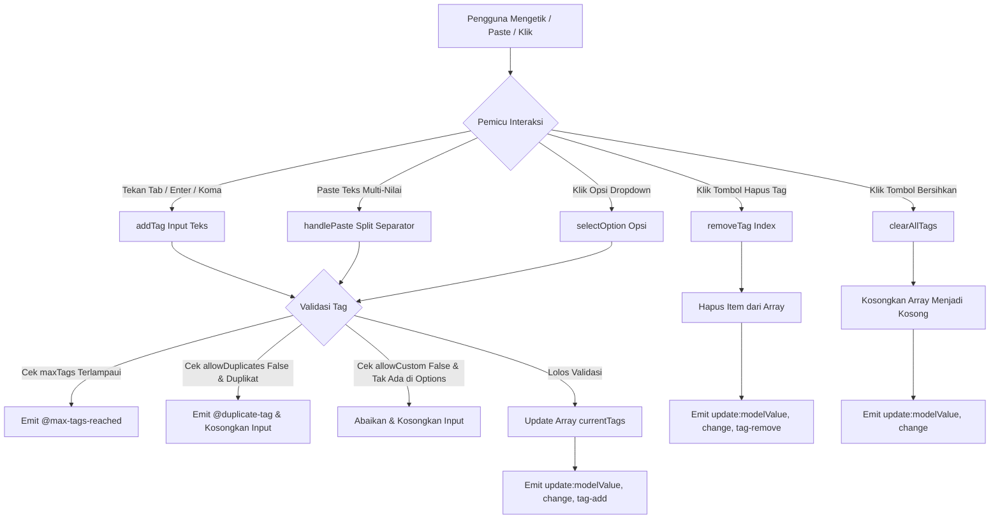

# TagInput Component

## 01. Overview

TagInput (tersedia melalui `<TagInput.vue />` dan `<InputTag.vue />`) adalah komponen formulir interaktif berbasis Vue 3 dan Tailwind CSS untuk mengelola kumpulan kata kunci, label kategori, keahlian, atau tag metadata dalam format chip. Komponen ini dirancang untuk alur kerja aplikasi enterprise dengan performa tinggi, navigasi keyboard lengkap, dan penanganan input hibrida.

Komponen ini mendukung input teks bebas (*free-form tagging*), pilihan terbatas dari daftar opsi yang telah ditentukan (*strict preset options*), maupun mode hibrida di mana pengguna dapat memilih saran otomatis sekaligus membuat entri baru secara fleksibel.

### Fungsi Utama
* Mengonversi teks yang diketik menjadi chip tag interaktif secara instan menggunakan pemicu tombol keyboard (`Tab`, `Enter`, atau koma `,`).
* Menyediakan daftar saran autocomplete dropdown melayang (*floating options*) yang bebas terpotong (*anti-clipping*) dengan z-index tinggi (`z-[9999]`).
* Mendukung pemecahan teks otomatis saat pengguna menempelkan (*paste*) daftar multi-item yang dipisahkan oleh koma, titik koma, spasi, atau baris baru (`\n`).
* Menyediakan 10 varian warna semantik (`default`, `primary`, `emerald`, `indigo`, `rose`, `amber`, `purple`, `dark`, `cyan`, dan `random`) dengan 3 gaya kartu (`soft`, `solid`, dan `outline`).
* Dilengkapi algoritma hash deterministik pada varian `random`, sehingga teks kata yang sama selalu mendapatkan kombinasi warna harmonis yang konsisten.
* Memiliki kontrol validasi ketat termasuk batas maksimum tag (`maxTags`), pencegahan duplikasi (`allowDuplicates`), konversi otomatis huruf kecil (`lowercase`), dan integrasi pesan kesalahan validasi Laravel (`error`).
* Mendukung slot kustom penuh (`#tag`, `#option`, `#prefix`) untuk mempersonalisasi tampilan chip dan baris pilihan dropdown.
* Mengintegrasikan komponen atomik `<Badge.vue />` secara internal untuk konsistensi visual dan kemudahan pemeliharaan desain sistem.

### Kapan Digunakan
* **Pengelompokan Artikel & Blog**: Menambahkan tag kategori atau topik berita pada editor konten.
* **Filter Data & Pencarian Multi-Nilai**: Memilih beberapa kriteria filter sekaligus pada tabel data atau toolbar pencarian.
* **Manajemen Profil & Keahlian**: Memasukkan daftar keterampilan teknis, bahasa yang dikuasai, atau peran pengguna.
* **Penetapan Hak Akses & Label Keamanan**: Menetapkan daftar label otorisasi atau peran keamanan sistem.

### Kapan Tidak Digunakan
* **Pilihan Tunggal Sederhana**: Jika pengguna hanya boleh memilih tepat satu opsi dari daftar tetap, gunakan **InputSelect** atau **InputRadio**.
* **Input Teks Baris Tunggal Biasa**: Jika kolom hanya memerlukan satu nilai teks pendek (seperti nama atau email), gunakan **InputField**.
* **Pilihan Banyak Status Sederhana**: Jika opsi berjumlah sedikit dan selalu tampil permanen di layar, gunakan **InputCheckbox**.

### Karakteristik Penting
* **Keyboard-First Workflow**: Navigasi tombol `Tab`, `Enter`, `Backspace`, panah atas/bawah, dan `Escape` dirancang untuk meminimalkan ketergantungan pada mouse.
* **True Center Alignment**: Teks, ikon Google Material Symbols, tombol hapus individual, dan tombol bersihkan semua diratakan secara vertikal dengan `inline-flex items-center justify-center leading-none`.
* **Atomic Component Reuse**: Chip tag internal merender komponen `<Badge.vue />` secara native sehingga mewarisi seluruh kemampuan rendering, aksesibilitas, dan styling badge.
* **Full Dark Mode**: Terintegrasi penuh dengan kelas `dark:` Tailwind CSS, menjaga kontras teks dan keterbacaan chip di berbagai latar belakang tema.

---

## 02. Preview

> [!TIP]
> Pengujian visual dan showcase interaktif entitas ini tersedia secara native pada portal pratinjau aplikasi:
>
> <a href="http://localhost:8000/preview/tag-input" target="_self" style="display: inline-flex; align-items: center; gap: 6px; padding: 6px 14px; border-radius: 8px; font-weight: 600; text-decoration: none; margin-top: 8px; background-color: var(--vp-c-brand-1, #4f46e5); color: #ffffff;">Buka Live Preview Komponen TagInput &rarr;</a>

### Ringkasan Blueprint Visual Showcase:
* **Interactive Playground Workbench**: Kanvas live component dengan simulasi v-model reaktif, pelacak telemetri event, dan generator template kode Vue 3 dinamis.
* **Panel Kontrol 5 Pilar**: Pengatur 10 varian warna (termasuk visual badge bar), 3 gaya kartu chip (`soft`, `solid`, `outline`), 3 ukuran (`sm`, `md`, `lg`), 7 radius, 6 pilihan ikon material, slider `maxTags`, serta sakelar toggle fungsional.
* **4 Koleksi Skenario Kasus Nyata**:
  1. *SEO & Kategori Berita*: Hash warna random konsisten, pill capsule, penambahan cepat.
  2. *Filter Katalog E-Commerce*: Mode strict preset options (`allowCustom: false`) dengan tombol reset filter.
  3. *Peran Akses Tim Proyek*: Gaya solid purple dengan kustomisasi scoped slot `#tag` menggunakan `<Badge.vue />`.
  4. *Validasi Formulir Registrasi*: Simulasi pesan kesalahan validasi dinamis jika tag kurang dari batas minimal.

---

## 03. Usage

```text
TagInput Workflow & Skema Penggunaan
├── 1. Mode Bebas (Tanpa Opsi) [allowCustom = true, showOptions = false / options = []]
│   ├── Blog Post Topics Bebas
│   ├── SEO Keywords Dinamis
│   └── Input Email / Tag Mentah
├── 2. Mode Hibrida (Bebas + Opsi) [allowCustom = true, showOptions = true]
│   ├── Kategori Produk Populer + Input Kategori Baru
│   ├── Keahlian Teknis Disarankan + Tambah Skill Kustom
│   └── Label Prioritas Fleksibel
└── 3. Mode Strict (Hanya dari Opsi) [allowCustom = false, showOptions = true]
    ├── Hak Akses Peran Keamanan / Permissions
    ├── Taksonomi Departemen Perusahaan Baku
    └── Filter Katalog Terstandarisasi (E-Commerce)
```

### 3 Skema Inti Penggunaan TagInput

TagInput dirancang dengan 3 skema perilaku utama yang dapat dikombinasikan melalui prop `allowCustom` dan `showOptions`:
1. **Mode Bebas (Tanpa Opsi)**: Pengguna bebas mengetik kata kunci apa saja. Dropdown saran dinonaktifkan (`showOptions = false` atau `options = []`). Pembuatan tag dipicu seketika saat menekan tombol `Tab`, `Enter`, atau koma `,`.
2. **Mode Hibrida (Bebas + Ada Opsi)**: Pengguna disajikan dropdown saran autocomplete saat mengetik untuk memilih opsi populer, namun tetap bebas mengetik kata kunci baru di luar daftar opsi (`allowCustom = true`, `showOptions = true`).
3. **Mode Strict (Hanya dari Opsi)**: Tag yang dimasukkan terkunci secara ketat dan **wajib** berasal dari daftar opsi yang telah ditentukan (`allowCustom = false`, `showOptions = true`). Jika pengguna mencoba mengetik teks di luar opsi, komponen akan menolak kata tersebut, mengosongkan input, dan memancarkan event `@invalid-tag`.

### 1. Penggunaan Dasar Komponen TagInput

```vue
<script setup>
import { ref } from 'vue';
import TagInput from '@/Components/Pack/TagInput.vue';

const categories = ref(['Laravel', 'Vue.js', 'Inertia.js']);
</script>

<template>
  <div class="max-w-md">
    <TagInput
      v-model="categories"
      label="Kategori Minat"
      placeholder="Ketik kategori lalu tekan Tab atau Enter..."
      hint="Tekan Tab, Enter, atau koma untuk menambahkan tag baru"
      icon="label"
      clearable
    />
  </div>
</template>
```

### 2. Integrasi Melalui InputField Facade

Komponen ini dapat dipanggil secara modular melalui facade formulir serbaguna `<InputField />`:

```vue
<script setup>
import { ref } from 'vue';
import InputField from '@/Components/Pack/InputField.vue';

const skills = ref(['Tailwind CSS', 'TypeScript']);
</script>

<template>
  <InputField
    v-model="skills"
    type="tag"
    label="Keahlian Teknis"
    :options="['Tailwind CSS', 'TypeScript', 'PHP', 'Docker']"
    :allow-custom="true"
    tag-variant="indigo"
    tag-style="soft"
    icon="school"
    placeholder="Pilih atau ketik keahlian..."
  />
</template>
```

---

## 04. Anatomy

### 1. Struktur Hierarki Elemen
```text
TagInput / InputTag (Root Container)
│
├── Label & Counter Header (Flex horizontal space-between)
│   ├── Label Text & Required Asterisk (*)
│   └── Max Tags Counter Indicator (e.g. '3 / 8 tag')
│
├── Relative Input Wrapper
│   │
│   ├── Main Box Container (Flex wrap, Focus-within ring, Border container)
│   │   │
│   │   ├── Leading Input Icon Slot / Google Material Symbol
│   │   │
│   │   ├── TransitionGroup (Animasi scale & opacity masuk/keluar chip)
│   │   │   │
│   │   │   └── Tag Chip Item (Scoped Slot #tag / Komponen <Badge />)
│   │   │       ├── Leading Chip Icon (Material Symbol)
│   │   │       ├── Tag Label Text (Truncate, Select-text)
│   │   │       └── Remove Button 'close' (Hover opacity, Centered icon)
│   │   │
│   │   ├── Interactive Text Input Field (Placeholder dinamis, Keydown handler)
│   │   │
│   │   └── Clear All Button (Tampil di kanan jika tags > 0 dan clearable=true)
│   │
│   └── Dropdown Options Panel (Absolute, Z-[9999], Floating menu, Backdrop blur)
│       ├── Suggestion Option Item Buttons (Highlighted index, Click handler)
│       │   ├── Option Icon (Material Symbol)
│       │   ├── Option Label & Subtext
│       │   └── Selection State Checkmark
│       └── Empty State Message (Tampil jika query tidak menemukan opsi)
│
└── Hint & Error Message Footer
    ├── Error Text with Warning Icon (Teks merah jika prop error terisi)
    └── Hint Guide Text (Teks abu-abu panduan pengisian)
```

### 2. Diagram Alur Data Internal


---

## 05. Variants

Komponen menyediakan 10 varian skema warna (`tagVariant`) dan 3 gaya visual kartu chip (`tagStyle`):

### 1. Skema Warna (`tagVariant`)

| Varian Warna | Prop Value | Karakteristik Visual | Kasus Penggunaan yang Direkomendasikan |
| :--- | :--- | :--- | :--- |
| **Default** | `'default'` *(default)* | Abu-abu slate netral dengan border halus. | Tag metadata umum, arsip dokumen, dan antarmuka monokrom. |
| **Primary** | `'primary'` | Biru royal profesional berdaya kontras seimbang. | Kategori utama, modul bisnis, dan topik standar. |
| **Emerald** | `'emerald'` | Hijau zamrud segar dengan nuansa positif. | Tag status aktif, fitur tersertifikasi, dan transaksi berhasil. |
| **Indigo** | `'indigo'` | Biru nila pekat bernuansa teknologi modern. | Bahasa pemrograman, keahlian teknis, dan arsitektur data. |
| **Rose** | `'rose'` | Merah mawar tegas berdaya tangkap visual tinggi. | Tag prioritas kritis, label darurat, dan peringatan bug. |
| **Amber** | `'amber'` | Kuning emas hangat berorientasi perhatian. | Peringatan dalam peninjauan, status draf, dan tag sementara. |
| **Purple** | `'purple'` | Ungu kreatif yang elegan. | Fitur VIP, akun premium, dan departemen desain. |
| **Dark** | `'dark'` | Hitam arang / zinc pekat bergaya terminal developer. | Sistem log, baris perintah CLI, dan antarmuka teknis. |
| **Cyan** | `'cyan'` | Biru toska cerah berdaya baca tajam. | Komputasi cloud, jaringan, dan modul telemetri. |
| **Random** | `'random'` | Algoritma hash deterministik memetakan setiap kata secara otomatis ke kombinasi warna harmonis. | Daftar tag multi-kategori dinamis di mana setiap nama kata selalu mendapatkan warna konsisten. |

### 2. Gaya Visual Chip (`tagStyle`)

| Gaya Tampilan | Prop Value | Deskripsi Visual |
| :--- | :--- | :--- |
| **Soft** | `'soft'` *(default)* | Latar belakang warna pastel lembut dengan teks bernuansa senada dan border tipis. |
| **Solid** | `'solid'` | Warna penuh solid berdaya kontras tinggi dengan teks dan ikon putih bersih. |
| **Outline** | `'outline'` | Latar belakang transparan dengan garis batas (*border*) berwarna semantik tegas. |

---

## 06. Sizes & Shapes

### 1. Skala Ukuran (`size`)

| Ukuran | Prop Value | Tinggi Minimal Wrapper | Dimensi Chip Tag | Ukuran Font Input | Kapan Digunakan |
| :--- | :--- | :--- | :--- | :--- | :--- |
| **Small** | `'sm'` | `min-h-7` (~28px) | `px-1.5 py-0.25 text-[11px]` | `text-xs` (12px) | Toolbar filter data, sidebar padat, dan tabel ringkas. |
| **Medium** | `'md'` *(default)* | `min-h-8.5` (~34px) | `px-2 py-0.5 text-xs` | `text-xs` (12px) | Standar formulir web dan dashboard enterprise. |
| **Large** | `'lg'` | `min-h-10` (~40px) | `px-2.5 py-0.75 text-xs font-medium` | `text-sm` (14px) | Hero section, pencarian beranda, dan mode aksesibilitas. |

### 2. Kelengkungan Sudut (`radius`)

Prop `radius` secara otomatis menyelaraskan kelengkungan kontainer kotak input dan chip tag di dalamnya:
* `'none'`: Sudut siku-siku tajam (`rounded-none`).
* `'sm'`: Kelengkungan mikro (`rounded-sm`).
* `'md'`: Kelengkungan sedang (`rounded-md`).
* `'lg'`: Kelengkungan standar modern (`rounded-lg`).
* `'xl'` *(default)*: Kelengkungan tegas elegan (`rounded-xl`).
* `'2xl'`: Kelengkungan melengkung halus (`rounded-2xl`).
* `'full'`: Format kapsul penuh (*pill capsule*).

---

## 07. States

| State | Kondisi Pemicu | Representasi Visual | Perilaku Fungsional |
| :--- | :--- | :--- | :--- |
| **Default / Idle** | Komponen siap menerima interaksi | Border abu-abu halus (`border-slate-200 dark:border-slate-800`), placeholder tampil jika kosong. | Menunggu fokus pengguna atau ketikan awal. |
| **Focused / Active** | Pengguna mengklik atau menekan Tab ke input | Border berubah emerald/aksen dengan ring lembut (`border-emerald-500 ring-2 ring-emerald-500/20`). | Membuka dropdown opsi otomatis jika opsi tersedia. |
| **Dropdown Open** | Input aktif dan opsi tersedia | Panel melayang muncul tepat di bawah kotak input dengan animasi transisi halus (`z-[9999]`). | Menampilkan daftar saran yang cocok dengan ketikan. |
| **Option Highlighted** | Menekan panah atas/bawah atau mengarahkan mouse ke baris opsi | Baris opsi berlatar emerald lembut dengan teks tebal. | Menyiapkan opsi untuk dipilih saat menekan Tab atau Enter. |
| **Max Tags Reached** | Jumlah tag mencapai nilai `maxTags` | Kotak input teks dinonaktifkan, indikator hitungan menunjukkan kapasitas penuh. | Memancarkan event `@max-tags-reached` dan mencegah penambahan tag baru. |
| **Duplicate Prevented** | Pengguna mengetik tag yang sudah ada (saat `allowDuplicates=false`) | Teks input dikosongkan seketika tanpa menambahkan duplikat. | Menjaga keunikan elemen dalam array dan memancarkan `@duplicate-tag`. |
| **Disabled** | Prop `disabled="true"` | Opasitas berkurang 60%, kursor `not-allowed`, tombol hapus disembunyikan. | Mengabaikan seluruh aksi keyboard dan klik. |
| **Readonly** | Prop `readonly="true"` | Teks tidak dapat disunting, tombol hapus disembunyikan. | Hanya menampilkan daftar tag untuk kebutuhan pratinjau. |
| **Error** | Prop `error` berisi pesan teks | Border berubah merah dengan ring error (`border-rose-300 ring-rose-500/20`), pesan galat tampil di bawah input. | Menginformasikan kegagalan validasi formulir. |

---

## 08. Props / Parameters / Attributes

| Prop | Tipe Data | Default | Pilihan Nilai | Keterangan |
| :--- | :--- | :--- | :--- | :--- |
| `modelValue` | `Array\|String` | `[]` | Array String / Objek | Nilai reaktif array tag terpilih (`v-model`). |
| `options` | `Array` | `[]` | Array String / Objek | Daftar opsi autocomplete atau pilihan tetap. Format objek: `{ label, value, icon, subtext }`. |
| `allowCustom` | `Boolean` | `true` | `true`, `false` | Jika `true`, pengguna bebas mengetik tag baru. Jika `false`, tag wajib dipilih dari `options`. |
| `separatorKeys` | `Array` | `['Tab', 'Enter', ',']` | Array String | Tombol keyboard yang memicu pembuatan tag saat mengetik. |
| `allowDuplicates`| `Boolean` | `false` | `true`, `false` | Mengizinkan atau menolak nilai tag kembar dalam satu daftar. |
| `maxTags` | `Number` | `null` | Angka Positif | Batas maksimal jumlah tag yang dapat dibuat. |
| `tagVariant` | `String` | `'default'` | `'default'`, `'primary'`, `'emerald'`, `'indigo'`, `'rose'`, `'amber'`, `'purple'`, `'dark'`, `'cyan'`, `'random'` | Skema warna visual untuk chip tag. |
| `tagStyle` | `String` | `'soft'` | `'soft'`, `'solid'`, `'outline'` | Gaya tampilan kartu chip tag. |
| `size` | `String` | `'md'` | `'sm'`, `'md'`, `'lg'` | Skala ukuran padding, font, dan dimensi chip tag. |
| `radius` | `String` | `'xl'` | `'none'`, `'sm'`, `'md'`, `'lg'`, `'xl'`, `'2xl'`, `'full'` | Kelengkungan sudut kotak input dan chip tag. |
| `label` | `String` | `''` | String Teks | Teks label formulir di atas kotak input. |
| `placeholder` | `String` | `'Ketik tag lalu tekan Tab atau Enter...'` | String Teks | Teks placeholder saat belum ada tag yang terpilih. |
| `hint` | `String` | `''` | String Teks | Teks petunjuk bantuan di bawah kotak input. |
| `error` | `String` | `''` | String Teks | Pesan galat validasi formulir (mengubah warna border menjadi merah). |
| `icon` | `String` | `''` | Nama Material Symbol | Ikon pemandu di sisi kiri dalam kotak input (misal: `icon="label"`). |
| `leadingIcon` | `String` | `''` | Nama Material Symbol | Alias dari prop `icon` untuk keselarasan dengan konvensi penamaan input pack. |
| `tagIcon` | `String` | `''` | Nama Material Symbol | Ikon yang disematkan secara seragam pada setiap chip tag. |
| `showOptions` | `Boolean` | `true` | `true`, `false` | Menampilkan atau menyembunyikan panel dropdown saran autocomplete. Jika `false`, saran tidak akan muncul (mode bebas murni). |
| `addOnBlur` | `Boolean` | `true` | `true`, `false` | Otomatis mengonversi sisa teks ketikan menjadi tag saat input kehilangan fokus (*blur*). |
| `removable` | `Boolean` | `true` | `true`, `false` | Menampilkan tombol silang `close` pada masing-masing chip tag. |
| `removeOnBackspace` | `Boolean` | `true` | `true`, `false` | Menghapus tag terakhir saat tombol Backspace ditekan pada kondisi input kosong. |
| `clearable` | `Boolean` | `true` | `true`, `false` | Menampilkan tombol silang di sisi kanan untuk membersihkan seluruh tag sekaligus. |
| `pasteSeparators` | `Array` | `[',', ';', '\n', '\t']` | Array Karakter | Karakter pemisah untuk memecah teks saat pengguna melakukan operasi paste. |
| `lowercase` | `Boolean` | `false` | `true`, `false` | Otomatis mengubah seluruh huruf tag menjadi huruf kecil. |
| `disabled` | `Boolean` | `false` | `true`, `false` | Menonaktifkan komponen secara menyeluruh. |
| `readonly` | `Boolean` | `false` | `true`, `false` | Mengunci komponen dalam mode hanya-baca. |
| `required` | `Boolean` | `false` | `true`, `false` | Menandai bahwa kolom wajib diisi (menampilkan tanda bintang merah). |

### Exposed Methods & Properties (`defineExpose`)
Komponen mengekspos metode internal yang dapat dipanggil melalui Template Ref:
* `addTag(text)`: Menambahkan tag baru secara programatis.
* `removeTag(index)`: Menghapus tag pada indeks tertentu.
* `clearAllTags()`: Mengosongkan seluruh tag yang ada.
* `focusInput()`: Memfokuskan kursor pada kotak input teks pengetikan.
* `currentTags`: Array reaktif daftar tag terpilih saat ini.

---

## 09. Slots / Content

| Slot Name | Scope Props | Deskripsi |
| :--- | :--- | :--- |
| `tag` | `{ tag, index, remove, icon, variantClasses }` | Menggantikan seluruh template chip tag dengan tata letak kustom (misal menyisipkan Avatar atau badge status). |
| `option` | `{ option, highlighted }` | Menggantikan tampilan setiap baris opsi pada dropdown autocomplete. |
| `prefix` | `-` | Menambahkan elemen kustom di sisi paling kiri sebelum daftar chip tag. |

---

## 10. Events / Interactions

| Event Name | Payload | Kapan Dipancarkan |
| :--- | :--- | :--- |
| `update:modelValue` | `Array` | Dipancarkan secara instan setiap kali ada penambahan, penghapusan, atau pembersihan tag (`v-model`). |
| `change` | `Array` | Dipancarkan saat status daftar tag selesai dimodifikasi. |
| `tag-add` | `String` | Dipancarkan tepat saat sebuah tag baru berhasil ditambahkan. |
| `tag-remove` | `String, Number` | Dipancarkan saat sebuah tag dihapus (mengirimkan teks tag dan indeks posisi). |
| `max-tags-reached` | `Number` | Dipancarkan saat pengguna mencoba menambahkan tag melebihi batas `maxTags`. |
| `duplicate-tag` | `String` | Dipancarkan saat pengguna mencoba menambahkan tag yang sudah ada dalam array (saat `allowDuplicates=false`). |
| `invalid-tag` | `String` | Dipancarkan saat pengguna mengetik kata di luar daftar opsi pada mode strict (`allowCustom=false`). |
| `clear` | `-` | Dipancarkan saat tombol bersihkan semua tag diklik. |
| `focus` | `FocusEvent` | Dipancarkan saat kotak input teks menerima fokus. |
| `blur` | `FocusEvent` | Dipancarkan saat kotak input teks kehilangan fokus. |

---

## 11. Code Example

### 1. Penggunaan Dasar (Basic Example)
Implementasi minimal input tag bebas untuk kata kunci pencarian:

```vue
<script setup>
import { ref } from 'vue';
import TagInput from '@/Components/Pack/TagInput.vue';

const keywords = ref(['Frontend', 'UI Design']);
</script>

<template>
  <TagInput
    v-model="keywords"
    label="Kata Kunci Pencarian"
    placeholder="Ketik kata kunci lalu tekan Enter..."
    clearable
  />
</template>
```

### 2. Penggunaan Menengah (Intermediate Example)
Menggunakan saran autocomplete, varian warna deterministik `random`, dan kelengkungan `full` (pill):

```vue
<script setup>
import { ref } from 'vue';
import TagInput from '@/Components/Pack/TagInput.vue';

const articleTopics = ref(['Teknologi', 'Tutorial']);
const topicSuggestions = [
    { label: 'Teknologi', icon: 'devices' },
    { label: 'Kecerdasan Buatan', icon: 'psychology' },
    { label: 'Keamanan Siber', icon: 'security' },
    { label: 'Tutorial', icon: 'school' },
    { label: 'Desain Grafis', icon: 'palette' },
];
</script>

<template>
  <TagInput
    v-model="articleTopics"
    :options="topicSuggestions"
    :allow-custom="true"
    tag-variant="random"
    tag-style="soft"
    radius="full"
    icon="tag"
    label="Topik Artikel"
    placeholder="Pilih topik atau buat baru..."
    hint="Tekan Tab, Enter, atau koma untuk memisahkan topik"
  />
</template>
```

### 3. Penggunaan Lanjutan / Enterprise (Advanced Example)
Integrasi formulir pembuatan proyek dengan validasi Inertia Form, pembatasan ketat (`allowCustom: false`), dan penanganan batas maksimum tag:

```vue
<script setup>
import { useForm } from '@inertiajs/vue3';
import TagInput from '@/Components/Pack/TagInput.vue';
import ButtonSubmit from '@/Components/Pack/ButtonSubmit.vue';

const form = useForm({
    title: '',
    department: 'Engineering',
    assignedRoles: ['Lead Architect'],
});

const securityRoles = [
    { label: 'Lead Architect', value: 'lead', icon: 'military_tech', subtext: 'Akses penuh arsitektur' },
    { label: 'DevOps Engineer', value: 'devops', icon: 'cloud', subtext: 'Deployment & server' },
    { label: 'Security Officer', value: 'security', icon: 'shield', subtext: 'Audit keamanan' },
    { label: 'QA Specialist', value: 'qa', icon: 'bug_report', subtext: 'Pengujian kualitas' },
];

const submitForm = () => {
    form.post('/projects', {
        preserveScroll: true,
    });
};
</script>

<template>
  <form @submit.prevent="submitForm" class="space-y-6 max-w-xl">
    <TagInput
      v-model="form.assignedRoles"
      :options="securityRoles"
      :allow-custom="false"
      label="Hak Akses Peran Proyek"
      placeholder="Pilih peran dari daftar otorisasi..."
      hint="Maksimal 3 peran keamanan per proyek"
      icon="admin_panel_settings"
      tag-variant="purple"
      tag-style="solid"
      radius="lg"
      :max-tags="3"
      :show-count="true"
      :error="form.errors.assignedRoles"
      required
    />

    <ButtonSubmit
      type="submit"
      variant="primary"
      :loading="form.processing"
      icon="save"
    >
      Simpan Pengaturan Proyek
    </ButtonSubmit>
  </form>
</template>
```

---

## 12. Result / Behavior

### 1. Pengetikan Cepat Berantai
Pengguna dapat mengetik kata pertama, menekan `Tab` atau `Enter`, langsung mengetik kata kedua tanpa jeda fokus, dan menekan `Tab` lagi. Tag langsung tertata rapi dalam array `v-model`.

### 2. Pencegahan Blur Bawaan Tab
Tombol `Tab` secara default dicegat (`e.preventDefault()`) saat terdapat ketikan aktif di input untuk mencegah kursor melompat ke elemen form berikutnya sebelum tag berhasil dibuat.

### 3. Pemecahan Paste Multi-Nilai
Jika pengguna menyalin teks berformat koma atau baris baru (`"PHP, TypeScript, Go, Python"`) dari dokumen lain lalu menempelkannya (*paste*), fungsi `handlePaste` secara otomatis memecah teks tersebut menjadi 4 chip tag individual yang tervalidasi.

### 4. Navigasi Keyboard Dropdown Cerdas
Saat daftar opsi disarankan muncul:
* Menekan tombol `ArrowDown` menyorot opsi berikutnya.
* Menekan tombol `ArrowUp` menyorot opsi sebelumnya.
* Menekan tombol `Enter` atau `Tab` memilih opsi yang disorot seketika dan menutup panel saran.
* Menekan `Escape` menutup panel saran tanpa memodifikasi nilai.

---

## 13. Customization

### 1. Kustomisasi Scoped Slot `#tag` dengan Komponen Badge
Komponen internal TagInput terintegrasi langsung dengan `<Badge.vue />`. Anda dapat memanfaatkan scoped slot `#tag` untuk mengganti tampilan chip secara spesifik:

```vue
<template>
  <TagInput v-model="teamRoles" :options="roleOptions" label="Peran Tim Proyek">
    <template #tag="{ tag, remove, icon }">
      <Badge
        variant="solid"
        color="purple"
        size="sm"
        rounded="md"
        :icon="icon || 'badge'"
        :removable="true"
        @remove="remove"
      >
        {{ tag }}
      </Badge>
    </template>
  </TagInput>
</template>
```

### 2. Kustomisasi Scoped Slot `#option` Dropdown
Menyisipkan avatar, ikon khusus, atau status badge pada setiap baris opsi dropdown autocomplete:

```vue
<template>
  <TagInput v-model="selectedMembers" :options="memberOptions" label="Tugaskan Anggota">
    <template #option="{ option, highlighted }">
      <div class="flex items-center gap-2.5 py-1">
        <span class="w-6 h-6 rounded-full bg-slate-200 dark:bg-slate-700 flex items-center justify-center text-xs font-bold">
          {{ option.label.charAt(0) }}
        </span>
        <div class="flex flex-col">
          <span class="text-xs font-semibold">{{ option.label }}</span>
          <span class="text-[10px] text-slate-400">{{ option.email }}</span>
        </div>
      </div>
    </template>
  </TagInput>
</template>
```

---

## 14. Accessibility (a11y)

Komponen mematuhi pedoman WAI-ARIA dan WCAG 2.1 Level AA:

### Matriks Dukungan Navigasi Keyboard:
| Tombol Keyboard | Konteks / Kondisi | Aksi yang Dijalankan |
| :--- | :--- | :--- |
| `Tab` | Input memiliki teks ketikan | Mencegah perpindahan fokus, mengonversi teks menjadi tag. |
| `Enter` | Input memiliki teks ketikan | Mencegah submit form bawaan, mengonversi teks menjadi tag. |
| `ArrowDown` | Dropdown opsi terbuka | Menyorot opsi berikutnya ke bawah. |
| `ArrowUp` | Dropdown opsi terbuka | Menyorot opsi sebelumnya ke atas. |
| `Backspace` | Input teks kosong & ada tag | Menghapus tag terakhir dalam array secara otomatis. |
| `Escape` | Dropdown opsi terbuka | Menutup panel dropdown dan mengembalikan fokus ke input. |

### Atribut ARIA & Standar Kontras:
* **Peran Combobox**: Wrapper luar mengelola status dropdown dengan `role="combobox"` dan `aria-expanded`.
* **Screen Reader Announcement**: Tombol silang individual pada Badge dilengkapi atribut `aria-label="Hapus badge"` untuk memberitahu teknologi asistif.
* **Focus Restoration**: Mengklik area kosong pada kontainer pembungkus input secara otomatis mengarahkan fokus ke elemen `<input />` internal (`cursor-text`).

---

## 15. Responsive Behavior

### Breakpoint Adaptations:
| Viewport | Rentang Lebar | Perilaku Antarmuka TagInput |
| :--- | :--- | :--- |
| **Mobile** | `< 768px` | Flex wrap penuh dengan `min-w-30` pada kotak input pengetikan, dropdown melayang mengambil lebar penuh kontainer dengan target tap nyaman (38px–42px). |
| **Tablet** | `768px - 1023px` | Tata letak kolom fleksibel di dalam form grid 2 kolom, teks tag otomatis terpotong (`truncate`) dengan aman pada batas lebar wajar. |
| **Desktop** | `>= 1024px` | Alur horisontal proporsional, scrollbar kustom halus pada dropdown (`max-h-56`), navigasi keyboard instan. |

### Touch Target & Text Truncation:
* Tombol silang hapus individual pada tag chip memiliki area klik minimal `w-5 h-5` hingga `w-6 h-6` yang terpusat secara presisi (*true center*).
* Teks label tag yang sangat panjang dibatasi dengan kelas utilitas `truncate` sehingga tidak pernah memecah tata letak form pada layar ponsel sempit (320px–375px).

---

## 16. Do / Don't

| Panduan Do (Direkomendasikan) | Panduan Don't (Dilarang / Hindari) |
| :--- | :--- |
| **Gunakan separatorKeys standar**: Pertahankan `Tab`, `Enter`, dan koma `,` agar pengguna terbiasa dengan pola input tag modern. | **Jangan biarkan kolom tanpa placeholder atau hint**: Selalu beri petunjuk tombol keyboard yang digunakan untuk membuat tag. |
| **Gunakan allowCustom=false untuk taksonomi kaku**: Kunci nilai tag hanya dari daftar opsi jika data harus cocok persis dengan kolom database (seperti role/permission). | **Jangan gunakan TagInput untuk pilihan tunggal**: Jika nilai hanya boleh 1, gunakan `InputField type="select"`. |
| **Gunakan varian 'random' untuk label dinamis**: Memberikan warna harmonis otomatis pada tag artikel atau kategori multi-topik. | **Jangan matikan removable jika data dapat diedit**: Mematikan tombol silang pada form edit akan membuat pengguna kebingungan saat ingin menghapus tag. |
| **Gunakan maxTags dengan showCount**: Berikan visualisasi jumlah kuota tag yang tersisa agar pengguna tidak frustrasi saat batas tercapai. | **Jangan letakkan ratusan opsi autocomplete tanpa filter**: Manfaatkan pencarian teks untuk menyaring daftar opsi panjang agar performa peramban tetap ringan. |

---

## 17. Examples / Recipes

### Resep 1: Formulir Artikel CMS dengan Inertia useForm & Validasi Backend
Pola integrasi form penulisan artikel lengkap dengan pengiriman data array tag ke Controller Laravel:

```vue
<script setup>
import { useForm } from '@inertiajs/vue3';
import TagInput from '@/Components/Pack/TagInput.vue';
import ButtonSubmit from '@/Components/Pack/ButtonSubmit.vue';

const form = useForm({
    title: '',
    content: '',
    tags: ['Laravel', 'Vue.js'],
});

const submitArticle = () => {
    form.post('/articles', {
        preserveScroll: true,
    });
};
</script>

<template>
  <form @submit.prevent="submitArticle" class="space-y-5">
    <TagInput
      v-model="form.tags"
      label="Tag Artikel"
      placeholder="Ketik topik artikel lalu tekan Tab atau Enter..."
      hint="Gunakan koma atau Enter untuk menambahkan tag baru"
      tag-variant="primary"
      tag-style="soft"
      icon="tag"
      :error="form.errors.tags"
      clearable
      required
    />

    <ButtonSubmit type="submit" :loading="form.processing">
      Publikasikan Artikel
    </ButtonSubmit>
  </form>
</template>
```

### Resep 2: Filter Pencarian Multi-Kriteria Katalog E-Commerce
Menyaring katalog produk berdasarkan kriteria tetap yang dapat ditambah dan dihapus seketika:

```vue
<script setup>
import { ref, watch } from 'vue';
import TagInput from '@/Components/Pack/TagInput.vue';

const activeFilters = ref(['Elektronik', 'Gratis Ongkir']);
const filterCriteria = ['Elektronik', 'Pakaian', 'Gratis Ongkir', 'Diskon 50%', 'Official Store', 'Cicilan 0%'];

const emit = defineEmits(['filter-change']);

watch(activeFilters, (newFilters) => {
    emit('filter-change', newFilters);
}, { deep: true });
</script>

<template>
  <div class="p-4 rounded-xl bg-slate-50 dark:bg-slate-900 border border-slate-200 dark:border-slate-800">
    <TagInput
      v-model="activeFilters"
      :options="filterCriteria"
      :allow-custom="false"
      label="Filter Aktif"
      placeholder="Pilih filter produk..."
      tag-variant="amber"
      tag-style="soft"
      icon="filter_alt"
      clearable
    />
  </div>
</template>
```

---

## 18. Related Items

| Komponen / Artefak | Hubungan & Integrasi | Kapan Digunakan Bersama |
| :--- | :--- | :--- |
| [Badge](/components/badge) | Komponen chip atomik internal | Digunakan di dalam TagInput untuk merender setiap tag individual secara konsisten. |
| [InputField](/components/input-field) | Facade komponen form utama | Membungkus TagInput dengan sintaks `<InputField type="tag" />`. |
| [InputSelect](/components/input-select) | Alternatif pilihan tunggal | Digunakan jika pengguna hanya diperbolehkan memilih tepat satu opsi. |
| [ButtonSubmit](/components/button-submit) | Tombol aksi form | Digunakan bersama TagInput di dalam formulir untuk aksi simpan atau reset. |
| [FilterToolbar](/components/filter-toolbar) | Wadah filter pencarian tabel | Menempatkan TagInput di bagian atas tabel data untuk filtering multi-kategori. |

---

## 19. Notes / Limitations

* **Ketergantungan Font Google Material Symbols**: Ikon penanda leading (`icon`), ikon chip tag (`tagIcon`), serta ikon dropdown mengandalkan font Google Material Symbols. Pastikan font tersebut telah dimuat pada layout induk aplikasi.
* **Perilaku Pemecah Paste Karakter Khusus**: Logika `handlePaste` memecah teks berdasarkan array karakter `pasteSeparators` (`[',', ';', '\n', '\t']`). Jika teks tag Anda secara sengaja mengandung karakter koma sebagai bagian dari satu kata, pastikan untuk menyesuaikan prop `pasteSeparators`.
* **Pencegahan Default Enter & Tab**: Komponen secara sengaja mencegat `event.preventDefault()` pada penekanan tombol `Enter` dan `Tab` saat input memiliki ketikan aktif untuk mencegah formulir HTML terkirim (*accidentally submitted*) sebelum kata selesai diubah menjadi tag.
