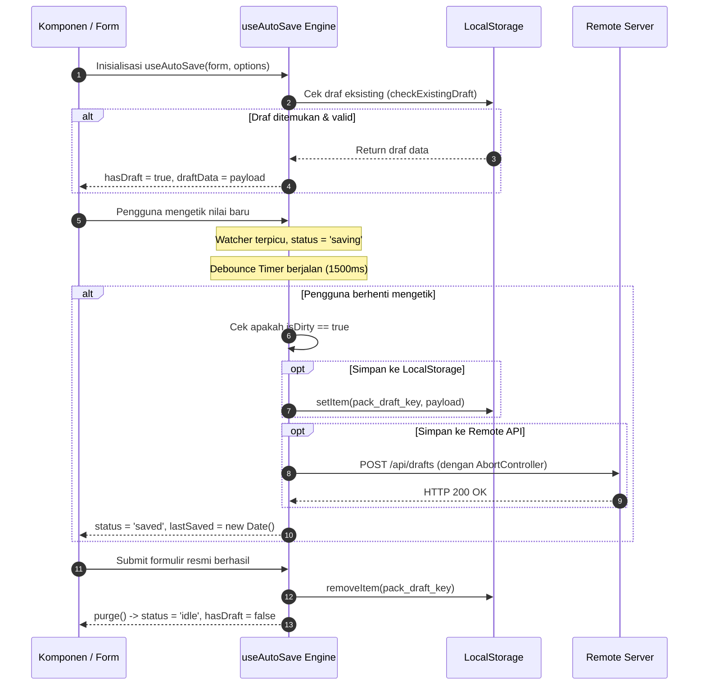

# useAutoSave (`useAutoSave.js`)

`useAutoSave` adalah composable tingkat enterprise yang menyediakan infrastruktur penyimpanan draf formulir otomatis (*auto-save*) secara transparan ke `localStorage` maupun endpoint REST API backend. Composable ini mengintegrasikan mekanisme pelacakan perubahan (*dirty tracking*), peredam ketukan (*debounce timer*), pencegahan kondisi balapan (*race condition guard* dengan `AbortController`), serta pemulihan draf (*draft restoration*) ketika pengguna kembali membuka halaman.

---

## 01. Overview

Composable ini dirancang untuk mengeliminasi risiko kehilangan data masukan pengguna akibat insiden tak terduga seperti tab browser tertutup, koneksi internet terputus, atau ketidaksengajaan navigasi halaman.

### 1.1 Apa Entitas Ini
`useAutoSave` adalah fungsi logika reaktif headless (Composable Function) berbasis Vue 3 Composition API yang terletak pada berkas [useAutoSave.js](file:///C:/SPEED/LARAVEL-PACK-UI/packages/laravel-pack-ui/resources/js/Composables/Pack/useAutoSave.js). Composable ini dapat dipasangkan dengan objek reaktif Vue biasa maupun instance formulir Inertia.js (`useForm`).

### 1.2 Fungsi Utama
- **Deteksi Perubahan Reaktif**: Memantau mutasi nilai formulir secara mendalam (*deep reactive watch*) dan mencocokkannya dengan snapshot penyimpanan terakhir (*dirty state computation*).
- **Eksekusi Hemat Beban (Debounce & Interval)**: Meredam eksekusi penyimpanan menggunakan jeda *debounce* sehingga tidak membebani memori lokal maupun lalu lintas jaringan saat pengguna mengetik cepat.
- **Penyimpanan Multi-Target**: Mendukung persistensi ke browser lokal (`localStorage`), endpoint API server (`POST`), atau kombinasi keduanya (*hybrid*).
- **Manajemen Kedaluwarsa Draf**: Mendeteksi umur draf secara otomatis dan membersihkan draf usang yang melebihi batas hari yang ditentukan (*TTL expiry*).
- **Pencegahan Konflik Asinkron**: Menggunakan `AbortController` untuk membatalkan request HTTP remote yang sedang berjalan apabila pemicu penyimpanan baru telah terjadi sebelum request sebelumnya selesai.

### 1.3 Kapan Digunakan
- Formulir penulisan konten panjang seperti artikel blog, editor WYSIWYG, draf lowongan pekerjaan, atau entri formulir proposal.
- Formulir transaksi bisnis multitahap (*multistep wizards*) yang membutuhkan proteksi data sementara antarlangkah.
- Dashboard operasional internal yang mengolah data formulir kompleks dengan banyak kolom input.

### 1.4 Karakteristik Penting
- **Kompatibilitas Penuh Inertia.js**: Otomatis mendeteksi dan mengekstraksi data bersih dari method `form.data()` pada instance Inertia `useForm`.
- **Independen Siklus Hidup**: Menggunakan deteksi aman `getCurrentInstance()` sehingga dapat dipanggil di dalam setup komponen maupun di luar konteks komponen (seperti Pinia store atau service worker).
- **Integrasi Visual Bawaan**: Berpasangan secara langsung dengan komponen UI [AutoSaveStatus.vue](file:///C:/SPEED/LARAVEL-PACK-UI/packages/laravel-pack-ui/resources/js/Components/Pack/AutoSaveStatus.vue) untuk visualisasi status real-time.

---

## 02. Preview

> [!TIP]
> Pengujian fungsional dan showcase composable ini dapat diuji secara native pada portal pratinjau aplikasi:
>
> <a href="http://localhost:8000/preview/auto-save-status" target="_self" style="display: inline-flex; align-items: center; gap: 6px; padding: 6px 14px; border-radius: 8px; font-weight: 600; text-decoration: none; margin-top: 8px; background-color: var(--vp-c-brand-1, #4f46e5); color: #ffffff;">Buka Live Preview Komponen AutoSaveStatus &rarr;</a>

---

## 03. Usage

Struktur arsitektural penggunaan `useAutoSave` dalam alur kerja aplikasi web:

### Pohon Konsep Penggunaan

```text
useAutoSave
├── Skenario Formulir Mandiri
│   ├── Formulir Pembuatan Konten Baru (Create Form Draft)
│   └── Formulir Penyuntingan Data Eksisting (Edit Form Safeguard)
├── Skenario Integrasi Penyimpanan
│   ├── Local Storage Only (Client-side fast recovery)
│   ├── Remote Endpoint (Server-side persistent draft)
│   └── Hybrid Mode (Local instant + Remote sync)
└── Siklus Pengelolaan Draf
    ├── Deteksi Draf Tersedia (hasDraft)
    ├── Pemulihan Data (restoreDraft)
    └── Pembersihan Tuntas (purge / discardDraft)
```

### Matriks Keputusan: Kapan Digunakan vs Dihindari

| Kriteria Kasus Penggunaan | Gunakan useAutoSave | Hindari useAutoSave | Alternatif yang Tepat |
| :--- | :--- | :--- | :--- |
| Form input panjang (> 3 field) | Ya | Tidak | - |
| Form penulisan artikel / draf | Ya | Tidak | - |
| Input kata sandi / data kredensial | Tidak | Ya | Standar form tanpa penyimpanan draf |
| Form pencarian cepat / filter | Tidak | Ya | Gunakan composable `useDebounce` |
| Form modal konfirmasi sederhana | Tidak | Ya | Komponen `Modal` standar |

### Alur Kerja Konseptual

```text
User Input -> Deep Watcher -> Debounce Timer (1500ms)
    -> Cek Perubahan (Dirty Check vs Snapshot)
    -> Serialisasi Payload (Local / Remote)
    -> Perbarui Status ('saving' -> 'saved')
    -> Pembaruan Teks Relatif ('baru saja')
```

---

## 04. Anatomy

Struktur internal dan alur kontrol reaktivitas composable `useAutoSave`:

### Diagram Hierarki Internal

```text
useAutoSave Composable
│
├── 1. State Management (Refs)
│   ├── status ('idle' | 'saving' | 'saved' | 'error' | 'paused')
│   ├── lastSaved (Date | null)
│   ├── lastError (string | null)
│   ├── hasDraft (boolean)
│   ├── draftData (object | null)
│   ├── draftSavedAt (Date | null)
│   └── isPaused (boolean)
│
├── 2. Computed Tracking
│   ├── isDirty (Boolean dirty detection)
│   ├── lastSavedFormatted (Relative human-readable time)
│   └── draftTimeFormatted (Detailed draft timestamp)
│
├── 3. Network & Storage Engine
│   ├── localStorage Engine (Prefix: pack_draft_)
│   ├── Remote Fetch Engine (HTTP POST via XMLHttpRequest header)
│   └── AbortController Guard (Race condition cancellation)
│
└── 4. Lifecycle & Timers
    ├── Debounce Timer Engine
    ├── Periodic Interval Engine
    └── Auto-cleanup on Unmount
```

### Diagram Alur Reaktivitas (Mermaid)



---

## 05. Variants

Mode operasional yang didukung oleh konfigurasi opsi `useAutoSave`:

### 1. Mode Local Storage (`storage: 'local'`)
Mode default. Draf disimpan di `localStorage` peramban pengguna. Tidak memerlukan endpoint jaringan dan bekerja secara instan tanpa latensi.

### 2. Mode Remote Server (`storage: 'remote'`)

Mode di mana data draf tidak disimpan pada browser pengguna, melainkan dikirimkan secara asinkron ke server backend (misalnya Laravel API) melalui protokol HTTP.

#### Mekanisme Kerja Internal:
1. **Pengiriman Asinkron via Fetch API**: Saat jeda `debounceMs` tercapai dan data terdeteksi kotor (`isDirty`), composable mengeksekusi HTTP `POST` ke URL yang didefinisikan pada opsi `endpoint`.
2. **Penyertaan Header Standar**: Request dikirimkan dengan header:
   - `'Content-Type': 'application/json'`
   - `'X-Requested-With': 'XMLHttpRequest'` (untuk memastikan Laravel mengenali request sebagai AJAX/Inertia request dan mengembalikan respons JSON, bukan redirect HTML).
3. **Proteksi Kondisi Balapan (AbortController Guard)**:
   - Jika pengguna mengetik kembali saat request HTTP sebelumnya masih berada di jaringan (*in-flight*), request lama otomatis dibatalkan menggunakan sinyal `abortController.abort()`.
   - Hal ini menjamin urutan data (*data consistency*) agar respons lambat dari request lama tidak menimpa data yang lebih baru di server.
4. **Opsi Kustom `saveHandler`**:
   - Jika aplikasi menggunakan pustaka HTTP pihak ketiga (seperti `axios`) atau membutuhkan otorisasi khusus (Bearer Token), pengembang dapat menyediakan fungsi callback `saveHandler: async (payload) => { ... }`.
   - Jika `saveHandler` didefinisikan, pemanggilan `fetch` bawaan dilewati dan eksekusi sepenuhnya diserahkan ke fungsi callback tersebut.

#### Contoh Endpoint Backend Laravel Penampung Draf:

```php
// routes/api.php atau routes/web.php
Route::post('/api/drafts/save', function (Request $request) {
    $request->validate([
        'title' => 'nullable|string',
        'notes' => 'nullable|string',
    ]);

    // Simpan draf ke tabel database atau Redis cache berdasarkan user aktif
    Draft::updateOrCreate(
        [
            'user_id' => $request->user()->id,
            'key'     => $request->input('key', 'default_draft'),
        ],
        [
            'payload'    => $request->all(),
            'updated_at' => now(),
        ]
    );

    return response()->json(['message' => 'Draf berhasil diamankan di server']);
})->middleware(['auth:sanctum']);
```

#### Kapan Wajib Menggunakan Mode Remote:
- **Draf Lintas Perangkat (Cross-Device Continuity)**: Pengguna mulai mengisi formulir di laptop kantor dan ingin melanjutkan pengisian draf yang sama di ponsel saat perjalanan.
- **Pembersihan Cache Lokal**: Pada perangkat umum/publik (seperti warnet atau komputer kantor bersama), penyimpanan data di `localStorage` peramban berisiko tertinggal atau terhapus saat pembersihan browser history.
- **Audit & Analitik Server**: Tim admin dapat memantau draf proposal atau transaksi yang ditinggalkan pengguna (*abandoned form analysis*) secara terpusat di basis data.

### 3. Mode Hybrid (`storage: 'both'`)
Menyimpan draf ke `localStorage` sebagai cache lokal instan (bebas latensi) sekaligus menyinkronkannya ke server backend di latar belakang. Jika jaringan terputus, data tetap aman di peramban lokal dan akan disinkronkan kembali saat koneksi pulih.

### 4. Mode Pemicu Penyimpanan
- **Debounced Trigger (Default)**: Menyimpan beberapa saat setelah pengguna berhenti mengetik (`debounceMs`).
- **Periodic Interval Trigger**: Menyimpan draf secara berkala setiap interval waktu tertentu (`intervalMs > 0`), sangat ideal untuk form pengisian panjang tanpa jeda ketik.

---

## 06. Sizes

Spesifikasi batas kapasitas data dan retensi penyimpanan:

| Parameter Batasan | Nilai Default | Batas Maksimum yang Direkomendasikan | Catatan Teknis |
| :--- | :--- | :--- | :--- |
| Ukuran Payload Draf | Bebas | `< 2 MB` per kunci draf | Batas total `localStorage` peramban adalah 5 MB per origin. |
| Retensi Draf (`expiryDays`) | `7` hari | `1` hingga `30` hari | Draf yang melebihi masa berlaku akan otomatis dibuang saat halaman dimuat. |
| Waktu Jeda Debounce | `1500 ms` | `500 ms` - `5000 ms` | Nilai di bawah 500ms dapat memicu lag pada formulir berukuran besar. |
| Interval Periodik | `0 ms` (nonaktif)| `>= 10000 ms` (10 detik) | Disarankan hanya jika pengguna mengisi teks panjang tanpa jeda. |

---

## 07. States

Daftar status operasional yang dapat dialami oleh composable:

| Status (`status`) | Deskripsi Representasi | Kondisi Pemicu |
| :--- | :--- | :--- |
| `idle` | Formulir dalam kondisi diam dan sinkron. | Awal inisialisasi atau setelah fungsi `purge()` dipanggil. |
| `saving` | Proses penyimpanan draf sedang berlangsung. | Pengguna melakukan mutasi input dan timer debounce sedang aktif. |
| `saved` | Data formulir berhasil diamankan ke media penyimpanan. | Serialisasi berhasil ditulis ke `localStorage` atau respons HTTP 200 diterima. |
| `error` | Gagal menyimpan draf ke storage atau jaringan remote. | Kuota `localStorage` penuh atau server remote mengembalikan status HTTP error. |
| `paused` | Auto-save dihentikan sementara. | Method `pause()` dipanggil secara eksplisit oleh pengembang. |

---

## 08. Props / Parameters / Attributes

Parameter fungsi `useAutoSave(formTarget, options)`:

### Parameter 1: `formTarget`
- **Tipe Data**: `Object | Ref<Object> | Reactive<Object>`
- **Wajib**: Ya
- **Deskripsi**: Objek formulir reaktif Vue 3 atau instance form Inertia (`useForm`) yang berisi field-field formulir.

### Parameter 2: `options`
| Opsi | Tipe Data | Nilai Default | Wajib | Deskripsi & Validasi |
| :--- | :--- | :--- | :--- | :--- |
| `key` | `string` | - | Ya | Pengenal unik draf (misal: `'article_create'`, `'order_12'`). Digunakan sebagai suffix kunci storage. |
| `debounceMs` | `number` | `1500` | Tidak | Jeda henti ketik sebelum eksekusi penyimpanan draf (dalam milidetik). |
| `intervalMs` | `number` | `0` | Tidak | Interval penyimpanan otomatis periodik (ms). Nilai `0` menonaktifkan interval periodik. |
| `storage` | `'local' \| 'remote' \| 'both'` | `'local'` | Tidak | Target penyimpanan draf. |
| `endpoint` | `string` | `''` | Tidak | URL API remote jika `storage` bernilai `'remote'` atau `'both'`. |
| `saveHandler` | `Function(payload)` | `null` | Tidak | Callback async kustom untuk menangani proses simpan draf secara manual. |
| `expiryDays` | `number` | `7` | Tidak | Masa kedaluwarsa draf dalam hari. Nilai `0` berarti draf tidak pernah kedaluwarsa. |
| `autoRestore` | `boolean` | `false` | Tidak | Jika `true`, memulihkan data draf secara otomatis saat mount tanpa perlu konfirmasi manual. |
| `onSaved` | `Function(payload, timestamp)` | `null` | Tidak | Callback yang dipanggil sesaat setelah proses simpan berhasil diselesaikan. |
| `onError` | `Function(error)` | `null` | Tidak | Callback yang dipanggil jika proses penyimpanan mengalami kegagalan. |

---

## 09. Slots / Content

Sebagai composable headless logika non-visual, `useAutoSave` tidak memiliki slot DOM templating. Namun composable ini menyediakan titik ekstensi fungsional (*functional hooks*):

| Hook / Callback | Parameter Terbuka | Deskripsi Titik Injeksi |
| :--- | :--- | :--- |
| `saveHandler` | `payload: Object` | Menggantikan mekanisme fetch HTTP standar dengan logika async kustom (misal: axios atau IndexedDB). |
| `onSaved` | `payload: Object, timestamp: Date` | Titik injeksi aksi lanjutan seperti memunculkan toast mini atau mencatat analitik pengguna. |
| `onError` | `error: Error` | Titik penanganan kegagalan untuk pelaporan error ke sistem monitoring. |

---

## 10. Events / Interactions / Returns

Nilai return objek reaktif dari pemanggilan `useAutoSave`:

| Properti / Method | Tipe Data | Reaktif | Deskripsi |
| :--- | :--- | :---: | :--- |
| `status` | `Ref<'idle' \| 'saving' \| 'saved' \| 'error' \| 'paused'>` | Ya | Status siklus penyimpanan draf saat ini. |
| `lastSaved` | `Ref<Date \| null>` | Ya | Objek tanggal dan waktu kapan draf terakhir berhasil disimpan. |
| `lastError` | `Ref<string \| null>` | Ya | Pesan kegagalan terakhir jika terjadi error penyimpanan. |
| `hasDraft` | `Ref<boolean>` | Ya | Bernilai `true` jika terdapat draf tersimpan yang berbeda dari nilai inisial form. |
| `draftData` | `Ref<Object \| null>` | Ya | Isi data mentah draf yang ditemukan di media penyimpanan. |
| `draftSavedAt` | `Ref<Date \| null>` | Ya | Timestamp kapan draf yang tersimpan dibuat. |
| `isPaused` | `Ref<boolean>` | Ya | Penanda apakah proses auto-save sedang dalam keadaan dijeda. |
| `isDirty` | `ComputedRef<boolean>` | Ya | Menandakan apakah ada perubahan data pada formulir dibanding penyimpanan terakhir. |
| `lastSavedFormatted` | `ComputedRef<string>` | Ya | Waktu relatif ramah pengguna (contoh: `"baru saja"`, `"3 menit yang lalu"`). |
| `draftTimeFormatted` | `ComputedRef<string>` | Ya | Format waktu relatif dan absolut dari draf yang tersimpan. |
| `saveNow()` / `save()` | `() => Promise<void>` | Tidak | Menjalankan proses penyimpanan seketika tanpa menunggu timer debounce. |
| `restoreDraft()` | `() => boolean` | Tidak | Memasukkan isi data draf ke dalam objek formulir reaktif yang dipantau. |
| `discardDraft()` | `() => void` | Tidak | Menghapus data draf dari penyimpanan lokal tanpa mengubah formulir. |
| `purge()` | `() => void` | Tidak | Menghapus draf dan menyinkronkan status form ke `idle` (dipanggil saat form sukses disubmit). |
| `pause()` | `() => void` | Tidak | Menghentikan sementara pemantauan auto-save. |
| `resume()` | `() => void` | Tidak | Melanjutkan kembali pemantauan auto-save. |
| `cleanup()` / `destroy()`| `() => void` | Tidak | Membersihkan watcher dan timer secara manual untuk pencegahan memory leak. |

---

## 11. Code Example

Tiga tingkatan implementasi kode siap pakai:

### 1. Penggunaan Dasar (Basic Reactive Form)

```vue
<script setup>
import { reactive } from 'vue';
import { useAutoSave } from '@/Composables/Pack/useAutoSave';

const form = reactive({
    notes: '',
});

const { status, lastSavedFormatted, saveNow } = useAutoSave(form, {
    key: 'quick_notes',
    debounceMs: 1000,
});
</script>

<template>
    <div class="space-y-3">
        <textarea v-model="form.notes" placeholder="Tulis catatan..." class="w-full border rounded-lg p-3" />
        <div class="flex justify-between items-center text-xs text-zinc-500">
            <span>Status: {{ status }} ({{ lastSavedFormatted }})</span>
            <button type="button" @click="saveNow" class="text-blue-600 font-semibold">Simpan Manual</button>
        </div>
    </div>
</template>
```

### 2. Penggunaan Menengah (Integrasi Inertia `useForm` & Komponen `AutoSaveStatus`)

```vue
<script setup>
import { useForm } from '@inertiajs/vue3';
import { useAutoSave } from '@/Composables/Pack/useAutoSave';
import AutoSaveStatus from '@/Components/Pack/AutoSaveStatus.vue';

const form = useForm({
    title: '',
    body: '',
    category_id: 1,
});

const {
    status,
    lastSavedFormatted,
    isDirty,
    hasDraft,
    restoreDraft,
    purge,
} = useAutoSave(form, {
    key: 'post_editor_create',
    debounceMs: 1500,
});

const handleSubmit = () => {
    form.post('/posts', {
        onSuccess: () => {
            // Bersihkan draf setelah berhasil disimpan secara permanen di database
            purge();
        },
    });
};
</script>

<template>
    <form @submit.prevent="handleSubmit" class="space-y-4">
        <div class="flex items-center justify-between pb-3 border-b">
            <AutoSaveStatus
                :status="status"
                :last-saved-text="lastSavedFormatted"
                :is-dirty="isDirty"
                variant="soft"
            />
            
            <div v-if="hasDraft" class="flex items-center gap-2 text-xs">
                <span class="text-amber-600 font-medium">Ada draf sebelumnya ditemukan</span>
                <button type="button" @click="restoreDraft" class="px-2 py-1 bg-amber-500 text-white rounded">
                    Pulihkan
                </button>
            </div>
        </div>

        <input v-model="form.title" type="text" placeholder="Judul Post..." class="w-full border p-2 rounded" />
        <textarea v-model="form.body" rows="6" placeholder="Konten artikel..." class="w-full border p-2 rounded" />
        
        <button type="submit" :disabled="form.processing" class="px-4 py-2 bg-blue-600 text-white rounded font-medium">
            Terbitkan Sekarang
        </button>
    </form>
</template>
```

### 3. Penggunaan Lanjutan (Enterprise Remote API Sync dengan Dialog Konfirmasi)

```vue
<script setup>
import { ref } from 'vue';
import { useForm } from '@inertiajs/vue3';
import { useAutoSave } from '@/Composables/Pack/useAutoSave';
import AutoSaveStatus from '@/Components/Pack/AutoSaveStatus.vue';
import Modal from '@/Components/Pack/Modal.vue';

const form = useForm({
    subject: '',
    message: '',
    attachments: [],
});

const showRestoreModal = ref(false);

const {
    status,
    lastSavedFormatted,
    draftTimeFormatted,
    isDirty,
    hasDraft,
    restoreDraft,
    discardDraft,
    purge,
} = useAutoSave(form, {
    key: 'ticket_reply_draft',
    storage: 'both',
    endpoint: '/api/v1/support/drafts',
    debounceMs: 2000,
    intervalMs: 30000, // Interval cadangan setiap 30 detik
    onSaved: (payload, timestamp) => {
        console.log('Draf berhasil disinkronkan:', timestamp);
    },
    onError: (err) => {
        console.warn('Gagal menyinkronkan draf ke server:', err);
    },
});

if (hasDraft.value) {
    showRestoreModal.value = true;
}

const confirmRestore = () => {
    restoreDraft();
    showRestoreModal.value = false;
};

const rejectRestore = () => {
    discardDraft();
    showRestoreModal.value = false;
};
</script>

<template>
    <div class="space-y-6">
        <!-- Dialog Pemulihan Draf -->
        <Modal
            :open="showRestoreModal"
            title="Draf Belum Tersimpan Ditemukan"
            variant="warning"
            @close="showRestoreModal = false"
            @confirm="confirmRestore"
            @cancel="rejectRestore"
            confirm-text="Pulihkan Draf"
            cancel-text="Abaikan"
        >
            <p class="text-sm text-zinc-600 dark:text-zinc-300">
                Sistem menemukan draf yang tersimpan pada <strong>{{ draftTimeFormatted }}</strong>. Apakah Anda ingin melanjutkan pengisian draf tersebut?
            </p>
        </Modal>

        <!-- Formulir Utama -->
        <div class="p-6 bg-white dark:bg-zinc-900 border rounded-2xl space-y-4">
            <AutoSaveStatus :status="status" :last-saved-text="lastSavedFormatted" :is-dirty="isDirty" />
            <input v-model="form.subject" placeholder="Subjek Tiket" class="w-full border p-2.5 rounded-lg" />
            <textarea v-model="form.message" rows="5" placeholder="Tuliskan pesan..." class="w-full border p-2.5 rounded-lg" />
        </div>
    </div>
</template>
```

---

## 12. Result / Behavior

Dampak komputasi dan reaksi sistem saat composable beroperasi:

### Alur Aksi ke Reaksi
1. **Pengetikan Pengguna**: Setiap masukan karakter memicu deep watcher. Timer debounce diatur ulang, dan `status` beralih ke `'saving'`.
2. **Jeda Debounce Tercapai**: Composable memeriksa apakah serialisasi form berbeda dari snapshot sebelumnya (`isDirty`).
3. **Penyimpanan Berhasil**: Data tersimpan ke storage, nilai `lastSavedSnapshot` diperbarui, `status` menjadi `'saved'`, dan `lastSaved` diisi waktu saat ini.
4. **Pembersihan Draf**: Saat tombol kirim form berhasil dieksekusi, pemanggilan method `purge()` menghapus kunci draf dari `localStorage` dan mereset status menjadi `'idle'`.

### Efek Samping (Side Effects)
- Menulis dan memperbarui entri pada `window.localStorage` dengan prefix `pack_draft_[key]`.
- Melakukan pemanggilan jaringan latar belakang (`fetch POST`) jika konfigurasi `storage` menggunakan `'remote'` atau `'both'`.
- Menggunakan `AbortController` untuk membatalkan koneksi HTTP lama yang belum tuntas saat ada perubahan data baru.

### Penanganan Error
- Jika `localStorage` penuh atau browser dalam mode private browsing yang memblokir akses storage, error ditangkap secara lokal tanpa menyebabkan runtime aplikasi berhenti (*graceful degradation*).
- Jika endpoint remote mengembalikan status HTTP 4xx atau 5xx, nilai `lastError` akan terisi dan status beralih menjadi `'error'`.

---

## 13. Customization

Opsi penyesuaian logika penyusunan draf:

### 1. Mengubah Jeda Waktu Debounce
Sesuaikan `debounceMs` sesuai kenyamanan interaksi pengguna:
```javascript
const { status } = useAutoSave(form, {
    key: 'editor_document',
    debounceMs: 2500, // 2.5 detik setelah henti ketik
});
```

### 2. Menggunakan Custom Async Save Handler
Untuk integrasi dengan klien Axios atau sistem state tersentralisasi:
```javascript
const { status } = useAutoSave(form, {
    key: 'user_profile_edit',
    storage: 'remote',
    saveHandler: async (payload) => {
        await axios.put('/api/drafts/profile', payload);
    },
});
```

---

## 14. Accessibility (a11y)

Pedoman aksesibilitas saat mengintegrasikan auto-save ke antarmuka pengguna:

- **Indikator Status Ramah Screen Reader**: Saat menggunakan komponen visual pendukung [AutoSaveStatus.vue](file:///C:/SPEED/LARAVEL-PACK-UI/packages/laravel-pack-ui/resources/js/Components/Pack/AutoSaveStatus.vue), pastikan kontainer memiliki atribut `aria-live="polite"` sehingga perubahan status (misal: "Draf berhasil disimpan") dibacakan tanpa memotong navigasi pengguna.
- **Konfirmasi Pemulihan Draf**: Sediakan fokus keyboard yang jelas pada tombol pemicu pemulihan draf (`restoreDraft`), dan gunakan dialog modal aksesibel jika pemulihan draf membutuhkan konfirmasi pengguna.
- **Pemberitahuan Error**: Jika status menjadi `'error'`, tampilkan pesan kesalahan dengan atribut `role="alert"` untuk pengguna perangkat bantu.

---

## 15. Responsive Behavior

Sebagai composable logika, `useAutoSave` tidak memiliki batasan dimensi layar visual. Namun, composable ini secara cerdas merespons siklus hidup aplikasi mobile:
- **Deteksi Event `visibilitychange` & `pagehide`**: Pada peramban seluler (iOS Safari dan Chrome Android), pengguna sering menutup aplikasi tanpa submit. Pengembang dapat mengikat event `visibilitychange` ke fungsi `saveNow()` untuk memastikan draf tersimpan seketika saat aplikasi diminimalkan.

---

## 16. Do / Don't

Pedoman implementasi terbaik:

### Rekomendasi (Do):
- Selalu panggil `purge()` atau `discardDraft()` di dalam callback `onSuccess` submit formulir Inertia agar draf usang tidak muncul kembali saat formulir baru dibuka.
- Tentukan nilai parameter `key` yang unik dan stabil (contoh: `'post_create'` untuk data baru atau `'post_edit_' + post.id` untuk data spesifik).
- Pasangkan dengan komponen visual bawaan [AutoSaveStatus.vue](file:///C:/SPEED/LARAVEL-PACK-UI/packages/laravel-pack-ui/resources/js/Components/Pack/AutoSaveStatus.vue) untuk transparansi status kepada pengguna.
- Berikan opsi dialog konfirmasi kepada pengguna sebelum memulihkan draf jika formulir memiliki data bawaan dari database.

### Larangan (Don't):
- Jangan menyimpan data kredensial sensitif seperti kata sandi (*password*), nomor CVV kartu kredit, atau token keamanan ke dalam `localStorage`.
- Jangan menggunakan nilai `debounceMs` yang terlalu kecil (`< 300ms`) pada formulir berukuran besar karena dapat memicu degradasi performa komputasi JSON serialization.
- Jangan mengabaikan penanganan error pada callback `onError` saat menggunakan mode remote storage.

---

## 17. Examples / Recipes

### Resep 1: Editor Form Multi-Tab dengan Pencegahan Kehilangan Draf

```vue
<script setup>
import { onMounted, onBeforeUnmount } from 'vue';
import { useForm } from '@inertiajs/vue3';
import { useAutoSave } from '@/Composables/Pack/useAutoSave';
import AutoSaveStatus from '@/Components/Pack/AutoSaveStatus.vue';

const form = useForm({
    title: '',
    content: '',
});

const { status, lastSavedFormatted, isDirty, saveNow, purge } = useAutoSave(form, {
    key: 'blog_post_entry',
    debounceMs: 1500,
});

// Simpan seketika jika pengguna berganti tab atau meminimalkan browser
const handleVisibilityChange = () => {
    if (document.visibilityState === 'hidden' && isDirty.value) {
        saveNow();
    }
};

onMounted(() => {
    document.addEventListener('visibilitychange', handleVisibilityChange);
});

onBeforeUnmount(() => {
    document.removeEventListener('visibilitychange', handleVisibilityChange);
});
</script>

<template>
    <div class="space-y-4">
        <AutoSaveStatus :status="status" :last-saved-text="lastSavedFormatted" :is-dirty="isDirty" />
        <input v-model="form.title" placeholder="Judul..." class="w-full border p-2 rounded" />
        <textarea v-model="form.content" placeholder="Konten..." class="w-full border p-2 rounded" />
    </div>
</template>
```

### Resep 2: Multi-Step Stepper Wizard dengan Pengamanan Draf Antar-Langkah

```vue
<script setup>
import { ref, reactive } from 'vue';
import { useAutoSave } from '@/Composables/Pack/useAutoSave';
import AutoSaveStatus from '@/Components/Pack/AutoSaveStatus.vue';

const currentStep = ref(1);

const wizardData = reactive({
    // Step 1: Informasi Bisnis
    companyName: '',
    taxId: '',
    // Step 2: Kontak Penanggung Jawab
    contactPerson: '',
    email: '',
    // Step 3: Paket Langganan
    planTier: 'enterprise',
});

// Auto-save mengamankan seluruh langkah formulir ke localStorage
const autoSave = useAutoSave(wizardData, {
    key: 'onboarding_wizard_draft',
    debounceMs: 1000,
    autoRestore: true, // Otomatis mengembalikan data saat pengguna kembali
});

const nextStep = () => {
    // Paksa simpan draf sebelum beralih ke langkah berikutnya
    autoSave.saveNow();
    currentStep.value++;
};

const completeOnboarding = async () => {
    // Eksekusi API submit pendaftaran...
    // Setelah sukses, bersihkan draf permanen
    autoSave.purge();
};
</script>

<template>
    <div class="space-y-6">
        <div class="flex items-center justify-between pb-3 border-b">
            <span class="text-xs font-semibold text-slate-500">Langkah {{ currentStep }} dari 3</span>
            <AutoSaveStatus :auto-save="autoSave" variant="badge" size="sm" />
        </div>

        <!-- Step Content -->
        <div v-if="currentStep === 1" class="space-y-3">
            <input v-model="wizardData.companyName" placeholder="Nama Perusahaan" class="w-full border p-2 rounded" />
            <input v-model="wizardData.taxId" placeholder="NPWP / Tax ID" class="w-full border p-2 rounded" />
            <button type="button" @click="nextStep" class="px-4 py-2 bg-blue-600 text-white rounded text-xs font-semibold">
                Lanjut ke Kontak
            </button>
        </div>

        <div v-else-if="currentStep === 2" class="space-y-3">
            <input v-model="wizardData.contactPerson" placeholder="Nama Lengkap" class="w-full border p-2 rounded" />
            <input v-model="wizardData.email" type="email" placeholder="Email Kerja" class="w-full border p-2 rounded" />
            <div class="flex gap-2">
                <button type="button" @click="currentStep--" class="px-3 py-1.5 border rounded text-xs">Kembali</button>
                <button type="button" @click="nextStep" class="px-4 py-2 bg-blue-600 text-white rounded text-xs font-semibold">
                    Lanjut ke Paket
                </button>
            </div>
        </div>

        <div v-else-if="currentStep === 3" class="space-y-3">
            <select v-model="wizardData.planTier" class="w-full border p-2 rounded">
                <option value="starter">Starter</option>
                <option value="business">Business</option>
                <option value="enterprise">Enterprise</option>
            </select>
            <button type="button" @click="completeOnboarding" class="px-5 py-2 bg-emerald-600 text-white rounded text-xs font-bold">
                Selesaikan Pendaftaran
            </button>
        </div>
    </div>
</template>
```

### Resep 3: Hybrid Sync dengan Feedback Toast Notification

```vue
<script setup>
import { reactive } from 'vue';
import { useAutoSave } from '@/Composables/Pack/useAutoSave';
import { useNotification } from '@/Composables/Pack/useNotification';
import AutoSaveStatus from '@/Components/Pack/AutoSaveStatus.vue';

const { toast } = useNotification();

const profileForm = reactive({
    bio: '',
    website: '',
    socialLinks: { twitter: '', github: '' },
});

const autoSave = useAutoSave(profileForm, {
    key: 'user_profile_edit',
    storage: 'both',
    endpoint: '/api/user/drafts',
    debounceMs: 2000,
    onSaved: (payload, timestamp) => {
        toast.info('Draf profil berhasil disinkronkan ke cloud', { duration: 2500 });
    },
    onError: (err) => {
        toast.error('Koneksi terputus: draf tetap aman di penyimpanan lokal.');
    },
});
</script>

<template>
    <div class="space-y-4">
        <AutoSaveStatus :auto-save="autoSave" variant="both" size="md" />
        <textarea v-model="profileForm.bio" rows="4" placeholder="Tuliskan biografi..." class="w-full border p-2.5 rounded-lg" />
        <input v-model="profileForm.website" placeholder="https://..." class="w-full border p-2.5 rounded-lg" />
    </div>
</template>
```

---

## 18. Related Items

Koleksi komponen dan composable yang saling melengkapi dalam ekosistem Laravel Pack UI:

```text
useAutoSave
├── Komponen UI Pendukung
│   ├── AutoSaveStatus.vue (Indikator status visual draf tersimpan)
│   ├── InputField.vue (Input field terstandarisasi)
│   ├── RichTextEditor.vue (Editor teks kaya dengan draf)
│   └── Modal.vue (Dialog konfirmasi pemulihan draf)
└── Composables Terkait
    ├── useUnsavedChanges.js (Peringatan saat meninggalkan halaman dengan data belum tersimpan)
    ├── useFormValidation.js (Validasi field formulir reaktif)
    └── useDateFormat.js (Penyedia helper format waktu relatif)
```

---

## 19. Notes / Limitations

- **Batasan Kuota Storage**: `localStorage` memiliki kuota penyimpanan terbatas (rata-rata 5 MB per origin domain). Hindari menyimpan draf yang berisi representasi file binary base64 berukuran besar di dalamnya.
- **Pembersihan Draf Terjadwal**: Nilai `expiryDays` hanya dievaluasi saat inisialisasi draf berlangsung. Untuk data draf yang sangat banyak pada perangkat bersama, sediakan opsi pembersihan cache manual.
- **Dukungan Lingkungan**: Berjalan pada semua peramban modern yang mendukung ES6+ dan Storage API. Pada lingkungan Server-Side Rendering (SSR), seluruh operasi browser guard otomatis dinonaktifkan secara aman.
