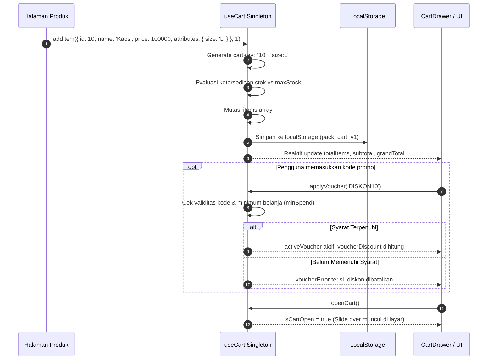

# useCart (`useCart.js`)

`useCart` adalah composable tingkat enterprise yang menyediakan manajemen keranjang belanja (*shopping cart*) terpusat berbasis status reaktif tunggal (*global reactive singleton state*). Composable ini mengelola variasi multi-atribut produk, penyesuaian kuantitas, perlindungan batas stok (*stock guard*), kalkulasi voucher diskon (persen atau nominal tetap), estimasi PPN 11% Indonesia, ambang batas bebas ongkos kirim (*free shipping threshold*), serta sinkronisasi otomatis antar-tab peramban (*cross-tab synchronization*) melalui `localStorage`.

---

## 01. Overview

Composable ini dirancang untuk menyatukan logika keranjang belanja lintas halaman dan komponen tanpa memerlukan setup pustaka state management eksternal yang rumit seperti Vuex atau Pinia.

### 1.1 Apa Entitas Ini
`useCart` adalah modul logika headless berbasis Vue 3 Composition API yang terletak pada berkas [useCart.js](file:///C:/SPEED/LARAVEL-PACK-UI/packages/laravel-pack-ui/resources/js/Composables/Pack/useCart.js). Menggunakan arsitektur modul level singleton sehingga seluruh komponen yang mengimpor composable ini membaca dan memutasi instance data yang sama secara instan.

### 1.2 Fungsi Utama
- **Manajemen State Singleton Global**: Header navbar counter, tombol beli pada kartu produk, laci keranjang belanja (*cart drawer*), dan halaman checkout selalu tersinkronisasi tanpa prop drilling.
- **Dukungan Variasi Produk Multi-Atribut**: Mengelompokkan item berdasarkan kombinasi atribut unik (misalnya: produk ID 5 ukuran "L" dan warna "Hitam" terpisah rapi dari produk ID 5 ukuran "M" dan warna "Putih").
- **Kalkulasi Finansial Otomatis**: Menghitung subtotal, diskon produk, diskon kupon voucher, ambang batas gratis ongkir (*free shipping progress*), nominal PPN 11%, dan grand total secara real-time.
- **Engine Voucher & Promo Fleksibel**: Mendukung voucher persentase dengan batas diskon maksimum (*capped discount*), voucher potongan nominal tetap (*fixed discount*), serta syarat minimal transaksi (*minimum spend*).
- **Sinkronisasi Multi-Tab Browser**: Mendengarkan event peramban `storage` untuk memastikan perubahan keranjang di satu tab langsung terfleksikan di tab browser lainnya yang sedang terbuka.

### 1.3 Kapan Digunakan
- Aplikasi e-commerce, toko daring ritel, marketplace, atau sistem pemesanan makanan (*F&B order system*).
- Katalog produk dengan alur pembelian instan (*quick add to cart*) dan drawer ringkasan pesanan.
- Alur transaksi multipages di mana pengguna menjelajahi halaman belanja sambil mengumpulkan item ke keranjang.

### 1.4 Karakteristik Penting
- **Perlindungan Stok Maksimum (`maxStock Guard`)**: Mencegah kuantitas item dalam keranjang melebihi ketersediaan inventaris produk fisik.
- **Format Rupiah Bawaan**: Menyediakan pasangan properti nilai numerik mentah dan nilai terformat Rupiah otomatis (`subtotal` dan `formattedSubtotal`).
- **Pencarian Ganda Cerdas**: Operasi mutasi seperti `removeItem`, `updateQuantity`, `incrementQuantity`, dan `decrementQuantity` dapat menerima parameter pengenal `cartKey` spesifik maupun `id` produk biasa.

---

## 02. Preview

> [!TIP]
> Pengujian fungsional dan showcase composable ini dapat diuji secara native pada portal pratinjau aplikasi:
>
> <a href="http://localhost:8000/preview" target="_self" style="display: inline-flex; align-items: center; gap: 6px; padding: 6px 14px; border-radius: 8px; font-weight: 600; text-decoration: none; margin-top: 8px; background-color: var(--vp-c-brand-1, #4f46e5); color: #ffffff;">Buka Live Preview Portal Komponen &rarr;</a>

---

## 03. Usage

Struktur pemanfaatan composable `useCart` dalam ekosistem aplikasi web:

### Pohon Konsep Penggunaan

```text
useCart
├── Operasi Item Keranjang
│   ├── Tambah Produk Standar (Single Item Add)
│   ├── Tambah Produk Bervariasi (Multi-Attribute Variations)
│   ├── Penyesuaian Kuantitas (Increment / Decrement / Manual)
│   └── Catatan Khusus Pembeli (Buyer Item Notes)
├── Mesin Perhitungan Finansial
│   ├── Subtotal Bersih & Diskon Langsung Produk
│   ├── Penerapan Kupon Voucher (Percent / Fixed / Min Spend)
│   ├── Ambang Batas Gratis Ongkir (Free Shipping Threshold)
│   └── Kalkulasi Estimasi PPN (11% Tax Rate)
├── Navigasi & Tampilan Antarmuka
│   ├── Pengendalian Visibilitas Laci (Cart Drawer Open / Close)
│   └── Badge Penghitung Kuantitas Navbar (Total Items Counter)
└── Sinkronisasi & Persistensi
    ├── Cache Lokal Peramban (localStorage v1)
    └── Sinkronisasi Antar-Tab (Window Storage Event)
```

### Matriks Keputusan: Kapan Digunakan vs Dihindari

| Kriteria Skenario Aplikasi | Gunakan useCart | Hindari useCart | Solusi Alternatif |
| :--- | :--- | :--- | :--- |
| Keranjang belanja toko online multi-produk | Ya | Tidak | - |
| Mini cart drawer di header navigasi | Ya | Tidak | - |
| Alur checkout e-commerce Inertia.js | Ya | Tidak | - |
| Pembelian langsung 1 produk (Beli Sekarang / Direct Checkout) | Ya | Tidak | Dapat menggunakan `addItem` lalu `openCart` |
| Validasi harga final sebelum pembayaran payment gateway | Tidak | Ya | Wajib divalidasi ulang di backend Laravel Controller |
| Sistem wishlist / produk favorit | Tidak | Ya | Gunakan composable `useLocalStorage` mandiri |

### Alur Kerja Konseptual

```text
Katalog Produk -> Klik "Tambah ke Keranjang" -> addItem(product, qty, attributes)
    -> Hitung cartKey Unik (id + attributes)
    -> Update items ref -> Watcher memicu persistStorage()
    -> Sinkronisasi ke LocalStorage & Tab Lain
    -> Header Counter & CartDrawer Otomatis Reaktif
```

---

## 04. Anatomy

Struktur state internal, kalkulasi komputasi, dan alur kontrol composable `useCart`:

### Diagram Hierarki Internal

```text
useCart Composable (Global Singleton)
│
├── 1. Core State (Refs)
│   ├── items (Array<CartItem>)
│   │   ├── cartKey (Unique Hash: id__attr1:val1|attr2:val2)
│   │   ├── id & sku
│   │   ├── name & image
│   │   ├── price & discountPrice
│   │   ├── quantity & maxStock
│   │   ├── attributes (Record<string, string>)
│   │   └── notes (Catatan khusus pembeli)
│   ├── isCartOpen (boolean)
│   ├── activeVoucher (Voucher | null)
│   ├── voucherError (string)
│   ├── taxRate (default: 0.11)
│   ├── shippingCost (default: 20000)
│   └── freeShippingThreshold (default: 150000)
│
├── 2. Computed Financial Engines
│   ├── totalItems & uniqueItemCount
│   ├── subtotal & originalSubtotal
│   ├── productDiscountSavings
│   ├── voucherDiscount & subtotalAfterVoucher
│   ├── effectiveShippingCost & freeShippingProgress
│   ├── taxAmount & grandTotal
│   └── Formatted Currency Helpers (formatRupiah)
│
└── 3. Storage & Multi-Tab Synchronization
    ├── LocalStorage Persistence (Key: pack_cart_v1)
    └── Window 'storage' Event Listener (Cross-tab Realtime Sync)
```

### Diagram Alur Transaksi Keranjang (Mermaid)



---

## 05. Variants

Strategi kalkulasi voucher dan mode promo yang didukung oleh voucher engine:

### 1. Voucher Persentase Bersyarat (`type: 'percent'`)
Memberikan potongan harga berdasarkan persentase nilai subtotal dengan proteksi batas nominal diskon maksimum:
```javascript
{
    code: 'DISKON10',
    type: 'percent',
    value: 10, // 10%
    minSpend: 50000, // Minimal belanja Rp 50.000
    maxDiscount: 25000, // Maksimal diskon Rp 25.000
}
```

### 2. Voucher Potongan Nominal Tetap (`type: 'fixed'`)
Memberikan potongan harga langsung dalam nominal rupiah tertentu:
```javascript
{
    code: 'HEMAT50K',
    type: 'fixed',
    value: 50000, // Potongan Rp 50.000
    minSpend: 200000, // Minimal belanja Rp 200.000
}
```

### 3. Subsidi Ongkos Kirim
Voucher atau fitur sistem yang memotong biaya pengiriman jika subtotal transaksi memenuhi ambang batas bebas ongkir (`freeShippingThreshold`).

---

## 06. Sizes

Batas skala kapasitas data dan batas kuantitas item:

| Aspek Batasan | Nilai Default | Batasan Teknis & Rekomendasi |
| :--- | :--- | :--- |
| Kuantitas per Item | `1` | Dibatasi oleh properti `maxStock` produk fisik. |
| Jumlah Item Unik | Tak terbatas | Direkomendasikan `< 100` item unik agar performa rendering list tetap ringan. |
| Ambang Gratis Ongkir | `Rp 150.000` | Dapat diubah secara dinamis melalui `setFreeShippingThreshold(amount)`. |
| Tarif Pajak (PPN) | `0.11` (11%) | Dapat disesuaikan melalui `setTaxRate(rate)` (contoh: `0` untuk bebas pajak). |
| Biaya Pengiriman Standar | `Rp 20.000` | Dapat dikonfigurasi melalui `setShippingCost(cost)`. |

---

## 07. States

Daftar status reaktif operasional yang disediakan oleh composable:

| Status / Indikator | Tipe Data | Deskripsi Representasi |
| :--- | :--- | :--- |
| `isCartEmpty` | `ComputedRef<boolean>` | Bernilai `true` jika keranjang belanja tidak memiliki item sama sekali. |
| `isCartOpen` | `Ref<boolean>` | Status visibilitas laci keranjang belanja (*open / close state*). |
| `isFreeShipping` | `ComputedRef<boolean>` | Bernilai `true` jika subtotal pesanan telah mencapai batas bebas biaya pengiriman. |
| `activeVoucher` | `Ref<Object \| null>` | Objek kupon diskon aktif yang sedang diterapkan. |
| `voucherError` | `Ref<string>` | Pesan kesalahan jika kode voucher tidak valid atau tidak memenuhi syarat transaksi. |
| `freeShippingProgress`| `ComputedRef<number>` | Persentase pencapaian (0 s.d. 100) menuju pembebasan biaya pengiriman. |

---

## 08. Props / Parameters / Attributes

Spesifikasi data masukan untuk fungsi-fungsi utama `useCart`:

### 1. Skema Objek Produk pada `addItem(itemData, qty)`
| Properti | Tipe Data | Wajib | Deskripsi |
| :--- | :--- | :--- | :--- |
| `id` | `string \| number` | Ya | Identitas unik produk dari basis data. |
| `name` | `string` | Ya | Nama judul produk yang tampil di keranjang. |
| `price` | `number` | Ya | Harga jual normal produk dalam satuan Rupiah. |
| `discountPrice` | `number \| null` | Tidak | Harga promo diskon langsung produk jika tersedia. |
| `sku` | `string` | Tidak | Nomor SKU produk (default: `SKU-[id]`). |
| `maxStock` | `number` | Tidak | Batas maksimum stok yang tersedia untuk dipesan. |
| `image` | `string` | Tidak | URL gambar thumbnail produk. |
| `attributes` | `Record<string, any>` | Tidak | Objek atribut variasi produk (misal: `{ size: 'XL', color: 'Merah' }`). |
| `notes` | `string` | Tidak | Instruksi atau catatan khusus dari pembeli untuk item ini. |

### 2. Parameter Fungsi `applyVoucher(code, customVouchers)`
| Parameter | Tipe Data | Wajib | Deskripsi |
| :--- | :--- | :--- | :--- |
| `code` | `string` | Ya | Kode voucher yang dimasukkan pengguna (case-insensitive). |
| `customVouchers` | `Array<Voucher>` | Tidak | Kumpulan daftar voucher kustom opsional dari server. |

---

## 09. Slots / Content

Sebagai composable headless logika non-visual, `useCart` tidak memiliki slot DOM visual. Namun composable ini menyediakan titik penyimpanan data terstruktur fleksibel:
- **`attributes`**: Menerima objek arbitrary untuk menyimpan detail spesifikasi varian apapun (ukuran, warna, material, kapasitas memori, garansi tambahan).
- **`notes`**: Field teks fleksibel per item untuk catatan kustom seperti pesan kartu ucapan atau instruksi potong bahan.

---

## 10. Events / Interactions / Returns

Nilai return objek lengkap yang diekspos oleh pemanggilan `useCart()`:

### Status Reaktif (State & Computed)
| Properti | Tipe Data | Deskripsi |
| :--- | :--- | :--- |
| `items` | `Ref<Array<CartItem>>` | Array reaktif seluruh item yang berada di keranjang belanja. |
| `isCartOpen` | `Ref<boolean>` | Status buka/tutup laci keranjang (*cart drawer*). |
| `activeVoucher` | `Ref<Voucher \| null>` | Data voucher promo yang sedang aktif. |
| `voucherError` | `Ref<string>` | Pesan error validasi voucher. |
| `totalItems` | `ComputedRef<number>` | Total kuantitas seluruh barang di keranjang. |
| `uniqueItemCount` | `ComputedRef<number>` | Jumlah baris variasi produk unik di keranjang. |
| `isCartEmpty` | `ComputedRef<boolean>` | Apakah keranjang dalam kondisi kosong. |
| `subtotal` | `ComputedRef<number>` | Akumulasi total harga barang sebelum diskon voucher dan pajak. |
| `originalSubtotal` | `ComputedRef<number>` | Total harga barang berdasarkan harga normal sebelum diskon produk. |
| `productDiscountSavings` | `ComputedRef<number>` | Total penghematan dari selisih harga normal dan harga promo produk. |
| `voucherDiscount` / `discountAmount` | `ComputedRef<number>` | Nominal potongan harga dari voucher aktif. |
| `subtotalAfterVoucher` | `ComputedRef<number>` | Subtotal setelah dikurangi diskon voucher. |
| `isFreeShipping` | `ComputedRef<boolean>` | Apakah transaksi berhak atas gratis ongkir. |
| `effectiveShippingCost` | `ComputedRef<number>` | Biaya ongkos kirim efektif yang dikenakan. |
| `freeShippingRemaining` | `ComputedRef<number>` | Kekurangan belanja untuk memperoleh gratis ongkir. |
| `freeShippingProgress` | `ComputedRef<number>` | Persentase progres menuju batas gratis ongkir (0 - 100). |
| `taxAmount` | `ComputedRef<number>` | Estimasi nominal PPN. |
| `grandTotal` | `ComputedRef<number>` | Total akhir yang harus dibayarkan pembeli. |

### Nilai Terformat Rupiah (Formatted Strings)
| Properti | Tipe Data | Contoh Nilai |
| :--- | :--- | :--- |
| `formattedSubtotal` / `subtotalFormatted` | `ComputedRef<string>` | `"Rp 150.000"` |
| `formattedVoucherDiscount` / `discountAmountFormatted` | `ComputedRef<string>` | `"Rp 25.000"` |
| `formattedShipping` / `shippingCostFormatted` | `ComputedRef<string>` | `"Gratis"` atau `"Rp 20.000"` |
| `formattedTax` / `taxAmountFormatted` | `ComputedRef<string>` | `"Rp 13.750"` |
| `formattedGrandTotal` / `grandTotalFormatted` | `ComputedRef<string>` | `"Rp 138.750"` |
| `formattedSavings` / `savingsFormatted` | `ComputedRef<string>` | `"Rp 45.000"` |

### Aksi & Metode Mutasi (Actions)
| Metode | Parameter | Deskripsi |
| :--- | :--- | :--- |
| `addItem(itemData, qty)` | `(itemData: Object, qty?: number) => boolean` | Menambahkan item ke keranjang atau menambah kuantitasnya jika sudah ada. |
| `removeItem(keyOrId)` | `(keyOrId: string \| number) => void` | Menghapus item dari keranjang berdasarkan `cartKey` atau `id`. |
| `updateQuantity(keyOrId, newQty)`| `(keyOrId: string \| number, newQty: number) => void` | Memperbarui kuantitas (otomatis menghapus jika kuantitas `<= 0`). |
| `incrementQuantity(keyOrId)` | `(keyOrId: string \| number) => void` | Menambah kuantitas item sebanyak 1 (menghormati `maxStock`). |
| `decrementQuantity(keyOrId)` | `(keyOrId: string \| number) => void` | Mengurangi kuantitas item sebanyak 1 (menghapus jika mencapai 0). |
| `updateItemNotes(keyOrId, notes)` | `(keyOrId: string \| number, notes: string) => void` | Memperbarui catatan pembeli pada item tertentu. |
| `clearCart()` | `() => void` | Mengosongkan keranjang belanja dan mereset voucher promo. |
| `applyVoucher(code, list?)` | `(code: string, list?: Array) => boolean` | Memasang kode kupon voucher. |
| `removeVoucher()` | `() => void` | Melepas voucher promo yang sedang aktif. |
| `getItemSubtotal(item)` | `(item: Object) => number` | Menghitung subtotal untuk satu baris item produk tertentu. |
| `getItemSubtotalFormatted(item)`| `(item: Object) => string` | Subtotal satu baris item dalam format Rupiah. |
| `openCart()` | `() => void` | Membuka laci keranjang belanja. |
| `closeCart()` | `() => void` | Menutup laci keranjang belanja. |
| `toggleCart()` | `() => void` | Membalikkan status buka/tutup laci keranjang. |
| `setTaxRate(rate)` | `(rate: number) => void` | Mengubah tarif PPN dinamis. |
| `setShippingCost(cost)` | `(cost: number) => void` | Mengubah biaya ongkos kirim standar. |
| `setFreeShippingThreshold(amount)` | `(amount: number) => void` | Mengubah batas nominal belanja untuk mendapatkan gratis ongkir. |

---

## 11. Code Example

Tiga tingkatan implementasi kode siap pakai:

### 1. Penggunaan Dasar (Tombol Tambah Produk & Header Counter Badge)

```vue
<script setup>
import { useCart } from '@/Composables/Pack/useCart';

const props = defineProps({
    product: Object,
});

const { totalItems, addItem, openCart } = useCart();

const handleAddToCart = () => {
    addItem({
        id: props.product.id,
        name: props.product.name,
        price: props.product.price,
        image: props.product.image_url,
    }, 1);
    
    // Buka laci keranjang otomatis setelah barang ditambahkan
    openCart();
};
</script>

<template>
    <div class="flex items-center justify-between">
        <!-- Tombol Tambah di Kartu Produk -->
        <button
            type="button"
            class="px-4 py-2 bg-blue-600 hover:bg-blue-700 text-white text-xs font-semibold rounded-lg"
            @click="handleAddToCart"
        >
            + Beli Sekarang
        </button>

        <!-- Indikator Keranjang Header -->
        <button type="button" @click="openCart" class="relative p-2 text-zinc-700 dark:text-zinc-200">
            <span class="material-symbols-outlined text-xl">shopping_cart</span>
            <span v-if="totalItems > 0" class="absolute -top-1 -right-1 bg-rose-600 text-white text-[10px] font-bold rounded-full h-4 w-4 flex items-center justify-center">
                {{ totalItems }}
            </span>
        </button>
    </div>
</template>
```

### 2. Penggunaan Menengah (Integrasi dengan Komponen `CartDrawer` & Voucher Promo)

```vue
<script setup>
import { ref } from 'vue';
import { useCart } from '@/Composables/Pack/useCart';
import CartDrawer from '@/Components/Pack/CartDrawer.vue';

const {
    isCartOpen,
    totalItems,
    formattedGrandTotal,
    voucherError,
    applyVoucher,
    closeCart,
} = useCart();

const promoCode = ref('');

const submitPromo = () => {
    applyVoucher(promoCode.value);
    promoCode.value = '';
};
</script>

<template>
    <div>
        <!-- Laci Keranjang Bawaan Laravel Pack UI -->
        <CartDrawer
            :open="isCartOpen"
            @close="closeCart"
        />

        <!-- Input Cepat Voucher di Footer Halaman Belanja -->
        <div class="fixed bottom-4 right-4 bg-white dark:bg-zinc-900 border p-4 rounded-xl shadow-lg flex items-center gap-2">
            <input
                v-model="promoCode"
                type="text"
                placeholder="Kode Promo (DISKON10)"
                class="border px-3 py-1.5 rounded-lg text-xs"
            />
            <button
                type="button"
                @click="submitPromo"
                class="px-3 py-1.5 bg-zinc-900 dark:bg-zinc-100 text-white dark:text-zinc-900 rounded-lg text-xs font-semibold"
            >
                Terapkan
            </button>
        </div>
        <p v-if="voucherError" class="text-rose-500 text-xs mt-1">{{ voucherError }}</p>
    </div>
</template>
```

### 3. Penggunaan Lanjutan (Form Checkout Inertia dengan Multi-Atribut & Stock Guard)

```vue
<script setup>
import { useForm } from '@inertiajs/vue3';
import { useCart } from '@/Composables/Pack/useCart';

const {
    items,
    subtotal,
    voucherDiscount,
    effectiveShippingCost,
    taxAmount,
    grandTotal,
    formattedGrandTotal,
    activeVoucher,
    clearCart,
} = useCart();

const checkoutForm = useForm({
    recipient_name: '',
    shipping_address: '',
    payment_method: 'bank_transfer',
    cart_items: [],
    voucher_code: '',
    client_subtotal: 0,
    client_grand_total: 0,
});

const submitOrder = () => {
    // Siapkan payload keranjang untuk validasi final di Laravel Controller
    checkoutForm.cart_items = items.value.map(i => ({
        product_id: i.id,
        quantity: i.quantity,
        attributes: i.attributes,
        notes: i.notes,
    }));
    checkoutForm.voucher_code = activeVoucher.value?.code || '';
    checkoutForm.client_subtotal = subtotal.value;
    checkoutForm.client_grand_total = grandTotal.value;

    checkoutForm.post('/checkout/process', {
        onSuccess: () => {
            // Bersihkan keranjang lokal setelah order resmi tercatat di database
            clearCart();
        },
    });
};
</script>

<template>
    <form @submit.prevent="submitOrder" class="grid grid-cols-1 lg:grid-cols-3 gap-6 p-6">
        <div class="lg:col-span-2 space-y-4">
            <h3 class="font-bold text-lg">Informasi Pengiriman</h3>
            <input v-model="checkoutForm.recipient_name" placeholder="Nama Penerima" class="w-full border p-2.5 rounded-lg" required />
            <textarea v-model="checkoutForm.shipping_address" placeholder="Alamat Lengkap" class="w-full border p-2.5 rounded-lg" required />
        </div>

        <div class="p-6 bg-zinc-50 dark:bg-zinc-900 border rounded-2xl space-y-4">
            <h4 class="font-bold border-b pb-2">Ringkasan Pembayaran</h4>
            <div class="text-sm space-y-2">
                <div class="flex justify-between">
                    <span>Subtotal:</span>
                    <span>Rp {{ subtotal.toLocaleString('id-ID') }}</span>
                </div>
                <div v-if="voucherDiscount > 0" class="flex justify-between text-emerald-600">
                    <span>Diskon Voucher:</span>
                    <span>-Rp {{ voucherDiscount.toLocaleString('id-ID') }}</span>
                </div>
                <div class="flex justify-between">
                    <span>Ongkos Kirim:</span>
                    <span>Rp {{ effectiveShippingCost.toLocaleString('id-ID') }}</span>
                </div>
                <div class="flex justify-between">
                    <span>PPN (11%):</span>
                    <span>Rp {{ taxAmount.toLocaleString('id-ID') }}</span>
                </div>
                <div class="flex justify-between font-bold text-base border-t pt-2">
                    <span>Total Tagihan:</span>
                    <span class="text-blue-600">{{ formattedGrandTotal }}</span>
                </div>
            </div>

            <button
                type="submit"
                :disabled="checkoutForm.processing || items.length === 0"
                class="w-full py-3 bg-emerald-600 hover:bg-emerald-700 text-white rounded-xl font-bold shadow-md disabled:opacity-50"
            >
                Bayar Sekarang
            </button>
        </div>
    </form>
</template>
```

---

## 12. Result / Behavior

Perubahan status dan reaksi sistem saat beroperasi:

### Alur Aksi ke Reaksi
1. **Penambahan Produk**: Saat `addItem` dipanggil, composable menghasilkan hash `cartKey`. Jika item dengan kombinasi atribut tersebut sudah ada, kuantitas bertambah. Jika belum, item baru dimasukkan ke array `items`.
2. **Kalkulasi Reaktif**: Setiap mutasi kuantitas langsung memperbarui `subtotal`, mengevaluasi kualifikasi gratis ongkir (`isFreeShipping`), menghitung ulang PPN, dan memperbarui `grandTotal`.
3. **Persistensi Seketika**: Watcher mendeteksi perubahan pada `items` atau `activeVoucher` dan menuliskannya ke `localStorage`.
4. **Sinkronisasi Tab Lain**: Event listener `window.onstorage` di tab lain menangkap pembaruan dan menyelaraskan nilai keranjang seketika tanpa perlu reload halaman.

### Penanganan Kasus Khusus
- **Kuantitas Mencapai Nol**: Memanggil `updateQuantity(key, 0)` atau `decrementQuantity` saat kuantitas bernilai `1` otomatis memicu `removeItem` untuk mengeluarkan item dari keranjang.
- **Melebihi Kapasitas Stok**: Jika penambahan kuantitas melebihi `maxStock`, kuantitas otomatis tertahan di nilai `maxStock` dan fungsi mengembalikan `false`.

---

## 13. Customization

Menyesuaikan parameter bisnis keranjang sesuai kebutuhan aplikasi:

### 1. Mengubah Aturan Pajak & Pengiriman
```javascript
const { setTaxRate, setShippingCost, setFreeShippingThreshold } = useCart();

// Bebaskan pajak PPN (0%)
setTaxRate(0);

// Atur tarif ongkir flat Rp 15.000
setShippingCost(15000);

// Naikkan batas belanja bebas ongkir menjadi Rp 250.000
setFreeShippingThreshold(250000);
```

### 2. Menggunakan Daftar Voucher Dinamis dari Backend
```javascript
const { applyVoucher } = useCart();

const serverVouchers = await fetch('/api/active-promos').then(r => r.json());
applyVoucher('MEGA2026', serverVouchers);
```

---

## 14. Accessibility (a11y)

Pedoman aksesibilitas untuk transaksi belanja:

- **Pengumuman Keranjang (`aria-live`)**: Setiap kali tombol beli diklik, pasang atribut `aria-live="polite"` pada indikator notifikasi (misal: "1 item ditambahkan ke keranjang belanja") agar pengguna screen reader mendapatkan umpan balik langsung.
- **Akses Tombol Tambah/Kurang Kuantitas**: Sediakan atribut `aria-label="Kurangi kuantitas"` dan `aria-label="Tambah kuantitas"` pada tombol `+` dan `-` kuantitas barang.
- **Navigasi Keyboard Drawer**: Komponen [CartDrawer.vue](file:///C:/SPEED/LARAVEL-PACK-UI/packages/laravel-pack-ui/resources/js/Components/Pack/CartDrawer.vue) memiliki focus trapping otomatis dan dapat ditutup menggunakan tombol keyboard `Escape`.

---

## 15. Responsive Behavior

Perilaku komponen antarmuka yang mengonsumsi `useCart`:
- **Layar Mobile (`< 768px`)**: Laci [CartDrawer.vue](file:///C:/SPEED/LARAVEL-PACK-UI/packages/laravel-pack-ui/resources/js/Components/Pack/CartDrawer.vue) otomatis mengisi lebar penuh layar peramban (`w-full`), dengan tombol checkout sticky di bagian dasar layar agar mudah dijangkau ibu jari (*thumb zone*).
- **Layar Desktop (`>= 1024px`)**: Laci keranjang belanja tampil sebagai slide-over elegan berukuran `max-w-md` di sisi kanan layar.

---

## 16. Do / Don't

Pedoman implementasi terbaik:

### Rekomendasi (Do):
- Selalu lakukan validasi ulang harga produk, stok ketersediaan, dan keabsahan voucher di sisi backend Laravel Controller sebelum memproses pembayaran final.
- Gunakan atribut variasi (`attributes`) jika produk memiliki pilihan ukuran, warna, atau model agar item terdata terpisah secara rapi.
- Manfaatkan nilai pembantu yang sudah terformat (`formattedGrandTotal`, `formattedSubtotal`) untuk mempermudah rendering di template antarmuka.
- Panggil `clearCart()` segera setelah pesanan berhasil terbayar atau tersimpan di server.

### Larangan (Don't):
- Jangan mempercayai total harga dari sisi klien (`grandTotal`) sebagai nilai mutlak tagihan tanpa verifikasi ulang di server.
- Jangan menyimpan data sensitif identitas pelanggan atau kartu kredit ke dalam properti `notes` atau atribut keranjang.
- Jangan memanipulasi array `items.value` secara mutasi manual tanpa melalui metode resmi (`addItem`, `removeItem`, `updateQuantity`).

---

## 17. Examples / Recipes

### Resep 1: Bar Ringkasan Pesanan Terapung (*Floating Bottom Cart Bar*)

```vue
<script setup>
import { useCart } from '@/Composables/Pack/useCart';

const { totalItems, formattedGrandTotal, openCart } = useCart();
</script>

<template>
    <div
        v-if="totalItems > 0"
        class="fixed bottom-6 left-1/2 -translate-x-1/2 z-40 bg-zinc-900 dark:bg-white text-white dark:text-zinc-900 px-6 py-3 rounded-full shadow-2xl flex items-center gap-6 border border-zinc-700/50"
    >
        <div class="text-xs">
            <span class="font-bold">{{ totalItems }} barang</span>
            <span class="mx-2 opacity-50">|</span>
            <span class="font-mono font-bold">{{ formattedGrandTotal }}</span>
        </div>
        <button
            type="button"
            @click="openCart"
            class="px-4 py-1.5 bg-blue-600 text-white rounded-full text-xs font-bold hover:bg-blue-700 transition-colors"
        >
            Lihat Keranjang
        </button>
    </div>
</template>
```

---

## 18. Related Items

Komponen dan composable yang saling berhubungan:

```text
useCart
├── Komponen UI Pendukung
│   ├── CartDrawer.vue (Laci geser ringkasan keranjang belanja)
│   ├── ProductGallery.vue (Galeri foto produk dengan tombol beli)
│   ├── Badge.vue (Penghitung kuantitas item di navbar)
│   └── Modal.vue (Dialog konfirmasi pengosongan keranjang)
└── Composables Terkait
    ├── useNumberFormat.js (Format mata uang Rupiah formatRupiah)
    ├── useNotification.js (Toast pemberitahuan saat produk berhasil ditambahkan)
    └── useLocalStorage.js (Pengelolaan penyimpanan lokal terisolasi)
```

---

## 19. Notes / Limitations

- **Keamanan Data Belanja**: Seluruh kalkulasi finansial di dalam `useCart` bersifat perkiraan untuk kenyamanan pengguna (*user experience convenience*). Integritas nominal transaksi harus selalu dihitung ulang di Laravel sebelum menerbitkan invoice atau tagihan payment gateway.
- **Penyimpanan Lokal Multi-Pengguna**: Data keranjang disimpan di `localStorage` peramban. Jika sebuah komputer dipakai bersama oleh beberapa akun berbeda tanpa logout browser, keranjang akan tetap tersimpan di peramban tersebut hingga `clearCart()` dipanggil.
- **Dukungan Peramban**: Kompatibel dengan 100% peramban modern yang mendukung `localStorage` dan Storage Event API.
