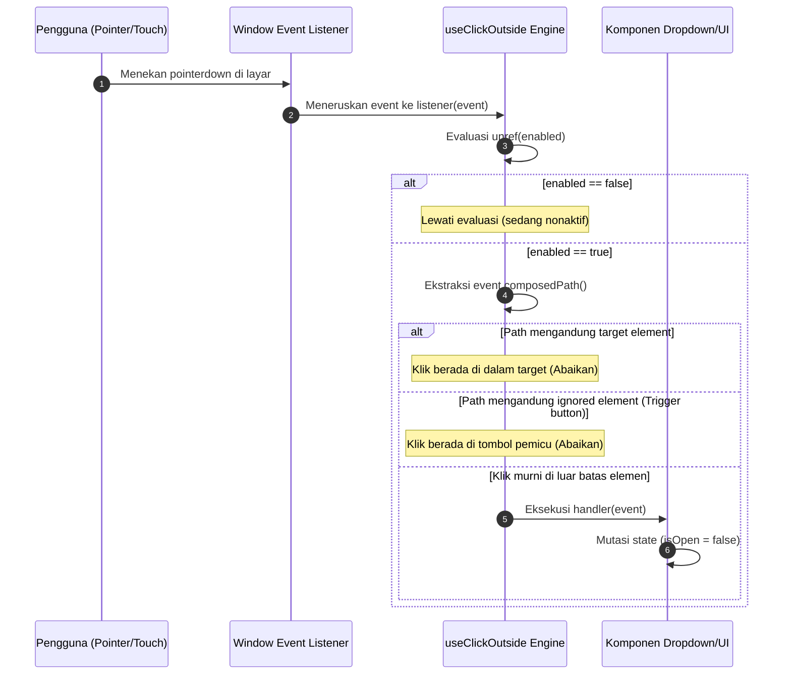

# useClickOutside (`useClickOutside.js`)

`useClickOutside` adalah composable tingkat enterprise yang dirancang untuk mendeteksi interaksi penunjuk (*pointerdown*, klik mouse, atau sentuhan layar sentuh) di luar elemen DOM target. Composable ini menjadi fondasi interaksi esensial untuk menutup komponen kontekstual mengambang seperti dropdown, popover, modal, datepicker, drawer, dan menu konteks saat pengguna berinteraksi dengan area luar halaman.

---

## 01. Overview

Composable ini menyediakan mekanisme pemantauan interaksi luar yang akurat, ringan, dan bebas dari kebocoran memori (*zero memory leak*) dengan pembersihan otomatis pada siklus hidup Vue 3.

### 1.1 Apa Entitas Ini
`useClickOutside` adalah fungsi logika reaktif headless (Composable Function) berbasis Vue 3 Composition API yang terletak pada berkas [useClickOutside.js](file:///C:/SPEED/LARAVEL-PACK-UI/packages/laravel-pack-ui/resources/js/Composables/Pack/useClickOutside.js). Composable ini dapat mengikat elemen template ref, elemen DOM murni, maupun instance komponen Vue.

### 1.2 Fungsi Utama
- **Deteksi Interaksi Luar yang Akurat**: Menangkap aksi penekanan pointer (*pointerdown*) di luar batas geometris elemen target dan memicu fungsi callback yang ditentukan pengembang.
- **Dukungan Multi-Target & Ignore List**: Mampu memantau beberapa elemen target sekaligus dalam bentuk array serta mengabaikan elemen pengecualian tertentu (misalnya tombol pemicu dropdown agar tidak terjadi konflik toggle).
- **Aman Shadow DOM & Dynamic Elements**: Menggunakan metode `event.composedPath()` untuk memastikan klik tetap terdeteksi secara presisi meskipun elemen anak di dalamnya di-unmount atau dimutasi saat klik terjadi.
- **Deteksi Interaksi Iframe**: Mendeteksi saat pengguna mengeklik area dokumen di dalam elemen `<iframe>` (yang menyebabkan event pointer hilang dari window utama) melalui pemantauan window blur.
- **Pembersihan Listener Otomatis**: Secara otomatis melepas event listener pada peramban saat komponen di-unmount (`onUnmounted`) atau melalui pemanggilan fungsi penghenti manual (`stop()`).

### 1.3 Kapan Digunakan
- Komponen menu navigasi mengambang (*dropdown menu*) dan submenu navigasi profil pengguna.
- Dialog popover ringkas, tooltip interaktif, atau panel pemilih tanggal (*date/time picker*).
- Panel laci samping (*drawer*) atau modal dialog yang memerlukan penutupan saat area kanvas luar diklik.

### 1.4 Karakteristik Penting
- **Fase Tangkapan Event (Capture Phase)**: Secara bawaan mendengarkan pada fase tangkapan (*capture: true*) sehingga interaksi luar tetap tertangkap meskipun elemen di dalam halaman menggunakan `event.stopPropagation()`.
- **Ekstraksi Elemen Fleksibel (`unrefElement`)**: Secara otomatis mengekstrak elemen DOM asli dari template ref Vue (`ref="boxRef"`), instance komponen Vue (`$el`), maupun elemen DOM murni.
- **Pengaktifan Reaktif (`enabled`)**: Mendukung pengaktifan atau penonaktifan pengawasan secara dinamis melalui ref boolean sehingga listener tidak membebani peramban saat menu sedang dalam kondisi tertutup.

---

## 02. Preview

> [!TIP]
> Pengujian fungsional dan showcase composable ini dapat diuji secara native pada portal pratinjau aplikasi:
>
> <a href="/preview" target="_self" style="display: inline-flex; align-items: center; gap: 6px; padding: 6px 14px; border-radius: 8px; font-weight: 600; text-decoration: none; margin-top: 8px; background-color: var(--vp-c-brand-1, #4f46e5); color: #ffffff;">Buka Live Preview Portal Komponen &rarr;</a>

---

## 03. Usage

Struktur arsitektural pemanfaatan `useClickOutside` dalam hierarki aplikasi:

### Pohon Konsep Penggunaan

```text
useClickOutside
├── Komponen Kontekstual Mengambang
│   ├── Menu Dropdown Navigasi (Profile Menu, Action Menu)
│   ├── Popover & Tooltip Interaktif
│   └── Panel Datepicker & Colorpicker
├── Komponen Shell & Dialog
│   ├── Modal Backdrop Dismissal
│   └── Mobile Sidebar / CartDrawer Dismissal
└── Pola Kontrol Interaksi
    ├── Target Tunggal (Single Target Ref)
    ├── Target Jamak (Array of Elements)
    └── Pengecualian Elemen (Ignored Trigger Button)
```

### Matriks Keputusan: Kapan Digunakan vs Dihindari

| Kriteria Kasus Penggunaan | Gunakan useClickOutside | Hindari useClickOutside | Alternatif yang Tepat |
| :--- | :--- | :--- | :--- |
| Menutup menu dropdown saat klik luar | Ya | Tidak | - |
| Menutup popover pencarian cepat | Ya | Tidak | - |
| Menutup dialog modal penting bertipe formulir | Tidak | Ya | Gunakan tombol Batal / Konfirmasi eksplisit |
| Deteksi penekanan tombol keyboard Escape | Tidak | Ya | Gunakan event listener `keydown.esc` |
| Deteksi elemen keluar dari viewport layar | Tidak | Ya | Gunakan `IntersectionObserver` |

### Alur Kerja Konseptual

```text
User Event (Pointer / Touch / Mouse) -> Window Capture Phase
    -> Evaluasi composedPath() terhadap Target & Ignore List
    -> Apakah Event berada di Luar Target?
       ├── Tidak: Abaikan event (interaksi di dalam elemen)
       └── Ya: Jalankan handler(event) -> Tutup Menu / Popover
```

---

## 04. Anatomy

Struktur kontrol dan alur evaluasi event internal:

### Diagram Hierarki Internal

```text
useClickOutside Composable
│
├── 1. Input Resolution (unrefElement)
│   ├── Target Element(s): Ref<HTMLElement> | Component.$el | HTMLElement[]
│   └── Ignore Element(s): Ref<HTMLElement>[]
│
├── 2. Event Listener Pipeline
│   ├── pointerdown Event Listener (window capture phase)
│   └── blur Event Listener (Iframe activeElement detection)
│
├── 3. Filtering & Boundary Verification
│   ├── Enabled Flag Guard (unref(enabled))
│   ├── composedPath Boundary Check
│   └── Element.contains Fallback Check
│
└── 4. Lifecycle & Teardown
    ├── onMounted (Bind window listeners)
    ├── onUnmounted (Remove window listeners)
    └── Return: stop() (Manual cleanup function)
```

### Diagram Alur Evaluasi Interaksi (Mermaid)



---

## 05. Variants

Variasi mode konfigurasi operasional:

### 1. Target Tunggal (Single Target Ref)
Mode paling umum di mana hanya ada satu elemen kontainer yang dipantau (misalnya elemen kontainer dropdown).
```javascript
useClickOutside(dropdownRef, () => isOpen.value = false);
```

### 2. Multi-Target dengan Ignore List
Memantau menu popover sekaligus mengabaikan tombol pemicu yang berada di luar hierarki DOM popover:
```javascript
useClickOutside(popoverRef, () => isOpen.value = false, {
    ignore: [triggerButtonRef],
});
```

### 3. Mode Pengaktifan Dinamis (`enabled`)
Mencegah overhead listener dengan hanya mengaktifkan pengawasan saat popup sedang terbuka:
```javascript
useClickOutside(menuRef, () => isOpen.value = false, {
    enabled: isOpen, // Hanya aktif saat isOpen bernilai true
});
```

---

## 06. Sizes

Spesifikasi kapasitas dan batasan dimensi:

| Parameter Batasan | Nilai Default | Batas yang Direkomendasikan | Catatan Teknis |
| :--- | :--- | :--- | :--- |
| Jumlah Elemen Target | `1` | `< 10` elemen | Mendukung target tunggal maupun array target. |
| Jumlah Elemen Ignore | `[]` | `< 10` elemen | Elemen pengecualian yang tidak memicu penutupan. |
| Kedalaman DOM Tree | Bebas | Standard DOM | Evaluasi `composedPath()` bekerja instan pada hierarki DOM dalam. |

---

## 07. States

Status operasional composable:

| Status Indikator | Tipe Data | Deskripsi Representasi |
| :--- | :--- | :--- |
| `enabled` | `Ref<boolean> \| boolean` | Status apakah composable sedang aktif memantau interaksi luar. |
| `isListening` | `boolean` (internal) | Menandakan apakah event listener telah terikat ke `window`. |

---

## 08. Props / Parameters / Attributes

Parameter fungsi `useClickOutside(target, handler, options)`:

### Parameter 1: `target`
- **Tipe Data**: `Ref<HTMLElement | null> | HTMLElement | Array<Ref<HTMLElement | null> | HTMLElement>`
- **Wajib**: Ya
- **Deskripsi**: Referensi elemen template atau elemen DOM yang menjadi batas dalam.

### Parameter 2: `handler`
- **Tipe Data**: `(event: PointerEvent | MouseEvent | TouchEvent) => void`
- **Wajib**: Ya
- **Deskripsi**: Callback yang dijalankan ketika interaksi pointer di luar target terdeteksi.

### Parameter 3: `options` (Opsional)
| Opsi | Tipe Data | Nilai Default | Wajib | Deskripsi |
| :--- | :--- | :--- | :--- | :--- |
| `ignore` | `Array<Ref \| HTMLElement>` | `[]` | Tidak | Daftar elemen yang dikecualikan dari pemicu klik luar. |
| `capture` | `boolean` | `true` | Tidak | Menggunakan capture phase pada listener untuk mendahului `stopPropagation`. |
| `enabled` | `boolean \| Ref<boolean>` | `true` | Tidak | Flag reaktif untuk mengaktifkan atau menonaktifkan pengawasan. |
| `detectIframe` | `boolean` | `true` | Tidak | Mendeteksi interaksi klik ke dalam elemen `<iframe>`. |

---

## 09. Slots / Content

Sebagai composable logika non-visual, `useClickOutside` tidak memiliki slot DOM. Namun, composable ini menyediakan titik kontrol fungsional:
- **`handler(event)`**: Meneruskan event asli peramban (*PointerEvent / MouseEvent*) sehingga pengembang dapat memeriksa target klik asli (`event.target`) jika diperlukan.

---

## 10. Events / Interactions / Returns

Nilai return dari pemanggilan `useClickOutside`:

| Return Value | Tipe Data | Deskripsi |
| :--- | :--- | :--- |
| `stop()` | `() => void` | Fungsi pembatalan manual untuk melepas seluruh event listener dari `window` tanpa menunggu unmount komponen. |

---

## 11. Code Example

Tiga tingkatan contoh implementasi:

### 1. Penggunaan Dasar (Single Element Dismissal)

```vue
<script setup>
import { ref } from 'vue';
import { useClickOutside } from '@/Composables/Pack/useClickOutside';

const isOpen = ref(false);
const panelRef = ref(null);

useClickOutside(panelRef, () => {
    isOpen.value = false;
});
</script>

<template>
    <div>
        <button @click="isOpen = !isOpen" type="button">Buka Panel</button>
        <div v-if="isOpen" ref="panelRef" class="p-4 border rounded-xl shadow-md">
            Konten Panel
        </div>
    </div>
</template>
```

### 2. Penggunaan Menengah (Dropdown dengan Ignored Trigger Button)

```vue
<script setup>
import { ref } from 'vue';
import { useClickOutside } from '@/Composables/Pack/useClickOutside';

const isOpen = ref(false);
const menuRef = ref(null);
const triggerRef = ref(null);

useClickOutside(menuRef, () => {
    isOpen.value = false;
}, {
    ignore: [triggerRef],
    enabled: isOpen,
});
</script>

<template>
    <div class="relative inline-block">
        <button ref="triggerRef" @click="isOpen = !isOpen" type="button" class="btn">
            Menu Tindakan
        </button>

        <div v-if="isOpen" ref="menuRef" class="absolute right-0 mt-2 w-48 bg-white border rounded-xl shadow-lg p-2">
            <a href="#" class="block p-2 hover:bg-zinc-100 rounded">Salin Tautan</a>
            <a href="#" class="block p-2 hover:bg-zinc-100 rounded">Bagikan</a>
        </div>
    </div>
</template>
```

### 3. Penggunaan Lanjutan (Multi-Target Floating Tooltip & Iframe Safe)

```vue
<script setup>
import { ref } from 'vue';
import { useClickOutside } from '@/Composables/Pack/useClickOutside';

const showInfo = ref(false);
const iconRef = ref(null);
const tooltipRef = ref(null);

const stop = useClickOutside([iconRef, tooltipRef], () => {
    showInfo.value = false;
}, {
    detectIframe: true,
    enabled: showInfo,
});
</script>

<template>
    <div class="flex items-center gap-2">
        <span>Pratinjau Dokumen:</span>
        <button ref="iconRef" @click="showInfo = !showInfo" type="button">
            <span class="material-symbols-outlined">help</span>
        </button>

        <div v-if="showInfo" ref="tooltipRef" class="p-3 bg-zinc-900 text-white rounded-lg text-xs shadow-xl">
            Informasi pratinjau dokumen eksternal.
        </div>
    </div>
</template>
```

---

## 12. Result / Behavior

Perilaku sistem saat interaksi luar berlangsung:

### Alur Aksi ke Reaksi
1. Pengguna menyentuh atau mengeklik area di luar kontainer target.
2. Event `pointerdown` tertangkap di level window pada fase *capture*.
3. Composable memverifikasi rantai path event (`composedPath`).
4. Karena target tidak berada di dalam path dan tidak masuk daftar `ignore`, fungsi handler dieksekusi secara instan.

### Penanganan Kasus Khusus
- **Elemen Anak Terhapus dari DOM**: Jika klik terjadi pada tombol di dalam target yang langsung menghapus dirinya sendiri dari DOM (misal tombol tab), penggunaan `composedPath` memastikan elemen induk tetap dikenali sehingga `handler` tidak terpanggil keliru.

---

## 13. Customization

Opsi kustomisasi fleksibel:

### 1. Menonaktifkan Deteksi Iframe
Jika halaman tidak memuat iframe atau pemantauan window blur tidak diinginkan:
```javascript
useClickOutside(targetRef, handler, {
    detectIframe: false,
});
```

### 2. Mengubah Fase Listener ke Bubble
```javascript
useClickOutside(targetRef, handler, {
    capture: false, // Menjalankan listener pada fase bubble
});
```

---

## 14. Accessibility (a11y)

Pedoman aksesibilitas terkait penutupan elemen luar:

- **Pengembalian Fokus Keyboard**: Saat menu mengambang ditutup via klik luar, pastikan fokus keyboard tidak hilang. Idealnya fokus dikembalikan ke tombol pemicu (*trigger button*).
- **Fallback Tombol Keyboard `Escape`**: Selain menutup via klik luar, pastikan selalu melengkapi komponen dengan penutupan via tombol keyboard `Escape` (`@keydown.esc="isOpen = false"`).
- **Atribut ARIA `aria-expanded`**: Pasang atribut `aria-expanded="true/false"` dan `aria-haspopup="true"` pada tombol pembuka menu.

---

## 15. Responsive Behavior

Perilaku lintas perangkat:
- **Mobile & Tablet**: Menggunakan event `pointerdown` menjamin responsivitas sentuhan jari instan tanpa jeda 300ms yang biasanya terjadi pada event `click` lama di browser seluler.
- **Desktop**: Merespons klik mouse kiri secara tepat waktu pada saat mouse ditekan (*mouse down*).

---

## 16. Do / Don't

Pedoman praktis:

### Rekomendasi (Do):
- Selalu masukkan tombol pemicu (*trigger button*) ke dalam opsi `ignore` jika tombol pemicu berada di luar kontainer target yang dipantau.
- Ikat opsi `enabled` ke state keterbukaan popup (`isOpen`) agar event listener tidak aktif sia-sia saat popup tersembunyi.
- Pastikan menyertakan penanganan tombol keyboard `Escape` bersamaan dengan `useClickOutside`.

### Larangan (Don't):
- Jangan menggunakan `useClickOutside` pada formulir penting tanpa konfirmasi jika data yang diinput pengguna belum disimpan.
- Jangan mengikat `useClickOutside` ke elemen yang selalu ter-render penuh di layar (seperti body atau shell utama).

---

## 17. Examples / Recipes

### Resep: Datepicker Popover dengan Penutupan Otomatis

```vue
<script setup>
import { ref } from 'vue';
import { useClickOutside } from '@/Composables/Pack/useClickOutside';

const isCalendarOpen = ref(false);
const calendarWrapper = ref(null);
const dateInput = ref(null);

useClickOutside(calendarWrapper, () => {
    isCalendarOpen.value = false;
}, {
    ignore: [dateInput],
    enabled: isCalendarOpen,
});
</script>

<template>
    <div class="relative">
        <input ref="dateInput" @focus="isCalendarOpen = true" placeholder="Pilih Tanggal..." class="border p-2 rounded" />
        <div v-if="isCalendarOpen" ref="calendarWrapper" class="absolute z-20 mt-1 p-4 bg-white border rounded-xl shadow-xl">
            <!-- Kalender Widget -->
            <p class="text-xs">Widget Kalender Interaktif</p>
        </div>
    </div>
</template>
```

---

## 18. Related Items

Komponen dan composable terkait:

```text
useClickOutside
├── Komponen UI Pengguna
│   ├── Dropdown.vue (Menu opsi mengambang)
│   ├── Modal.vue (Dialog jendela popup)
│   ├── CartDrawer.vue (Laci keranjang samping)
│   └── FilterToolbar.vue (Toolbar filter dengan popover)
└── Composables Terkait
    ├── useConfirm.js (Dialog konfirmasi aksi)
    └── useSidebar.js (Pengelolaan status buka-tutup sidebar)
```

---

## 19. Notes / Limitations

- **Cross-Origin Iframe**: Browser melarang pembacaan konten di dalam iframe lintas domain karena kebijakan Same-Origin Policy. Oleh karena itu, deteksi klik iframe mengandalkan event `window.blur`.
- **Dukungan Peramban**: Bekerja pada 100% peramban modern yang mendukung Pointer Events dan Event Composed Path API.