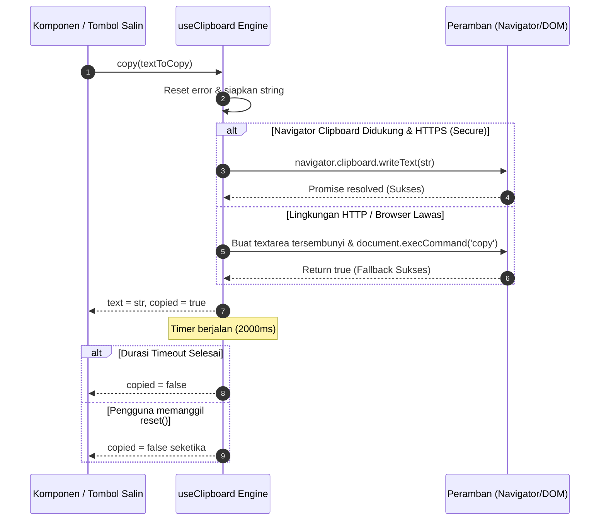

# useClipboard (`useClipboard.js`)

`useClipboard` adalah composable tingkat enterprise yang menyediakan antarmuka reaktif untuk berinteraksi dengan papan klip (*system clipboard*) peramban. Composable ini mendukung operasi penyalinan teks (*write*), pembacaan isi clipboard (*read*), pelacakan status penanda tersalin otomatis (*copied status timer*), serta *fallback* kompatibilitas penuh untuk peramban lawas atau lingkungan non-HTTPS.

---

## 01. Overview

Composable ini mengabstraksi kerumitan Async Clipboard API peramban modern dan menyediakan transisi status visual yang ramah pengguna.

### 1.1 Apa Entitas Ini
`useClipboard` adalah modul logika headless berbasis Vue 3 Composition API yang terletak pada berkas [useClipboard.js](file:///C:/SPEED/LARAVEL-PACK-UI/packages/laravel-pack-ui/resources/js/Composables/Pack/useClipboard.js). Composable ini dapat diintegrasikan pada komponen tombol salin kode, input tautan share, kartu kupon belanja, maupun dialog token kredensial.

### 1.2 Fungsi Utama
- **Penyalinan Teks Asinkron (`copy`)**: Menyalin string teks ke papan klip sistem operasi menggunakan modern `navigator.clipboard.writeText()` dengan penanganan promise.
- **Status Reaktif Otomatis (`copied`)**: Mengubah nilai ref boolean `copied` menjadi `true` selama durasi waktu tertentu (`timeout`, default 2 detik) sebelum kembali ke `false`.
- **Dukungan Pembacaan Clipboard (`read`)**: Membaca teks terkini dari clipboard pengguna dengan penanganan izin peramban (*permission handling*).
- **Fallback Kompatibilitas Legacy**: Beralih secara otomatis ke mekanisme `document.execCommand('copy')` dengan elemen textarea tersembunyi jika peramban berada dalam konteks non-HTTPS (*insecure context*) atau tidak mendukung Clipboard API modern.
- **Pembersihan Timer Otomatis**: Membersihkan timer internal saat komponen di-unmount (`onUnmounted`) guna mencegah pembaruan state pada komponen yang sudah tidak aktif.

### 1.3 Kapan Digunakan
- Tombol salin kode kupon promo atau voucher diskon e-commerce.
- Tombol salin tautan undangan referal (*referral share link*).
- Panel pengembang untuk menyalin token otentikasi API (*API Key/Bearer Token*), potongan kode, atau log server.

### 1.4 Karakteristik Penting
- **Dukungan Teks Sumber Bawaan (`source`)**: Mendukung opsi `source` sehingga pemanggilan `copy()` dapat dilakukan tanpa menyertakan argumen teks berulang kali.
- **Penyetelan Ulang Manual (`reset`)**: Menyediakan method `reset()` untuk mengembalikan status `copied` ke `false` seketika tanpa harus menunggu durasi timeout berakhir.
- **Deteksi Dukungan Lingkungan (`isSupported`)**: Memberikan flag boolean untuk mengetahui apakah fitur clipboard didukung oleh peramban pengguna saat ini.

---

## 02. Preview

> [!TIP]
> Pengujian fungsional dan showcase composable ini dapat diuji secara native pada portal pratinjau aplikasi:
>
> <a href="http://localhost:8000/preview" target="_self" style="display: inline-flex; align-items: center; gap: 6px; padding: 6px 14px; border-radius: 8px; font-weight: 600; text-decoration: none; margin-top: 8px; background-color: var(--vp-c-brand-1, #4f46e5); color: #ffffff;">Buka Live Preview Portal Komponen &rarr;</a>

---

## 03. Usage

Struktur arsitektural pemanfaatan `useClipboard` dalam alur kerja antarmuka:

### Pohon Konsep Penggunaan

```text
useClipboard
├── Operasi Penyalinan (Write to Clipboard)
│   ├── Salin Nilai Input Dinamis (Dynamic Input Field)
│   ├── Salin Token Rahasia (API Keys / Passwords)
│   └── Salin Tautan Berbagi (Referral & Invoice URLs)
├── Operasi Pembacaan (Read from Clipboard)
│   └── Tempel Cepat Data (Paste Quick Action)
└── Pengelolaan Status & Umpan Balik
    ├── Transisi Waktu Aktif (copied: true -> false)
    ├── Reset Manual (reset())
    └── Penanganan Error Izin Peramban
```

### Matriks Keputusan: Kapan Digunakan vs Dihindari

| Kriteria Kasus Penggunaan | Gunakan useClipboard | Hindari useClipboard | Solusi Alternatif |
| :--- | :--- | :--- | :--- |
| Tombol salin tautan / kupon promo | Ya | Tidak | - |
| Salin cuplikan kode dokumentasi | Ya | Tidak | - |
| Penyalinan file biner berukuran besar (gambar/dokumen) | Tidak | Ya | Gunakan File API / Download link |
| Operasi drag-and-drop antar elemen | Tidak | Ya | Gunakan composable `useDragDrop` |

### Alur Kerja Konseptual

```text
Klik Tombol "Salin" -> copy(textToCopy)
    -> Apakah Didukung & Secure Context (HTTPS)?
       ├── Ya: navigator.clipboard.writeText(text)
       └── Tidak: Jalankan fallback legacyCopy (execCommand)
    -> Sukses: copied = true, text = payload
    -> Timer Timeout (2000ms) Berjalan -> copied = false
```

---

## 04. Anatomy

Struktur internal dan alur eksekusi composable `useClipboard`:

### Diagram Hierarki Internal

```text
useClipboard Composable
│
├── 1. Reactive State
│   ├── copied (Ref<boolean>)
│   ├── text (Ref<string>)
│   ├── error (Ref<Error | null>)
│   └── isSupported (boolean)
│
├── 2. Core Execution Engines
│   ├── Modern Async Clipboard Engine (navigator.clipboard.writeText)
│   ├── Async Clipboard Reader (navigator.clipboard.readText)
│   └── Legacy ExecCommand Fallback (Hidden Textarea select)
│
└── 3. Lifecycle & Timing
    ├── Auto-reset Timer Engine (timeout parameter)
    ├── reset() Manual Action
    └── Auto-cleanup on onUnmounted
```

### Diagram Alur Penyalinan (Mermaid)



---

## 05. Variants

Variasi mode eksekusi yang didukung oleh `useClipboard`:

### 1. Mode Modern Async Clipboard
Mode utama yang berjalan pada peramban modern di bawah koneksi HTTPS (`window.isSecureContext = true`). Tidak memanipulasi elemen DOM dan bekerja secara murni asinkron.

### 2. Mode Legacy Fallback (`legacy: true`)
Bekerja secara transparan jika peramban tidak mendukung Async Clipboard API atau berjalan pada koneksi non-HTTPS (seperti lingkungan pengembangan lokal HTTP non-localhost). Composable membuat elemen `<textarea>` tersembunyi dan menjalankan `document.execCommand('copy')`.

### 3. Operasi Pembacaan (`read()`)
Membaca teks dari clipboard sistem operasi menggunakan `navigator.clipboard.readText()`. Berguna untuk tombol "Tempel Cepat" pada formulir.

---

## 06. Sizes

Spesifikasi batas payload dan waktu timer:

| Parameter Batasan | Nilai Default | Batasan yang Direkomendasikan | Catatan Teknis |
| :--- | :--- | :--- | :--- |
| Durasi Timeout (`timeout`) | `2000 ms` | `1000 ms` - `4000 ms` | Waktu ideal agar pengguna sempat membaca feedback visual. |
| Ukuran String Teks | Bebas | `< 10 MB` | Teks teks murni tanpa batasan praktis pada penggunaan normal. |
| Opsi Sumber (`source`) | `''` | String / Ref | Nilai bawaan jika argumen `copy()` diabaikan. |

---

## 07. States

Daftar status reaktif operasional yang disediakan:

| Status / Nilai | Tipe Data | Deskripsi Representasi |
| :--- | :--- | :--- |
| `copied` | `Ref<boolean>` | Bernilai `true` selama durasi timeout setelah penyalinan berhasil. |
| `text` | `Ref<string>` | String teks terakhir yang berhasil disalin atau dibaca. |
| `error` | `Ref<Error \| null>` | Menampung objek exception jika operasi clipboard gagal atau izin ditolak. |
| `isSupported` | `boolean` | Status ketersediaan API modern `navigator.clipboard` di peramban saat ini. |

---

## 08. Props / Parameters / Attributes

Parameter konfigurasi fungsi `useClipboard(options)`:

| Opsi | Tipe Data | Nilai Default | Wajib | Deskripsi |
| :--- | :--- | :--- | :--- | :--- |
| `timeout` | `number` | `2000` | Tidak | Durasi dalam milidetik status `copied` bertahan aktif sebelum kembali `false`. |
| `source` | `string \| Ref<string>` | `''` | Tidak | Teks default yang akan disalin jika pemanggilan `copy()` tidak menyertakan argumen. |
| `legacy` | `boolean` | `true` | Tidak | Mengizinkan penggunaan fallback `document.execCommand` jika API modern tidak tersedia. |

---

## 09. Slots / Content

Sebagai composable non-visual, `useClipboard` tidak memiliki slot DOM. Seluruh data disajikan dalam bentuk variabel reaktif untuk diikatkan ke slot tombol UI aplikasi.

---

## 10. Events / Interactions / Returns

Nilai return objek lengkap dari pemanggilan `useClipboard()`:

| Properti / Method | Tipe Data | Reaktif | Deskripsi |
| :--- | :--- | :---: | :--- |
| `copied` | `Ref<boolean>` | Ya | Status penanda apakah penyalinan baru saja berhasil dilakukan. |
| `text` | `Ref<string>` | Ya | String teks terakhir yang berhasil disalin. |
| `error` | `Ref<Error \| null>` | Ya | Objek error jika terjadi kegagalan penyalinan atau penolakan izin. |
| `isSupported` | `boolean` | Tidak | Status ketersediaan Clipboard API pada peramban klien. |
| `copy(textToCopy?)` | `(text?: string \| number) => Promise<boolean>` | Tidak | Mengeksekusi penyalinan teks ke clipboard. Mengembalikan `true` jika sukses. |
| `read()` | `() => Promise<string>` | Tidak | Membaca isi teks terkini dari clipboard sistem operasi. |
| `reset()` | `() => void` | Tidak | Menyetel ulang status `copied` menjadi `false` seketika dan mematikan timer. |

---

## 11. Code Example

Tiga tingkatan implementasi kode siap pakai:

### 1. Penggunaan Dasar (Tombol Salin Cepat)

```vue
<script setup>
import { useClipboard } from '@/Composables/Pack/useClipboard';

const { copy, copied } = useClipboard({ timeout: 2000 });
const invoiceNumber = 'INV-2026-09-8812';
</script>

<template>
    <div class="flex items-center gap-2">
        <span class="font-mono text-sm">{{ invoiceNumber }}</span>
        <button
            type="button"
            @click="copy(invoiceNumber)"
            class="px-3 py-1 bg-blue-600 text-white rounded text-xs font-semibold"
        >
            {{ copied ? 'Tersalin!' : 'Salin Nomor' }}
        </button>
    </div>
</template>
```

### 2. Penggunaan Menengah (Kartu Kupon Diskon dengan Ikon Dinamis)

```vue
<script setup>
import { useClipboard } from '@/Composables/Pack/useClipboard';

const { copy, copied } = useClipboard({ timeout: 2500 });
const couponCode = 'HEMAT50K';
</script>

<template>
    <div class="p-4 border rounded-xl flex items-center justify-between bg-zinc-50 dark:bg-zinc-900">
        <div>
            <div class="text-xs text-zinc-500">Kode Promo Spesial:</div>
            <div class="font-mono font-bold text-lg">{{ couponCode }}</div>
        </div>

        <button
            type="button"
            @click="copy(couponCode)"
            :class="copied ? 'bg-emerald-600 text-white' : 'border border-zinc-300 text-zinc-700'"
            class="px-4 py-2 rounded-lg text-xs font-semibold flex items-center gap-1.5 transition"
        >
            <span class="material-symbols-outlined text-sm">
                {{ copied ? 'done' : 'content_copy' }}
            </span>
            <span>{{ copied ? 'Berhasil Disalin!' : 'Salin Kode' }}</span>
        </button>
    </div>
</template>
```

### 3. Penggunaan Lanjutan (API Token Generator dengan Opsi Read & Reset)

```vue
<script setup>
import { ref } from 'vue';
import { useClipboard } from '@/Composables/Pack/useClipboard';

const apiToken = ref('pk_live_992104918239012481');
const { copy, copied, read, reset, error } = useClipboard({
    source: apiToken,
    timeout: 3000,
});

const pastedContent = ref('');

const handlePasteFromClipboard = async () => {
    pastedContent.value = await read();
};
</script>

<template>
    <div class="space-y-4 p-6 border rounded-2xl bg-white dark:bg-zinc-900">
        <h4 class="font-bold text-sm">Token Kredensial API</h4>
        
        <div class="flex gap-2">
            <input v-model="apiToken" type="text" readonly class="flex-1 font-mono text-xs border p-2 rounded-lg bg-zinc-50" />
            <button
                type="button"
                @click="copy()"
                :class="copied ? 'bg-emerald-600' : 'bg-blue-600'"
                class="px-4 py-2 text-white font-semibold text-xs rounded-lg shadow-sm"
            >
                {{ copied ? 'Tersalin!' : 'Salin Token' }}
            </button>
            <button v-if="copied" type="button" @click="reset" class="px-2 text-xs text-zinc-400">
                Reset
            </button>
        </div>

        <p v-if="error" class="text-rose-500 text-xs">Gagal mengakses clipboard: {{ error.message }}</p>

        <!-- Tombol Tempel Cepat -->
        <div class="pt-2 border-t flex items-center gap-3">
            <button type="button" @click="handlePasteFromClipboard" class="text-xs text-blue-600 hover:underline">
                Tempel dari Clipboard
            </button>
            <span v-if="pastedContent" class="text-xs text-zinc-500 truncate">Isi: {{ pastedContent }}</span>
        </div>
    </div>
</template>
```

---

## 12. Result / Behavior

Perilaku sistem saat interaksi penyalinan berlangsung:

### Alur Aksi ke Reaksi
1. Pengguna mengeklik elemen pemicu `copy(str)`.
2. Jika berada di lingkungan HTTPS aman, perintah diserahkan ke `navigator.clipboard.writeText`.
3. Jika di lingkungan HTTP lokal non-secure, composable secara instan beralih ke seleksi textarea tersembunyi `execCommand`.
4. Nilai `copied` berubah menjadi `true`, memicu pembaruan visual label atau warna tombol di antarmuka.
5. Setelah waktu `timeout` (default 2 detik) terlampaui, `copied` otomatis kembali ke `false`.

---

## 13. Customization

Menyesuaikan durasi timeout atau fallback:
```javascript
const { copy, copied } = useClipboard({
    timeout: 4000, // Tombol status tersalin aktif selama 4 detik
    legacy: true,   // Mempertahankan fallback ke execCommand
});
```

---

## 14. Accessibility (a11y)

Pedoman aksesibilitas saat mengimplementasikan tombol salin:

- **Atribut `aria-live` untuk Screen Reader**: Berikan elemen penampung umpan balik teks dengan atribut `aria-live="polite"` agar pembaca layar mengumumkan "Teks berhasil disalin" saat status `copied` aktif.
- **Aria Label Deskriptif**: Pasang atribut `aria-label="Salin nomor invoice INV-2026"` pada tombol, bukan sekadar "Salin".

---

## 15. Responsive Behavior

Perilaku lintas perangkat:
- **Mobile Safari & Chrome**: Mendukung penyalinan instan saat dipicu oleh aksi langsung pengguna (*user gesture event* seperti `click` atau `touchend`).
- **Desktop**: Mendukung integrasi dengan kombinasi keyboard shortcut.

---

## 16. Do / Don't

Pedoman implementasi terbaik:

### Rekomendasi (Do):
- Selalu berikan umpan balik visual yang jelas (perubahan teks atau ikon centang hijau) saat `copied` bernilai `true`.
- Pasangkan dengan composable [useNotification.js](file:///C:/SPEED/LARAVEL-PACK-UI/packages/laravel-pack-ui/resources/js/Composables/Pack/useNotification.js) jika ingin menampilkan notifikasi toast mengambang saat penyalinan berhasil.
- Manfaatkan opsi `source` untuk komponen yang menyalin teks statis secara konsisten.

### Larangan (Don't):
- Jangan memicu `copy()` di luar event interaksi pengguna langsung (misal memanggil `copy()` di dalam timer `setTimeout` tanpa klik pengguna), karena peramban akan memblokir akses clipboard karena alasan keamanan.
- Jangan mengandalkan fitur `read()` tanpa menangani kemungkinan penolakan izin peramban oleh pengguna.

---

## 17. Examples / Recipes

### Resep: Input Field Tautan Berbagi dengan Tombol Salin Terintegrasi

```vue
<script setup>
import { useClipboard } from '@/Composables/Pack/useClipboard';

const shareUrl = 'https://app.domain.com/invite?ref=PARTNER2026';
const { copy, copied } = useClipboard({ source: shareUrl, timeout: 2000 });
</script>

<template>
    <div class="space-y-1.5">
        <label class="text-xs font-semibold text-zinc-600 dark:text-zinc-300">Tautan Undangan:</label>
        <div class="flex rounded-xl border overflow-hidden bg-zinc-50 dark:bg-zinc-950">
            <input :value="shareUrl" readonly class="flex-1 px-3 py-2 text-xs bg-transparent border-none outline-none font-mono" />
            <button
                type="button"
                @click="copy()"
                :class="copied ? 'bg-emerald-600 text-white' : 'bg-zinc-200 dark:bg-zinc-800 text-zinc-800 dark:text-zinc-200'"
                class="px-4 text-xs font-semibold transition"
            >
                {{ copied ? 'Tersalin' : 'Salin' }}
            </button>
        </div>
    </div>
</template>
```

---

## 18. Related Items

Komponen dan composable terkait:

```text
useClipboard
├── Komponen UI Pendukung
│   ├── InputField.vue (Input field dengan slot trailing copy button)
│   ├── ToastNotification.vue (Notifikasi toast saat tersalin)
│   └── Badge.vue (Label status indikator)
└── Composables Terkait
    ├── useNotification.js (Pemicu toast umpan balik visual)
    └── useLocalStorage.js (Penyimpanan draf teks lokal)
```

---

## 19. Notes / Limitations

- **Keharusan HTTPS (Secure Context)**: API modern `navigator.clipboard` dibatasi oleh kebijakan peramban hanya pada situs web dengan protokol aman HTTPS atau `http://localhost`. Pada HTTP biasa, `useClipboard` otomatis beralih ke fallback legacy.
- **Izin Pembacaan (Clipboard Read)**: Operasi `read()` memerlukan izin eksplisit dari pengguna via dialog peramban (*permission prompt*).
- **Dukungan Peramban**: Kompatibel dengan seluruh peramban modern (Chrome, Safari, Firefox, Edge, Opera) baik di perangkat desktop maupun seluler.
