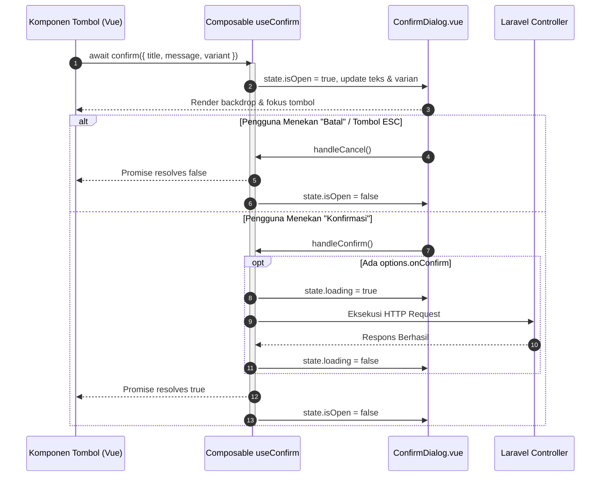

# useConfirm (`useConfirm.js`)

## 01. Overview

`useConfirm` adalah composable dialog konfirmasi berbasis *Promise* (*asynchronous*) untuk ekosistem Vue 3 dan Laravel Inertia. Composable ini memfasilitasi pemanggilan dialog konfirmasi modal semudah fungsi bawaan `window.confirm()`, namun menghasilkan antarmuka modal modern yang responsif, terisolasi, ramah aksesibilitas, serta selaras dengan sistem desain aplikasi.

### 1.1 Apa Entitas Ini
* **Tipe Artefak**: Composable Function (Vue 3 Composition API).
* **Lokasi Berkas Sumber**: [useConfirm.js](file:///c:/SPEED/LARAVEL-PACK-UI/packages/laravel-pack-ui/resources/js/Composables/Pack/useConfirm.js).
* **Komponen Renderer Pasangan**: [ConfirmDialog.vue](file:///c:/SPEED/LARAVEL-PACK-UI/packages/laravel-pack-ui/resources/js/Components/Pack/ConfirmDialog.vue).
* **Target Ekosistem**: Single Page Application (SPA) berbasis Inertia.js, Pinia, dan Tailwind CSS.

### 1.2 Fungsi Utama
* Menggantikan dialog native peramban `window.confirm()` yang kaku, memblokir thread JavaScript, dan tidak mendukung kustomisasi tema atau branding.
* Menyediakan antarmuka Promise asinkron (`async/await`) yang menyelesaikan nilai boolean (`true` saat pengguna menyetujui, `false` saat membatalkan).
* Mendukung penanganan callback asinkron langsung (`onConfirm: async () => ...`) dengan status pemuatan (*loading spinner*) terintegrasi pada tombol konfirmasi.
* Mengisolasi status modal ke dalam reactive state terpusat yang dapat diakses oleh komponen rendering di level layout aplikasi.

### 1.3 Kapan Digunakan
* Konfirmasi sebelum mengeksekusi penghapusan rekaman data permanen (*destructive delete*).
* Verifikasi saat pengguna hendak mempublikasikan konten atau mengubah status operasional penting.
* Peringatan mitigasi kehilangan data ketika pengguna akan meninggalkan formulir dengan perubahan yang belum tersimpan.
* Konfirmasi otorisasi sesi atau pergantian peran hak akses pengguna.

### 1.4 Karakteristik Penting
* **Promise-Based Flow**: Menghilangkan kebutuhan mendefinisikan variabel `isOpen` lokal atau handler event berulang pada setiap tombol pemicu.
* **Auto-Cleanup & Safe Overwrite**: Jika sebuah dialog baru dipanggil saat dialog sebelumnya masih aktif, dialog lama otomatis dibatalkan (`false`) secara tertib tanpa menimbulkan memory leak atau unhandled promise rejection.
* **Built-in Semantic Helpers**: Menyediakan jalan pintas fungsional seperti `confirm.danger()`, `confirm.warning()`, `confirm.info()`, `confirm.success()`, dan `confirm.primary()`.
* **Aksesibilitas WAI-ARIA**: Terintegrasi dengan penanganan tombol Escape, penguncian scroll layar (`overflow-hidden`), serta atribut dialog modal.

---

## 02. Preview

> [!TIP]
> Pengujian fungsional dan showcase composable ini dapat diuji secara native pada portal pratinjau aplikasi:
>
> <a href="http://localhost:8000/preview" target="_self" style="display: inline-flex; align-items: center; gap: 6px; padding: 6px 14px; border-radius: 8px; font-weight: 600; text-decoration: none; margin-top: 8px; background-color: var(--vp-c-brand-1, #4f46e5); color: #ffffff;">Buka Live Preview Portal Komponen &rarr;</a>

---

## 03. Usage

### Konsep Pemetaan Arsitektur Penggunaan
```text
useConfirm
├── Verifikasi Tindakan Destruktif (Danger)
│   ├── Hapus Data Permanen (Hard Delete)
│   ├── Reset Pengaturan Pabrik
│   └── Cabut Hak Akses / Banned Akun
├── Konfirmasi Status Operasional (Warning)
│   ├── Publikasi Artikel Draf
│   ├── Batalkan Transaksi Berjalan
│   └── Abaikan Perubahan Formulir
├── Validasi Bisnis & Transaksi (Success / Primary)
│   ├── Finalisasi Pembayaran Kasir
│   ├── Setujui Pengajuan Cuti (Approve)
│   └── Kirimkan Laporan Pajak Tahunan
└── Pemberitahuan Interaktif (Info)
    ├── Verifikasi Perangkat Baru
    └── Ketentuan Pembaruan Lisensi
```

### Matriks Keputusan: Kapan Digunakan vs Alternatif
| Kebutuhan Skenario | Pilihan Terbaik | Alasan Teknis |
| :--- | :--- | :--- |
| Konfirmasi sederhana sebelum hapus / simpan data | `useConfirm` | Alur kode linier via `await confirm()`, tanpa perlu boilerplate modal lokal |
| Formulir input kompleks dengan banyak field di dalam modal | `Modal.vue` | Membutuhkan tata letak slot kustom, formulir berulang, dan validasi field |
| Notifikasi pasif yang tidak memerlukan persetujuan pengguna | `useToast` / `Alert.vue` | Informasi satu arah tanpa memutus alur kerja pengguna |
| Dialog peringatan mendesak sistem level peramban | `window.alert()` | Sebaiknya dihindari di aplikasi modern karena memblokir UI |

---

## 04. Anatomy

### Struktur Hierarki State & Elemen
```text
useConfirm State Architecture
│
├── Global Reactive State (state)
│   ├── isOpen (Boolean) ────────────── Mengatur visibilitas Teleport
│   ├── title & message (String) ───── Teks header dan rincian peringatan
│   ├── context (String) ───────────── Badge penjelas konteks rekaman data
│   ├── variant (String) ───────────── Skema warna semantik (danger/warning/dll)
│   ├── confirmText & cancelText ───── Label tombol aksi
│   ├── loading (Boolean) ──────────── Indikator spinner saat eksekusi asinkron
│   ├── closable (Boolean) ─────────── Izin penutupan via backdrop atau Escape
│   └── resolver (Function) ────────── Callback resolusi Promise internal
│
└── ConfirmDialog.vue (Renderer)
    ├── Teleport to <body>
    ├── Backdrop Overlay (Blur & Dark Tint)
    └── Modal Panel Container (Card)
        ├── Header Section (Icon, Context Badge, Title, Close Button)
        ├── Body Section (Message with whitespace-pre-line)
        └── Footer Actions (Cancel Button & Submit Confirm Button)
```

### Diagram Alur Siklus Hidup Eksekusi (Mermaid)



---

## 05. Variants

`useConfirm` mendukung 5 varian semantik visual yang secara otomatis menyesuaikan warna aksen, ikon Material Symbols, dan warna tombol aksi pada komponen renderer:

| Varian | Skema Warna | Ikon Default | Rekomendasi Kasus Penggunaan |
| :--- | :--- | :--- | :--- |
| `danger` | Rose / Merah | `error` | Hapus permanen, pembatalan pesanan, reset basis data |
| `warning` | Amber / Kuning | `warning` | Pengabaian perubahan yang belum tersimpan, publikasi konten |
| `info` | Sky / Biru Terang | `info` | Verifikasi sesi, pembacaan regulasi, konfirmasi sistem |
| `primary` | Blue / Biru Utama | `help` | Aksi navigasi penting, penugasan tiket, pemindahan data |
| `success` | Emerald / Hijau | `check_circle` | Penyelesaian pembayaran, verifikasi persetujuan (approval) |

---

## 06. Sizes

Secara arsitektur, dialog konfirmasi dioptimalkan dengan lebar proporsional tetap untuk memastikan fokus pesan tidak tersebar:

| Parameter Ukuran | Nilai / Dimensi | Deskripsi |
| :--- | :--- | :--- |
| Lebar Maksimum Kontainer | `max-w-md` (448px) | Standar modal kartu konfirmasi yang ringkas dan terpusat |
| Dimensi Ikon Header | `w-11 h-11` (44px) | Target visual utama penanda tingkat keparahan pesan |
| Padding Kontainer Internal | `p-6` (24px) | Ruang napas ergonomis antar elemen teks dan tombol |
| Target Sentuh Tombol Aksi | Minimum 40px tinggi | Memenuhi batas kelayakan interaksi sentuh layar sentuh |

---

## 07. States

| Status | Properti Reaktif | Representasi Visual / Perilaku |
| :--- | :--- | :--- |
| `Idle / Closed` | `isOpen: false` | Modal tersembunyi sepenuhnya dari DOM dan accessibility tree |
| `Open / Awaiting` | `isOpen: true` | Backdrop blur tampil, scroll body dikunci, tombol menerima fokus |
| `Loading` | `loading: true` | Tombol konfirmasi menampilkan spinner, tombol batal dinonaktifkan |
| `Resolved (True)` | `isOpen: false` | Promise selesai bernilai `true`, dialog tertutup |
| `Cancelled (False)` | `isOpen: false` | Promise selesai bernilai `false`, dialog tertutup |

---

## 08. Parameters / Options Reference

### Parameter Fungsi `confirm(options)`

Fungsi `confirm()` dapat menerima string pesan langsung atau objek konfigurasi lengkap:

| Nama Properti | Tipe Data | Nilai Default | Wajib | Keterangan & Dampak |
| :--- | :--- | :--- | :---: | :--- |
| `title` | `String` | `'Konfirmasi Tindakan'` | Tidak | Judul utama header dialog |
| `message` | `String` | `'Apakah Anda yakin...'` | Tidak | Isi teks penjelasan tindakan yang akan dieksekusi |
| `context` | `String` | `''` | Tidak | Teks badge kecil di atas judul (misal: ID rekaman data) |
| `variant` | `String` | `'danger'` | Tidak | Pilihan: `'danger'`, `'warning'`, `'info'`, `'primary'`, `'success'` |
| `confirmText` | `String` | `'Ya, Lanjutkan'` | Tidak | Label teks tombol konfirmasi persetujuan |
| `cancelText` | `String` | `'Batal'` | Tidak | Label teks tombol pembatalan |
| `icon` | `String` | `''` | Tidak | Nama icon Material Symbols untuk menimpa ikon bawaan varian |
| `closable` | `Boolean` | `true` | Tidak | Menentukan apakah klik backdrop atau tombol Escape diizinkan |
| `onConfirm` | `Function` | `null` | Tidak | Fungsi asinkron yang dijalankan saat tombol konfirmasi ditekan |

---

## 09. Slots / Content

Sebagai artefak composable logika murni, `useConfirm` tidak mengekspos slot Vue. Kustomisasi konten dilakukan melalui passing options (`title`, `message`, `context`) ke dalam fungsi pemanggil. Jika komponen Anda membutuhkan render kustom yang fleksibel (seperti form input password verifikasi), gunakan komponen [Modal.vue](file:///c:/SPEED/LARAVEL-PACK-UI/packages/laravel-pack-ui/resources/js/Components/Pack/Modal.vue) yang didukung slot template penuh.

---

## 10. Returns (API Reference)

Objek yang diekspos saat memanggil `useConfirm()`:

| Properti / Method | Tipe Data | Reaktif | Deskripsi |
| :--- | :--- | :---: | :--- |
| `confirm(options)` | `Function(options): Promise<boolean>` | Tidak | Membuka modal konfirmasi dan mengembalikan Promise hasil keputusan |
| `confirm.danger(options)` | `Function(options): Promise<boolean>` | Tidak | Jalan pintas pemanggilan dengan varian semantik `danger` |
| `confirm.warning(options)` | `Function(options): Promise<boolean>` | Tidak | Jalan pintas pemanggilan dengan varian semantik `warning` |
| `confirm.info(options)` | `Function(options): Promise<boolean>` | Tidak | Jalan pintas pemanggilan dengan varian semantik `info` |
| `confirm.success(options)` | `Function(options): Promise<boolean>` | Tidak | Jalan pintas pemanggilan dengan varian semantik `success` |
| `confirm.primary(options)` | `Function(options): Promise<boolean>` | Tidak | Jalan pintas pemanggilan dengan varian semantik `primary` |
| `state` | `Reactive<ConfirmState>` | Ya | Objek state reaktif global yang dipantau oleh `ConfirmDialog.vue` |
| `handleConfirm()` | `Function(): void` | Tidak | Menyelesaikan Promise dengan nilai `true` dan menutup modal |
| `handleCancel()` | `Function(): void` | Tidak | Menyelesaikan Promise dengan nilai `false` dan menutup modal |
| `setLoading(val)` | `Function(val: boolean): void` | Tidak | Menyetel status spinner secara imperatif |
| `close()` | `Function(): void` | Tidak | Menutup dialog seketika dan membatalkan Promise |
| `reset()` | `Function(): void` | Tidak | Mengembalikan seluruh properti state ke konfigurasi awal |

---

## 11. Code Example

### 1. Penggunaan Dasar (Basic Example)
Pemanggilan ringkas dengan parameter teks tunggal untuk verifikasi cepat:

```vue
<script setup>
import { useConfirm } from '@/Composables/Pack/useConfirm';

const { confirm } = useConfirm();

const handleLogout = async () => {
    const isConfirmed = await confirm('Apakah Anda yakin ingin keluar dari sesi aplikasi saat ini?');

    if (isConfirmed) {
        window.location.href = '/logout';
    }
};
</script>

<template>
    <button type="button" @click="handleLogout">
        Keluar Sesi
    </button>
</template>
```

### 2. Penggunaan Varian & Opsi Menengah (Intermediate Example)
Menggunakan helper varian spesifik dengan kustomisasi teks dan badge konteks:

```vue
<script setup>
import { useConfirm } from '@/Composables/Pack/useConfirm';

const { confirm } = useConfirm();

const publishArticle = async (articleId) => {
    const isApproved = await confirm.warning({
        title: 'Publikasikan Artikel Sekarang?',
        message: 'Artikel ini akan langsung dapat dibaca oleh seluruh pengunjung website.',
        context: `Draf #${articleId}`,
        confirmText: 'Ya, Publikasikan',
        cancelText: 'Simpan Draf Saja',
    });

    if (isApproved) {
        // Eksekusi pembaruan status
    }
};
</script>

<template>
    <button type="button" @click="publishArticle(102)">
        Publikasikan Konten
    </button>
</template>
```

### 3. Penggunaan Lanjutan dengan Laravel Inertia (Advanced Enterprise Example)
Integrasi lengkap dengan penanganan request asinkron via `router.delete`, status loading tombol otomatis, dan notifikasi flash:

```vue
<script setup>
import { router } from '@inertiajs/vue3';
import { useConfirm } from '@/Composables/Pack/useConfirm';

const { confirm } = useConfirm();

const deleteRecord = async (user) => {
    await confirm.danger({
        title: `Hapus Akun: ${user.name}?`,
        message: `Tindakan ini bersifat permanen. Seluruh file dan histori aktivitas milik ${user.email} akan dihapus seketika.`,
        context: `User ID: #${user.id}`,
        confirmText: 'Hapus Permanen',
        cancelText: 'Batalkan',
        onConfirm: () => {
            return new Promise((resolve, reject) => {
                router.delete(`/admin/users/${user.id}`, {
                    preserveScroll: true,
                    onSuccess: () => resolve(true),
                    onError: (errors) => reject(errors),
                });
            });
        },
    });
};
</script>

<template>
    <button
        type="button"
        class="text-xs font-semibold text-rose-600 hover:text-rose-700"
        @click="deleteRecord({ id: 84, name: 'Bambang Sudibyo', email: 'bambang@company.id' })"
    >
        Hapus Akun Pengguna
    </button>
</template>
```

---

## 12. Result / Behavior

### Alur Aksi ke Reaksi
1. **Trigger Aksi**: Pengembang memanggil `await confirm(...)`. Eksekusi fungsi pemanggil tertahan pada titik `await`.
2. **Mounting Render**: State `state.isOpen` bermutasi menjadi `true`. Komponen `<ConfirmDialog />` yang terpasang di root layout merender backdrop beranimasi pudar (*fade-in*) dan kartu modal dengan efek skala (*zoom-in*).
3. **Pemberhentian Interaksi Latar**: Kelas utilitas `overflow-hidden` ditambahkan pada elemen `document.body` untuk mencegah interaksi scroll pada konten halaman utama.
4. **Keputusan Pengguna**:
   - Jika pengguna memilih **Konfirmasi**: Promise selesai mengembalikan `true`.
   - Jika pengguna memilih **Batal**, menekan tombol **Escape**, atau mengeklik area **Backdrop**: Promise selesai mengembalikan `false`.
5. **Pembersihan State**: Modal menutup dengan transisi keluar halus, scroll body dipulihkan, dan referensi resolver dinolkan.

---

## 13. Customization

### Integrasi dengan Komponen Dialog Kustom
Jika Anda ingin merancang tampilan dialog konfirmasi sendiri tanpa memakai `ConfirmDialog.vue` bawaan paket, Anda cukup mengimpor reactive `state` dan handler dari `useConfirm`:

```vue
<script setup>
import { useConfirm } from '@/Composables/Pack/useConfirm';

const { state, handleConfirm, handleCancel } = useConfirm();
</script>

<template>
    <div v-if="state.isOpen" class="custom-modal-backdrop">
        <div class="custom-modal-card">
            <h3>{{ state.title }}</h3>
            <p>{{ state.message }}</p>
            <div class="actions">
                <button @click="handleCancel">{{ state.cancelText }}</button>
                <button @click="handleConfirm" :disabled="state.loading">
                    {{ state.confirmText }}
                </button>
            </div>
        </div>
    </div>
</template>
```

---

## 14. Accessibility (a11y)

| Aspek Aksesibilitas | Implementasi Teknis |
| :--- | :--- |
| **Keyboard Navigation** | Menekan tombol `Escape` otomatis memicu `handleCancel()` jika `state.closable` aktif |
| **Focus Trapping** | Saat modal aktif, interaksi keyboard dibatasi hanya di dalam modal dialog |
| **Atribut WAI-ARIA** | Menggunakan atribut `role="dialog"`, `aria-modal="true"`, dan `:aria-label="state.title"` |
| **Screen Reader** | Label tombol penutup `aria-label="Tutup dialog"` tersedia untuk perangkat assistive technology |
| **Scroll Lock** | Menghapus scrollbar window saat modal aktif agar orientasi pembaca layar tidak berpindah |

---

## 15. Responsive Behavior

| Viewport | Lebar Layar | Perilaku Antarmuka Dialog |
| :--- | :--- | :--- |
| **Mobile** | `< 640px` | Dialog memenuhi lebar layar dengan margin `p-4`, tombol aksi ditumpuk proporsional |
| **Tablet & Desktop** | `>= 640px` | Dialog berada di titik pusat viewport (`items-center justify-center`) dengan lebar maksimum `max-w-md` |
| **Touch Target** | Semua Layar | Tombol memiliki target klik minimum 40px untuk kenyamanan sentuhan jari |

---

## 16. Do / Don't

### Rekomendasi (Do)
* Gunakan teks tombol konfirmasi yang spesifik dan langsung menjelaskan aksi, seperti "Hapus Akun", "Publikasikan", bukan sekadar kata "OK".
* Pasang komponen `<ConfirmDialog />` satu kali saja di file root layout utama (misal: `AppLayout.vue` atau `AuthenticatedLayout.vue`).
* Manfaatkan `await confirm(...)` agar alur logika asinkron Anda mudah dibaca dari atas ke bawah.

### Larangan (Don't)
* Jangan memasang komponen `<ConfirmDialog />` berulang kali di dalam komponen anak (child components), karena state modal bersifat global tunggal (*singleton*).
* Jangan gunakan dialog konfirmasi untuk pesan informasi biasa yang tidak memerlukan keputusan kritis; gunakan [Alert](file:///c:/SPEED/LARAVEL-PACK-UI/packages/laravel-pack-ui/doc/components/alert.md) atau Toast.
* Jangan membiarkan proses penghapusan data kritis berjalan tanpa perlindungan dialog konfirmasi.

---

## 17. Examples / Recipes

### Resep: Dialog Konfirmasi Pengabaian Formulir yang Belum Tersimpan
Kombinasi `useConfirm` dengan composable [useUnsavedChanges](file:///c:/SPEED/LARAVEL-PACK-UI/packages/laravel-pack-ui/doc/composables/use-unsaved-changes.md):

```vue
<script setup>
import { router } from '@inertiajs/vue3';
import { useConfirm } from '@/Composables/Pack/useConfirm';

const { confirm } = useConfirm();

const handleLeaveForm = async (targetUrl, isFormDirty) => {
    if (!isFormDirty) {
        router.visit(targetUrl);
        return;
    }

    const shouldLeave = await confirm.warning({
        title: 'Tinggalkan Formulir?',
        message: 'Perubahan yang telah Anda ketik belum tersimpan ke server. Lanjutkan navigasi?',
        confirmText: 'Ya, Tinggalkan',
        cancelText: 'Tetap di Halaman Ini',
    });

    if (shouldLeave) {
        router.visit(targetUrl);
    }
};
</script>
```

---

## 18. Related Items

```text
useConfirm
├── Komponen Pasangan
│   ├── ConfirmDialog.vue (Komponen modal renderer bawaan)
│   └── Modal.vue (Komponen modal umum dengan slot formulir)
├── Composables Pelengkap
│   ├── useUnsavedChanges.js (Pencegahan navigasi formulir dirty)
│   └── useNotification.js (Pemberitahuan hasil pasca-konfirmasi)
└── Komponen Umpan Balik Terkait
    ├── ButtonSubmit.vue (Tombol pemicu dengan status loading)
    └── Alert.vue (Banner umpan balik inline)
```

---

## 19. Notes / Limitations

* **Single Active Dialog**: `useConfirm` dirancang menggunakan state global tunggal (*singleton*). Memanggil `confirm()` saat dialog lain masih terbuka akan membatalkan dialog sebelumnya dengan nilai `false` untuk menjaga integritas tampilan.
* **Kebutuhan Layout Renderer**: Agar visual modal muncul di layar, pastikan komponen `<ConfirmDialog />` telah diregistrasikan di file layout aplikasi Anda.
* **Integrasi SSR (Server-Side Rendering)**: Composable aman dieksekusi di lingkungan Node.js/SSR karena pemeriksaan ketersediaan objek `window` dan `document` dilakukan sebelum event listener didaftarkan.
