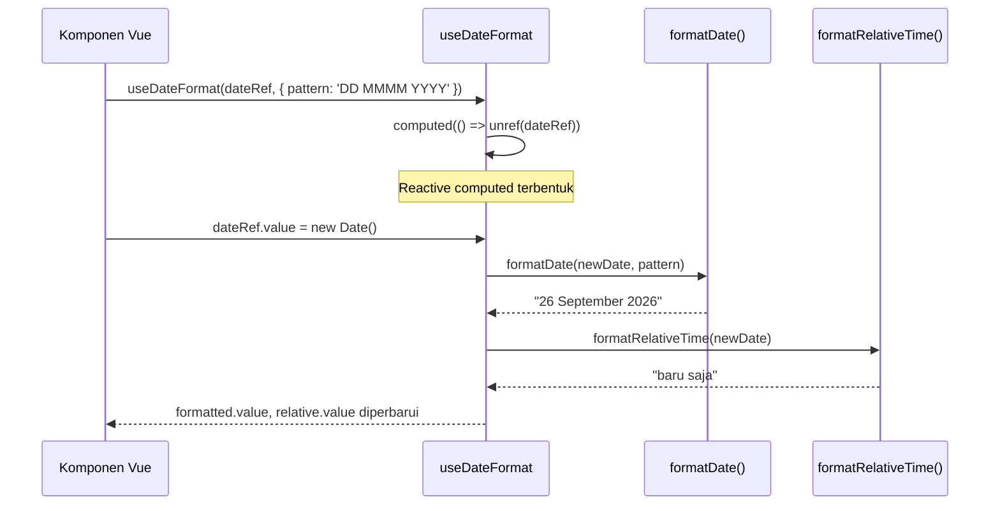

# useDateFormat (`useDateFormat.js`)

## 01. Overview

`useDateFormat` adalah kumpulan fungsi pemformatan tanggal dan waktu untuk Vue 3 yang dirancang khusus untuk ekosistem Indonesia. Composable ini menyediakan format tanggal bertampilan Indonesia (`DD MMMM YYYY`), waktu relatif dinamis (*time ago*), dan format durasi dalam berbagai gaya output.

### 1.1 Apa Entitas Ini

- **Tipe Artefak**: Composable Function + Pure Utility Helpers (Vue 3 Composition API).
- **Lokasi Berkas Sumber**: [useDateFormat.js](file:///c:/SPEED/LARAVEL-PACK-UI/packages/laravel-pack-ui/resources/js/Composables/Pack/useDateFormat.js).
- **Ekspor Kunci**: `useDateFormat`, `formatDate`, `formatRelativeTime`, `formatDuration`, `parseDate`.
- **Target Ekosistem**: Komponen tampilan data, tabel, timeline, notifikasi, dan formulir yang menampilkan data waktu.

### 1.2 Fungsi Utama

- Memformat tanggal ke pola token kustom (contoh: `DD MMMM YYYY HH:mm`) dengan nama bulan dan hari dalam Bahasa Indonesia.
- Menghasilkan teks waktu relatif dinamis (`baru saja`, `5 menit yang lalu`, `3 hari lagi`) dari selisih Unix timestamp.
- Memformat durasi dari jumlah detik ke tiga gaya output: `digital` (`01:02:05`), `human` (`1 jam 2 menit`), dan `short` (`1j 2m 5s`).
- Menyediakan parser input fleksibel yang menerima string ISO, Unix timestamp, maupun objek `Date` JavaScript.
- Menyediakan composable `useDateFormat()` reaktif yang secara otomatis memperbarui nilai `formatted` dan `relative` saat input Ref berubah.

### 1.3 Kapan Digunakan

- Kolom tanggal pada komponen `TableComponent` atau `DataGrid`.
- Label waktu di komponen `Badge`, `Timeline`, atau notifikasi toast.
- Footer kartu dengan keterangan "Diperbarui 3 hari lalu".
- Komponen timer atau countdown pelatihan/ujian yang membutuhkan format durasi.
- Seluruh konteks yang perlu menampilkan nilai `Date` dalam tampilan Bahasa Indonesia yang ramah.

### 1.4 Karakteristik Penting

- **Lokal Indonesia**: Nama bulan dan hari tersedia dalam Bahasa Indonesia penuh (`MMMM` = "September") dan singkat (`MMM` = "Sep").
- **Tanpa Dependensi Eksternal**: Tidak membutuhkan `dayjs`, `date-fns`, atau `moment.js`; 100% ditulis dengan native JavaScript.
- **Dukungan Input Fleksibel**: Fungsi `parseDate()` menormalisasi semua format input umum menjadi objek `Date` sebelum diproses.
- **Reaktif melalui Computed**: Fungsi `useDateFormat()` mengembalikan computed ref yang secara otomatis bereaksi saat nilai input Ref berubah.

---

## 02. Preview

> [!TIP]
> Pengujian fungsional dan showcase composable ini dapat diuji secara native pada portal pratinjau aplikasi:
>
> <a href="/preview" target="_self" style="display: inline-flex; align-items: center; gap: 6px; padding: 6px 14px; border-radius: 8px; font-weight: 600; text-decoration: none; margin-top: 8px; background-color: var(--vp-c-brand-1, #4f46e5); color: #ffffff;">Buka Live Preview Portal Komponen &rarr;</a>

---

## 03. Usage

### Peta Penggunaan Konseptual

```text
useDateFormat Ecosystem
├── Penggunaan Reactive (dalam komponen Vue)
│   └── useDateFormat(dateRef, options)
│       ├── formatted    → computed nilai bertampilan standar
│       ├── relative     → computed waktu relatif dinamis
│       └── format(pat)  → fungsi format dengan pola kustom ad-hoc
│
└── Penggunaan Pure (di luar komponen / template)
    ├── formatDate(date, pattern)     → format satu kali
    ├── formatRelativeTime(date)      → waktu relatif satu kali
    ├── formatDuration(secs, opts)    → format durasi dari detik
    └── parseDate(input)              → normalisasi input ke Date
```

### Matriks Keputusan Penggunaan

| Kondisi | Rekomendasi |
| :--- | :--- |
| Perlu nilai reaktif yang berubah saat state `ref` berubah | `useDateFormat(dateRef)` |
| Format tanggal satu kali dalam computed atau script biasa | `formatDate(date, pattern)` |
| Tampilkan "3 menit yang lalu" atau "2 hari lagi" | `formatRelativeTime(date)` |
| Format durasi video, timer, atau sesi dari jumlah detik | `formatDuration(seconds, opts)` |
| Parse string atau timestamp tidak dikenal ke objek `Date` | `parseDate(input)` |

---

## 04. Anatomy

### Hierarki Modul

```text
useDateFormat.js
│
├── Konstanta Lokal Indonesia
│   ├── MONTH_NAMES_ID  → ['Januari', ..., 'Desember']
│   ├── MONTH_SHORT_ID  → ['Jan', ..., 'Des']
│   ├── DAY_NAMES_ID    → ['Minggu', ..., 'Sabtu']
│   └── DAY_SHORT_ID    → ['Min', ..., 'Sab']
│
├── padZero(num, length)         → Penyesuai padding angka
│
├── parseDate(dateInput)         → Normalisasi input ke Date|null
│
├── formatDate(dateInput, pattern)
│   ├── Panggil parseDate()
│   ├── Ekstrak komponen waktu (tahun, bulan, hari, jam, menit, detik)
│   └── Token replacement berantai
│
├── formatRelativeTime(dateInput)
│   ├── Hitung selisih detik dari Date.now()
│   └── Peta selisih ke teks (detik, menit, jam, hari, minggu, bulan, tahun)
│
├── formatDuration(seconds, options)
│   ├── Mode 'digital'  → 'HH:MM:SS'
│   ├── Mode 'short'    → '1j 2m 5s'
│   └── Mode 'human'    → '1 jam 2 menit 5 detik'
│
└── useDateFormat(dateInput, options)   (Composable Reaktif)
    ├── dateVal  = computed(() => unref(dateInput))
    ├── formatted = computed(() => formatDate(dateVal, pattern))
    ├── relative  = computed(() => formatRelativeTime(dateVal))
    └── format(pattern) → fungsi helper ad-hoc
```

### Diagram Alur Data Reaktif



---

## 05. Variants

### Token Pattern `formatDate()`

| Token | Output | Keterangan |
| :--- | :--- | :--- |
| `YYYY` | `2026` | Tahun 4 digit |
| `YY` | `26` | Tahun 2 digit |
| `MMMM` | `September` | Nama bulan penuh Indonesia |
| `MMM` | `Sep` | Nama bulan singkat Indonesia |
| `MM` | `09` | Bulan 2 digit dengan padding |
| `M` | `9` | Bulan tanpa padding |
| `DDDD` | `Sabtu` | Nama hari penuh Indonesia |
| `DDD` | `Sab` | Nama hari singkat Indonesia |
| `DD` | `13` | Tanggal 2 digit dengan padding |
| `D` | `13` | Tanggal tanpa padding |
| `HH` | `14` | Jam 24h 2 digit |
| `H` | `14` | Jam 24h tanpa padding |
| `mm` | `30` | Menit 2 digit |
| `ss` | `05` | Detik 2 digit |

### Mode Format Durasi

| Mode | Input (3725 detik) | Output |
| :--- | :--- | :--- |
| `digital` | 3725 | `01:02:05` |
| `human` | 3725 | `1 jam 2 menit 5 detik` |
| `short` | 3725 | `1j 2m 5s` |

---

## 06. Sizes

Tidak relevan untuk composable utility ini.

---

## 07. States

| State | Kondisi | Return Value |
| :--- | :--- | :--- |
| Input valid | `dateInput` berupa string ISO, timestamp, atau Date valid | Nilai string hasil format |
| Input kosong | `dateInput` adalah `null`, `undefined`, atau `''` | `'-'` |
| Input tidak valid | String tidak dapat di-parse ke Date valid | `'-'` |
| Durasi nol | `seconds = 0` pada `formatDuration` | `'00:00'` atau `'0 detik'` |
| Waktu relatif kurang dari 15 detik | Selisih < 15000ms | `'baru saja'` |
| Masa depan | Tanggal di masa depan | `'3 hari lagi'`, `'2 minggu lagi'` |

---

## 08. Props / Parameters

### `useDateFormat(dateInput, options?)`

| Parameter | Tipe | Default | Wajib | Deskripsi |
| :--- | :--- | :--- | :--- | :--- |
| `dateInput` | `Ref<any> \| string \| number \| Date` | - | Ya | Input tanggal yang dapat berupa Ref reaktif atau nilai biasa |
| `options.pattern` | `string` | `'DD MMMM YYYY HH:mm'` | Tidak | Pola format default untuk computed `formatted` |

### `formatDate(dateInput, pattern?)`

| Parameter | Tipe | Default | Wajib | Deskripsi |
| :--- | :--- | :--- | :--- | :--- |
| `dateInput` | `string \| number \| Date` | - | Ya | Input tanggal target |
| `pattern` | `string` | `'DD MMMM YYYY HH:mm'` | Tidak | Pola token pemformatan |

### `formatDuration(seconds, options?)`

| Parameter | Tipe | Default | Wajib | Deskripsi |
| :--- | :--- | :--- | :--- | :--- |
| `seconds` | `number` | - | Ya | Durasi dalam satuan detik |
| `options.format` | `'digital' \| 'human' \| 'short'` | `'digital'` | Tidak | Gaya tampilan output |
| `options.locale` | `'id' \| 'en'` | `'id'` | Tidak | Bahasa label unit waktu |

---

## 09. Slots / Content

Tidak relevan. Ini adalah composable function tanpa slot template.

---

## 10. Events / Interactions / Returns

### `useDateFormat()` Return Object

| Properti / Method | Tipe | Reaktif | Deskripsi |
| :--- | :--- | :---: | :--- |
| `formatted` | `ComputedRef<string>` | Ya | Nilai tanggal terformat sesuai `options.pattern` |
| `relative` | `ComputedRef<string>` | Ya | Waktu relatif yang diperbarui setiap kali `dateInput` berubah |
| `format(pattern)` | `(pattern: string) => string` | Tidak | Fungsi helper untuk format ad-hoc dengan pola tertentu |
| `formatDate` | `Function` | Tidak | Referensi ke fungsi pure `formatDate` |
| `formatRelativeTime` | `Function` | Tidak | Referensi ke fungsi pure `formatRelativeTime` |
| `formatDuration` | `Function` | Tidak | Referensi ke fungsi pure `formatDuration` |
| `parseDate` | `Function` | Tidak | Referensi ke fungsi pure `parseDate` |

---

## 11. Code Example

### Basic: Tampilkan Tanggal Satu Kali

```vue
<script setup>
import { formatDate, formatRelativeTime } from '@/Composables/Pack/useDateFormat';

const createdAt = '2026-09-13T14:30:00';
</script>

<template>
    <div>
        <p>{{ formatDate(createdAt, 'DD MMMM YYYY') }}</p>
        <!-- Output: "13 September 2026" -->

        <p>{{ formatRelativeTime(createdAt) }}</p>
        <!-- Output: "3 hari yang lalu" (tergantung waktu saat ini) -->
    </div>
</template>
```

### Intermediate: Composable Reaktif dengan Ref

```vue
<script setup>
import { ref } from 'vue';
import { useDateFormat } from '@/Composables/Pack/useDateFormat';

const selectedDate = ref(new Date().toISOString());
const { formatted, relative, format } = useDateFormat(selectedDate, {
    pattern: 'DDDD, DD MMMM YYYY',
});
</script>

<template>
    <div class="space-y-2">
        <input v-model="selectedDate" type="datetime-local" />
        <p>Format lengkap: <strong>{{ formatted }}</strong></p>
        <p>Relatif: <em>{{ relative }}</em></p>
        <p>Khusus: {{ format('DD/MM/YYYY') }}</p>
    </div>
</template>
```

### Advanced: Kolom Tanggal di Tabel dengan Durasi Timer

```vue
<script setup>
import { ref, computed } from 'vue';
import { formatDate, formatRelativeTime, formatDuration } from '@/Composables/Pack/useDateFormat';

const orders = ref([
    { id: 1, title: 'Pesanan #001', createdAt: '2026-09-10T09:00:00', processingSeconds: 4523 },
    { id: 2, title: 'Pesanan #002', createdAt: '2026-09-13T14:30:00', processingSeconds: 182 },
]);

const enrichedOrders = computed(() =>
    orders.value.map((o) => ({
        ...o,
        displayDate: formatDate(o.createdAt, 'DD MMM YYYY'),
        relativeTime: formatRelativeTime(o.createdAt),
        processingTime: formatDuration(o.processingSeconds, { format: 'human' }),
    }))
);
</script>

<template>
    <table class="w-full text-sm">
        <thead>
            <tr class="text-left border-b">
                <th class="pb-2">Pesanan</th>
                <th class="pb-2">Tanggal</th>
                <th class="pb-2">Waktu</th>
                <th class="pb-2">Durasi Proses</th>
            </tr>
        </thead>
        <tbody>
            <tr v-for="order in enrichedOrders" :key="order.id" class="border-b">
                <td class="py-2">{{ order.title }}</td>
                <td class="py-2">{{ order.displayDate }}</td>
                <td class="py-2 text-gray-500">{{ order.relativeTime }}</td>
                <td class="py-2">{{ order.processingTime }}</td>
            </tr>
        </tbody>
    </table>
</template>
```

---

## 12. Result / Behavior

- Saat `dateInput` yang diterima `useDateFormat()` adalah sebuah `Ref`, perubahan nilai ref tersebut secara otomatis memicu rekalkulasi `formatted` dan `relative` tanpa memanggil fungsi ulang secara eksplisit.
- `formatRelativeTime()` tidak memperbarui nilainya secara otomatis seiring berjalannya waktu nyata. Untuk live-updating, pasangkan dengan `setInterval` yang memperbarui nilai input ref.
- Semua fungsi mengembalikan string `'-'` untuk input yang tidak dapat diparsing, sehingga aman digunakan langsung di template tanpa pengecekan null terpisah.
- `parseDate()` menangani edge case: string `""`, `null`, `undefined`, dan timestamp negatif mengembalikan `null` daripada melempar exception.

---

## 13. Customization

### Menggunakan Pola Kustom

Tidak ada konfigurasi global yang diperlukan. Setiap panggilan `formatDate()` menerima pola string yang bersifat stateless dan composable.

### Menambahkan Lokal Tambahan

Konstanta `MONTH_NAMES_ID`, `MONTH_SHORT_ID`, `DAY_NAMES_ID`, dan `DAY_SHORT_ID` diekspor dari modul dan dapat diimpor untuk keperluan kustom jika dibutuhkan.

### Integrasi dengan `useFormat` (Aggregator)

```javascript
import { formatDate, formatRelativeTime } from '@/Composables/Pack/useFormat';
// useFormat.js mengekspor ulang semua fungsi dari useDateFormat secara otomatis.
```

---

## 14. Accessibility

Composable ini tidak menghasilkan elemen DOM. Saat nilai yang diformat digunakan di template, pastikan:

- Tanggal ditampilkan dalam atribut `datetime` pada elemen `<time>` untuk pembaca layar.

```html
<time :datetime="isoDate">{{ formatDate(isoDate, 'DD MMMM YYYY') }}</time>
```

- Teks waktu relatif ("3 hari yang lalu") dilengkapi dengan `aria-label` yang memuat nilai tanggal penuh untuk konteks aksesibilitas yang jelas.

---

## 15. Responsive Behavior

Tidak ada perilaku responsif khusus. Output composable adalah string teks yang dapat diintegrasikan ke komponen apapun dengan tata letak responsif sesuai kebutuhan.

---

## 16. Do / Don't

**Lakukan:**

- Gunakan `<time :datetime="isoDate">{{ formatted }}</time>` agar mesin pencari dan pembaca layar mendapatkan konteks tanggal mesin-terbaca.
- Gunakan `formatDuration()` untuk menampilkan durasi sesi, video, atau proses yang dikirim server dalam satuan detik.
- Gunakan `useDateFormat(dateRef)` di dalam komponen jika nilai tanggal berubah secara reaktif (misal: timer).

**Jangan:**

- Jangan menyerupai efek "*time ago* live" dengan hanya menggunakan `formatRelativeTime()` tanpa memperbarui `ref` secara berkala via `setInterval`.
- Jangan menggunakan `formatDate()` untuk memvalidasi apakah sebuah string adalah tanggal yang valid; gunakan `parseDate()` dan periksa hasilnya bukan `null`.
- Jangan menyertakan pustaka `moment.js` atau `dayjs` hanya untuk memformat tanggal dalam Bahasa Indonesia; composable ini sudah mencakup kebutuhan tersebut.

---

## 17. Examples / Recipes

### Resep: Komponen Label Waktu Relatif Live

```vue
<script setup>
import { ref, onMounted, onUnmounted } from 'vue';
import { formatRelativeTime } from '@/Composables/Pack/useDateFormat';

const props = defineProps({ timestamp: String });

const ticker = ref(0); // Counter untuk memaksa rekalkulasi
const relativeText = computed(() => {
    // ticker.value sebagai dependensi agar computed dijalankan ulang setiap tick
    // eslint-disable-next-line no-unused-expressions
    ticker.value;
    return formatRelativeTime(props.timestamp);
});

let timer = null;
onMounted(() => {
    timer = setInterval(() => {
        ticker.value++;
    }, 30000); // Perbarui setiap 30 detik
});
onUnmounted(() => clearInterval(timer));
</script>

<template>
    <span :title="timestamp">{{ relativeText }}</span>
</template>
```

### Resep: Ekspor Tabel dengan Format Tanggal

```javascript
import { formatDate } from '@/Composables/Pack/useDateFormat';
import { useExportTable } from '@/Composables/Pack/useExportTable';

const { exportToCsv } = useExportTable();

const exportOrders = (orders) => {
    const rows = orders.map((o) => ({
        ...o,
        created_at: formatDate(o.created_at, 'DD/MM/YYYY HH:mm'),
    }));
    exportToCsv(rows, { filename: 'laporan-pesanan' });
};
```

---

## 18. Related Items

```text
useDateFormat
├── Composables Terkait
│   ├── useFormat.js          → Aggregator yang mengekspor semua fungsi ini
│   ├── useNumberFormat.js    → Pasangan format angka dan mata uang
│   └── useServerTable.js     → Sering menampilkan kolom tanggal di tabel
│
└── Komponen Terkait
    ├── TableComponent.vue    → Menampilkan kolom tanggal yang diformat
    ├── Badge.vue             → Label tanggal kecil ringkas
    └── ToastNotification     → Timestamp notifikasi
```

---

## 19. Notes / Limitations

- **Tidak Ada Timezone Conversion**: Semua fungsi beroperasi pada zona waktu lokal browser (`Date` JavaScript). Untuk konversi timezone server-to-client, lakukan konversi di backend sebelum mengirim ke frontend.
- **Akurasi Waktu Relatif Bulan**: `formatRelativeTime()` menghitung bulan sebagai 30 hari dan tahun sebagai 365 hari. Ini adalah pendekatan (tidak memperhitungkan bulan 28/30/31 hari atau tahun kabisat).
- **Nama Hari/Bulan Indonesia Saja**: Versi saat ini hanya menyediakan lokal `id` (Indonesia). Untuk lokal lain, gunakan `Intl.DateTimeFormat` bawaan browser.
- **Format Token Tidak Mendukung Escape**: Jika teks literal dalam pola format mengandung token yang sama dengan token penggantian (seperti huruf `D`, `M`), gunakan wrapper kustom di atas `formatDate()`.
