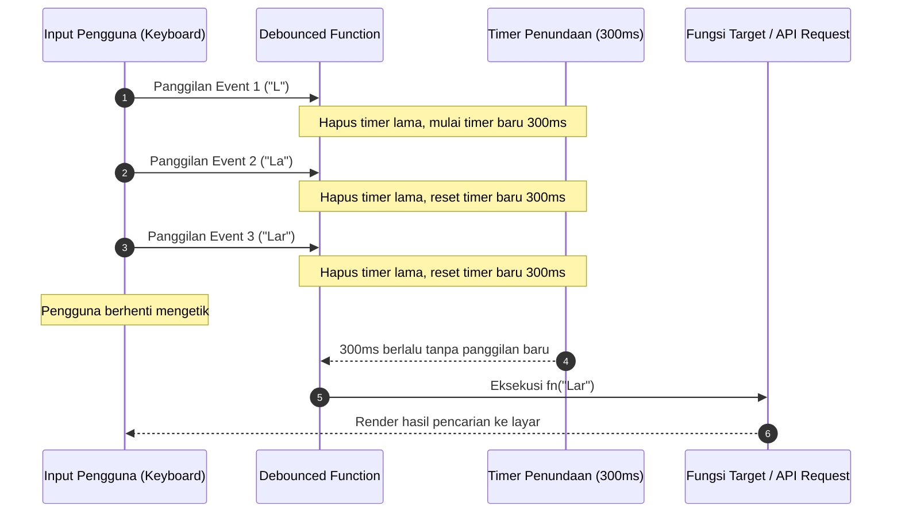

# useDebounce (`useDebounce.js`)

## 01. Overview

`useDebounce` adalah utilitas reaktif komprehensif untuk Vue 3 dan Laravel Inertia yang menyediakan teknik *debouncing* dan *throttling*. Utilitas ini dirancang untuk mengendalikan laju eksekusi fungsi callback, watcher data, maupun referensi state reaktif (`ref`) saat menangani event berfrekuensi tinggi seperti pengetikan teks pencarian, pengguliran layar (*scrolling*), pengubahan ukuran jendela (*resize*), dan penyimpanan otomatis (*auto-save*).

### 1.1 Apa Entitas Ini
* **Tipe Artefak**: Composable Functions & Pure Utility Helpers (Vue 3 Composition API).
* **Lokasi Berkas Sumber**: [useDebounce.js](file:///c:/SPEED/LARAVEL-PACK-UI/packages/laravel-pack-ui/resources/js/Composables/Pack/useDebounce.js).
* **Ekspor Kunci**: `useDebounce`, `debounce`, `useThrottle`, `throttle`, `useDebouncedRef`, `useThrottledRef`, `useDebounceFn`, `useThrottleFn`.
* **Target Ekosistem**: Single Page Application (SPA), komponen form pencarian, tabel data, dan penanganan event peramban.

### 1.2 Fungsi Utama
* Menunda pemanggilan fungsi target hingga pengguna berhenti memicu event selama durasi milidetik tertentu (*debounce*).
* Membatasi frekuensi eksekusi fungsi maksimal satu kali setiap interval waktu tertentu (*throttle*).
* Menyediakan referensi reaktif kustom (`useDebouncedRef` dan `useThrottledRef`) yang menunda sinkronisasi nilai reaktif secara internal.
* Mencegah pemborosan kuota API request, mencegah query database berlebih ke server backend, dan menjaga kelancaran 60fps rendering antarmuka pengguna.

### 1.3 Kapan Digunakan
* Kolom pencarian data langsung (*live search* / autocomplete) yang mengirimkan HTTP request ke backend Laravel.
* Penyimpanan draf formulir otomatis (*auto-save*) saat pengguna berhenti mengetik.
* Pelacakan koordinat kursor atau event scroll jendela berkecepatan tinggi tanpa membebani browser thread.
* Tombol pemicu transaksi untuk mencegah multi-klik cepat yang tidak disengaja (*spam click*).

### 1.4 Karakteristik Penting
* **Auto-Cleanup Lifecycle**: Composable `useDebounce` dan `useThrottle` otomatis membatalkan timer aktif saat komponen Vue di-unmount, mencegah memory leak atau pembaruan state pada komponen yang sudah tidak aktif.
* **Kontrol Eksekusi Fleksibel**: Dilengkapi dengan method `.cancel()` untuk pembatalan instan, `.flush()` untuk eksekusi langsung tanpa menunggu timer, dan `.pending()` untuk membaca status antrean.
* **Dukungan Opsi Lanjutan**: Mendukung opsi `immediate` (panggilan pertama langsung jalan), `maxWait` (jaminan eksekusi maksimum saat event terus menerus berlangsung), serta opsi `leading` dan `trailing` pada throttle.
* **Aman di Berbagai Lingkungan**: Dilengkapi pengaman `getCurrentInstance()` sehingga helper aman diinisialisasi di dalam maupun di luar konteks setup Vue (seperti Pinia store atau berkas utilitas murni).

---

## 02. Preview

> [!TIP]
> Pengujian fungsional dan showcase composable ini dapat diuji secara native pada portal pratinjau aplikasi:
>
> <a href="/preview" target="_self" style="display: inline-flex; align-items: center; gap: 6px; padding: 6px 14px; border-radius: 8px; font-weight: 600; text-decoration: none; margin-top: 8px; background-color: var(--vp-c-brand-1, #4f46e5); color: #ffffff;">Buka Live Preview Portal Komponen &rarr;</a>

---

## 03. Usage

### Konsep Pemetaan Arsitektur Penggunaan
```text
Ekosistem useDebounce
├── Strategi Debounce (Tunggu Diam / Jeda)
│   ├── useDebounce (Hook pembungkus fungsi + auto-cleanup)
│   ├── debounce (Helper pure JavaScript)
│   └── useDebouncedRef (Ref kustom reaktif tertunda)
└── Strategi Throttle (Batas Kecepatan Berkala)
    ├── useThrottle (Hook pembungkus fungsi + auto-cleanup)
    ├── throttle (Helper pure JavaScript)
    └── useThrottledRef (Ref kustom reaktif terbatas interval)
```

### Matriks Keputusan: Debounce vs Throttle
| Skenario Kasus | Strategi yang Tepat | Alasan Teknis |
| :--- | :--- | :--- |
| Live Search / Autocomplete | **Debounce** (`300ms - 500ms`) | Hanya butuh hasil akhir saat pengetikan selesai; tidak perlu mencari setiap karakter tengah |
| Auto-save formulir input | **Debounce** (`1000ms - 2000ms`) | Simpan data ke server hanya saat user selesai mengisi blok paragraf |
| Window Scroll / Parallax Tracker | **Throttle** (`100ms - 250ms`) | Butuh update kontinu berkala secara halus tanpa membebani scroll listener |
| Button Multi-Click Guard | **Throttle** (`800ms - 1500ms`) | Mencegah tombol diproses dua kali dalam jendela waktu singkat |

---

## 04. Anatomy

### Diagram Hierarki Fungsional
```text
useDebounce Internal Anatomy
│
├── debounce(fn, delay, options)
│   ├── timer (Timeout ID internal)
│   ├── maxTimer (Timeout jaminan batas maxWait)
│   ├── invoke() ───────── Menjalankan fn dengan argumen & konteks terkini
│   ├── .cancel() ──────── Membersihkan seluruh timer & menghapus argumen antrean
│   ├── .flush() ───────── Menjalankan eksekusi tertunda seketika
│   └── .pending() ─────── Mengembalikan boolean status antrean timer
│
├── throttle(fn, limit, options)
│   ├── inThrottle / timer (Pengendali interval limit)
│   ├── leading / trailing (Opsi eksekusi permulaan dan akhir interval)
│   ├── .cancel(), .flush(), .pending()
│
└── useDebounce / useThrottle (Vue Lifecycle Bridge)
    ├── Memanggil factory debounce / throttle
    └── Registrasi onUnmounted(() => fn.cancel()) dengan pengaman instance
```

### Diagram Alur Kontrol Debounce (Mermaid)



---

## 05. Variants

Paket utilitas `useDebounce.js` menyediakan beberapa varian fungsional:

| Varian Ekspor | Tipe Kembalian | Deskripsi Singkat |
| :--- | :--- | :--- |
| `useDebounce(fn, delay, opts)` | `DebouncedFunction` | Composable Vue pembungkus fungsi debounce dengan auto-cleanup saat unmount |
| `debounce(fn, delay, opts)` | `DebouncedFunction` | Helper fungsi JavaScript murni tanpa ketergantungan siklus hidup komponen |
| `useThrottle(fn, limit, opts)` | `ThrottledFunction` | Composable Vue pembungkus fungsi throttle dengan auto-cleanup saat unmount |
| `throttle(fn, limit, opts)` | `ThrottledFunction` | Helper fungsi JavaScript murni pembatas frekuensi interval waktu |
| `useDebouncedRef(initial, delay)` | `Ref<T>` | Ref kustom Vue yang nilainya tertunda selama `delay` milidetik saat disetel |
| `useThrottledRef(initial, limit)` | `Ref<T>` | Ref kustom Vue yang nilainya dibatasi frekuensi pembaruannya setiap `limit` ms |

---

## 06. Sizes (Skala Nilai Delay / Interval)

Rekomendasi skala waktu delay (*latency tuning*) berdasarkan tipe beban kerja:

| Tingkat Kecepatan | Rentang Milidetik | Penggunaan yang Direkomendasikan |
| :--- | :--- | :--- |
| **Ultra Fast** | `50ms - 100ms` | Window resizing, repositioning elemen tooltip / dropdown floating |
| **Normal Search** | `300ms - 500ms` | Input live search, filter tabel, pencarian autocomplete |
| **Moderate** | `800ms - 1200ms` | Validasi asinkron ketersediaan username / email ke server |
| **Relaxed Auto-Save** | `1500ms - 3000ms` | Penyimpanan draf formulir artikel, editor teks catatan panjang |

---

## 07. States

| Status Fungsi | Method Evaluasi | Makna Operasional |
| :--- | :--- | :--- |
| `Idle` | `fn.pending() === false` | Tidak ada timer yang aktif, sistem menunggu pemicu berikutnya |
| `Pending / Queued` | `fn.pending() === true` | Fungsi telah dipanggil dan timer sedang berjalan menanti jeda selesai |
| `Executed` | Callback target terpanggil | Durasi delay berlalu dan fungsi target telah dieksekusi dengan argumen terakhir |
| `Cancelled` | Pasca `.cancel()` dipanggil | Timer dihentikan seketika dan antrean argumen dibersihkan tanpa eksekusi |
| `Flushed` | Pasca `.flush()` dipanggil | Antrean yang sedang tertunda langsung dieksekusi tanpa menunggu sisa delay |

---

## 08. Parameters Reference

### Parameter `useDebounce(fn, delay, options)` & `debounce(...)`

| Parameter | Tipe Data | Nilai Default | Wajib | Keterangan |
| :--- | :--- | :--- | :---: | :--- |
| `fn` | `Function` | - | Ya | Fungsi target yang akan ditunda eksekusinya |
| `delay` | `Number` | `300` | Tidak | Durasi waktu penundaan dalam milidetik |
| `options.immediate` | `Boolean` | `false` | Tidak | Jika `true`, fungsi langsung dipanggil pada pemicuan awal |
| `options.maxWait` | `Number` | `null` | Tidak | Batas waktu tunggu maksimal sebelum eksekusi dipaksa berjalan |

### Parameter `useThrottle(fn, limit, options)` & `throttle(...)`

| Parameter | Tipe Data | Nilai Default | Wajib | Keterangan |
| :--- | :--- | :--- | :---: | :--- |
| `fn` | `Function` | - | Ya | Fungsi target yang akan dibatasi frekuensi eksekusinya |
| `limit` | `Number` | `300` | Tidak | Batas interval waktu dalam milidetik |
| `options.leading` | `Boolean` | `true` | Tidak | Menentukan apakah panggilan dieksekusi pada permulaan interval |
| `options.trailing` | `Boolean` | `true` | Tidak | Menentukan apakah panggilan terakhir dieksekusi saat interval berakhir |

---

## 09. Slots / Content

Sebagai utilitas logis murni (*headless function*), entitas ini tidak menggunakan slot visual. Seluruh interaksi dihubungkan ke handler event elemen formulir atau watcher Vue.

---

## 10. Returns (API Reference)

Fungsi pembungkus yang dikembalikan oleh `useDebounce`, `debounce`, `useThrottle`, dan `throttle` memiliki antarmuka method tambahan:

| Properti / Method | Tipe Data | Deskripsi |
| :--- | :--- | :--- |
| `(...args)` | `Function` | Menjalankan pemanggilan debounced/throttled dengan argumen kustom |
| `cancel()` | `Function(): void` | Membatalkan timer aktif seketika dan membersihkan referensi argumen |
| `flush()` | `Function(): any` | Menjalankan panggilan tertunda seketika dan mengembalikan nilai hasil eksekusinya |
| `pending()` | `Function(): boolean` | Memeriksa apakah ada pemanggilan yang sedang tertahan dalam timer antrean |

---

## 11. Code Example

### 1. Penggunaan Dasar: Live Search dengan `useDebounce`
Implementasi sederhana untuk menunda request pencarian produk:

```vue
<script setup>
import { ref, watch } from 'vue';
import { useDebounce } from '@/Composables/Pack/useDebounce';

const keyword = ref('');
const results = ref([]);

const searchProducts = useDebounce(async (query) => {
    if (!query.trim()) {
        results.value = [];
        return;
    }
    const response = await fetch(`/api/products/search?q=${encodeURIComponent(query)}`);
    results.value = await response.json();
}, 400);

watch(keyword, (val) => {
    searchProducts(val);
});
</script>

<template>
    <div>
        <input v-model="keyword" type="text" placeholder="Cari nama produk..." />
        <ul>
            <li v-for="item in results" :key="item.id">{{ item.name }}</li>
        </ul>
    </div>
</template>
```

### 2. Penggunaan Varian: Ref Reaktif `useDebouncedRef`
Menghubungkan input pencarian langsung ke `v-model` tanpa perlu menulis fungsi watcher terpisah:

```vue
<script setup>
import { watch } from 'vue';
import { useDebouncedRef } from '@/Composables/Pack/useDebounce';

// Nilai searchKeyword baru akan memancarkan trigger reaktif 500ms setelah user berhenti mengetik
const searchKeyword = useDebouncedRef('', 500);

watch(searchKeyword, (debouncedValue) => {
    console.log('Nilai terkonfirmasi setelah debounce:', debouncedValue);
});
</script>

<template>
    <input v-model="searchKeyword" type="text" placeholder="Ketik kata kunci..." />
</template>
```

### 3. Penggunaan Lanjutan: Laravel Inertia Server Table Filter dengan `flush()` pada Form Submit
Integrasi dengan Inertia router, opsi `maxWait`, pembatalan, dan eksekusi instan saat pengguna menekan tombol Enter:

```vue
<script setup>
import { ref, watch } from 'vue';
import { router } from '@inertiajs/vue3';
import { useDebounce } from '@/Composables/Pack/useDebounce';

const props = defineProps({
    filters: Object,
});

const search = ref(props.filters?.search || '');

const applyFilter = useDebounce(
    (query) => {
        router.get(
            '/admin/users',
            { search: query },
            { preserveState: true, preserveScroll: true, replace: true }
        );
    },
    500,
    { maxWait: 2000 } // Jaminan eksekusi maksimal tiap 2 detik meski user terus mengetik
);

watch(search, (newVal) => {
    applyFilter(newVal);
});

// Jika pengguna menekan Enter pada formulir, langsung eksekusi tanpa menunggu jeda 500ms
const handleSubmitInstant = () => {
    applyFilter.flush();
};
</script>

<template>
    <form @submit.prevent="handleSubmitInstant">
        <input v-model="search" type="text" placeholder="Cari data pengguna..." />
        <button type="submit">Cari Sekarang</button>
    </form>
</template>
```

---

## 12. Result / Behavior

### Alur Aksi ke Reaksi
1. **Event Pengetikan Masuk**: Pengguna menekan tombol keyboard secara cepat. Setiap keystroke meneruskan panggilan ke fungsi debounced.
2. **Penjadwalan Timer**: Timer sebelumnya (jika ada) dibersihkan melalui `clearTimeout`. Timer baru dijadwalkan ulang sesuai nilai `delay`.
3. **Kondisi Pending**: Selama jeda delay berjalan, method `pending()` mengembalikan nilai `true`. Antarmuka dapat menampilkan teks atau spinner penanda bahwa sistem sedang menunggu.
4. **Eksekusi Final**: Begitu jeda waktu terpenuhi tanpa ada input baru, callback dieksekusi dengan argumen terakhir yang masuk.
5. **Pencegahan Stale Response**: Pemanggilan yang tidak valid atau pembatalan via `.cancel()` memastikan callback lama tidak dieksekusi.

---

## 13. Customization

### Konfigurasi Global Delay Helper
Anda dapat membuat berkas wrapper helper lokal untuk standarisasi durasi delay di seluruh aplikasi Anda:

```javascript
// resources/js/Utils/debounceConfig.js
import { useDebounce } from '@/Composables/Pack/useDebounce';

export const DELAY_SEARCH = 400;
export const DELAY_AUTOSAVE = 1500;

export function useSearchDebounce(fn, options = {}) {
    return useDebounce(fn, DELAY_SEARCH, { maxWait: 2000, ...options });
}
```

---

## 14. Accessibility (a11y)

| Aspek Aksesibilitas | Implementasi Rekomendasi |
| :--- | :--- |
| **Screen Reader Announcement** | Saat live search aktif dengan debounce, gunakan elemen tersembunyi ber-atribut `aria-live="polite"` untuk mengumumkan jumlah hasil pencarian |
| **Status Pending** | Pasang atribut `aria-busy="true"` pada kontainer hasil pencarian saat `searchApi.pending()` bernilai `true` |
| **Keyboard Interaction** | Pastikan pengguna keyboard dapat menekan tombol `Enter` untuk melakukan pencarian langsung (`flush()`) tanpa harus menunggu jeda debounce |

---

## 15. Responsive Behavior

Sebagai utilitas logis murni, `useDebounce` tidak terpengaruh oleh orientasi layout fisik. Namun, pada perangkat mobile dengan koneksi jaringan seluler yang fluktuatif, nilai delay disarankan dinaikkan menjadi `500ms - 600ms` untuk meminimalkan beban sinyal data pengguna.

---

## 16. Do / Don't

### Rekomendasi (Do)
* Gunakan `useDebounce` atau `useThrottle` di dalam komponen Vue agar pembersihan timer saat komponen di-unmount terjamin otomatis.
* Manfaatkan `.flush()` pada event form submit agar data terbaru yang masih tertahan di timer langsung dieksekusi sebelum navigasi.
* Gunakan opsi `maxWait` untuk mencegah skenario penundaan tak berhingga jika pengguna mengetik teks dalam waktu yang sangat panjang.

### Larangan (Don't)
* Jangan gunakan debounce pada input password atau data sensitif yang membutuhkan validasi instan karakter per karakter.
* Jangan menyetel nilai delay terlalu pendek (misal: di bawah `100ms`) untuk request API server, karena tidak memberikan efek penghematan beban yang signifikan.
* Jangan mendefinisikan instance `debounce()` baru di dalam blok fungsi render berulang; inisialisasikan di level `<script setup>`.

---

## 17. Examples / Recipes

### Resep: Pelacakan Scroll Navbar Transparan dengan `useThrottle`
Mengubah transparansi header aplikasi saat halaman digulir tanpa menyebabkan frame drop:

```vue
<script setup>
import { ref, onMounted } from 'vue';
import { useThrottle } from '@/Composables/Pack/useDebounce';

const isScrolled = ref(false);

const handleScroll = useThrottle(() => {
    isScrolled.value = window.scrollY > 50;
}, 150);

onMounted(() => {
    window.addEventListener('scroll', handleScroll, { passive: true });
});
</script>

<template>
    <header :class="isScrolled ? 'bg-white shadow-md' : 'bg-transparent'">
        <nav>Navigasi Aplikasi</nav>
    </header>
</template>
```

---

## 18. Related Items

```text
useDebounce
├── Composables Terkait
│   ├── useAutoSave.js (Menggunakan debounce internal untuk draf)
│   ├── useServerTable.js (Menggunakan debounce untuk query filter)
│   └── useClickOutside.js (Penanganan event DOM pelengkap)
└── Komponen Pendukung
    ├── InputField.vue (Komponen input teks yang terhubung)
    ├── FilterToolbar.vue (Bilah pencarian tabel)
    └── AutoSaveStatus.vue (Indikator status simpan otomatis)
```

---

## 19. Notes / Limitations

* **Ketergantungan Siklus Hidup**: Composable `useDebounce` dan `useThrottle` mengandalkan hook `onUnmounted` Vue. Jika Anda membutuhkan helper di dalam pure JavaScript file atau Node.js script, gunakan helper `debounce()` dan `throttle()` murni.
* **Return Value Synchronicity**: Fungsi debounced mengeksekusi callback di masa mendatang secara asinkron; nilai kembalian dari fungsi target hanya dapat diakses saat menggunakan `.flush()` atau melalui pembaruan state reaktif di dalam callback.
* **Kompatibilitas Framework**: Berfungsi penuh di semua versi Vue 3 (Composition API) dan sepenuhnya kompatibel dengan ekosistem Nuxt 3 maupun VitePress.
