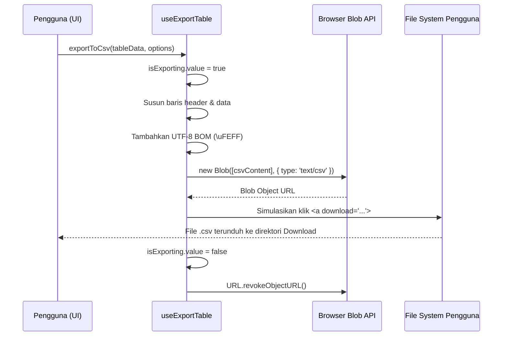

# useExportTable (`useExportTable.js`)

## 01. Overview

`useExportTable` adalah composable Vue 3 untuk mengekspor kumpulan data tabel langsung di sisi klien (*client-side*) ke dalam berbagai format standar: CSV (*Comma-Separated Values*), berkas pertukaran data JSON, dan jendela cetak dokumen (*print preview*) terisolasi. Composable ini memproses data secara instan tanpa membebani antrean pekerjaan di server backend.

### 1.1 Apa Entitas Ini

- **Tipe Artefak**: Composable Function (Vue 3 Composition API).
- **Lokasi Berkas Sumber**: [useExportTable.js](file:///c:/SPEED/LARAVEL-PACK-UI/packages/laravel-pack-ui/resources/js/Composables/Pack/useExportTable.js).
- **Ekspor Kunci**: `useExportTable`, `exportToCsv`, `exportToJson`, `printTable`, `isExporting`.
- **Target Ekosistem**: Halaman laporan, komponen data grid, tabel pesanan, mutasi perbankan, dan log audit di Laravel Inertia.

### 1.2 Fungsi Utama

- Menghasilkan file CSV dari array objek dengan sisipan *Byte Order Mark* (BOM `\uFEFF`) UTF-8 agar Microsoft Excel membaca teks Latin, tanda koma, dan karakter khusus Indonesia secara tepat tanpa karakter acak.
- Menyediakan fleksibilitas pemetaan kolom (`columns`) untuk menyaring atau memberi label khusus pada header CSV.
- Mengekspor data mentah atau terstruktur ke format berkas JSON dengan indentasi rapi.
- Membuka jendela cetak terisolasi (`printTable`) yang secara otomatis menyembunyikan header/sidebar aplikasi dan hanya mencetak tabel menggunakan stylesheet ramah kertas.
- Menyediakan status reaktif `isExporting` untuk menonaktifkan tombol dan menampilkan indikator loading saat berkas berukuran besar diproses.

### 1.3 Kapan Digunakan

- Tombol "Unduh Excel (CSV)" pada toolbar tabel data admin panel.
- Fitur "Backup Data" atau "Ekspor JSON" pada modul pengaturan atau riwayat log pengguna.
- Fitur cetak faktur, struk, atau rekap transaksi fisik melalui dialog cetak browser.
- Kebutuhan unduh data cepat (di bawah 10.000 baris) tanpa harus menginstalasikan *package* spreadsheet PHP yang berat di backend Laravel.

### 1.4 Karakteristik Penting

- **100% Client-Side**: Pembuatan berkas dilakukan melalui Blob URL di browser pengguna (`URL.createObjectURL`), menghemat penggunaan CPU dan RAM server.
- **Kompatibilitas Microsoft Excel Penuh**: Prepend UTF-8 BOM memastikan program Microsoft Excel Windows/macOS membuka file dengan pemisahan kolom yang benar tanpa wizard import manual.
- **Auto-Cleanup Memory**: Object URL yang dibuat untuk memicu unduhan otomatis dicabut (`URL.revokeObjectURL`) segera setelah tautan dieksekusi untuk mencegah kebocoran memori.
- **Dukungan Delimiter Fleksibel**: Mendukung konfigurasi pemisah kolom koma (`,`) standar internasional maupun titik koma (`;`) untuk sistem operasi dengan locale Indonesia/Eropa.

---

## 02. Preview

> [!TIP]
> Pengujian fungsional dan showcase composable ini dapat diuji secara native pada portal pratinjau aplikasi:
>
> <a href="/preview" target="_self" style="display: inline-flex; align-items: center; gap: 6px; padding: 6px 14px; border-radius: 8px; font-weight: 600; text-decoration: none; margin-top: 8px; background-color: var(--vp-c-brand-1, #4f46e5); color: #ffffff;">Buka Live Preview Portal Komponen &rarr;</a>

---

## 03. Usage

### Pohon Konsep Penggunaan

```text
useExportTable
├── Format CSV (exportToCsv)
│   ├── Laporan Penjualan & Transaksi Bulanan
│   ├── Daftar Pelanggan & Kontak Tim
│   └── Log Aktivitas Pengguna
├── Format JSON (exportToJson)
│   ├── Cadangan Data Konfigurasi
│   ├── Payload Audit Trail
│   └── Ekspor Raw Dataset untuk Analisis
└── Format Print (printTable)
    ├── Cetak Rekapitulasi Pembukuan Fisik
    ├── Struk / Faktur Sederhana
    └── Dokumen Arsip PDF via Browser Printer
```

### Matriks Keputusan: Client-side vs Server-side Export

| Kriteria | Client-side (`useExportTable`) | Server-side (Laravel Excel / Spout) |
| :--- | :--- | :--- |
| **Volume Data** | 1 - 10.000 baris | > 10.000 baris / jutaan baris |
| **Beban Server** | Nol (diproses di browser) | Membutuhkan antrean worker & disk server |
| **Waktu Tunggu** | Instan (< 1 detik) | Bergantung antrean job background |
| **Kebutuhan Styling XLS Khusus** | Terbatas pada struktur CSV standar | Mendukung formula cell, merge, dan styling Excel khusus |
| **Dependensi Eksternal** | Nol dependensi npm | Memerlukan PhpSpreadsheet / extension zip |

---

## 04. Anatomy

### Hierarki Modul

```text
useExportTable.js
│
├── downloadBlob(blob, filename)
│   ├── URL.createObjectURL(blob)
│   ├── Inject hidden <a> tag ke DOM
│   ├── Trigger link.click()
│   └── URL.revokeObjectURL(url) via setTimeout
│
├── exportToCsv(data, options)
│   ├── Normalisasi opsi (filename, columns, delimiter)
│   ├── Format baris header (escaped double-quotes)
│   ├── Iterasi baris data & sanitasi nilai
│   ├── Prepend UTF-8 BOM (\uFEFF)
│   └── Bungkus ke Blob text/csv
│
├── exportToJson(data, filename)
│   ├── JSON.stringify(data, null, 2)
│   └── Bungkus ke Blob application/json
│
├── printTable(target, optionsOrTitle)
│   ├── Deteksi input: String (Element ID) atau Array (Data Objek)
│   ├── Bangun dokumen HTML mandiri terisolasi
│   ├── Sisipkan CSS khusus @media print
│   └── Trigger window.print() saat window.onload
│
└── Return Object: { exportToCsv, exportToJson, printTable, isExporting }
```

### Diagram Alur Kerja Ekspor (Mermaid)



---

## 05. Variants

Composable ini menyediakan tiga metode aksi ekspor sesuai kebutuhan format keluaran:

| Metode | Ekstensi / Media | Output | Kasus Penggunaan Ideal |
| :--- | :--- | :--- | :--- |
| `exportToCsv()` | `.csv` | Spreadsheet text-based dengan BOM UTF-8 | Laporan data angka yang akan dianalisis lebih lanjut di Excel/Google Sheets. |
| `exportToJson()` | `.json` | Berkas teks JSON terformat rapi (*pretty printed*) | Migrasi data teknis, konfigurasi, atau impor balik ke sistem lain. |
| `printTable()` | Dialog Cetak Browser | Tampilan cetak halaman fisik atau Simpan sebagai PDF | Dokumen arsip fisik, lampiran berkas tanda tangan, atau lembar kerja tim. |

---

## 06. Sizes

Tidak relevan dalam arti dimensi piksel CSS. Namun, batasan ukuran dataset yang direkomendasikan adalah:

| Skala Data | Jumlah Baris | Perilaku Eksekusi |
| :--- | :--- | :--- |
| **Kecil** | < 1.000 baris | Seketika (< 50ms), tanpa lag antarmuka. |
| **Sedang** | 1.000 - 10.000 baris | Waktu proses 100ms - 500ms, gunakan indikator `isExporting`. |
| **Besar** | > 10.000 baris | Sebaiknya dialihkan ke proses streaming server backend untuk mencegah browser kehabisan memori (*out of memory*). |

---

## 07. States

Composable mengelola status eksekusi asinkron reaktif berikut:

| Status | Representasi Reaktif | Keterangan & Dampak UI |
| :--- | :--- | :--- |
| **Idle** | `isExporting.value === false` | Kondisi normal; tombol ekspor aktif dan dapat diklik. |
| **Processing** | `isExporting.value === true` | Penyusunan string data dan pembuatan berkas Blob sedang berlangsung; tombol dinonaktifkan (`disabled`) untuk mencegah klik ganda. |

---

## 08. Props / Parameters / Attributes

### Parameter Metode `exportToCsv(data, options)`

| Parameter | Tipe Data | Wajib | Nilai Default | Deskripsi |
| :--- | :--- | :--- | :--- | :--- |
| `data` | `Array<Object>` | Ya | - | Array objek berisi baris data tabel. |
| `options.filename` | `String` | Tidak | `'export.csv'` | Nama berkas unduhan (otomatis diberi ekstensi `.csv` jika belum ada). |
| `options.columns` | `Array<Object\|String>` | Tidak | `null` | Spesifikasi kolom yang diekspor. Format: `[{ key: 'id', label: 'ID' }]` atau `['id', 'name']`. Jika `null`, seluruh key objek pertama akan dijadikan kolom. |
| `options.delimiter` | `String` | Tidak | `','` | Karakter pemisah kolom (koma `','` atau titik koma `';'`). |

### Parameter Metode `exportToJson(data, filename)`

| Parameter | Tipe Data | Wajib | Nilai Default | Deskripsi |
| :--- | :--- | :--- | :--- | :--- |
| `data` | `Array<Object> \| Object` | Ya | - | Data objek atau array data yang akan diserialisasi ke JSON. |
| `filename` | `String` | Tidak | `'export.json'` | Nama berkas unduhan JSON. |

### Parameter Metode `printTable(target, optionsOrTitle)`

| Parameter | Tipe Data | Wajib | Nilai Default | Deskripsi |
| :--- | :--- | :--- | :--- | :--- |
| `target` | `String \| Array<Object>` | Ya | - | ID elemen DOM kontainer tabel, atau array objek data yang akan dicetak secara dinamis. |
| `optionsOrTitle` | `String \| Object` | Tidak | `'Laporan Cetak'` | Jika `string`, menjadi judul dokumen cetak. Jika `object`, format: `{ title: 'Judul', columns: [{ key, label }] }`. |

---

## 09. Slots / Content

Tidak relevan untuk composable murni tanpa markup UI.

---

## 10. Events / Interactions / Returns

### Return Object `useExportTable()`

| Properti / Method | Tipe Data | Reaktif | Deskripsi |
| :--- | :--- | :--- | :--- |
| `isExporting` | `Ref<boolean>` | Ya | Status apakah proses ekspor sedang aktif. |
| `exportToCsv` | `Function(data, options)` | Tidak | Memproses dan mengunduh berkas CSV. Mengembalikan boolean keberhasilan. |
| `exportToJson` | `Function(data, filename)` | Tidak | Memproses dan mengunduh berkas JSON. Mengembalikan boolean keberhasilan. |
| `printTable` | `Function(target, options)` | Tidak | Membuka jendela dialog cetak browser terisolasi. |

---

## 11. Code Example

### 1. Penggunaan Dasar (Basic Example)

Ekspor cepat seluruh kolom data tabel ke CSV dengan opsi bawaan:

```vue
<script setup>
import { useExportTable } from '@/Composables/Pack/useExportTable';

const props = defineProps({
    products: Array,
});

const { exportToCsv, isExporting } = useExportTable();

const downloadCsv = () => {
    exportToCsv(props.products, {
        filename: 'daftar-produk.csv',
    });
};
</script>

<template>
    <button
        type="button"
        :disabled="isExporting"
        @click="downloadCsv"
        class="px-3 py-1.5 rounded-lg bg-emerald-600 hover:bg-emerald-700 text-white text-xs font-semibold"
    >
        {{ isExporting ? 'Mengekspor...' : 'Unduh CSV' }}
    </button>
</template>
```

### 2. Penggunaan Menengah (Variant / Intermediate Example)

Menyesuaikan kolom tertentu, delimiter titik koma untuk pengguna Excel regional Indonesia, dan ekspor JSON:

```vue
<script setup>
import { useExportTable } from '@/Composables/Pack/useExportTable';

const props = defineProps({
    orders: Array,
});

const { exportToCsv, exportToJson, isExporting } = useExportTable();

// Kolom yang difilter dan diberi label ramah bahasa Indonesia
const exportColumns = [
    { key: 'invoice_number', label: 'Nomor Faktur' },
    { key: 'customer_name', label: 'Nama Pelanggan' },
    { key: 'total_amount', label: 'Total Transaksi (IDR)' },
    { key: 'payment_status', label: 'Status Pembayaran' },
    { key: 'created_at', label: 'Waktu Transaksi' },
];

const handleExportExcel = () => {
    exportToCsv(props.orders, {
        filename: `rekap-pesanan-${new Date().toISOString().slice(0, 10)}.csv`,
        delimiter: ';', // Titik koma agar langsung terbagi rapi di Microsoft Excel Windows region Indonesia
        columns: exportColumns,
    });
};

const handleExportJson = () => {
    exportToJson(props.orders, 'backup-pesanan.json');
};
</script>

<template>
    <div class="flex items-center gap-2">
        <button
            type="button"
            :disabled="isExporting"
            @click="handleExportExcel"
            class="px-3 py-1.5 rounded-lg bg-emerald-600 text-white text-xs font-medium"
        >
            Ekspor Excel (CSV)
        </button>
        <button
            type="button"
            :disabled="isExporting"
            @click="handleExportJson"
            class="px-3 py-1.5 rounded-lg border border-gray-300 dark:border-gray-600 text-xs font-medium"
        >
            Ekspor JSON
        </button>
    </div>
</template>
```

### 3. Penggunaan Lanjutan (Advanced / Enterprise Example)

Integrasi lengkap dengan `useServerTable`, pagination dinamis, tombol dropdown menu ekspor, dan pencetakan dokumen kustom:

```vue
<script setup>
import { ref } from 'vue';
import { useServerTable } from '@/Composables/Pack/useServerTable';
import { useExportTable } from '@/Composables/Pack/useExportTable';
import { formatDate } from '@/Composables/Pack/useDateFormat';

const { data, isLoading } = useServerTable({
    endpoint: '/api/v1/finance/transactions',
});

const { exportToCsv, exportToJson, printTable, isExporting } = useExportTable();

const isDropdownOpen = ref(false);

const exportColumns = [
    { key: 'id', label: 'No. Transaksi' },
    { key: 'client', label: 'Klien' },
    { key: 'amountFormatted', label: 'Nominal' },
    { key: 'status', label: 'Status' },
    { key: 'dateFormatted', label: 'Tanggal' },
];

const prepareExportPayload = () => {
    // Normalisasi dan format data sebelum diunduh
    return data.value.map((item) => ({
        ...item,
        amountFormatted: `Rp ${Number(item.amount).toLocaleString('id-ID')}`,
        dateFormatted: formatDate(item.created_at, 'DD/MM/YYYY HH:mm'),
    }));
};

const onExport = (type) => {
    isDropdownOpen.value = false;
    const payload = prepareExportPayload();

    if (type === 'csv') {
        exportToCsv(payload, {
            filename: `transaksi_keuangan_${Date.now()}`,
            columns: exportColumns,
            delimiter: ',',
        });
    } else if (type === 'json') {
        exportToJson(payload, `transaksi_keuangan_${Date.now()}.json`);
    } else if (type === 'print') {
        printTable(payload, {
            title: 'Laporan Mutasi Keuangan Perusahaan',
            columns: exportColumns,
        });
    }
};
</script>

<template>
    <div class="flex items-center justify-between gap-4 p-4">
        <h2 class="text-base font-semibold">Tabel Transaksi Keuangan</h2>

        <div class="relative">
            <button
                type="button"
                :disabled="isLoading || isExporting"
                @click="isDropdownOpen = !isDropdownOpen"
                class="inline-flex items-center gap-1.5 px-3 py-1.5 rounded-lg border border-gray-300 dark:border-gray-700 bg-white dark:bg-gray-800 text-xs font-semibold shadow-sm hover:bg-gray-50"
            >
                <span>{{ isExporting ? 'Mengekspor...' : 'Opsi Ekspor' }}</span>
                <span class="text-[10px]">▼</span>
            </button>

            <!-- Dropdown Menu -->
            <div
                v-if="isDropdownOpen"
                class="absolute right-0 mt-1 w-44 rounded-xl border border-gray-200 dark:border-gray-700 bg-white dark:bg-gray-800 shadow-lg py-1 z-20 text-xs"
            >
                <button
                    type="button"
                    @click="onExport('csv')"
                    class="w-full text-left px-3 py-2 hover:bg-gray-50 dark:hover:bg-gray-700"
                >
                    Unduh CSV (.csv)
                </button>
                <button
                    type="button"
                    @click="onExport('json')"
                    class="w-full text-left px-3 py-2 hover:bg-gray-50 dark:hover:bg-gray-700"
                >
                    Unduh JSON (.json)
                </button>
                <button
                    type="button"
                    @click="onExport('print')"
                    class="w-full text-left px-3 py-2 hover:bg-gray-50 dark:hover:bg-gray-700 border-t border-gray-100 dark:border-gray-700"
                >
                    Cetak Tabel Dokumen
                </button>
            </div>
        </div>
    </div>
</template>
```

---

## 12. Result / Behavior

### Alur Aksi ke Reaksi

1. Pengguna mengeklik tombol pemicu ekspor di antarmuka tabel.
2. `isExporting` berubah menjadi `true`, menonaktifkan tombol pemanggil.
3. Fungsi menyaring kolom yang didefinisikan dalam `options.columns` atau mengekstraksi seluruh properti objek.
4. Nilai string dibersihkan dan di-escape tanda petik dua (`"` diubah menjadi `""`).
5. Prepend `\uFEFF` disematkan ke awal string CSV, lalu diubah menjadi objek `Blob` binary.
6. Elemen jangkar `<a>` tersembunyi disisipkan sementara ke `document.body`, diklik secara otomatis via JavaScript, lalu dicabut.
7. Jendela dialog unduhan berkas browser terbuka, dan memori Blob URL segera dibersihkan via `revokeObjectURL`.
8. `isExporting` kembali ke `false`.

### Efek Samping (Side Effects)

- Mengunduh file baru ke folder unduhan (*Downloads*) pengguna.
- Untuk `printTable()`, browser membuka jendela popup terisolasi baru dan otomatis memicu event native `window.print()`.

### Penanganan Error

- Jika data yang dikirimkan kosong (`[]`), fungsi membatalkan eksekusi, mencetak peringatan ke console, dan mengembalikan `false`.
- Jika jendela cetak diblokir oleh pemblokir popup browser (*pop-up blocker*), fungsi menampilkan peringatan ramah pengembang di log console.

---

## 13. Customization

### Format Nilai Khusus (Sanitasi Angka Diawali Nol)

Di aplikasi Indonesia, kolom seperti nomor HP (`08123...`) atau NIK sering kali kehilangan angka nol di depannya saat dibuka di Excel jika diisi sebagai integer. Format kolom dengan tanda petik tunggal (`'`) sebelum diteruskan ke `exportToCsv()`:

```javascript
const sanitizedData = data.map((item) => ({
    ...item,
    phone_number: `'${item.phone_number}`, // Mencegah Excel menghapus angka 0 di depan
}));
```

### Kustomisasi Delimiter Regional

- Gunakan `delimiter: ','` untuk distribusi internasional atau impor ke basis data (PostgreSQL/MySQL).
- Gunakan `delimiter: ';'` untuk pengguna korporat Indonesia yang menggunakan Windows dengan regional setting Indonesia di mana pemisah desimal adalah koma (`,`).

---

## 14. Accessibility (a11y)

- **Status Pemuatan**: Tautkan `isExporting` ke atribut `aria-busy="true"` pada container tabel atau tombol untuk menginformasikan teknologi asistif (*screen reader*) bahwa proses komputasi sedang berlangsung.
- **Label Tombol**: Sediakan atribut `aria-label` yang spesifik pada tombol ekspor (contoh: `aria-label="Unduh laporan transaksi dalam format Excel CSV"`).
- **Fokus Keyboard**: Pastikan tombol ekspor dapat diakses dan diaktifkan menggunakan tombol `Tab` dan `Enter` / `Space`.

---

## 15. Responsive Behavior

| Viewport | Perilaku Antarmuka yang Disarankan |
| :--- | :--- |
| **Mobile (`< 768px`)** | Kelompokkan tombol ekspor ke dalam menu dropdown atau modal aksi agar tidak memenuhi ruang sempit header layar ponsel. |
| **Tablet (`768px - 1023px`)** | Tampilkan tombol ekspor dengan ikon dan teks ringkas (`CSV`, `JSON`, `Print`). |
| **Desktop (`>= 1024px`)** | Tampilkan tombol ekspor berdampingan dengan kotak pencarian dan filter tabel secara horizontal. |

---

## 16. Do / Don't

### Rekomendasi (Do)

- Gunakan format kolom eksplisit (`columns: [{ key, label }]`) agar header dokumen bersih dan tidak menampilkan nama kolom internal database seperti `id_transaksi_internal_fk`.
- Manfaatkan `isExporting` untuk menonaktifkan tombol pemanggil guna mencegah pengguna mengeklik berkali-kali secara tidak sengaja.
- Format nilai tanggal dan nominal mata uang terlebih dahulu menggunakan `useDateFormat` atau `useNumberFormat` sebelum diekspor.

### Larangan (Don't)

- Jangan menggunakan `useExportTable` untuk mengekspor dataset ratusan ribu baris secara langsung di browser; gunakan antrean ekspor backend untuk skala tersebut.
- Jangan menyertakan properti sensitif seperti password hash atau token autentikasi ke dalam array data ekspor.
- Jangan lupa menyertakan BOM `\uFEFF` jika membuat custom exporter, karena tanpa BOM karakter UTF-8 akan rusak di Microsoft Excel.

---

## 17. Examples / Recipes

### Resep: Tombol Ekspor dengan Indikator Loading & Notifikasi Selesai

```vue
<script setup>
import { useExportTable } from '@/Composables/Pack/useExportTable';
import { useNotification } from '@/Composables/Pack/useNotification';

const props = defineProps({ records: Array });
const { exportToCsv, isExporting } = useExportTable();
const { showNotification } = useNotification();

const handleExport = () => {
    const success = exportToCsv(props.records, {
        filename: 'data-pegawai',
        columns: [
            { key: 'nip', label: 'NIP' },
            { key: 'name', label: 'Nama Lengkap' },
            { key: 'department', label: 'Departemen' },
        ],
    });

    if (success) {
        showNotification({
            type: 'success',
            title: 'Ekspor Berhasil',
            message: 'Berkas CSV telah tersimpan di komputer Anda.',
        });
    }
};
</script>

<template>
    <button
        type="button"
        :disabled="isExporting"
        @click="handleExport"
        class="inline-flex items-center gap-1.5 px-3 py-1.5 rounded-lg bg-emerald-600 text-white text-xs font-semibold disabled:opacity-50"
    >
        <span>{{ isExporting ? 'Memproses...' : 'Unduh CSV Pegawai' }}</span>
    </button>
</template>
```

---

## 18. Related Items

```text
useExportTable
├── Composables Pendukung
│   ├── useServerTable.js      → Mengelola state data pagination dan filter tabel
│   ├── useDateFormat.js       → Memformat kolom tanggal sebelum diekspor
│   └── useNumberFormat.js     → Memformat kolom nominal uang dan persentase
│
└── Komponen Terkait
    ├── TableComponent.vue     → Komponen tabel tampilan data utama
    ├── FilterToolbar.vue      → Baris kontrol filter di mana tombol ekspor ditempatkan
    └── ButtonSubmit.vue       → Tombol dengan visual status loading bawaan
```

---

## 19. Notes / Limitations

- **Batas Memori String Browser**: Browser umumnya memiliki batas alokasi memori per string sekitar 256MB hingga 512MB. Untuk dataset di atas 50.000 baris dengan ratusan kolom, browser dapat mengalami perlambatan (*freeze*).
- **Pop-up Blocker pada `printTable()`**: Browser modern dapat memblokir jendela baru jika `printTable()` dipanggil di luar alur event klik langsung pengguna (misal dipanggil di dalam timeout asinkron yang panjang).
- **Formula Injection (CSV Injection)**: Jika data berasal dari input pengguna bebas dan diawali karakter `=`, `+`, `-`, atau `@`, Microsoft Excel dapat mengeksekusinya sebagai rumus spreadsheet. Pastikan nilai teks yang diawali karakter tersebut di-sanitize jika diperlukan.
