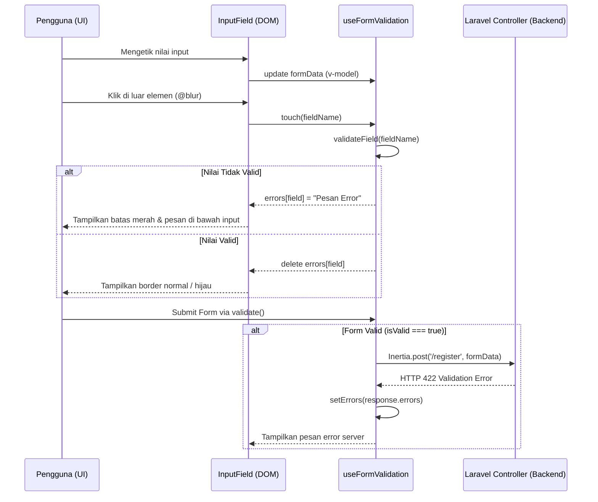

# useFormValidation (`useFormValidation.js`)

## 01. Overview

`useFormValidation` adalah composable validasi formulir sisi klien (*client-side*) untuk aplikasi Vue 3 dan Laravel Inertia. Composable ini menyediakan sistem validasi berbasis skema aturan (*rule-based schema*), evaluasi status *touched* untuk mencegah kemunculan pesan kesalahan sebelum pengguna selesai mengetik, serta integrasi mulus dengan respon kesalahan validasi HTTP 422 dari Laravel backend.

### 1.1 Apa Entitas Ini

- **Tipe Artefak**: Composable Function (Vue 3 Composition API).
- **Lokasi Berkas Sumber**: [useFormValidation.js](file:///c:/SPEED/LARAVEL-PACK-UI/packages/laravel-pack-ui/resources/js/Composables/Pack/useFormValidation.js).
- **Ekspor Kunci**: `useFormValidation`.
- **Target Ekosistem**: Seluruh komponen formulir input, modal dialog pengisian data, registrasi pengguna, dan checkout transaksi di Laravel Inertia.

### 1.2 Fungsi Utama

- Menjalankan validasi aturan deklaratif: `required`, `email`, `phone` (format nomor Indonesia), `numeric`, `min`, `max`, `minLength`, `maxLength`, `pattern` (Regex), dan `confirmed` (pencocokan kata sandi).
- Mendukung fungsi validator kustom (`custom: (val, allData) => string|null`) untuk aturan kompleks yang bergantung pada beberapa input sekaligus.
- Menyediakan tiga mode evaluasi interaksi: `touched` (evaluasi saat event blur), `eager` (evaluasi langsung tiap penekanan tombol keyboard), dan `lazy` (evaluasi manual saat tombol submit diklik).
- Menyediakan method `setErrors()` untuk memetakan objek error dari *Laravel FormRequest* (HTTP status 422 *Unprocessable Entity*) ke dalam state error komponen secara instan.
- Melacak status interaksi formulir secara reaktif melalui `isValid` dan `isDirty`.

### 1.3 Kapan Digunakan

- Formulir pendaftaran akun atau formulir login yang memerlukan umpan balik validasi cepat tanpa memicu HTTP request berulang kali.
- Formulir transaksi dengan konfirmasi sandi baru (`password_confirmation`).
- Formulir checkout atau pengajuan berkas yang perlu memastikan data lengkap sebelum tombol kirim diaktifkan.
- Penanganan respon kesalahan validasi dari *Laravel FormRequest* di controller backend.

### 1.4 Karakteristik Penting

- **Dukungan Tipe Data Fleksibel**: Menerima objek JavaScript standar `reactive()`, Vue 3 `ref()`, maupun form helper resmi Inertia `useForm()`.
- **Label Humanis Otomatis**: Jika label kolom tidak didefinisikan secara eksplisit, nama variabel (seperti `customer_phone` atau `userEmail`) secara cerdas diubah menjadi `"Customer Phone"` atau `"User Email"`.
- **Deep Watcher Terisolasi**: Secara otomatis memperbarui pesan kesalahan saat data form diubah setelah kolom tersebut ditandai telah disentuh (*touched*).
- **Aksesibilitas Ramah Pengguna**: Mengelola pemetaan ID error yang siap dihubungkan ke atribut WAI-ARIA `aria-invalid` dan `aria-describedby` pada komponen input.

---

## 02. Preview

> [!TIP]
> Pengujian fungsional dan showcase composable ini dapat diuji secara native pada portal pratinjau aplikasi:
>
> <a href="/preview" target="_self" style="display: inline-flex; align-items: center; gap: 6px; padding: 6px 14px; border-radius: 8px; font-weight: 600; text-decoration: none; margin-top: 8px; background-color: var(--vp-c-brand-1, #4f46e5); color: #ffffff;">Buka Live Preview Portal Komponen &rarr;</a>

---

## 03. Usage

### Pohon Konsep Penggunaan

```text
useFormValidation
├── Aturan Validasi Bawaan (Built-in Rules)
│   ├── Keberadaan Nilai (required)
│   ├── Format Khusus (email, phone Indonesia)
│   ├── Batasan Numerik (numeric, min, max)
│   ├── Batasan Karakter (minLength, maxLength, pattern Regex)
│   └── Pencocokan Kolom (confirmed - misal konfirmasi password)
│
├── Mode Evaluasi (options.mode)
│   ├── 'touched' (Default: validasi muncul setelah blur)
│   ├── 'eager'   (Validasi langsung setiap ketikan)
│   └── 'lazy'    (Validasi hanya saat tombol submit diklik)
│
└── Penanganan Respon Server
    ├── setErrors(laravel422Errors)
    └── clearErrors(fieldKey)
```

### Matriks Keputusan: Kapan Menggunakan Mode Validasi

| Mode | Kapan Digunakan | Keunggulan UX |
| :--- | :--- | :--- |
| `'touched'` *(Default)* | Formulir standar registrasi, profil, dan checkout. | Pengguna tidak terganggu oleh pesan merah saat baru mengetik karakter pertama. |
| `'eager'` | Indikator kekuatan kata sandi atau validasi format slug URL. | Umpan balik seketika saat pengguna mengetik. |
| `'lazy'` | Formulir singkat satu atau dua kolom (misal formulir login atau pencarian). | Antarmuka tetap tenang hingga pengguna secara sadar menekan tombol submit. |

---

## 04. Anatomy

### Hierarki Modul Tekstual

```text
useFormValidation.js
│
├── State Reaktif
│   ├── errors   (reactive object: { [field]: errorMessage })
│   ├── touched  (reactive object: { [field]: boolean })
│   ├── isValid  (computed: true jika Object.keys(errors).length === 0)
│   └── isDirty  (computed: true jika salah satu field telah disentuh)
│
├── Engine Validasi
│   ├── getFieldValue(field)       → Pembacaan nilai aman dari ref / reactive
│   ├── getFieldLabel(field, rule) → Resolver label ramah pembaca
│   └── validateFieldRule(field)   → Pipeline evaluasi 11 aturan bawaan
│
├── Public Controller Methods
│   ├── validate()                 → Validasi seluruh field dalam skema
│   ├── validateField(field)       → Validasi satu field spesifik
│   ├── touch(field)               → Tandai field telah dikunjungi (blur)
│   ├── setFieldError(field, msg)  → Tetapkan pesan error kustom manual
│   ├── setErrors(errorsObj)       → Batch import error backend Laravel 422
│   ├── clearErrors(field)         → Bersihkan error per field / seluruhnya
│   └── reset()                    → Reset seluruh state error & touched
```

### Diagram Alur Siklus Hidup Validasi (Mermaid)



---

## 05. Variants

Composable mendukung tiga mode operasional via parameter `options.mode`:

| Mode | Trigger Evaluasi | Penjelasan Perilaku |
| :--- | :--- | :--- |
| `'touched'` *(Default)* | Event `blur` atau method `touch()` | Error hanya dimunculkan setelah pengguna selesai berinteraksi dengan field terkait. Setelah pernah disentuh, perubahan selanjutnya langsung dievaluasi secara dinamis. |
| `'eager'` | Event `input` pertama kali | Evaluasi dilakukan seketika sejak karakter pertama dimasukkan. Cocok untuk meteran kekuatan password. |
| `'lazy'` | Pemanggilan `validate()` | Menahan seluruh pesan error hingga tombol submit diklik. |

---

## 06. Sizes

Tidak relevan untuk composable logika validasi.

---

## 07. States

| Status | Tipe | Indikator Reaktif | Keterangan |
| :--- | :--- | :--- | :--- |
| **Pristine** | Boolean | `!isDirty.value` | Formulir belum pernah disentuh oleh pengguna sejak dibuka. |
| **Dirty** | Boolean | `isDirty.value` | Minimal ada satu field yang telah menerima fokus atau disentuh pengguna. |
| **Valid** | Boolean | `isValid.value === true` | Seluruh field yang didefinisikan dalam skema memenuhi aturan validasi. |
| **Invalid** | Boolean | `isValid.value === false` | Terdapat minimal satu pelanggaran aturan validasi di dalam state `errors`. |

---

## 08. Props / Parameters / Attributes

### Parameter `useFormValidation(formData, schemaRules, options)`

| Parameter | Tipe Data | Wajib | Default | Deskripsi |
| :--- | :--- | :--- | :--- | :--- |
| `formData` | `Object \| Ref` | Ya | - | Objek formulir reaktif (`reactive`, `ref`, atau Inertia `useForm`). |
| `schemaRules` | `Object` | Tidak | `{}` | Objek pemetaan aturan validasi per field kolom. |
| `options.mode` | `String` | Tidak | `'touched'` | Mode evaluasi: `'touched'`, `'eager'`, atau `'lazy'`. |

### Daftar Konfigurasi Aturan Skema (`schemaRules[field]`)

| Nama Aturan | Tipe | Contoh Nilai | Deskripsi |
| :--- | :--- | :--- | :--- |
| `required` | `Boolean \| String` | `true` atau `'Wajib diisi.'` | Memastikan nilai tidak kosong, bukan string kosong, dan bukan array kosong. |
| `email` | `Boolean \| String` | `true` | Memvalidasi sintaks format alamat email standar. |
| `phone` | `Boolean \| String` | `true` | Memvalidasi panjang nomor telepon antara 10 hingga 15 digit numerik. |
| `numeric` | `Boolean \| String` | `true` | Memastikan nilai adalah angka murni. |
| `min` | `Number` | `10000` | Memvalidasi nilai minimum angka. |
| `max` | `Number` | `5000000` | Memvalidasi nilai maksimum angka. |
| `minLength` | `Number` | `6` | Memvalidasi panjang karakter minimum string. |
| `maxLength` | `Number` | `100` | Memvalidasi panjang karakter maksimum string. |
| `pattern` | `RegExp \| String` | `/^[A-Z0-9]+$/` | Memvalidasi nilai terhadap pola regular expression. |
| `patternMessage` | `String` | `'Hanya huruf kapital dan angka'` | Pesan kesalahan jika aturan `pattern` dilanggar. |
| `confirmed` | `String` | `'password'` | Nama field target yang harus bernilai identik (misal konfirmasi sandi). |
| `custom` | `Function(val, allData)`| `(val) => val === 'ID' ? null : 'Harus ID'` | Fungsi validasi kustom; kembalikan string pesan error jika tidak valid. |
| `label` | `String` | `'Nomor WhatsApp'` | Label kustom untuk penyusunan pesan error otomatis. |

---

## 09. Slots / Content

Tidak relevan untuk composable murni tanpa markup UI.

---

## 10. Events / Interactions / Returns

### Return Object `useFormValidation()`

| Properti / Method | Tipe Data | Reaktif | Deskripsi |
| :--- | :--- | :--- | :--- |
| `errors` | `Reactive<Object>` | Ya | Kamus pesan kesalahan `{ [field]: 'Pesan error' }`. |
| `touched` | `Reactive<Object>` | Ya | Status apakah field telah dikunjungi `{ [field]: true }`. |
| `isValid` | `ComputedRef<boolean>` | Ya | Bernilai `true` jika kamus `errors` kosong. |
| `isDirty` | `ComputedRef<boolean>` | Ya | Bernilai `true` jika salah satu field telah disentuh. |
| `validate()` | `Function() => boolean` | Tidak | Memvalidasi seluruh field; mengembalikan `true` jika valid. |
| `validateField(field)` | `Function(field) => boolean` | Tidak | Memvalidasi satu field tertentu dan memperbarui state error. |
| `touch(field)` | `Function(field)` | Tidak | Menandai field telah disentuh dan memicu validasi jika mode bukan lazy. |
| `clearErrors(field?)` | `Function(field?)` | Tidak | Menghapus pesan error satu field atau seluruh field. |
| `setFieldError(field, msg)` | `Function(field, msg)` | Tidak | Menetapkan pesan error secara manual untuk field tertentu. |
| `setErrors(errorsObj)` | `Function(errorsObj)` | Tidak | Memetakan objek error dari respon backend (Laravel 422). |
| `reset()` | `Function()` | Tidak | Mengosongkan seluruh pesan error dan status touched. |
| `resetValidation()` | `Function()` | Tidak | Alias resmi untuk `reset()`. |

---

## 11. Code Example

### 1. Penggunaan Dasar (Basic Example)

Validasi formulir pendaftaran buletin sederhana:

```vue
<script setup>
import { reactive } from 'vue';
import { useFormValidation } from '@/Composables/Pack/useFormValidation';

const form = reactive({
    email: '',
});

const rules = {
    email: { required: 'Alamat email wajib diisi.', email: true },
};

const { errors, touch, validate } = useFormValidation(form, rules);

const handleSubmit = () => {
    if (validate()) {
        alert(`Berhasil mendaftar: ${form.email}`);
    }
};
</script>

<template>
    <form @submit.prevent="handleSubmit" class="space-y-3">
        <div>
            <label class="block text-xs font-semibold mb-1">Email Anda</label>
            <input
                v-model="form.email"
                type="text"
                placeholder="nama@domain.com"
                :class="errors.email ? 'border-rose-500' : 'border-gray-300'"
                class="w-full px-3 py-2 rounded-lg border text-sm"
                @blur="touch('email')"
            />
            <p v-if="errors.email" class="text-xs text-rose-500 mt-1">{{ errors.email }}</p>
        </div>
        <button type="submit" class="px-4 py-2 bg-blue-600 text-white rounded-lg text-sm font-semibold">
            Daftar Sekarang
        </button>
    </form>
</template>
```

### 2. Penggunaan Menengah (Variant / Intermediate Example)

Formulir ubah kata sandi dengan aturan `minLength`, `confirmed`, dan fungsi kustom angka:

```vue
<script setup>
import { reactive } from 'vue';
import { useFormValidation } from '@/Composables/Pack/useFormValidation';

const form = reactive({
    password: '',
    password_confirmation: '',
});

const rules = {
    password: {
        required: 'Kata sandi baru wajib diisi.',
        minLength: 8,
        custom: (val) => (!/[0-9]/.test(val) ? 'Kata sandi harus mengandung minimal 1 digit angka.' : null),
        label: 'Kata Sandi Baru',
    },
    password_confirmation: {
        required: 'Ulangi kata sandi Anda.',
        confirmed: 'password',
        label: 'Konfirmasi Sandi',
    },
};

const { errors, touch, validate, isValid } = useFormValidation(form, rules, {
    mode: 'touched',
});

const submitPassword = () => {
    if (validate()) {
        console.log('Kata sandi valid, lanjutkan proses...');
    }
};
</script>

<template>
    <form @submit.prevent="submitPassword" class="space-y-4">
        <div>
            <label class="block text-xs font-semibold mb-1">Kata Sandi Baru</label>
            <input
                v-model="form.password"
                type="password"
                class="w-full px-3 py-2 border rounded-lg text-sm"
                @blur="touch('password')"
            />
            <p v-if="errors.password" class="text-xs text-rose-500 mt-1">{{ errors.password }}</p>
        </div>

        <div>
            <label class="block text-xs font-semibold mb-1">Konfirmasi Kata Sandi Baru</label>
            <input
                v-model="form.password_confirmation"
                type="password"
                class="w-full px-3 py-2 border rounded-lg text-sm"
                @blur="touch('password_confirmation')"
            />
            <p v-if="errors.password_confirmation" class="text-xs text-rose-500 mt-1">{{ errors.password_confirmation }}</p>
        </div>

        <button
            type="submit"
            class="px-4 py-2 bg-emerald-600 text-white rounded-lg text-sm font-semibold"
        >
            Simpan Kata Sandi
        </button>
    </form>
</template>
```

### 3. Penggunaan Lanjutan (Advanced / Enterprise Example)

Integrasi penuh dengan `useForm` dari InertiaJS dan pemetaan error backend Laravel FormRequest 422:

```vue
<script setup>
import { useForm } from '@inertiajs/vue3';
import { useFormValidation } from '@/Composables/Pack/useFormValidation';
import ButtonSubmit from '@/Components/Pack/ButtonSubmit.vue';

const form = useForm({
    name: '',
    email: '',
    phone: '',
    role: 'staff',
});

const rules = {
    name: { required: true, minLength: 3, label: 'Nama Pengguna' },
    email: { required: true, email: true, label: 'Alamat Email' },
    phone: { required: true, phone: true, label: 'Nomor WhatsApp' },
};

const { errors, touch, validate, setErrors } = useFormValidation(form, rules, {
    mode: 'touched',
});

const submitUser = () => {
    // 1. Validasi awal sisi klien (mencegah request jika belum valid)
    if (!validate()) return;

    // 2. Kirim via Inertia useForm
    form.post('/admin/users', {
        onError: (serverErrors) => {
            // 3. Petakan error HTTP 422 dari Laravel backend langsung ke state UI
            setErrors(serverErrors);
        },
        onSuccess: () => {
            form.reset();
        },
    });
};
</script>

<template>
    <form @submit.prevent="submitUser" class="space-y-4 max-w-lg">
        <div>
            <label class="block text-xs font-semibold mb-1">Nama Lengkap</label>
            <input
                v-model="form.name"
                type="text"
                :class="errors.name ? 'border-rose-500' : 'border-gray-300'"
                class="w-full px-3 py-2 rounded-lg border text-sm"
                @blur="touch('name')"
            />
            <p v-if="errors.name" class="text-xs text-rose-500 mt-1">{{ errors.name }}</p>
        </div>

        <div>
            <label class="block text-xs font-semibold mb-1">Alamat Email</label>
            <input
                v-model="form.email"
                type="text"
                :class="errors.email ? 'border-rose-500' : 'border-gray-300'"
                class="w-full px-3 py-2 rounded-lg border text-sm"
                @blur="touch('email')"
            />
            <p v-if="errors.email" class="text-xs text-rose-500 mt-1">{{ errors.email }}</p>
        </div>

        <div>
            <label class="block text-xs font-semibold mb-1">Nomor WhatsApp</label>
            <input
                v-model="form.phone"
                type="text"
                :class="errors.phone ? 'border-rose-500' : 'border-gray-300'"
                class="w-full px-3 py-2 rounded-lg border text-sm"
                @blur="touch('phone')"
            />
            <p v-if="errors.phone" class="text-xs text-rose-500 mt-1">{{ errors.phone }}</p>
        </div>

        <ButtonSubmit :loading="form.processing" variant="primary">
            Tambah Pengguna
        </ButtonSubmit>
    </form>
</template>
```

---

## 12. Result / Behavior

### Alur Aksi ke Reaksi

1. Pengguna mengetik atau berinteraksi dengan field input.
2. Ketika kursor berpindah keluar dari elemen (`@blur`), fungsi `touch(fieldName)` menandai kolom tersebut telah disentuh.
3. Fungsi `validateField(fieldName)` mengevaluasi aturan yang berlaku untuk field tersebut.
4. Jika ditemukan pelanggaran aturan, pesan kesalahan pertama dicatat ke dalam kamus reaktif `errors[fieldName]` dan kelas styling invalid langsung diaplikasikan ke elemen form.
5. Ketika seluruh kolom valid, `isValid` menjadi `true`.

### Penanganan Error Server Backend (Laravel 422)

Jika server Laravel mengembalikan respon kegagalan validasi (misal email telah terdaftar di database via rule `unique:users,email`), panggil `setErrors(response.data.errors)`. Fungsi ini akan mengekstrak pesan array pertama Laravel dan menampilkannya di field yang sesuai tanpa me-refresh halaman.

---

## 13. Customization

### Validator Kustom Berbasis Seluruh Data Formulir

Aturan `custom` menerima dua argumen: nilai field saat ini (`val`) dan seluruh data formulir (`allData`):

```javascript
const rules = {
    discount_amount: {
        numeric: true,
        custom: (val, allData) => {
            if (Number(val) > Number(allData.total_amount)) {
                return 'Diskon tidak boleh lebih besar dari total belanja.';
            }
            return null; // Return null jika valid
        },
    },
};
```

---

## 14. Accessibility (a11y)

- **Atribut WAI-ARIA**: Hubungkan pesan error dengan input menggunakan atribut standar WAI-ARIA:
  ```html
  <input
    id="user-email"
    :aria-invalid="!!errors.email"
    :aria-describedby="errors.email ? 'user-email-error' : undefined"
  />
  <p v-if="errors.email" id="user-email-error" role="alert">
    {{ errors.email }}
  </p>
  ```
- **Focus Restoration saat Submit**: Jika tombol submit ditekan dan formulir gagal validasi, fokuskan kursor secara otomatis ke elemen pertama yang mengalami kesalahan:
  ```javascript
  const handleSubmit = () => {
    if (!validate()) {
      const firstErrorField = Object.keys(errors)[0];
      const el = document.querySelector(`[name="${firstErrorField}"]`);
      if (el) el.focus();
    }
  };
  ```

---

## 15. Responsive Behavior

Tidak relevan untuk composable logika tanpa tata letak fisik.

---

## 16. Do / Don't

### Rekomendasi (Do)

- Gunakan mode `'touched'` secara default agar pengguna tidak langsung melihat peringatan merah saat baru mengisi huruf pertama.
- Selalu pertahankan validasi backend di Laravel (`FormRequest`). Validasi frontend `useFormValidation` ditujukan untuk kenyamanan pengguna (*user experience*), bukan sebagai batas keamanan (*security guardrail*).
- Manfaatkan `setErrors(serverErrors)` untuk mengalirkan pesan error backend Laravel ke form UI tanpa duplikasi kode pesan kesalahan.

### Larangan (Don't)

- Jangan mengandalkan validasi frontend semata untuk mencegah manipulasi data; pengguna teknis dapat memotong JavaScript browser dan mengirim data berbahaya langsung ke API.
- Jangan menggunakan mode `'eager'` untuk field email sebelum pengguna selesai mengetik seluruh alamat domain, karena akan mengganggu kenyamanan baca.
- Jangan lupa menyertakan atribut `confirmed: 'targetField'` saat memvalidasi konfirmasi password baru.

---

## 17. Examples / Recipes

### Resep: Form Registrasi dengan Shield Submit Otomatis

```vue
<script setup>
import { reactive, computed } from 'vue';
import { useFormValidation } from '@/Composables/Pack/useFormValidation';

const form = reactive({
    username: '',
    email: '',
    agree_terms: false,
});

const rules = {
    username: { required: 'Username wajib diisi.', minLength: 4 },
    email: { required: 'Email wajib diisi.', email: true },
    agree_terms: {
        custom: (val) => (!val ? 'Anda harus menyetujui syarat & ketentuan.' : null),
    },
};

const { errors, touched, isValid, touch, validate } = useFormValidation(form, rules);

// Disable submit jika form sudah disentuh tapi belum valid
const canSubmit = computed(() => {
    return isValid.value;
});
</script>

<template>
    <div class="p-6 bg-white dark:bg-gray-900 rounded-xl border border-gray-200 dark:border-gray-800 space-y-4">
        <div>
            <label class="block text-xs font-semibold mb-1">Username</label>
            <input
                v-model="form.username"
                type="text"
                class="w-full px-3 py-2 border rounded-lg text-xs"
                @blur="touch('username')"
            />
            <p v-if="errors.username" class="text-xs text-rose-500 mt-1">{{ errors.username }}</p>
        </div>

        <div>
            <label class="block text-xs font-semibold mb-1">Email</label>
            <input
                v-model="form.email"
                type="text"
                class="w-full px-3 py-2 border rounded-lg text-xs"
                @blur="touch('email')"
            />
            <p v-if="errors.email" class="text-xs text-rose-500 mt-1">{{ errors.email }}</p>
        </div>

        <div class="flex items-center gap-2">
            <input
                v-model="form.agree_terms"
                type="checkbox"
                id="terms"
                @change="touch('agree_terms')"
            />
            <label for="terms" class="text-xs text-gray-600 dark:text-gray-400">
                Saya menyetujui syarat dan ketentuan
            </label>
        </div>
        <p v-if="errors.agree_terms" class="text-xs text-rose-500">{{ errors.agree_terms }}</p>

        <button
            type="button"
            :disabled="!canSubmit"
            @click="validate"
            class="w-full py-2 bg-blue-600 hover:bg-blue-700 disabled:opacity-50 text-white rounded-lg text-xs font-semibold transition"
        >
            Daftar Akun Baru
        </button>
    </div>
</template>
```

---

## 18. Related Items

```text
useFormValidation
├── Composables Terkait
│   ├── useAutoSave.js          → Menyimpan draf form otomatis sebelum disubmit
│   ├── useUnsavedChanges.js    → Mencegah tab tertutup jika form telah dirty
│   └── useMask.js              → Memformat input nomor telepon & kartu saat diketik
│
└── Komponen Terkait
    ├── InputField.vue          → Komponen input dengan display pesan error bawaan
    ├── ButtonSubmit.vue        → Tombol kirim formulir dengan indikator loading
    └── Alert.vue               → Banner ringkasan pesan kesalahan validasi
```

---

## 19. Notes / Limitations

- **Tidak Mendukung Asinkron Langsung di Objek Aturan**: Aturan validasi bawaan beroperasi secara sinkron murni. Untuk validasi asinkron (misal pengecekan keunikan username via API saat mengetik), gunakan fungsi debounce independen di luar skema aturan.
- **Keterbatasan Regex Email**: Regex email bawaan memverifikasi format umum (`user@domain.com`). Standar RFC 5322 lengkap sengaja tidak digunakan untuk menjaga performa rendering tetap instan.
- **Bukan Pengganti Laravel FormRequest**: Validasi sisi klien mudah dilewati menggunakan alat inspeksi jaringan. Pastikan controller Laravel tetap menggunakan `$request->validate(...)` atau class `FormRequest` untuk validasi otoritatif final.