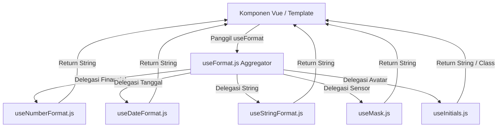

# useFormat (`useFormat.js`)

## 01. Overview

`useFormat` adalah *aggregator composable* yang menggabungkan seluruh pustaka pemformatan data terstandarisasi untuk ekosistem Indonesia ke dalam satu pintu masuk praktis. Modul ini menyatukan pemformatan tanggal dan durasi (`useDateFormat.js`), angka finansial Rupiah (`useNumberFormat.js`), manipulasi teks dan URL slug (`useStringFormat.js`), sensor privasi data (`useMask.js`), serta ekstraksi inisial avatar (`useInitials.js`).

### 1.1 Apa Entitas Ini

- **Tipe Artefak**: Aggregator Composable Function & Module Re-exporter (Vue 3 Composition API).
- **Lokasi Berkas Sumber**: [useFormat.js](file:///c:/SPEED/LARAVEL-PACK-UI/packages/laravel-pack-ui/resources/js/Composables/Pack/useFormat.js).
- **Ekspor Kunci**: `useFormat`, re-ekspor seluruh fungsi utilitas dari 5 sub-modul format.
- **Target Ekosistem**: Seluruh komponen UI, template halaman Inertia, kartu metrik ringkasan, dan tabel data yang membutuhkan pemformatan data siap saji.

### 1.2 Fungsi Utama

- Menyediakan titik impor tunggal (*single import point*) untuk 20+ fungsi pemformatan tanpa perlu mengingat lokasi berkas masing-masing utilitas secara terpisah.
- Menggabungkan pemformatan mata uang Rupiah (`formatRupiah`), angka desimal Indonesia (`formatNumber`), dan penyingkat angka ringkas (`formatCompactNumber`).
- Mengintegrasikan pemformatan tanggal berstandar Indonesia (`formatDate`), waktu lampau dinamis (`formatRelativeTime`), dan format durasi waktu (`formatDuration`).
- Menyediakan pengubahan gaya penamaan string (`slugify`, `titleCase`, `camelCase`, `snakeCase`, `kebabCase`) serta pembersihan HTML (`stripHtml`).
- Menyediakan fungsi sensor data sensitif perbankan dan kependudukan (`maskSensitive`) serta standardisasi nomor HP (`formatPhone`).
- Menghasilkan inisial nama cerdas (`formatInitials`) dan palet warna avatar Tailwind yang konsisten (`formatAvatarColor`).

### 1.3 Kapan Digunakan

- Di dalam komponen Vue yang membutuhkan pemformatan lintas tipe data sekaligus (misal kartu pesanan yang menampilkan harga Rupiah, tanggal transaksi, nama pengguna, dan status tersensor).
- Saat pengembang menginginkan sintaks impor yang cepat dan bersih tanpa daftar impor panjang dari berbagai file terpisah.
- Sebagai dependensi formatting global untuk disuntikkan ke helper template atau filter kustom Vue.

### 1.4 Karakteristik Penting

- **Dua Model Konsumsi**: Mendukung pemanggilan via composable hook `const { ... } = useFormat()` maupun melalui impor bernama langsung (`import { formatRupiah, formatDate } from '@/Composables/Pack/useFormat'`).
- **Nol Dependensi Berat**: Seluruh logika dibangun menggunakan fitur bawaan JavaScript modern dan `Intl` API native browser, menjaga ukuran bundel tetap ringan.
- **Konsistensi Lokal Indonesia**: Seluruh sub-modul dirancang khusus mengikuti konvensi Bahasa Indonesia (pemisah ribuan titik, pemisah desimal koma, singkatan juta `jt`, dan nama hari/bulan resmi).

---

## 02. Preview

> [!TIP]
> Pengujian fungsional dan showcase composable ini dapat diuji secara native pada portal pratinjau aplikasi:
>
> <a href="/preview" target="_self" style="display: inline-flex; align-items: center; gap: 6px; padding: 6px 14px; border-radius: 8px; font-weight: 600; text-decoration: none; margin-top: 8px; background-color: var(--vp-c-brand-1, #4f46e5); color: #ffffff;">Buka Live Preview Portal Komponen &rarr;</a>

---

## 03. Usage

### Pohon Hubungan Aggregator

```text
useFormat (Aggregator Gateway)
├── 1. Finansial & Angka (via useNumberFormat.js)
│   ├── formatRupiah(val, options)        → "Rp 1.500.000"
│   ├── formatNumber(val, decimals)       → "1.500.000,50"
│   ├── formatCompactNumber(val)          → "1,5 jt"
│   ├── formatPercent(val, decimals)      → "15,4%"
│   ├── formatOrdinal(num)                → "ke-3"
│   └── formatBytes(bytes)                → "15,2 MB"
│
├── 2. Tanggal & Waktu (via useDateFormat.js)
│   ├── formatDate(date, pattern)         → "26 September 2026"
│   ├── formatRelativeTime(date)          → "3 jam yang lalu"
│   ├── formatDuration(seconds, options)  → "1 jam 2 menit"
│   └── parseDate(input)                  → Date Object
│
├── 3. Teks & String (via useStringFormat.js)
│   ├── slugify(text, separator)          → "koleksi-laravel-pack"
│   ├── truncate(text, length, options)   → "Potongan kalimat..."
│   ├── titleCase(text)                   → "Judul Dokumen"
│   ├── camelCase(text)                   → "userProfileId"
│   ├── snakeCase(text)                   → "user_profile_id"
│   ├── kebabCase(text)                   → "user-profile-id"
│   └── stripHtml(html)                   → "Teks Bersih"
│
├── 4. Sensor & Privasi (via useMask.js)
│   ├── maskSensitive(val, type)          → "**** **** **** 9010"
│   └── formatPhone(phone)                → "+62 812-3456-7890"
│
└── 5. Inisial & Avatar (via useInitials.js)
    ├── formatInitials(name, max)         → "CTA"
    └── formatAvatarColor(name)           → "bg-blue-600 text-white"
```

### Matriks Keputusan: `useFormat` vs Sub-Modul Terpisah

| Kasus Penggunaan | Gunakan `useFormat` | Gunakan Sub-Modul Langsung |
| :--- | :--- | :--- |
| Komponen membutuhkan 3+ jenis format berbeda (angka, tanggal, teks) | Sangat Disarankan | Kurang Efisien (butuh banyak file import) |
| Komponen reaktif yang membutuhkan watcher `useDateFormat(dateRef)` | Gunakan named import `useDateFormat` | Sangat Disarankan |
| Halaman ringan yang hanya butuh 1 fungsi kecil (misal hanya `formatRupiah`) | Opsi valid via re-ekspor | Sangat Disarankan untuk optimasi tree-shaking mikro |

---

## 04. Anatomy

### Hubungan Arsitektur Modul

```text
resources/js/Composables/Pack/
│
├── useDateFormat.js     ──────┐
├── useNumberFormat.js   ──────┤
├── useStringFormat.js   ──────┼──> useFormat.js (Aggregator Hub) ──> Vue Component
├── useMask.js           ──────┤
└── useInitials.js       ──────┘
```

### Diagram Alur Data Aggregator (Mermaid)



---

## 05. Variants

Kategori fungsi yang diekspos melalui `useFormat` dikelompokkan ke dalam 5 domain fungsional:

| Domain | Fungsi Utama | Karakteristik Standar |
| :--- | :--- | :--- |
| **Finansial** | `formatRupiah`, `formatCompactNumber`, `formatPercent` | Prefix `Rp`, spasi tunggal, pemisah ribuan titik (`.`), pemisah desimal koma (`,`). |
| **Kronologi** | `formatDate`, `formatRelativeTime`, `formatDuration` | Nama bulan & hari Indonesia resmi, token kustom, kalkulasi selisih waktu dinamis. |
| **String** | `slugify`, `truncate`, `titleCase`, `stripHtml` | Pemotongan berbasis word boundary, sanitasi script/style, pembersih Unicode beraksen. |
| **Privasi** | `maskSensitive`, `formatPhone` | Sensor kartu kredit/debit, email, NIK KTP, dan format standar nomor telepon Indonesia `+62`. |
| **Identitas** | `formatInitials`, `formatAvatarColor` | Ekstraksi 1-3 huruf inisial, deterministik hashing warna avatar Tailwind. |

---

## 06. Sizes

Tidak relevan untuk composable murni tanpa elemen tata letak fisik.

---

## 07. States

### Penanganan Fallback Nilai Kosong / Error Input

Seluruh fungsi yang diekspos oleh `useFormat` memiliki mekanisme fallback bawaan:

| Tipe Nilai Input | Perilaku Default | Contoh Hasil |
| :--- | :--- | :--- |
| `null` atau `undefined` | Mengembalikan string kosong atau tanda hubung | `formatDate(null)` → `"-"`<br>`slugify(null)` → `""` |
| `NaN` pada fungsi angka | Mengembalikan fallback default | `formatRupiah('invalid')` → `"Rp 0"` |
| String HTML rusak pada `stripHtml` | Sanitasi aman tanpa throw exception | `stripHtml('<p>Teks')` → `"Teks"` |

---

## 08. Props / Parameters / Attributes

### Parameter Kunci Fungsi Finansial & Angka

| Fungsi | Parameter | Tipe Data | Default | Keterangan |
| :--- | :--- | :--- | :--- | :--- |
| `formatRupiah` | `(value, options)` | `Number, Object` | `{ withSymbol: true }` | Opsi `{ withSymbol: false, decimals: 2 }` |
| `formatNumber` | `(value, decimals)` | `Number, Number` | `0` | Menentukan jumlah angka di belakang koma desimal |
| `formatCompactNumber` | `(value)` | `Number` | - | Menyingkat angka besar (contoh: `1.500.000` → `"1,5 jt"`) |

### Parameter Kunci Fungsi Tanggal

| Fungsi | Parameter | Tipe Data | Default | Keterangan |
| :--- | :--- | :--- | :--- | :--- |
| `formatDate` | `(date, pattern)` | `String\|Date, String` | `'DD MMMM YYYY HH:mm'` | Pola token (contoh: `'DD/MM/YYYY'`) |
| `formatRelativeTime` | `(date)` | `String\|Date` | - | Selisih waktu dinamis terhadap `Date.now()` |
| `formatDuration` | `(seconds, options)` | `Number, Object` | `{ format: 'digital' }` | Pilihan mode: `'digital'`, `'human'`, `'short'` |

### Parameter Kunci Fungsi String & Privasi

| Fungsi | Parameter | Tipe Data | Default | Keterangan |
| :--- | :--- | :--- | :--- | :--- |
| `slugify` | `(text, separator)` | `String, String` | `'-'` | Pembuat URL slug ramah SEO |
| `truncate` | `(text, length, opts)` | `String, Number, Object` | `100, { suffix: '...' }` | Pemotongan cerdas di batas spasi kata |
| `maskSensitive` | `(value, type)` | `String, String` | `'card'` | Tipe: `'card'`, `'email'`, `'phone'`, `'nik'` |

---

## 09. Slots / Content

Tidak relevan untuk composable murni tanpa komponen visual langsung.

---

## 10. Events / Interactions / Returns

### Return Object dari `useFormat()`

| Properti / Method | Tipe Data | Reaktif | Deskripsi |
| :--- | :--- | :--- | :--- |
| `formatRupiah` | `Function(val, opts)` | Tidak | Format mata uang Rupiah IDR. |
| `formatNumber` | `Function(val, decimals)` | Tidak | Format angka desimal pemisah titik. |
| `formatCompactNumber` | `Function(val)` | Tidak | Format angka ringkas ribuan/jutaan. |
| `formatPercent` | `Function(val, decimals)` | Tidak | Format persentase. |
| `formatBytes` | `Function(bytes)` | Tidak | Format ukuran kapasitas berkas. |
| `formatDate` | `Function(date, pattern)` | Tidak | Format tanggal lokal Indonesia. |
| `formatRelativeTime` | `Function(date)` | Tidak | Format waktu lampau / mendatang. |
| `formatDuration` | `Function(sec, opts)` | Tidak | Format durasi detik ke teks. |
| `parseDate` | `Function(input)` | Tidak | Parser normalisasi tanggal ke objek Date. |
| `slugify` | `Function(text, sep)` | Tidak | Generator slug URL. |
| `truncate` | `Function(text, len, opts)`| Tidak | Pemotong panjang teks batas kata. |
| `titleCase` | `Function(text)` | Tidak | Kapitalisasi awal tiap kata. |
| `camelCase` | `Function(text)` | Tidak | Konversi ke camelCase. |
| `snakeCase` | `Function(text)` | Tidak | Konversi ke snake_case. |
| `kebabCase` | `Function(text)` | Tidak | Konversi ke kebab-case. |
| `stripHtml` | `Function(html)` | Tidak | Menghapus tag markup HTML. |
| `maskSensitive` | `Function(val, type)` | Tidak | Sensor data privasi pengguna. |
| `formatPhone` | `Function(phone)` | Tidak | Standardisasi nomor telepon seluler. |
| `formatInitials` | `Function(name, max)` | Tidak | Ekstraksi inisial nama pengguna. |
| `formatAvatarColor` | `Function(name)` | Tidak | Hashing warna avatar latar belakang. |

---

## 11. Code Example

### 1. Penggunaan Dasar (Basic Example)

Menampilkan harga dan tanggal pada kartu produk ringkas:

```vue
<script setup>
import { useFormat } from '@/Composables/Pack/useFormat';

const props = defineProps({
    product: Object,
});

const { formatRupiah, formatDate } = useFormat();
</script>

<template>
    <div class="p-4 rounded-xl border border-gray-200 dark:border-gray-800">
        <h3 class="font-bold text-base">{{ product.name }}</h3>
        <p class="text-emerald-600 font-semibold">{{ formatRupiah(product.price) }}</p>
        <p class="text-xs text-gray-500">Terdaftar pada: {{ formatDate(product.created_at, 'DD MMMM YYYY') }}</p>
    </div>
</template>
```

### 2. Penggunaan Menengah (Variant / Intermediate Example)

Menampilkan baris transaksi perbankan dengan sensor nomor rekening/kartu, waktu relatif, dan badge inisial avatar:

```vue
<script setup>
import { useFormat } from '@/Composables/Pack/useFormat';

const props = defineProps({
    transaction: Object,
});

const {
    formatRupiah,
    formatRelativeTime,
    maskSensitive,
    formatInitials,
    formatAvatarColor,
} = useFormat();
</script>

<template>
    <div class="flex items-center justify-between p-3.5 rounded-xl bg-white dark:bg-gray-900 border border-gray-100 dark:border-gray-800">
        <div class="flex items-center gap-3">
            <!-- Avatar Inisial Dinamis -->
            <div
                :class="formatAvatarColor(transaction.customer_name)"
                class="w-9 h-9 rounded-full flex items-center justify-center font-bold text-xs text-white"
            >
                {{ formatInitials(transaction.customer_name, 2) }}
            </div>

            <div>
                <p class="font-semibold text-sm text-gray-900 dark:text-white">{{ transaction.customer_name }}</p>
                <p class="text-xs font-mono text-gray-400">
                    Kartu: {{ maskSensitive(transaction.card_number, 'card') }}
                </p>
            </div>
        </div>

        <div class="text-right">
            <p class="font-bold text-sm text-gray-900 dark:text-white">
                {{ formatRupiah(transaction.total) }}
            </p>
            <p class="text-xs text-gray-400">
                {{ formatRelativeTime(transaction.timestamp) }}
            </p>
        </div>
    </div>
</template>
```

### 3. Penggunaan Lanjutan (Advanced / Enterprise Example)

ViewModel ringkasan halaman pesanan e-commerce terintegrasi:

```vue
<script setup>
import { computed } from 'vue';
import { useFormat } from '@/Composables/Pack/useFormat';

const props = defineProps({
    order: Object,
});

const {
    formatRupiah,
    formatDate,
    formatPhone,
    formatCompactNumber,
    slugify,
    truncate,
} = useFormat();

const shareableUrl = computed(() => {
    return `/pesanan/${props.order.id}/${slugify(props.order.title)}`;
});

const shortDescription = computed(() => {
    return truncate(props.order.notes || 'Tidak ada catatan pesanan.', 60);
});
</script>

<template>
    <div class="p-6 rounded-2xl bg-white dark:bg-gray-900 border border-gray-200 dark:border-gray-800 space-y-4">
        <div class="flex justify-between items-start">
            <div>
                <span class="text-xs text-gray-400 font-mono">Pesanan #{{ order.id }}</span>
                <h2 class="text-lg font-bold">{{ order.title }}</h2>
                <p class="text-xs text-gray-500 mt-1">{{ shortDescription }}</p>
            </div>
            <div class="text-right">
                <span class="text-xl font-bold text-emerald-600 dark:text-emerald-400">
                    {{ formatRupiah(order.amount) }}
                </span>
                <p class="text-[11px] text-gray-400">
                    Volume: {{ formatCompactNumber(order.total_items) }} unit
                </p>
            </div>
        </div>

        <div class="pt-4 border-t border-gray-100 dark:border-gray-800 grid grid-cols-2 gap-4 text-xs">
            <div>
                <span class="text-gray-400 block">Waktu Checkout:</span>
                <span class="font-medium text-gray-800 dark:text-gray-200">
                    {{ formatDate(order.created_at, 'DDDD, DD MMMM YYYY [pukul] HH:mm') }}
                </span>
            </div>
            <div>
                <span class="text-gray-400 block">Nomor WhatsApp Pembeli:</span>
                <span class="font-medium font-mono text-gray-800 dark:text-gray-200">
                    {{ formatPhone(order.customer_phone) }}
                </span>
            </div>
        </div>
    </div>
</template>
```

---

## 12. Result / Behavior

### Alur Kerja Eksekusi

1. Pengembang mengimpor `useFormat` ke dalam modul atau komponen Vue.
2. Composable mengembalikan objek berisi fungsi referensi murni (*pure functions*) yang langsung siap dieksekusi di skrip maupun di template HTML.
3. Setiap fungsi mengevaluasi tipe data input, melakukan sanitasi nilai, dan menghasilkan representasi string terstandarisasi.
4. Karena fungsi-fungsi yang dikembalikan adalah fungsi murni (*pure functions*), eksekusinya bersifat idempoten dan tidak mengubah state eksternal aplikasi.

---

## 13. Customization

### Konfigurasi Lokal Khusus

Jika membutuhkan penyesuaian di luar standar Indonesia, fungsi-fungsi pendukung menerima opsi parameter tambahan:

```javascript
import { formatDuration, formatRupiah } from '@/Composables/Pack/useFormat';

// Durasi dalam Bahasa Inggris
formatDuration(3600, { locale: 'en', format: 'human' }); // "1 hr"

// Rupiah tanpa simbol untuk ekspor akuntansi murni
formatRupiah(1500000, { withSymbol: false }); // "1.500.000"
```

---

## 14. Accessibility (a11y)

- **Angka Finansial untuk Screen Reader**: Nilai singkat dari `formatCompactNumber` (`"1,5 jt"`) baik untuk visual mobile, tetapi pertimbangkan menyertakan atribut `aria-label` dengan angka lengkap (`aria-label="1 juta 500 ribu rupiah"`) untuk kenyamanan pengguna pembaca layar.
- **Sensor Data Sensitif**: Saat menampilkan data tersensor via `maskSensitive`, pastikan pembaca layar mengumumkan status tersebut dengan jelas, misalnya: `<span aria-label="Nomor kartu berakhiran 9010">{{ maskSensitive(cardNumber, 'card') }}</span>`.

---

## 15. Responsive Behavior

Tidak relevan untuk composable logika data tanpa markup antarmuka.

---

## 16. Do / Don't

### Rekomendasi (Do)

- Gunakan `useFormat()` di komponen yang membutuhkan lebih dari satu domain format (misal gabungan tanggal, Rupiah, dan sensor nomor telepon).
- Manfaatkan `slugify` saat membuat tautan SEO-friendly dari judul artikel atau produk di frontend.
- Gunakan `maskSensitive` di seluruh tampilan data publik yang mengandung nomor kartu atau NIK KTP untuk mematuhi regulasi perlindungan data pribadi (UU PDP).

### Larangan (Don't)

- Jangan melakukan manipulasi string manual seperti `split` atau `replace` manual untuk nominal Rupiah; selalu gunakan `formatRupiah`.
- Jangan menggunakan `useFormat` jika Anda membutuhkan ref reaktif dua arah yang otomatis mengamati mutasi objek; untuk kebutuhan tersebut gunakan composable khusus seperti `useDateFormat(dateRef)`.
- Jangan meneruskan nilai hasil `formatRupiah` ke backend sebagai nilai komputasi matematis; selalu simpan dan kirim nilai integer murni (*cents* atau nominal asli) ke API.

---

## 17. Examples / Recipes

### Resep: Format Ringkasan Metrik Kartu Admin Panel

```vue
<script setup>
import { useFormat } from '@/Composables/Pack/useFormat';

const props = defineProps({
    stats: Object,
});

const { formatRupiah, formatCompactNumber, formatPercent, formatDate } = useFormat();
</script>

<template>
    <div class="grid grid-cols-1 sm:grid-cols-3 gap-4">
        <!-- Pendapatan Total -->
        <div class="p-4 rounded-xl border border-gray-200 dark:border-gray-800 bg-white dark:bg-gray-900">
            <span class="text-xs text-gray-500 uppercase font-semibold">Omzet Bulan Ini</span>
            <div class="text-xl font-bold text-emerald-600 mt-1">{{ formatRupiah(stats.totalRevenue) }}</div>
            <span class="text-xs text-gray-400">Ringkas: {{ formatCompactNumber(stats.totalRevenue) }}</span>
        </div>

        <!-- Pertumbuhan Penjualan -->
        <div class="p-4 rounded-xl border border-gray-200 dark:border-gray-800 bg-white dark:bg-gray-900">
            <span class="text-xs text-gray-500 uppercase font-semibold">Pertumbuhan</span>
            <div class="text-xl font-bold text-blue-600 mt-1">{{ formatPercent(stats.growthRate) }}</div>
            <span class="text-xs text-gray-400">Dibandingkan bulan lalu</span>
        </div>

        <!-- Pembaruan Terakhir -->
        <div class="p-4 rounded-xl border border-gray-200 dark:border-gray-800 bg-white dark:bg-gray-900">
            <span class="text-xs text-gray-500 uppercase font-semibold">Sinkronisasi Terakhir</span>
            <div class="text-sm font-semibold text-gray-800 dark:text-gray-200 mt-1">
                {{ formatDate(stats.lastSyncedAt, 'DD MMM YYYY HH:mm') }}
            </div>
            <span class="text-xs text-emerald-600 font-medium">Status Realtime</span>
        </div>
    </div>
</template>
```

---

## 18. Related Items

```text
useFormat
├── Sub-Modul Terkait
│   ├── useDateFormat.js       → Format tanggal & durasi waktu
│   ├── useNumberFormat.js     → Format Rupiah, desimal, persentase, & bytes
│   ├── useStringFormat.js     → Slugify, truncate, & konversi kasus teks
│   ├── useMask.js             → Sensor nomor kartu, NIK, & format telepon
│   └── useInitials.js         → Ekstraksi inisial & generator warna avatar
│
└── Komponen Konsumen
    ├── TableComponent.vue     → Menampilkan kolom tanggal & mata uang
    ├── Avatar.vue             → Komponen visual avatar pengguna
    └── Card.vue               → Kartu ringkasan metrik dashboard
```

---

## 19. Notes / Limitations

- **Aggregator Re-Export Overhead**: Mengimpor `useFormat` menyertakan 5 modul helper. Pada aplikasi dengan target ukuran bundle ultra-ketat, pengembang disarankan mengimpor fungsi spesifik langsung dari sub-modul terkait (misal `import { formatRupiah } from '@/Composables/Pack/useNumberFormat'`).
- **Tidak Memiliki State Reaktif Sendiri**: `useFormat()` mengembalikan kumpulan fungsi murni tanpa state internal. Jika Anda membutuhkan computed ref yang bereaksi terhadap perubahan data form, gunakan composable khusus seperti `useStringFormat(myRef)`.
