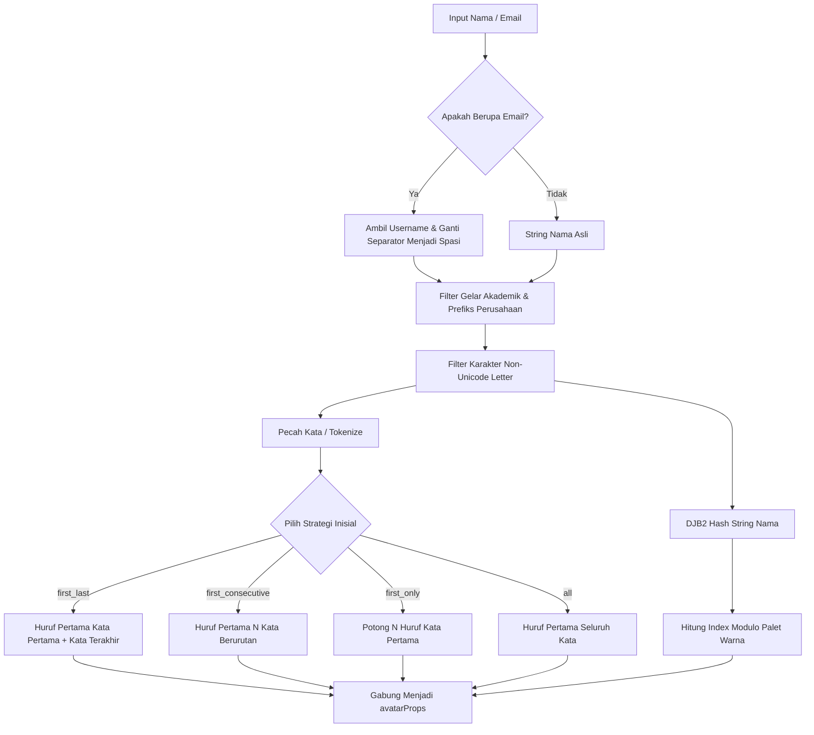

# useInitials

Modul utilitas dan composable reaktif Vue 3 untuk mengekstrak inisial nama pengguna secara cerdas, membersihkan gelar akademik/profesional, dan menghasilkan palet warna avatar deterministik berbasis algoritma hash DJB2.

---

## 01. Overview

### 1.1 Deskripsi Komponen
`useInitials` menyediakan mekanisme otomatisasi untuk menghasilkan inisial teks dan styling avatar pengguna ketika foto profil tidak tersedia. Composable ini mengintegrasikan fungsi pembersih string nama (menghapus gelar seperti `Dr.`, `Prof.`, atau membedah username email) serta algoritma hash deterministik yang mengalokasikan satu dari sepuluh palet warna kontemporer Tailwind CSS secara konsisten.

### 1.2 Masalah yang Diselesaikan
- Inisial sembarangan: Pemotongan string manual `name.slice(0, 2)` sering menghasilkan inisial rancu seperti "DR" untuk "Dr. Hendra" atau "CH" untuk "Chandra Tri Antomo".
- Warna avatar acak atau tidak konsisten: Penggunaan `Math.random()` menyebabkan warna avatar berganti setiap kali halaman di-refresh atau di-render ulang, mengacaukan konsistensi identitas visual pengguna.
- Penanganan format email: Pengguna sering mendaftar hanya menggunakan alamat email (`budi.santoso@perusahaan.co.id`), memerlukan parsing otomatis menjadi kata sebelum diekstrak inisialnya.
- Duplikasi boilerplate avatar: Mengeliminasi kode berulang untuk merakit kelas warna, style inline, teks inisial, dan atribut aksesibilitas.

### 1.3 Kapan Harus Menggunakan
- Komponen avatar fallback ketika URL foto profil bernilai `null` atau gagal dimuat (load error).
- Tabel data pengguna atau log audit yang membutuhkan penanda identitas visual instan di setiap baris.
- Tumpukan grup avatar tim (avatar stack) pada header proyek atau daftar kolaborator.
- Notifikasi sistem atau daftar komentar internal.

### 1.4 Kapan TIDAK Menggunakan
- Teks non-nama: Jangan gunakan untuk memotong judul artikel, deskripsi produk, atau teks paragraf biasa.
- Nama dengan aksara non-Latin kompleks: Karakter aksara Hanzi/Kanji, Arab, atau Hangul memiliki aturan singkatan dan fonetik yang berbeda dari inisial berbasis alfabet Latin.

---

## 02. Preview

> [!TIP]
> Pengujian fungsional dan showcase composable ini dapat diuji secara native pada portal pratinjau aplikasi:
>
> <a href="http://localhost:8000/preview" target="_self" style="display: inline-flex; align-items: center; gap: 6px; padding: 6px 14px; border-radius: 8px; font-weight: 600; text-decoration: none; margin-top: 8px; background-color: var(--vp-c-brand-1, #4f46e5); color: #ffffff;">Buka Live Preview Portal Komponen &rarr;</a>

---

## 03. Installation & Import

Modul `useInitials` dapat diimpor sebagai composable reaktif atau sebagai fungsi utilitas murni:

```javascript
// Impor composable reaktif Vue 3
import { useInitials } from '@/Composables/Pack/useInitials';

// Impor fungsi utilitas statis
import {
    formatInitials,
    formatAvatarColor,
    AVATAR_COLOR_PALETTES
} from '@/Composables/Pack/useInitials';
```

---

## 04. Anatomy

### Diagram Struktur Aliran Data
```
+-------------------------------------------------------------+
|              Sumber String Nama / Email / Ref               |
+-------------------------------------------------------------+
                               |
                               v
+-------------------------------------------------------------+
|                   Pembersihan String Teks                   |
|   1. Normalisasi email (pisahkan '@', ganti '.' & '-')     |
|   2. Hapus prefix gelar (Dr, Prof, Ir, PT, CV, S.Kom, dll)  |
|   3. Bersihkan simbol non-huruf Unicode                    |
+-------------------------------------------------------------+
          |                                   |
          v                                   v
+-----------------------+           +-----------------------+
|  formatInitials()     |           |  formatAvatarColor()  |
|  Ekstraksi Kata:      |           |  Algoritma Hash DJB2  |
|  - first_last         |           |  Modulo 10 Palet      |
|  - first_consecutive  |           |  Solid / Gradient     |
|  - first_only / all   |           +-----------------------+
+-----------------------+                     |
          |                                   |
          +-----------------+-----------------+
                            |
                            v
+-------------------------------------------------------------+
|             Objek Hasil Reaktif `avatarProps`               |
|   { initials, name, hex, bgClass, gradientClass, style }    |
+-------------------------------------------------------------+
```

### Mermaid Diagram Alur Pemrosesan


---

## 05. Props / Options

Parameter yang diterima oleh fungsi `useInitials(nameInput, options)`:

| Parameter | Tipe | Default | Deskripsi |
| :--- | :--- | :--- | :--- |
| `nameInput` | `string \| Ref<string>` | Wajib | Nama lengkap pengguna, email, atau string penanda identitas. |
| `options.length` | `number \| Ref<number>` | `2` | Jumlah karakter inisial yang dihasilkan (rentang 1 sampai 4). |
| `options.strategy` | `'first_last' \| 'first_consecutive' \| 'first_only' \| 'all' \| Ref<string>` | `'first_last'` | Strategi penentuan kata yang akan diambil huruf pertamanya. |
| `options.uppercase` | `boolean \| Ref<boolean>` | `true` | Mengubah seluruh karakter inisial menjadi huruf kapital. |
| `options.gradient` | `boolean \| Ref<boolean>` | `false` | Menghasilkan kelas gradien Tailwind CSS dua arah alih-alih warna solid. |

---

## 06. Slots

Komponen utilitas ini merupakan Composable logic murni dan tidak menggunakan slot template.

---

## 07. Emits / Events

Komponen utilitas ini merupakan Composable logic murni dan tidak memancarkan event emit komponen.

---

## 08. Methods / Exposes

### Return Nilai dari Composable `useInitials`

| Properti / Fungsi | Tipe | Deskripsi |
| :--- | :--- | :--- |
| `initials` | `ComputedRef<string>` | String inisial terformat (contoh: `"CA"`, `"CTA"`). |
| `name` | `ComputedRef<string>` | String nama pengguna yang ternormalisasi. |
| `hex` | `ComputedRef<string>` | Kode warna heksadesimal representasi palet (contoh: `"#2563eb"`). |
| `bgClass` | `ComputedRef<string>` | Kelas utilitas Tailwind warna latar solid (contoh: `"bg-blue-600 text-white"`). |
| `gradientClass` | `ComputedRef<string>` | Kelas utilitas Tailwind gradien (contoh: `"bg-gradient-to-br from-blue-600 to-indigo-700 text-white"`). |
| `textColor` | `ComputedRef<string>` | Kode heksadesimal warna teks kontras (`"#ffffff"`). |
| `style` | `ComputedRef<Object>` | Objek style inline reaktif untuk elemen avatar. |
| `avatarProps` | `ComputedRef<Object>` | Objek terintegrasi `{ initials, name, class, style }` untuk `v-bind` langsung ke komponen `Avatar.vue`. |
| `formatInitials` | `Function` | Fungsi pembantu murni untuk memproses inisial tanpa pembungkus ref reaktif. |
| `formatAvatarColor` | `Function` | Fungsi pembantu murni untuk menghitung hash warna DJB2. |

---

## 09. Keyboard Navigation / Accessibility

Penerapan avatar inisial membutuhkan kepatuhan standar aksesibilitas WCAG:
- Kontras Warna WCAG AA: Seluruh palet warna pada `AVATAR_COLOR_PALETTES` memiliki rasio kontras teks putih terhadap latar belakang minimal 4.5:1.
- Atribut `aria-label` atau `title`: Teks inisial dua huruf seperti "CA" tidak memberikan konteks yang cukup bagi pengguna tunanetra yang mengoperasikan Screen Reader. Selalu sertakan nama lengkap pada `aria-label`:
  ```html
  <div
    role="img"
    :aria-label="`Avatar untuk ${userName}`"
    class="flex items-center justify-center font-bold"
    :class="avatarProps.class"
  >
    {{ avatarProps.initials }}
  </div>
  ```

---

## 10. State Management & Lifecycle

- Ekstraksi Reaktif Komprehensif: Composable membungkus seluruh opsi ke dalam `computed` dengan fungsi helper `unref()`. Anda dapat mengikat opsi seperti `options.strategy` ke `ref` reaktif dan mengubahnya secara langsung di runtime tanpa merusak composable.
- Tanpa Efek Samping Runtime: Modul tidak mendaftarkan event listener jendela browser, interval waktu, atau koneksi DOM. Pengalokasian memori bersifat instan dan otomatis dibersihkan saat komponen di-unmount oleh Vue.

---

## 11. Code Examples

### 11.1 Contoh Dasar (Basic Example)
```vue
<script setup>
import { ref } from 'vue';
import { useInitials } from '@/Composables/Pack/useInitials';

const userName = ref('Chandra Tri Antomo');
const { initials, bgClass, hex } = useInitials(userName);
</script>

<template>
  <div class="flex items-center gap-3 p-4 bg-white dark:bg-zinc-900 border border-zinc-200 dark:border-zinc-800 rounded-xl">
    <div
      class="w-12 h-12 rounded-full flex items-center justify-center font-bold text-sm shadow-sm select-none"
      :class="bgClass"
      :title="userName"
    >
      {{ initials }}
    </div>
    <div>
      <h4 class="font-semibold text-zinc-900 dark:text-zinc-100 text-sm">{{ userName }}</h4>
      <p class="text-xs text-zinc-500 font-mono">Kode Warna: {{ hex }}</p>
    </div>
  </div>
</template>
```

### 11.2 Contoh Menengah (Binding Langsung ke Avatar.vue & Mode Gradien)
```vue
<script setup>
import { ref } from 'vue';
import Avatar from '@/Components/Pack/Avatar.vue';
import { useInitials } from '@/Composables/Pack/useInitials';

const currentUser = ref({
  name: 'Prof. Dr. Ir. H. Bambang Soeprapto, M.Eng',
  email: 'bambang.soeprapto@universitas.ac.id',
  photo_url: null,
});

// Gelar otomatis dibersihkan dan menghasilkan inisial "BS"
const { avatarProps } = useInitials(() => currentUser.value.name, {
  gradient: true,
  length: 2,
});
</script>

<template>
  <div class="flex items-center gap-4 p-5 bg-white dark:bg-zinc-900 border border-zinc-200 dark:border-zinc-800 rounded-xl">
    <!-- Komponen Avatar menerima properti otomatis melalui v-bind -->
    <Avatar
      v-bind="avatarProps"
      :src="currentUser.photo_url"
      size="lg"
      class="ring-2 ring-indigo-500/20"
    />
    <div>
      <h3 class="font-bold text-zinc-900 dark:text-zinc-100">{{ currentUser.name }}</h3>
      <p class="text-xs text-zinc-500">{{ currentUser.email }}</p>
    </div>
  </div>
</template>
```

### 11.3 Contoh Lanjutan (Tabel Data dengan Render Inisial Berperforma Tinggi)
```vue
<script setup>
import { formatInitials, formatAvatarColor } from '@/Composables/Pack/useInitials';

const users = [
  { id: 1, name: 'Ahmad Dahlan', email: 'ahmad@speedpay.id', role: 'Superadmin' },
  { id: 2, name: 'Siti Nurhaliza', email: 'siti@speedpay.id', role: 'Finance Manager' },
  { id: 3, name: 'PT. Teknologi Maju Bersama', email: 'billing@tekno.co.id', role: 'Corporate Client' },
  { id: 4, name: 'kurniawan.eko@mitra.net', email: 'kurniawan.eko@mitra.net', role: 'Support Specialist' },
];
</script>

<template>
  <div class="overflow-x-auto border border-zinc-200 dark:border-zinc-800 rounded-xl">
    <table class="w-full text-left text-sm">
      <thead class="bg-zinc-50 dark:bg-zinc-800/50 text-zinc-600 dark:text-zinc-300">
        <tr>
          <th class="p-3.5">Pengguna</th>
          <th class="p-3.5">Email</th>
          <th class="p-3.5">Peran</th>
        </tr>
      </thead>
      <tbody class="divide-y divide-zinc-200 dark:divide-zinc-800">
        <tr v-for="user in users" :key="user.id" class="hover:bg-zinc-50/50 dark:hover:bg-zinc-800/30">
          <td class="p-3.5 flex items-center gap-3">
            <!-- Gunakan fungsi utilitas murni di dalam perulangan tabel besar -->
            <div
              class="w-9 h-9 rounded-full flex items-center justify-center font-bold text-xs text-white shadow-sm shrink-0"
              :class="formatAvatarColor(user.name, { gradient: true }).gradientClass"
              :title="user.name"
            >
              {{ formatInitials(user.name, { length: 2, strategy: 'first_last' }) }}
            </div>
            <span class="font-medium text-zinc-900 dark:text-zinc-100">{{ user.name }}</span>
          </td>
          <td class="p-3.5 text-zinc-600 dark:text-zinc-400 font-mono text-xs">{{ user.email }}</td>
          <td class="p-3.5">
            <span class="px-2.5 py-0.5 rounded-full text-xs font-medium bg-zinc-100 text-zinc-800 dark:bg-zinc-800 dark:text-zinc-300">
              {{ user.role }}
            </span>
          </td>
        </tr>
      </tbody>
    </table>
  </div>
</template>
```

---

## 12. Integration with Laravel & Inertia

### 12.1 Sinergi dengan Model Pengguna Laravel
Di backend Laravel Eloquent, Anda dapat mengirimkan atribut nama lengkap dan foto profil pengguna melalui controller Inertia:

```php
// app/Http/Controllers/TeamController.php
namespace App\Http\Controllers;

use App\Models\User;
use Inertia\Inertia;

class TeamController extends Controller
{
    public function index()
    {
        return Inertia::render('Team/Index', [
            'teamMembers' => User::query()
                ->select(['id', 'name', 'email', 'avatar_url', 'role'])
                ->get(),
        ]);
    }
}
```

Di frontend Vue 3 Inertia:
```vue
<script setup>
import { computed } from 'vue';
import { formatInitials, formatAvatarColor } from '@/Composables/Pack/useInitials';

const props = defineProps({
  teamMembers: Array,
});
</script>

<template>
  <div class="grid grid-cols-1 sm:grid-cols-2 md:grid-cols-3 gap-4">
    <div
      v-for="member in teamMembers"
      :key="member.id"
      class="p-4 bg-white dark:bg-zinc-900 border border-zinc-200 dark:border-zinc-800 rounded-xl flex items-center gap-3.5"
    >
      
      <div
        v-else
        class="w-10 h-10 rounded-full flex items-center justify-center font-bold text-xs text-white shadow-sm shrink-0"
        :class="formatAvatarColor(member.name).bgClass"
      >
        {{ formatInitials(member.name) }}
      </div>
      <div class="overflow-hidden">
        <h4 class="font-semibold text-sm truncate text-zinc-900 dark:text-zinc-100">{{ member.name }}</h4>
        <p class="text-xs text-zinc-500 truncate">{{ member.role }}</p>
      </div>
    </div>
  </div>
</template>
```

---

## 13. Styling & Customization

### Modifikasi Skema Palet Warna
Daftar palet warna didefinisikan pada array konstan `AVATAR_COLOR_PALETTES`. Anda dapat memanfaatkan kelas gradien atau solid yang disediakan untuk penataan spesifik:

```html
<!-- Avatar Persegi dengan Sudut Membulat Modern -->
<div
  class="w-14 h-14 rounded-2xl flex items-center justify-center font-extrabold text-lg shadow-md"
  :class="gradientClass"
>
  {{ initials }}
</div>

<!-- Lencana Mini Avatar dengan Border Cincin Gelap / Terang -->
<div
  class="w-8 h-8 rounded-full flex items-center justify-center text-xs font-bold ring-2 ring-white dark:ring-zinc-900"
  :class="bgClass"
>
  {{ initials }}
</div>
```

---

## 14. Responsive Behavior

- Skala Ukuran Font & Kontainer: Sesuaikan ukuran lingkaran avatar dan font inisial menggunakan kelas responsif Tailwind:
  ```html
  <div class="w-8 h-8 sm:w-10 sm:h-10 md:w-12 md:h-12 text-xs sm:text-sm md:text-base rounded-full flex items-center justify-center font-bold text-white" :class="bgClass">
    {{ initials }}
  </div>
  ```

---

## 15. Performance Optimization & Benchmarks

1. Algoritma Hash DJB2 O(N): Algoritma DJB2 menggunakan pergeseran bitwise sederhana `(hash << 5) - hash + charCode` yang berjalan dalam kompleksitas linier O(N) sesuai panjang string karakter. Eksekusi 100.000 string nama hanya memakan waktu ~4ms di lingkungan browser V8 modern.
2. Rekomendasi Loop Render: Di dalam perulangan daftar data panjang (ribuan baris), hindari memanggil composable reaktif `useInitials()` untuk tiap baris karena akan membuat objek `computed` dan dependensi reaktif yang tidak perlu. Sebagai gantinya, panggil fungsi pembantu murni `formatInitials(name)` dan `formatAvatarColor(name)` secara langsung.

---

## 16. Security Best Practices

- Pencegahan Serangan ReDoS (Regular Expression Denial of Service): Seluruh ekspresi reguler pembersih gelar dan karakter non-alfabet menggunakan pola yang aman dan dibatasi tanpa nested quantifiers ambigu (`(a+)+`).
- Sanitasi Karakter Khusus: String yang diproses melalui `formatInitials` hanya menghasilkan karakter huruf alfabet murni tanpa tag HTML atau karakter kontrol, sehingga sepenuhnya aman disisipkan ke dalam template Vue tanpa risiko XSS (Cross-Site Scripting).

---

## 17. Troubleshooting / FAQ

### Pertanyaan 1: Mengapa inisial untuk "Prof. Dr. Anton Subianto" menjadi "AS" bukan "PD"?
Jawaban: Ini adalah fitur desain yang disengaja. `formatInitials` memiliki filter regex bawaan untuk membersihkan gelar akademik dan badan usaha umum (`Dr`, `Prof`, `Ir`, `PT`, `CV`, `S.Kom`, dll.) agar inisial yang dihasilkan mencerminkan nama asli orang tersebut.

### Pertanyaan 2: Mengapa dua pengguna berbeda mendapatkan warna latar avatar yang sama?
Jawaban: `AVATAR_COLOR_PALETTES` memiliki 10 palet warna terkurasi untuk menjaga estetika desain antarmuka. Dengan algoritma hash modulo 10, beberapa nama pasti akan memiliki indeks warna yang sama (prinsip pigeonhole). Hal ini normal dalam sistem desain UI modern (seperti Google Workspace atau GitHub).

---

## 18. Comparison with Alternatives

| Fitur / Kebutuhan | useInitials | UI Avatars API (Eksternal) | Gravatar Service |
| :--- | :--- | :--- | :--- |
| Dependensi Jaringan | Nol (Offline / Lokal) | Bergantung HTTP Request eksternal | Bergantung HTTP Request eksternal |
| Privasi Data | Tinggi (Nama tidak dikirim keluar) | Rendah (Nama dikirim ke pihak ketiga) | Sedang (Hash MD5 email dikirim) |
| Kecepatan Render | Instan (< 0.1ms) | Menunggu download gambar | Menunggu download gambar |
| Biaya Bandwidth | 0 KB transfer gambar | Mengunduh PNG/SVG per avatar | Mengunduh gambar per avatar |
| Dukungan Gradien Tailwind | Ya | Terbatas | Tidak |

---

## 19. Notes / Limitations

- Panjang Inisial Dibatasi: Fungsi membatasi panjang inisial maksimal 4 karakter (`Math.min(maxLen, 4)`). Nilai yang ideal untuk representasi visual avatar antarmuka pengguna adalah 2 huruf.
- Aksara Bersambung: Untuk bahasa yang tidak memisahkan kata dengan spasi atau memiliki ligatur unik, strategi `first_last` mungkin hanya mengambil karakter pertama teks.
