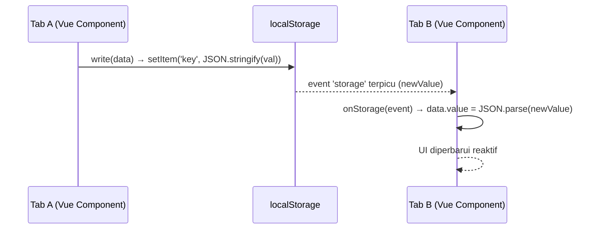

# useLocalStorage (`useLocalStorage.js`)

## 01. Overview

`useLocalStorage` adalah composable untuk menyimpan dan menyinkronkan state reaktif Vue 3 secara dua arah (*two-way*) dengan `localStorage` browser. Setiap perubahan pada `data` otomatis diserialisasi dan ditulis ke storage, dan setiap perubahan dari tab browser lain otomatis dibaca kembali melalui event `storage`.

### 1.1 Apa Entitas Ini

- **Tipe Artefak**: Composable Function (Vue 3 Composition API).
- **Lokasi Berkas Sumber**: [useLocalStorage.js](file:///c:/SPEED/LARAVEL-PACK-UI/packages/laravel-pack-ui/resources/js/Composables/Pack/useLocalStorage.js).
- **Ekspor Kunci**: `useLocalStorage`.
- **Target Ekosistem**: Preferensi pengguna, filter tabel tersimpan, tema, dan state antarmuka yang harus persisten antar sesi.

### 1.2 Fungsi Utama

- Menyimpan nilai `Ref` reaktif ke `localStorage` secara otomatis saat nilainya berubah.
- Membaca nilai tersimpan kembali ke Vue state saat komponen pertama kali dimuat.
- Menyinkronkan perubahan dari tab browser lain melalui event `storage` (opsional).
- Mendukung `initialValue` berupa nilai statis maupun fungsi factory `() => value`.
- Membersihkan listener `storage` secara otomatis saat komponen di-unmount.

### 1.3 Kapan Digunakan

- Preferensi tampilan pengguna: tema gelap/terang, jumlah baris per halaman tabel, bahasa.
- Filter dan sorting tabel yang perlu tetap ada saat halaman di-refresh.
- State sidebar collapse yang disimpan antar navigasi halaman.
- Token sesi atau konfigurasi kecil yang tidak memerlukan enkripsi.

### 1.4 Karakteristik Penting

- **SSR Safe**: Semua akses ke `window.localStorage` dibungkus pengecekan `typeof window !== 'undefined'`, aman di lingkungan Inertia SSR.
- **Storage Quota Guard**: Operasi tulis dibungkus `try/catch`; kegagalan karena kuota penuh tidak menyebabkan crash aplikasi.
- **Deep Watcher**: Secara default menggunakan `deep: true` agar perubahan properti dalam objek bertingkat juga dipantau.
- **Auto-Cleanup**: Listener `storage` untuk sinkronisasi lintas tab dibersihkan otomatis di `onUnmounted`.

---

## 02. Preview

> [!TIP]
> Pengujian fungsional dan showcase composable ini dapat diuji secara native pada portal pratinjau aplikasi:
>
> <a href="http://localhost:8000/preview" target="_self" style="display: inline-flex; align-items: center; gap: 6px; padding: 6px 14px; border-radius: 8px; font-weight: 600; text-decoration: none; margin-top: 8px; background-color: var(--vp-c-brand-1, #4f46e5); color: #ffffff;">Buka Live Preview Portal Komponen &rarr;</a>

---

## 03. Usage

### Peta Penggunaan Konseptual

```text
useLocalStorage
├── Kasus Sederhana: Nilai Tunggal
│   └── useLocalStorage('sidebar_collapsed', false)
│       └── data → boolean tersimpan
│
├── Kasus Objek: Preferensi / Filter
│   └── useLocalStorage('table_filter', { status: 'all', perPage: 25 })
│       └── data → objek kompleks tersimpan + deep watcher
│
└── Kasus Isolasi Tab
    └── useLocalStorage('key', val, { listenToStorage: false })
        └── Tidak sinkronisasi lintas tab, hanya tulis lokal
```

### Matriks Keputusan

| Kondisi | Rekomendasi |
| :--- | :--- |
| State harus tetap ada setelah refresh halaman | `useLocalStorage` |
| State sensitif / memerlukan enkripsi | Jangan gunakan localStorage |
| Sinkronisasi realtime antar perangkat berbeda | Gunakan `useOfflineSync` + server endpoint |
| State hanya dibutuhkan selama sesi browser aktif | Gunakan `sessionStorage` secara manual |

---

## 04. Anatomy

### Hierarki Internal

```text
useLocalStorage(key, initialValue, options)
│
├── read()         → Baca localStorage.getItem(key) → JSON.parse()
├── write(val)     → JSON.stringify(val) → localStorage.setItem(key)
│
├── data = ref(read())         → State reaktif utama
│
├── watch(data) → write()      → Auto-simpan saat data berubah
│
├── onStorage(event)           → Listener perubahan dari tab lain
│   ├── Filter event.key === key
│   └── data.value = JSON.parse(event.newValue)
│
├── addEventListener('storage', onStorage)  ← Saat mounted
└── removeEventListener('storage', onStorage) ← Saat unmounted
```

### Diagram Alur Sinkronisasi Lintas Tab



---

## 05. Variants

Tidak ada varian mode yang berbeda. Perilaku dapat dikontrol melalui opsi `listenToStorage` dan `deep`.

---

## 06. Sizes

Tidak relevan untuk composable utility ini.

---

## 07. States

| State | Kondisi | Perilaku |
| :--- | :--- | :--- |
| Key baru (belum tersimpan) | `localStorage.getItem(key) === null` | Mengembalikan `initialValue` |
| Key tersimpan (ada data) | `getItem(key)` mengembalikan JSON valid | Deserialize dan set ke `data` |
| Storage penuh | `setItem()` melempar `QuotaExceededError` | Error ditelan di catch, UI tidak crash |
| Mode privat (private browsing) | `localStorage` tidak tersedia di beberapa browser | Fallback ke `initialValue` |
| Perubahan dari tab lain | Event `storage` terpicu | `data.value` diperbarui secara reaktif |
| `remove()` dipanggil | - | Item dihapus dari storage, `data` reset ke `initialValue` |

---

## 08. Props / Parameters

### `useLocalStorage(key, initialValue, options?)`

| Parameter | Tipe | Default | Wajib | Deskripsi |
| :--- | :--- | :--- | :--- | :--- |
| `key` | `string` | - | Ya | Kunci unik entri di `localStorage`. Harus unik di seluruh aplikasi. |
| `initialValue` | `any \| () => any` | - | Ya | Nilai bawaan jika key belum pernah tersimpan. Dapat berupa fungsi factory. |
| `options.listenToStorage` | `boolean` | `true` | Tidak | Dengarkan event `storage` untuk sinkronisasi perubahan dari tab browser lain |
| `options.deep` | `boolean` | `true` | Tidak | Deep watcher agar perubahan pada properti objek/array bagian dalam juga tercatat |

---

## 09. Slots / Content

Tidak relevan. Ini adalah composable function tanpa slot template.

---

## 10. Events / Interactions / Returns

### Return Object

| Properti / Method | Tipe | Reaktif | Deskripsi |
| :--- | :--- | :---: | :--- |
| `data` | `Ref<T>` | Ya | Nilai reaktif yang selalu tersinkronisasi dengan `localStorage`. Ubah `data.value` untuk menyimpan ke storage. |
| `remove()` | `() => void` | Tidak | Menghapus entri dari `localStorage` dan mereset `data.value` ke `initialValue`. |

---

## 11. Code Example

### Basic: Simpan Preferensi Boolean

```vue
<script setup>
import { useLocalStorage } from '@/Composables/Pack/useLocalStorage';

const { data: isDarkMode } = useLocalStorage('dark_mode', false);
</script>

<template>
    <button @click="isDarkMode = !isDarkMode">
        Mode: {{ isDarkMode ? 'Gelap' : 'Terang' }}
    </button>
</template>
```

### Intermediate: Filter Tabel Persisten

```vue
<script setup>
import { useLocalStorage } from '@/Composables/Pack/useLocalStorage';

const { data: filterState, remove: resetFilter } = useLocalStorage('order_filter', {
    status: 'all',
    dateRange: 'last_30_days',
    perPage: 25,
});
</script>

<template>
    <div class="flex gap-3">
        <select v-model="filterState.status">
            <option value="all">Semua Status</option>
            <option value="paid">Lunas</option>
            <option value="pending">Pending</option>
        </select>
        <select v-model="filterState.perPage">
            <option :value="10">10 baris</option>
            <option :value="25">25 baris</option>
            <option :value="50">50 baris</option>
        </select>
        <button @click="resetFilter">Reset Filter</button>
    </div>
</template>
```

### Advanced: Sinkronisasi Pengaturan Pengguna Lintas Tab

```vue
<script setup>
import { useLocalStorage } from '@/Composables/Pack/useLocalStorage';

// Preferensi akan sinkron otomatis saat pengguna mengubahnya di tab lain
const { data: userPrefs } = useLocalStorage(
    `user_prefs_${page.props.auth.user.id}`, // Key per-user
    {
        language: 'id',
        timezone: 'Asia/Jakarta',
        notificationSound: true,
    }
);
</script>
```

---

## 12. Result / Behavior

- Saat `data.value` diubah di komponen mana pun, watcher internal langsung memanggil `write()` yang meng-serialize nilai ke JSON dan menyimpannya ke `localStorage`.
- Jika komponen lain di tab yang sama menggunakan kunci `key` yang sama, mereka akan berbagi `Ref` yang sama (karena `read()` akan membaca dari storage yang sama).
- Saat tab browser lain mengubah kunci yang sama, event `storage` terpicu dan `data.value` di tab pertama diperbarui secara reaktif, tanpa perlu reload.
- `remove()` menghapus entri dari storage DAN mereset state lokal ke `initialValue`, sehingga kondisi kembali seperti pertama kali halaman dibuka.

---

## 13. Customization

### Menggunakan Key Dinamis per Pengguna

```javascript
import { usePage } from '@inertiajs/vue3';
const userId = usePage().props.auth.user.id;
const { data } = useLocalStorage(`settings_${userId}`, {});
```

### Menonaktifkan Deep Watcher untuk Performa

```javascript
// Hanya memantau perubahan referensi (bukan isi objek)
const { data } = useLocalStorage('simple_key', 'default', { deep: false });
```

---

## 14. Accessibility

Composable ini tidak menghasilkan elemen DOM. Tidak ada pertimbangan aksesibilitas khusus.

---

## 15. Responsive Behavior

Tidak ada perilaku responsif khusus. `localStorage` beroperasi secara konsisten di semua ukuran viewport.

---

## 16. Do / Don't

**Lakukan:**

- Gunakan key yang deskriptif dan unik per domain fitur (`'order_table_filter'`, bukan `'filter'`).
- Gunakan `initialValue` sebagai fungsi factory `() => ({...})` untuk objek, agar setiap komponen mendapat salinan objek awal yang terpisah.
- Panggil `remove()` pada handler logout untuk membersihkan data pengguna dari storage.

**Jangan:**

- Jangan menyimpan data sensitif (token, password, data pribadi) di `localStorage` tanpa enkripsi.
- Jangan menggunakan key yang sama dari berbagai fitur yang tidak berhubungan; ini menyebabkan konflik data.
- Jangan mengandalkan `localStorage` sebagai sumber kebenaran tunggal (*single source of truth*) untuk data yang membutuhkan sinkronisasi antar perangkat berbeda; gunakan server API.

---

## 17. Examples / Recipes

### Resep: State Sidebar yang Persisten

```vue
<script setup>
import { useLocalStorage } from '@/Composables/Pack/useLocalStorage';
import { useSidebar } from '@/Composables/Pack/useSidebar';

const { data: sidebarOpen } = useLocalStorage('sidebar_open', true);

// Sambungkan ke composable sidebar
const { toggle, isOpen } = useSidebar({ defaultOpen: sidebarOpen.value });

watch(isOpen, (val) => {
    sidebarOpen.value = val;
});
</script>
```

---

## 18. Related Items

```text
useLocalStorage
├── Composables Terkait
│   ├── useAutoSave.js       → Menggunakan localStorage sebagai storage mode 'local'
│   ├── useOfflineSync.js    → Outbox pattern berbasis localStorage untuk sinkronisasi
│   ├── useTheme.js          → Menyimpan preferensi tema gelap/terang ke localStorage
│   └── useSidebar.js        → Menyimpan state collapse sidebar ke localStorage
│
└── Komponen Terkait
    └── Sidebar.vue          → Membaca state open/close dari localStorage
```

---

## 19. Notes / Limitations

- **Batas Ukuran**: `localStorage` umumnya dibatasi 5MB per origin. Jangan menyimpan data besar seperti gambar base64 atau dataset lengkap.
- **Tidak Tersedia di Web Worker**: `localStorage` tidak dapat diakses dari dalam Web Worker. Gunakan `IndexedDB` jika diperlukan untuk background task.
- **Tidak Ter-encrypt**: Data tersimpan dalam format teks JSON plaintext yang dapat dibaca melalui DevTools browser. Jangan menyimpan data sensitif.
- **Tidak Reaktif Antar Composable Tanpa Event**: Dua pemanggilan `useLocalStorage('key', ...)` di dalam satu tab menggunakan `watch` terpisah dan tidak berbagi `Ref` yang sama. Perubahan di satu instans tidak akan otomatis memperbarui yang lain tanpa sinkronisasi eksplisit.
