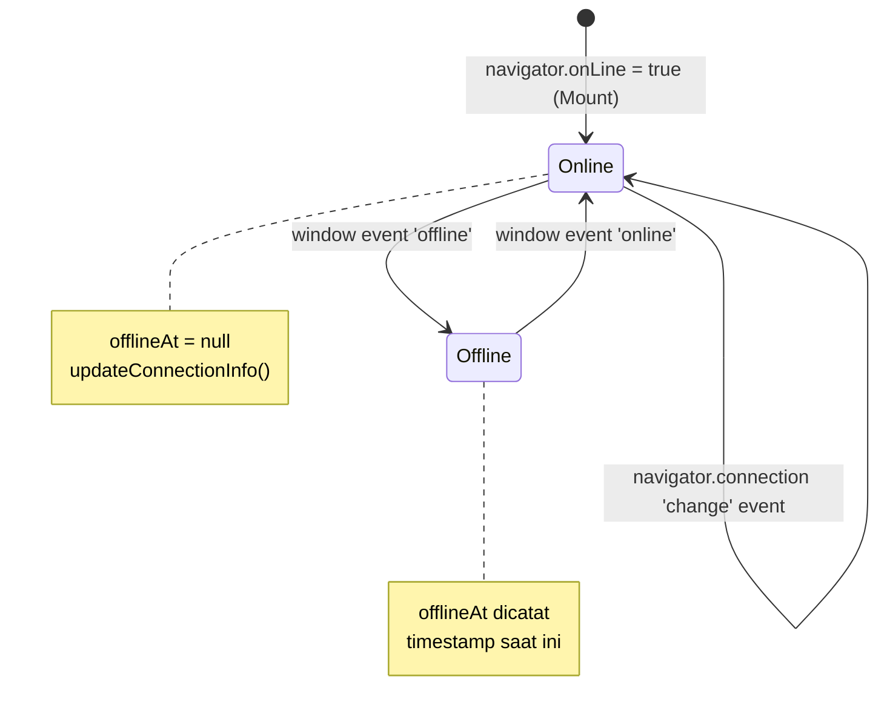

# useNetworkStatus (`useNetworkStatus.js`)

## 01. Overview

`useNetworkStatus` adalah composable yang melacak status koneksi jaringan internet browser secara reaktif. Composable ini mendengarkan event `online` dan `offline` bawaan browser serta membaca metadata kecepatan koneksi dari Network Information API, sehingga komponen Vue dapat merespons perubahan jaringan secara langsung.

### 1.1 Apa Entitas Ini

- **Tipe Artefak**: Composable Function (Vue 3 Composition API).
- **Lokasi Berkas Sumber**: [useNetworkStatus.js](file:///c:/SPEED/LARAVEL-PACK-UI/packages/laravel-pack-ui/resources/js/Composables/Pack/useNetworkStatus.js).
- **Ekspor Kunci**: `useNetworkStatus`.
- **Target Ekosistem**: Banner notifikasi offline, disable form saat tidak ada koneksi, pengambilan keputusan sinkronisasi di `useOfflineSync`.

### 1.2 Fungsi Utama

- Menyediakan `isOnline` sebagai `Ref<boolean>` yang berubah secara reaktif saat koneksi terhubung atau terputus.
- Mencatat waktu kapan koneksi terputus melalui `offlineAt`.
- Membaca metadata Network Information API: kecepatan downlink, RTT (Round-Trip Time), tipe koneksi (`4g`, `3g`, `wifi`, dll), dan status `saveData`.
- Membersihkan semua event listener secara otomatis saat komponen di-unmount.

### 1.3 Kapan Digunakan

- Banner atau toast "Anda sedang offline" yang muncul saat koneksi putus.
- Menonaktifkan tombol simpan atau submit saat tidak ada internet.
- Memicu proses sinkronisasi antrian offline saat koneksi kembali (`useOfflineSync`).
- Menampilkan indikator kualitas sinyal di header atau status bar aplikasi.

### 1.4 Karakteristik Penting

- **Event-Driven**: Mengandalkan event `online` dan `offline` dari `window`, bukan polling berkala, sehingga tidak ada overhead performa.
- **Network Information API**: Metadata kecepatan koneksi hanya tersedia di browser yang mendukung (Chrome/Android); di browser lain nilai-nilainya tetap `null`.
- **Auto-Cleanup**: Semua event listener dihapus di `onUnmounted`, termasuk listener `change` dari `navigator.connection`.
- **SSR Safe**: Seluruh akses ke `window` dan `navigator` dilindungi pengecekan `typeof window !== 'undefined'`.

---

## 02. Preview

> [!TIP]
> Pengujian fungsional dan showcase composable ini dapat diuji secara native pada portal pratinjau aplikasi:
>
> <a href="/preview" target="_self" style="display: inline-flex; align-items: center; gap: 6px; padding: 6px 14px; border-radius: 8px; font-weight: 600; text-decoration: none; margin-top: 8px; background-color: var(--vp-c-brand-1, #4f46e5); color: #ffffff;">Buka Live Preview Portal Komponen &rarr;</a>

---

## 03. Usage

### Peta Penggunaan Konseptual

```text
useNetworkStatus
├── Monitoring Status
│   ├── isOnline  → boolean reaktif (true/false)
│   └── offlineAt → timestamp kapan koneksi terputus
│
└── Metadata Koneksi (Network Information API)
    ├── effectiveType → '4g' | '3g' | '2g' | 'slow-2g'
    ├── downlink      → Estimasi bandwidth (Mbps)
    ├── rtt           → Round-trip time (ms)
    ├── saveData      → Mode hemat data aktif
    └── type          → 'wifi' | 'cellular' | 'ethernet' | 'none'
```

### Matriks Keputusan

| Kondisi | Rekomendasi |
| :--- | :--- |
| Hanya perlu tahu online/offline | `const { isOnline } = useNetworkStatus()` |
| Perlu waktu saat offline dimulai | Gunakan `offlineAt` |
| Perlu antrian request saat offline | Kombinasikan dengan `useOfflineSync` |
| Perlu kualitas koneksi untuk adaptasi UI | Gunakan `effectiveType` dan `downlink` |

---

## 04. Anatomy

### Hierarki Internal

```text
useNetworkStatus()
│
├── State Reaktif
│   ├── isOnline        → ref(navigator.onLine)
│   ├── offlineAt       → ref(null)
│   ├── downlink        → ref(null)
│   ├── downlinkMax     → ref(null)
│   ├── effectiveType   → ref(null)
│   ├── rtt             → ref(null)
│   ├── saveData        → ref(false)
│   └── type            → ref(null)
│
├── updateConnectionInfo()
│   └── Baca navigator.connection dan perbarui semua ref metadata
│
├── handleOnline()
│   ├── isOnline.value = true
│   ├── offlineAt.value = null
│   └── updateConnectionInfo()
│
├── handleOffline()
│   ├── isOnline.value = false
│   └── offlineAt.value = new Date()
│
├── onMounted
│   ├── addEventListener('online', handleOnline)
│   ├── addEventListener('offline', handleOffline)
│   └── navigator.connection.addEventListener('change', updateConnectionInfo)
│
└── onUnmounted
    ├── removeEventListener('online', handleOnline)
    ├── removeEventListener('offline', handleOffline)
    └── navigator.connection.removeEventListener('change', updateConnectionInfo)
```

### Diagram Alur Event Jaringan



---

## 05. Variants

Tidak ada varian mode. Semua informasi dikembalikan dalam satu panggilan `useNetworkStatus()`.

---

## 06. Sizes

Tidak relevan untuk composable ini.

---

## 07. States

| State | Nilai `isOnline` | Deskripsi |
| :--- | :---: | :--- |
| Browser terhubung internet | `true` | Kondisi normal |
| Browser terputus dari internet | `false` | Event `offline` terpicu |
| Browser tidak mendukung `onLine` | `true` | Fallback aman (tidak false-negative) |
| Network Information API tidak tersedia | `null` pada metadata | Browser tanpa dukungan API (Safari, Firefox) |

---

## 08. Props / Parameters

`useNetworkStatus()` tidak menerima parameter apapun.

---

## 09. Slots / Content

Tidak relevan.

---

## 10. Events / Interactions / Returns

### Return Object

| Properti | Tipe | Reaktif | Deskripsi |
| :--- | :--- | :---: | :--- |
| `isOnline` | `Ref<boolean>` | Ya | Status koneksi internet saat ini |
| `offlineAt` | `Ref<Date \| null>` | Ya | Timestamp saat koneksi terakhir terputus, `null` jika online |
| `downlink` | `Ref<number \| null>` | Ya | Estimasi bandwidth unduhan (Mbps) |
| `downlinkMax` | `Ref<number \| null>` | Ya | Bandwidth unduhan maksimum hardware |
| `effectiveType` | `Ref<string \| null>` | Ya | Tipe koneksi efektif: `'slow-2g'`, `'2g'`, `'3g'`, `'4g'` |
| `rtt` | `Ref<number \| null>` | Ya | Estimasi round-trip time (ms) |
| `saveData` | `Ref<boolean>` | Ya | `true` jika pengguna mengaktifkan mode hemat data |
| `type` | `Ref<string \| null>` | Ya | Tipe koneksi hardware: `'wifi'`, `'cellular'`, `'ethernet'`, `'none'` |
| `isSupported` | `boolean` | Tidak | `true` jika `window` dan `navigator` tersedia |

---

## 11. Code Example

### Basic: Banner Offline

```vue
<script setup>
import { useNetworkStatus } from '@/Composables/Pack/useNetworkStatus';

const { isOnline } = useNetworkStatus();
</script>

<template>
    <div v-if="!isOnline" class="fixed top-0 inset-x-0 z-50 bg-red-600 text-white text-center py-2 text-sm">
        Tidak ada koneksi internet. Beberapa fitur mungkin tidak tersedia.
    </div>
    <slot />
</template>
```

### Intermediate: Nonaktifkan Tombol Simpan saat Offline

```vue
<script setup>
import { useNotification } from '@/Composables/Pack/useNotification';
import { useNetworkStatus } from '@/Composables/Pack/useNetworkStatus';

const { isOnline } = useNetworkStatus();
const { warning } = useNotification();

const handleSave = () => {
    if (!isOnline.value) {
        warning('Tidak dapat menyimpan saat offline. Periksa koneksi internet Anda.');
        return;
    }
    // lanjutkan proses simpan
};
</script>

<template>
    <button @click="handleSave" :disabled="!isOnline" class="btn-primary">
        {{ isOnline ? 'Simpan' : 'Offline...' }}
    </button>
</template>
```

### Advanced: Watcher Koneksi untuk Pemicu Sinkronisasi

```vue
<script setup>
import { watch } from 'vue';
import { useNetworkStatus } from '@/Composables/Pack/useNetworkStatus';
import { useOfflineSync } from '@/Composables/Pack/useOfflineSync';

const { isOnline, offlineAt } = useNetworkStatus();
const { syncPendingQueue, queueCount } = useOfflineSync();

// Saat koneksi pulih, langsung sinkronisasi antrian offline
watch(isOnline, async (online) => {
    if (online && queueCount.value > 0) {
        await syncPendingQueue();
    }
});
</script>

<template>
    <div class="flex items-center gap-2 text-sm">
        <span :class="isOnline ? 'bg-emerald-500' : 'bg-red-500'" class="size-2 rounded-full" />
        <span>{{ isOnline ? 'Online' : 'Offline' }}</span>
        <span v-if="!isOnline && offlineAt" class="text-gray-500">
            Sejak {{ offlineAt.toLocaleTimeString('id-ID') }}
        </span>
    </div>
</template>
```

---

## 12. Result / Behavior

- Saat perangkat kehilangan koneksi, browser menembakkan event `offline`. `isOnline` menjadi `false` dan `offlineAt` diisi dengan `Date` saat ini.
- Saat koneksi pulih, event `online` ditembakkan. `isOnline` kembali `true`, `offlineAt` direset ke `null`, dan `updateConnectionInfo()` dijalankan untuk memperbarui metadata kecepatan.
- Nilai `isOnline` diinisialisasi dari `navigator.onLine` saat komponen dipasang, sehingga kondisi offline yang terjadi sebelum komponen di-mount juga terdeteksi.
- Jika browser tidak mendukung Network Information API (`navigator.connection` tidak ada), semua ref metadata (`downlink`, `rtt`, dll) tetap bernilai `null` dan tidak akan pernah diperbarui.

---

## 13. Customization

### Integrasi Notifikasi Toast Otomatis

```vue
<script setup>
import { watch } from 'vue';
import { useNetworkStatus } from '@/Composables/Pack/useNetworkStatus';
import { useNotification } from '@/Composables/Pack/useNotification';

const { isOnline } = useNetworkStatus();
const { error, success } = useNotification();

let wasOnline = isOnline.value;
watch(isOnline, (online) => {
    if (!online) {
        error('Koneksi terputus. Anda sedang dalam mode offline.', { duration: 0 });
    } else if (!wasOnline) {
        success('Koneksi kembali. Data akan disinkronkan.');
    }
    wasOnline = online;
});
</script>
```

---

## 14. Accessibility

Composable ini tidak menghasilkan elemen DOM. Saat menampilkan status jaringan di UI, pastikan:

- Gunakan elemen dengan `role="status"` dan `aria-live="polite"` agar perubahan status dapat diumumkan ke pembaca layar.
- Jangan mengandalkan warna saja sebagai indikator; sertakan teks label "Online" / "Offline".

---

## 15. Responsive Behavior

Tidak ada perilaku responsif khusus. Status jaringan bersifat global dan konsisten di semua ukuran viewport.

---

## 16. Do / Don't

**Lakukan:**

- Pasang `useNetworkStatus` di layout root (`AuthenticatedLayout.vue`) agar kondisi jaringan dimonitor sepanjang siklus hidup aplikasi.
- Kombinasikan `isOnline` dengan `useOfflineSync` untuk pola antrian offline-first yang andal.
- Tampilkan `offlineAt` kepada pengguna agar mereka tahu sudah berapa lama offline.

**Jangan:**

- Jangan menggunakan `isOnline` sebagai satu-satunya penjaga untuk validasi data penting; koneksi yang ada tidak menjamin server backend dapat dijangkau.
- Jangan berasumsi semua browser mendukung Network Information API; selalu periksa `null` sebelum menggunakan `effectiveType`, `downlink`, atau `rtt`.

---

## 17. Examples / Recipes

### Resep: Indikator Kualitas Sinyal

```vue
<script setup>
import { computed } from 'vue';
import { useNetworkStatus } from '@/Composables/Pack/useNetworkStatus';

const { isOnline, effectiveType, downlink } = useNetworkStatus();

const signalLabel = computed(() => {
    if (!isOnline.value) return 'Offline';
    const labels = { '4g': 'Sangat Cepat', '3g': 'Cepat', '2g': 'Lambat', 'slow-2g': 'Sangat Lambat' };
    return labels[effectiveType.value] || 'Terhubung';
});
</script>

<template>
    <span class="text-xs text-gray-500">{{ signalLabel }} {{ downlink ? `(${downlink} Mbps)` : '' }}</span>
</template>
```

---

## 18. Related Items

```text
useNetworkStatus
├── Composables Terkait
│   ├── useOfflineSync.js   → Menggunakan isOnline untuk memicu sinkronisasi antrian
│   └── useNotification.js  → Menampilkan toast saat status jaringan berubah
│
└── Komponen Terkait
    └── ToastNotification   → Wadah notifikasi toast offline
```

---

## 19. Notes / Limitations

- **Network Information API**: Hanya tersedia di Chrome 61+ dan browser berbasis Chromium. Firefox dan Safari saat ini tidak mendukung `navigator.connection`.
- **`isOnline` Tidak Sama dengan Koneksi Server**: `navigator.onLine` hanya mendeteksi apakah perangkat terhubung ke jaringan lokal atau tidak. Perangkat bisa "online" menurut browser namun server backend tidak dapat dijangkau (captive portal, server down).
- **Event Berbasis Push, Bukan Poll**: Pembaruan `isOnline` hanya terjadi saat browser menembakkan event. Tidak ada mekanisme polling berkala.
