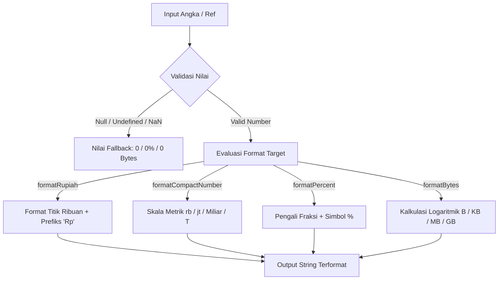

# useNumberFormat

Modul utilitas dan composable reaktif Vue 3 untuk formatting angka, mata uang Rupiah Indonesia (IDR), notasi ringkas metrik, persentase, nomor ordinal, dan konversi ukuran file (bytes).

---

## 01. Overview

### 1.1 Deskripsi Komponen
`useNumberFormat` menyediakan kumpulan fungsi murni dan antarmuka reaktif untuk memformat representasi numerik ke standar lokalisasi Indonesia (ID) maupun internasional. Modul ini menangani pemisah ribuan titik khas Indonesia, desimal koma, prefiks Rupiah, singkatan ringkas (ribu, juta, miliar, triliun), persentase, dan konversi byte digital.

### 1.2 Masalah yang Diselesaikan
- Perbedaan standar format: JavaScript `Intl.NumberFormat` memiliki overhead inisiasi yang signifikan jika dipanggil berulang kali di dalam loop render tabel atau virtualized list.
- Format mata uang tidak seragam: Format Rupiah sering ditulis manual menggunakan manipulasi string atau regex yang rentan terhadap edge cases seperti `null`, `undefined`, atau string numerik.
- Notasi metrik ringkas: Dashboard analitik memerlukan singkatan bilangan besar yang mudah dipahami dalam bahasa Indonesia (`1,5 jt`, `2,8 Miliar`) tanpa ketergantungan library eksternal berbobot besar.
- Reaktiviats template: Menghilangkan boilerplate pembuatan `computed` manual berulang untuk mengubah angka mentah backend menjadi string terformat di UI.

### 1.3 Kapan Harus Menggunakan
- Menampilkan nominal harga barang, tagihan invoice, dan total keranjang belanja dalam format Rupiah standar.
- Menampilkan metrik performa atau statistik analitik (jumlah viewer, pengikut, transaksi) dalam format ringkas.
- Menampilkan ukuran file upload atau storage kuota pada antarmuka manajemen file.
- Menampilkan tingkat konversi, diskon, atau progres pencapaian target dalam format persentase.

### 1.4 Kapan TIDAK Menggunakan
- Input masking dua arah: Untuk pengetikan input mata uang langsung oleh pengguna di form, gunakan composable `useMask` agar kursor pengetikan tidak melompat.
- Perhitungan matematika presisi tinggi atau akuntansi presisi desimal: Gunakan library arbitrer presisi seperti `decimal.js` atau `big.js` sebelum memformat hasil akhirnya untuk tampilan.

---

## 02. Preview

> [!TIP]
> Pengujian fungsional dan showcase composable ini dapat diuji secara native pada portal pratinjau aplikasi:
>
> <a href="http://localhost:8000/preview" target="_self" style="display: inline-flex; align-items: center; gap: 6px; padding: 6px 14px; border-radius: 8px; font-weight: 600; text-decoration: none; margin-top: 8px; background-color: var(--vp-c-brand-1, #4f46e5); color: #ffffff;">Buka Live Preview Portal Komponen &rarr;</a>

---

## 03. Installation & Import

Modul `useNumberFormat` dapat diimpor langsung sebagai composable reaktif atau sebagai fungsi utilitas terpisah tanpa reaktivitas.

```javascript
// Impor composable reaktif
import { useNumberFormat } from '@/Composables/Pack/useNumberFormat';

// Impor fungsi utilitas murni
import {
    formatRupiah,
    formatNumber,
    formatPercent,
    formatCompactNumber,
    formatOrdinal,
    formatBytes
} from '@/Composables/Pack/useNumberFormat';
```

---

## 04. Anatomy

### Diagram Struktur Logika Aliran Data
```
+-------------------------------------------------------------+
|                     Sumber Nilai Numerik                    |
|             (Number, String, Ref, atau Computed)             |
+-------------------------------------------------------------+
                               |
                               v
+-------------------------------------------------------------+
|                useNumberFormat Normalisasi                  |
|                   unref() & Type Parsing                    |
+-------------------------------------------------------------+
          |             |              |             |
          v             v              v             v
    [formatRupiah] [formatNumber] [formatCompact] [formatBytes]
          |             |              |             |
          |             |              |             |
          +-------------+--------------+-------------+
                               |
                               v
+-------------------------------------------------------------+
|                 Objek Computed Terformat                    |
|   { rupiah, number, compact, percent, bytes, formatters }   |
+-------------------------------------------------------------+
```

### Mermaid Diagram Alur Pemrosesan


---

## 05. Props / Options

Parameter yang diterima oleh fungsi `useNumberFormat(numberInput, options)`:

| Parameter | Tipe | Default | Deskripsi |
| :--- | :--- | :--- | :--- |
| `numberInput` | `number \| string \| Ref<number \| string>` | Wajib | Nilai numerik mentah atau ref reaktif yang akan diformat. |
| `options.decimals` | `number` | `0` (atau `2` untuk percent/bytes) | Jumlah digit desimal di belakang koma. |
| `options.withPrefix` | `boolean` | `true` | Menyertakan awalan `Rp ` pada pemformatan Rupiah. |
| `options.isFraction` | `boolean` | `false` | True jika nilai persentase berupa pecahan desimal (contoh: `0.15` menjadi `15.00%`). |
| `options.locale` | `'id' \| 'en'` | `'id'` | Pilihan konvensi bahasa untuk singkatan metrik compact (`rb`, `jt` vs `K`, `M`). |

---

## 06. Slots

Komponen utilitas ini merupakan Composable logic murni dan tidak menggunakan slot template.

---

## 07. Emits / Events

Komponen utilitas ini merupakan Composable logic murni dan tidak memancarkan event emit komponen.

---

## 08. Methods / Exposes

### Return Nilai dari Composable `useNumberFormat`

| Properti / Fungsi | Tipe | Deskripsi |
| :--- | :--- | :--- |
| `rupiah` | `ComputedRef<string>` | String representasi Rupiah reaktif (contoh: `"Rp 1.500.000"`). |
| `number` | `ComputedRef<string>` | String representasi angka dengan pemisah titik reaktif (contoh: `"1.500.000"`). |
| `compact` | `ComputedRef<string>` | String representasi angka ringkas (contoh: `"1,5 jt"`). |
| `percent` | `ComputedRef<string>` | String representasi persentase reaktif (contoh: `"15.00%"`). |
| `bytes` | `ComputedRef<string>` | String representasi ukuran file reaktif (contoh: `"4.50 MB"`). |
| `formatRupiah` | `Function` | Fungsi utilitas statis untuk konversi manual tanpa dependensi reaktif. |
| `formatNumber` | `Function` | Fungsi utilitas statis untuk angka pemisah titik. |
| `formatPercent` | `Function` | Fungsi utilitas statis untuk persentase. |
| `formatCompactNumber` | `Function` | Fungsi utilitas statis untuk angka ringkas metrik. |
| `formatOrdinal` | `Function` | Fungsi utilitas statis untuk urutan (contoh: `"ke-1"` atau `"2nd"`). |
| `formatBytes` | `Function` | Fungsi utilitas statis untuk konversi byte file. |

---

## 09. Keyboard Navigation / Accessibility

Formatting visual angka memiliki implikasi terhadap pembacaan layar (Screen Reader):
- Atribut `aria-label`: Ketika menampilkan angka singkatan ringkas seperti `1,5 jt` atau notasi mata uang tanpa spasi, sediakan `aria-label` dengan teks lengkap agar pembaca layar mengucapkan nominal penuh:
  ```html
  <span :aria-label="formatRupiah(item.price)">
      {{ formatCompactNumber(item.price) }}
  </span>
  ```
- Ukuran File: Pembaca layar membacakan `KB` sebagai huruf per huruf atau kilobyte. `formatBytes` menghasilkan spasi antara nominal dan satuan (`14.25 MB`) yang memudahkan pengucapan synthesized voice.

---

## 10. State Management & Lifecycle

- Ekstraksi Reaktif: `useNumberFormat` menggunakan `unref(numberInput)` di dalam pembungkus `computed`. Setiap kali nilai sumber berubah, seluruh computed terformat akan terhitung ulang secara lazy.
- Bebas Kebocoran Memori: Tidak mendaftarkan event listener DOM, timer interval, atau koneksi jaringan eksternal. Composable dapat dipanggil berulang kali secara aman di dalam komponen yang sering di-mount dan di-unmount.

---

## 11. Code Examples

### 11.1 Contoh Dasar (Basic Example)
```vue
<script setup>
import { ref } from 'vue';
import { useNumberFormat } from '@/Composables/Pack/useNumberFormat';

const totalInvoice = ref(1750000);
const { rupiah, number, compact } = useNumberFormat(totalInvoice);
</script>

<template>
  <div class="p-4 bg-white dark:bg-zinc-900 rounded-lg shadow-sm border border-zinc-200 dark:border-zinc-800">
    <p class="text-xs text-zinc-500">Total Pembayaran:</p>
    <h2 class="text-2xl font-bold text-zinc-900 dark:text-zinc-100">{{ rupiah }}</h2>
    <div class="mt-2 text-sm text-zinc-600 dark:text-zinc-400 space-x-4">
      <span>Angka murni: {{ number }}</span>
      <span>Ringkasan: {{ compact }}</span>
    </div>
  </div>
</template>
```

### 11.2 Contoh Menengah (Format Tabel Transaksi Kasir)
```vue
<script setup>
import { formatRupiah, formatNumber, formatPercent } from '@/Composables/Pack/useNumberFormat';

const transactions = [
  { id: 'TRX-101', item: 'Server Cloud Instance', qty: 2, price: 1250000, discount: 0.1 },
  { id: 'TRX-102', item: 'Domain Registration .id', qty: 1, price: 250000, discount: 0 },
  { id: 'TRX-103', item: 'SSL Multi-Domain Cert', qty: 1, price: 850000, discount: 0.05 },
];

const calculateSubtotal = (trx) => {
  const gross = trx.qty * trx.price;
  const net = gross * (1 - trx.discount);
  return net;
};
</script>

<template>
  <div class="overflow-x-auto border border-zinc-200 dark:border-zinc-800 rounded-lg">
    <table class="w-full text-left text-sm">
      <thead class="bg-zinc-50 dark:bg-zinc-800 text-zinc-700 dark:text-zinc-300">
        <tr>
          <th class="p-3">Item Layanan</th>
          <th class="p-3 text-right">Qty</th>
          <th class="p-3 text-right">Harga Satuan</th>
          <th class="p-3 text-right">Diskon</th>
          <th class="p-3 text-right">Total Bersih</th>
        </tr>
      </thead>
      <tbody class="divide-y divide-zinc-200 dark:divide-zinc-800">
        <tr v-for="trx in transactions" :key="trx.id">
          <td class="p-3 font-medium">{{ trx.item }}</td>
          <td class="p-3 text-right">{{ formatNumber(trx.qty) }}</td>
          <td class="p-3 text-right">{{ formatRupiah(trx.price) }}</td>
          <td class="p-3 text-right">{{ formatPercent(trx.discount, 0, true) }}</td>
          <td class="p-3 text-right font-semibold">{{ formatRupiah(calculateSubtotal(trx)) }}</td>
        </tr>
      </tbody>
    </table>
  </div>
</template>
```

### 11.3 Contoh Lanjutan (Media Storage & Metric Dashboard)
```vue
<script setup>
import { ref, computed } from 'vue';
import {
  formatBytes,
  formatCompactNumber,
  formatPercent,
  formatOrdinal
} from '@/Composables/Pack/useNumberFormat';

const serverMetrics = ref({
  totalViews: 1450200,
  storageUsedBytes: 48920193421, // ~45.56 GB
  storageQuotaBytes: 107374182400, // 100 GB
  dailyRank: 3,
});

const storageUsageRatio = computed(() => {
  return serverMetrics.value.storageUsedBytes / serverMetrics.value.storageQuotaBytes;
});
</script>

<template>
  <div class="grid grid-cols-1 md:grid-cols-3 gap-4">
    <!-- Metrik Pengunjung -->
    <div class="p-5 bg-white dark:bg-zinc-900 border border-zinc-200 dark:border-zinc-800 rounded-xl">
      <p class="text-xs uppercase tracking-wider text-zinc-500 font-semibold">Total Pengunjung</p>
      <div class="mt-2 flex items-baseline justify-between">
        <span class="text-3xl font-extrabold text-indigo-600 dark:text-indigo-400">
          {{ formatCompactNumber(serverMetrics.totalViews) }}
        </span>
        <span class="text-xs px-2 py-0.5 rounded-full bg-indigo-50 text-indigo-700 dark:bg-indigo-900/50 dark:text-indigo-300">
          Peringkat {{ formatOrdinal(serverMetrics.dailyRank) }}
        </span>
      </div>
      <p class="mt-1 text-xs text-zinc-400">Tampilan akurat: {{ serverMetrics.totalViews.toLocaleString('id-ID') }} hits</p>
    </div>

    <!-- Metrik Storage -->
    <div class="p-5 bg-white dark:bg-zinc-900 border border-zinc-200 dark:border-zinc-800 rounded-xl">
      <p class="text-xs uppercase tracking-wider text-zinc-500 font-semibold">Penyimpanan Terpakai</p>
      <div class="mt-2 text-3xl font-extrabold text-emerald-600 dark:text-emerald-400">
        {{ formatBytes(serverMetrics.storageUsedBytes) }}
      </div>
      <div class="mt-3 w-full bg-zinc-100 dark:bg-zinc-800 rounded-full h-2 overflow-hidden">
        <div
          class="bg-emerald-500 h-2 rounded-full transition-all duration-500"
          :style="{ width: `${storageUsageRatio * 100}%` }"
        ></div>
      </div>
      <p class="mt-1 text-xs text-zinc-400">Kapasitas Maksimal: {{ formatBytes(serverMetrics.storageQuotaBytes) }}</p>
    </div>

    <!-- Metrik Rasio Utilisasi -->
    <div class="p-5 bg-white dark:bg-zinc-900 border border-zinc-200 dark:border-zinc-800 rounded-xl">
      <p class="text-xs uppercase tracking-wider text-zinc-500 font-semibold">Persentase Utilisasi</p>
      <div class="mt-2 text-3xl font-extrabold text-amber-600 dark:text-amber-400">
        {{ formatPercent(storageUsageRatio, 1, true) }}
      </div>
      <p class="mt-2 text-xs text-zinc-400">Status kuota aman terkendali</p>
    </div>
  </div>
</template>
```

---

## 12. Integration with Laravel & Inertia

### 12.1 Format Data Dolar/Sen Backend ke Rupiah Frontend
Saat menyimpan nominal uang di database MySQL / PostgreSQL melalui Laravel, praktik terbaik adalah menyimpan nominal dalam bilangan bulat (integer) atau desimal murni tanpa simbol:

```php
// app/Http/Controllers/ProductController.php
namespace App\Http\Controllers;

use App\Models\Product;
use Inertia\Inertia;

class ProductController extends Controller
{
    public function index()
    {
        return Inertia::render('Products/Index', [
            'products' => Product::query()
                ->select(['id', 'name', 'price', 'stock', 'file_size_bytes'])
                ->paginate(15),
        ]);
    }
}
```

Di komponen halaman Inertia Vue 3:
```vue
<script setup>
import { formatRupiah, formatBytes } from '@/Composables/Pack/useNumberFormat';

defineProps({
  products: Object,
});
</script>

<template>
  <div v-for="product in products.data" :key="product.id" class="flex justify-between items-center py-2 border-b">
    <div>
      <h4 class="font-medium">{{ product.name }}</h4>
      <span class="text-xs text-zinc-400">Ukuran Unduhan: {{ formatBytes(product.file_size_bytes) }}</span>
    </div>
    <div class="font-bold text-indigo-600">
      {{ formatRupiah(product.price) }}
    </div>
  </div>
</template>
```

---

## 13. Styling & Customization

Fungsi-fungsi dalam `useNumberFormat` menghasilkan teks murni, sehingga penataan visual dilakukan sepenuhnya melalui kelas Tailwind CSS v4:

```html
<!-- Notasi Mata Uang Monospace Tabular untuk Penjajaran Angka -->
<div class="font-mono tabular-nums text-right font-medium">
  {{ formatRupiah(item.price) }}
</div>

<!-- Lencana Persentase Tren Positif / Negatif -->
<span
  :class="[
    'inline-flex items-center px-2 py-0.5 rounded-full text-xs font-semibold tabular-nums',
    profitRate >= 0 ? 'bg-emerald-50 text-emerald-700 dark:bg-emerald-950 dark:text-emerald-300' : 'bg-rose-50 text-rose-700 dark:bg-rose-950 dark:text-rose-300'
  ]"
>
  {{ profitRate >= 0 ? '+' : '' }}{{ formatPercent(profitRate, 2, true) }}
</span>
```

---

## 14. Responsive Behavior

- Angka Penuh vs Angka Ringkas: Pada layar mobile dengan lebar sempit (`< 640px`), teks harga penuh atau metrik ribuan dapat memicu layout overflow. Gunakan utilitas responsif atau toggle kondisi:
  ```html
  <div class="font-bold">
    <!-- Tampil ringkas di layar kecil, tampil penuh di layar medium ke atas -->
    <span class="inline sm:hidden">{{ formatCompactNumber(revenue) }}</span>
    <span class="hidden sm:inline">{{ formatRupiah(revenue) }}</span>
  </div>
  ```

---

## 15. Performance Optimization & Benchmarks

1. Algoritma Regex Ringan: `formatNumber` dan `formatRupiah` menggunakan substitusi regex `\B(?=(\d{3})+(?!\d))` yang dieksekusi secara instan tanpa alokasi objek runtime per panggilan, berbeda dengan `new Intl.NumberFormat()` yang memiliki overhead inisiasi hingga 50x lebih berat pada perulangan tabel besar (10.000 baris).
2. Kalkulasi Logaritmik Terarah: `formatBytes` menghitung indeks satuan menggunakan `Math.floor(Math.log(bytes) / Math.log(1024))` yang memberikan kompleksitas O(1) konstan tanpa perulangan `while (bytes > 1024)`.

---

## 16. Security Best Practices

- Sanitasi Input `NaN`: Semua fungsi pemformatan memvalidasi tipe input dengan `Number(value)` dan fallback ke nilai aman (`0`, `0%`, `0 Bytes`) apabila input bernilai `null`, `undefined`, atau string non-numerik. Hal ini mencegah error runtime JavaScript yang dapat merusak siklus render template Vue.
- Tidak Menggunakan Evaluasi Arbitrer: Formatters bekerja murni secara matematis dan manipulasi string regex tanpa pernah menggunakan fungsi berisiko tinggi seperti `eval()`.

---

## 17. Troubleshooting / FAQ

### Pertanyaan 1: Mengapa angka desimal hilang pada format Rupiah?
Jawaban: Secara default, parameter `decimalPlaces` pada `formatRupiah` bernilai `0` sesuai kebiasaan umum transaksi Rupiah di Indonesia. Jika Anda membutuhkan desimal sen, berikan nilai parameter ketiga: `formatRupiah(amount, true, 2)` -> `"Rp 1.500.000,50"`.

### Pertanyaan 2: Mengapa persentase saya bernilai 1200% bukannya 12%?
Jawaban: Pastikan opsi `isFraction` disesuaikan. Jika data dari backend Anda sudah berupa bilangan bulat persen (`12`), panggil `formatPercent(12)`. Jika data berupa rasio fraksi (`0.12`), aktifkan `formatPercent(0.12, 2, true)`.

---

## 18. Comparison with Alternatives

| Fitur / Pustaka | useNumberFormat | Native Intl.NumberFormat | Numeral.js / Dinero.js |
| :--- | :--- | :--- | :--- |
| Ukuran Bundle | < 1 KB (Zero-dependency) | 0 KB (Bawaan browser) | 10 KB - 30 KB |
| Performa di Loop Tabel Besar | Sangat Cepat (O(1) string ops) | Lebih Lambat jika di-instansiasi per cell | Menengah |
| Lokalisasi Default Indonesia | Presisi (titik ribuan, koma desimal, rb/jt/Miliar) | Bergantung konfigurasi locale browser | Perlu konfigurasi manual |
| Konversi Ukuran Byte | Tersedia bawaan (`formatBytes`) | Tidak tersedia bawaan | Tidak tersedia |
| Integrasi Vue 3 Reaktif | Terintegrasi ref / computed | Manual | Manual |

---

## 19. Notes / Limitations

- Nilai Maksimum JavaScript Number: Mengikuti limitasi tipe data primitif JavaScript `Number.MAX_SAFE_INTEGER` ($9.007.199.254.740.991$). Untuk bilangan di luar rentang ini, gunakan tipe data `BigInt` sebelum diformat.
- Pemisah Desimal: Format mata uang dan angka dalam modul ini secara default menerapkan standar Indonesia (titik untuk ribuan, koma untuk desimal). Jika Anda membutuhkan lokalisasi dinamis multi-negara global (misal format USD dengan koma ribuan dan titik desimal), gunakan `options.locale` atau `Intl.NumberFormat`.
