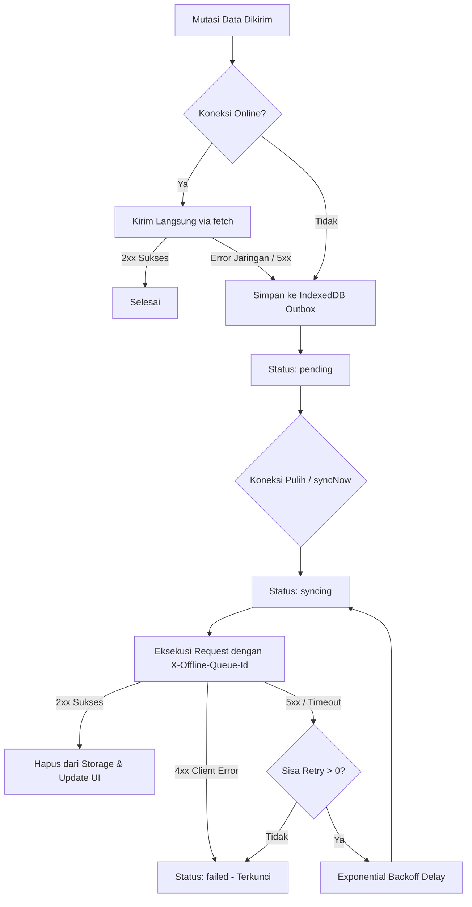

# useOfflineSync

Modul composable enterprise Vue 3 yang mengimplementasikan Outbox Pattern untuk aplikasi offline-first. Menyimpan mutasi data ke IndexedDB browser saat offline dan menyinkronkannya secara otomatis dengan exponential backoff saat koneksi pulih, tanpa ketergantungan Service Worker.

---

## 01. Overview

### 1.1 Deskripsi Komponen
`useOfflineSync` adalah solusi manajemen antrean mutasi data (Outbox Pattern) sisi klien. Ketika koneksi internet terputus atau tidak stabil, operasi pembuatan, pembaruan, dan penghapusan data (POST, PUT, PATCH, DELETE) secara transparan dialihkan dan disimpan ke dalam basis data browser IndexedDB (dengan fallback otomatis ke `localStorage`). Begitu koneksi internet pulih, sistem secara otomatis mengeksekusi antrean tersebut secara berurutan (FIFO) ke server backend.

### 1.2 Masalah yang Diselesaikan
- Kehilangan Data Saat Koneksi Putus: Pengguna yang mengisi formulir transaksi panjang di lapangan sering kehilangan seluruh input data saat jaringan seluler tiba-tiba hilang di tengah proses submit.
- Kegagalan Jaringan Sementara: Mengatasi galat jaringan sesaat (network drop, DNS timeout, atau server 5xx) dengan mekanisme coba ulang otomatis (retry) berbasis exponential backoff.
- Ketergantungan Service Worker: Tidak semua aplikasi memerlukan konfigurasi Service Worker atau PWA yang kompleks. Composable ini murni berjalan di runtime browser standar.
- Pengalaman Pengguna Terhenti (Blocking UI): Memungkinkan aplikasi tetap responsif dan menerima input pengguna meskipun perangkat dalam status terputus dari internet.

### 1.3 Kapan Harus Menggunakan
- Aplikasi kasir (POS), pemesanan resto, atau logistik pengantaran barang yang harus beroperasi tanpa gangguan sinyal.
- Formulir survei lapangan, inspeksi teknis, atau pencatatan inventaris di lokasi terpencil.
- Fitur penulisan konten atau draf yang membutuhkan garansi tersimpan di server saat koneksi internet kembali stabil.

### 1.4 Kapan TIDAK Menggunakan
- Operasi Baca (Read/GET Requests): Outbox Pattern hanya ditujukan untuk mutasi data yang mengubah state di backend. Untuk caching data tampilan saat offline, gunakan Cache API atau Service Worker.
- Transaksi Finansial Real-Time Ketat: Jangan gunakan untuk operasi yang memerlukan konfirmasi saldo instan sebelum barang diserahkan (misal validasi saldo e-wallet seketika).

---

## 02. Preview

> [!TIP]
> Pengujian fungsional dan showcase composable ini dapat diuji secara native pada portal pratinjau aplikasi:
>
> <a href="/preview" target="_self" style="display: inline-flex; align-items: center; gap: 6px; padding: 6px 14px; border-radius: 8px; font-weight: 600; text-decoration: none; margin-top: 8px; background-color: var(--vp-c-brand-1, #4f46e5); color: #ffffff;">Buka Live Preview Portal Komponen &rarr;</a>

---

## 03. Installation & Import

Modul `useOfflineSync` diimpor langsung dari direktori Composables:

```javascript
import { useOfflineSync } from '@/Composables/Pack/useOfflineSync';
```

---

## 04. Anatomy

### Diagram Struktur Penyimpanan & Aliran Outbox
```
+-------------------------------------------------------------+
|             Aksi Pengguna (Form Submit / Mutasi Data)       |
+-------------------------------------------------------------+
                               |
                               v
+-------------------------------------------------------------+
|                 send() Evaluasi Status Jaringan              |
+-------------------------------------------------------------+
          |                                   |
    [Online Nyata]                     [Offline / Error]
          |                                   |
          v                                   v
+-----------------------+           +-----------------------+
|  fetch() ke Server    |           |  enqueue() ke Outbox  |
|  - 2xx: Sukses        |           |  - Simpan ke IndexedDB|
|  - 5xx/Drop: Masuk    |           |  - Fallback: LocalStrg|
|    ke Outbox Queue    |           |  - Status: 'pending'  |
+-----------------------+           +-----------------------+
                                              |
                                              v
+-------------------------------------------------------------+
|              Penyelarasan Otomatis (Auto-Sync FIFO)         |
|  1. Event 'online' terdeteksi atau pemanggilan syncNow()    |
|  2. Kirim item berurutan dengan jeda Exponential Backoff    |
|  3. Respon 2xx -> Hapus item dari IndexedDB                 |
|  4. Respon 4xx -> Tandai 'failed' (kunci retry otomatis)    |
+-------------------------------------------------------------+
```

### Mermaid Diagram Siklus Hidup Antrean


---

## 05. Props / Options

Parameter konfigurasi yang diterima oleh fungsi `useOfflineSync(options)`:

| Parameter | Tipe | Default | Deskripsi |
| :--- | :--- | :--- | :--- |
| `options.dbName` | `string` | `'pack_offline_outbox'` | Nama database IndexedDB lokal browser. |
| `options.storeName` | `string` | `'outbox_queue'` | Nama ObjectStore di dalam IndexedDB. |
| `options.autoSync` | `boolean` | `true` | Otomatis memproses antrean begitu event jaringan `online` terdeteksi. |
| `options.maxRetries` | `number` | `3` | Batas maksimal percobaan pengiriman ulang untuk galat jaringan/5xx. |
| `options.baseRetryDelayMs` | `number` | `2000` | Waktu jeda dasar untuk perhitungan exponential backoff ($2^n \times \text{delay}$). |
| `options.pingUrl` | `string` | `''` | URL endpoint untuk memverifikasi koneksi nyata via HTTP HEAD handshake. |
| `options.onItemSuccess` | `Function` | `null` | Callback saat sebuah item antrean sukses disinkronkan `(item, response) => void`. |
| `options.onItemFailed` | `Function` | `null` | Callback saat sebuah item antrean gagal diproses `(item, error) => void`. |
| `options.onSyncComplete` | `Function` | `null` | Callback saat seluruh antrean selesai diproses `({ total, succeeded, failed }) => void`. |

---

## 06. Slots

Komponen utilitas ini merupakan Composable logic murni dan tidak menggunakan slot template.

---

## 07. Emits / Events

Komponen utilitas ini merupakan Composable logic murni dan tidak memancarkan event emit komponen.

---

## 08. Methods / Exposes

### Return Nilai dari Composable `useOfflineSync`

| Properti / Fungsi | Tipe | Deskripsi |
| :--- | :--- | :--- |
| `queue` | `Ref<Array>` | Array reaktif berisi seluruh item antrean mutasi yang tersimpan di storage. |
| `isOnline` | `ComputedRef<boolean>` | Status koneksi efektif (memperhitungkan flag `simulateOffline`). |
| `isSyncing` | `Ref<boolean>` | Bernilai `true` saat proses sinkronisasi antrean sedang berlangsung. |
| `isPaused` | `Ref<boolean>` | Bernilai `true` jika dispatcher dihentikan sementara via `pause()`. |
| `simulateOffline` | `Ref<boolean>` | Ref Boolean untuk memaksa mode offline bagi kebutuhan testing developer. |
| `pendingCount` | `ComputedRef<number>` | Jumlah total item berstatus `pending` atau `syncing`. |
| `failedCount` | `ComputedRef<number>` | Jumlah item yang gagal permanen (melebihi batas retry atau error 4xx). |
| `totalCount` | `ComputedRef<number>` | Total seluruh item yang berada di antrean. |
| `enqueue(job)` | `Function` | Menambahkan pekerjaan mutasi baru ke IndexedDB secara manual. |
| `send(config)` | `Function` | Helper pengiriman pintar (kirim langsung jika online, fallback antrean jika offline). |
| `syncNow()` | `Function` | Memicu pemrosesan antrean outbox secara manual seketika. |
| `retryItem(id)` | `Function` | Mengatur ulang counter retry dan mencoba mengirim ulang item yang gagal. |
| `removeItem(id)` | `Function` | Menghapus item tertentu dari IndexedDB dan state memori. |
| `clearQueue()` | `Function` | Menghapus seluruh antrean dari IndexedDB dan memori. |
| `pause()` | `Function` | Menghentikan sementara pemrosesan antrean otomatis. |
| `resume()` | `Function` | Melanjutkan kembali pemrosesan antrean dan memicu sync jika online. |
| `refreshQueue()` | `Function` | Memuat ulang seluruh data dari storage ke memori reaktif. |

---

## 09. Keyboard Navigation / Accessibility

Penyelarasan data offline memerlukan transparansi status untuk pengguna dengan alat bantu (Screen Reader):
- Pengumuman Status Offline: Saat koneksi terputus, pastikan antarmuka menampilkan elemen banner dengan `role="status"` dan `aria-live="polite"` agar screen reader mengumumkan bahwa data disimpan secara lokal.
- Indikator Antrean Tersisa: Tombol pemicu sinkronisasi manual harus menyertakan label aksesibel yang jelas:
  ```html
  <button :aria-label="`Sinkronkan ${pendingCount} transaksi tertunda`" @click="syncNow">
      Sinkronkan ({{ pendingCount }})
  </button>
  ```

---

## 10. State Management & Lifecycle

- Ketahanan Multi-Layer: Composable membuka IndexedDB versi 1 dengan ObjectStore `outbox_queue`. Jika browser berada dalam mode privasi ketat yang memblokir IndexedDB, sistem secara otomatis mengalihkan penyimpanan ke `localStorage`.
- Self-Healing State: Jika pengguna me-refresh atau menutup tab browser saat item berada di tengah-tengah pengiriman (status `syncing`), fungsi `refreshQueue()` saat siklus `onMounted` akan otomatis mereset status item tersebut kembali ke `pending` agar tidak tertinggal selamanya.
- Pembersihan Listener Otomatis: Event listener jendela browser (`online` dan `offline`) otomatis didaftarkan pada `onMounted` dan dicabut pada `onUnmounted`.

---

## 11. Code Examples

### 11.1 Contoh Dasar (Submit Transaksi dengan `send`)
```vue
<script setup>
import { ref } from 'vue';
import { useOfflineSync } from '@/Composables/Pack/useOfflineSync';
import { useNotification } from '@/Composables/Pack/useNotification';

const { send, isOnline, pendingCount } = useOfflineSync();
const { success, warning, error } = useNotification();

const orderForm = ref({ customer: '', total: 0 });

const handleSubmit = async () => {
  const result = await send({
    url: '/api/orders',
    method: 'POST',
    data: orderForm.value,
    title: `Pesanan ${orderForm.value.customer}`,
  });

  if (result.queued) {
    warning('Koneksi terputus: Pesanan disimpan di perangkat dan akan dikirim saat online.');
  } else if (result.success) {
    success('Pesanan berhasil tersimpan di server!');
  } else {
    error(`Gagal mengirim data: ${result.error?.message}`);
  }
};
</script>

<template>
  <form @submit.prevent="handleSubmit" class="space-y-4 max-w-md p-4 border rounded-xl">
    <div v-if="!isOnline" class="p-2 bg-amber-50 text-amber-800 text-xs rounded-lg">
      Anda sedang offline. Data akan disimpan ke Outbox antrean lokal.
    </div>

    <div>
      <label class="block text-xs font-semibold mb-1">Nama Pelanggan:</label>
      <input v-model="orderForm.customer" type="text" class="w-full px-3 py-2 border rounded-lg" required />
    </div>

    <button type="submit" class="w-full py-2 bg-indigo-600 text-white font-medium rounded-lg text-sm">
      Simpan Pesanan
    </button>
  </form>
</template>
```

### 11.2 Contoh Menengah (Panel Monitor Antrean dengan Kontrol Tindakan)
```vue
<script setup>
import { useOfflineSync } from '@/Composables/Pack/useOfflineSync';

const { queue, isSyncing, pendingCount, failedCount, syncNow, retryItem, removeItem } = useOfflineSync();
</script>

<template>
  <div class="border border-zinc-200 dark:border-zinc-800 rounded-2xl p-5 bg-white dark:bg-zinc-900 space-y-4">
    <div class="flex justify-between items-center">
      <div>
        <h3 class="font-bold text-zinc-900 dark:text-zinc-100">Antrean Sinkronisasi Offline</h3>
        <p class="text-xs text-zinc-500">{{ pendingCount }} menunggu, {{ failedCount }} gagal permanen</p>
      </div>
      <button
        type="button"
        :disabled="isSyncing || pendingCount === 0"
        class="px-4 py-2 bg-emerald-600 hover:bg-emerald-700 disabled:opacity-50 text-white rounded-xl text-xs font-semibold"
        @click="syncNow"
      >
        {{ isSyncing ? 'Menyinkronkan...' : 'Sinkronkan Sekarang' }}
      </button>
    </div>

    <div class="divide-y divide-zinc-100 dark:divide-zinc-800">
      <div v-for="item in queue" :key="item.id" class="py-3 flex justify-between items-center text-xs">
        <div>
          <p class="font-semibold text-zinc-800 dark:text-zinc-200">{{ item.title }}</p>
          <p class="text-zinc-400 font-mono">{{ item.method }} {{ item.url }}</p>
          <p v-if="item.lastError" class="text-rose-500 mt-0.5">{{ item.lastError }}</p>
        </div>
        <div class="flex gap-2">
          <button v-if="item.status === 'failed'" class="text-indigo-600 hover:underline" @click="retryItem(item.id)">
            Coba Lagi
          </button>
          <button class="text-rose-600 hover:underline" @click="removeItem(item.id)">
            Hapus
          </button>
        </div>
      </div>
      <p v-if="queue.length === 0" class="text-center py-4 text-zinc-400 text-xs">Semua data telah tersinkronisasi.</p>
    </div>
  </div>
</template>
```

### 11.3 Contoh Lanjutan (Konfigurasi Enterprise dengan Handshake Ping & Idempotency)
```javascript
import { useOfflineSync } from '@/Composables/Pack/useOfflineSync';
import { useNotification } from '@/Composables/Pack/useNotification';

const { success, error } = useNotification();

export const offlineDispatcher = useOfflineSync({
    dbName: 'enterprise_pos_db',
    storeName: 'sales_outbox',
    pingUrl: '/api/health-check', // Verifikasi koneksi nyata
    maxRetries: 5,
    baseRetryDelayMs: 1500,
    onItemSuccess: (item, res) => {
        success(`Transaksi "${item.title}" berhasil disinkronkan ke server.`);
    },
    onItemFailed: (item, err) => {
        if (item.retryCount >= 5) {
            error(`Transaksi "${item.title}" gagal setelah 5 percobaan. Hubungi teknisi.`);
        }
    },
    onSyncComplete: ({ succeeded, failed }) => {
        console.log(`[Outbox] Sinkronisasi tuntas: ${succeeded} sukses, ${failed} gagal.`);
    },
});
```

---

## 12. Integration with Laravel & Inertia

### 12.1 Penanganan Idempotency dan Header di Backend Laravel
Setiap request dari `dispatchItem` menyertakan dua header khusus:
- `X-Offline-Queue-Id`: UUID unik item antrean dari browser.
- `X-Client-Updated-At`: Timestamp ISO saat aksi dilakukan oleh pengguna di perangkat lokal.

Controller Laravel dapat menggunakan header ini untuk mencegah duplikasi data transaksi (Idempotency Key):

```php
// app/Http/Controllers/OrderController.php
namespace App\Http\Controllers;

use App\Models\Order;
use Illuminate\Http\Request;
use Illuminate\Support\Facades\Cache;

class OrderController extends Controller
{
    public function store(Request $request)
    {
        $queueId = $request->header('X-Offline-Queue-Id');

        // Jika request berasal dari antrean outbox offline, cegah duplikasi
        if ($queueId) {
            $lockKey = "offline_job_{$queueId}";
            if (Cache::has($lockKey)) {
                return response()->json(['message' => 'Transaksi sudah diproses sebelumnya.'], 200);
            }
            Cache::put($lockKey, true, now()->addDays(7));
        }

        $validated = $request->validate([
            'customer' => 'required|string',
            'amount' => 'required|numeric',
        ]);

        $order = Order::create([
            'customer' => $validated['customer'],
            'amount' => $validated['amount'],
            'client_timestamp' => $request->header('X-Client-Updated-At', now()),
        ]);

        return response()->json($order, 201);
    }
}
```

---

## 13. Styling & Customization

Penataan antarmuka status antrean outbox diatur menggunakan kelas Tailwind CSS v4:

```html
<!-- Lencana Status Indikator di Header Aplikasi -->
<div class="inline-flex items-center gap-2 px-3 py-1 rounded-full text-xs font-medium border border-zinc-200 dark:border-zinc-800 bg-white dark:bg-zinc-900">
  <span class="w-2 h-2 rounded-full" :class="isOnline ? 'bg-emerald-500' : 'bg-rose-500'"></span>
  <span class="text-zinc-700 dark:text-zinc-300">
    {{ isOnline ? 'Tersambung' : 'Mode Offline' }}
  </span>
  <span v-if="pendingCount > 0" class="ml-1 px-1.5 py-0.5 rounded-full bg-amber-100 text-amber-800 dark:bg-amber-950 dark:text-amber-300 font-mono text-[10px]">
    {{ pendingCount }}
  </span>
</div>
```

---

## 14. Responsive Behavior

Panel antrean sinkronisasi dirancang modular dan fluid. Pada layar smartphone (`< 640px`), tumpukan antrean menampilkan judul dan status dalam format vertikal satu kolom untuk memastikan teks URL atau pesan galat tidak memicu overflow horizontal.

---

## 15. Performance Optimization & Benchmarks

1. Transaksi Asinkron Non-Blocking: Pembacaan dan penulisan ke IndexedDB menggunakan API Promise asinkron yang berjalan di luar thread render utama Vue, mencegah frame rate UI turun saat menyimpan payload data besar.
2. Pemrosesan FIFO Terkendali: Request dikirimkan satu per satu (sekuensial), bukan secara paralel ugal-ugalan (`Promise.all`). Hal ini menjaga integritas urutan transaksi di sisi database backend dan mencegah kemacetan koneksi pada jaringan berkecepatan rendah.

---

## 16. Security Best Practices

- Injeksi Otomatis Token CSRF: `dispatchItem` dan `send` secara otomatis membaca token CSRF Laravel dari `<meta name="csrf-token">` dan menyematkannya ke header `X-CSRF-TOKEN`.
- Penanganan Token Kedaluwarsa: Jika antrean disimpan terlalu lama saat perangkat offline, sesi otentikasi atau token CSRF mungkin kedaluwarsa. Server akan mengembalikan `401 Unauthorized` atau `419 Page Expired`. Sistem menandai status item menjadi `failed` dan memanggil `onItemFailed` sehingga aplikasi dapat meminta pengguna login ulang tanpa menghapus data antrean lokal yang belum tersimpan.

---

## 17. Troubleshooting / FAQ

### Pertanyaan 1: Mengapa item dengan error validasi 422 tidak dicoba ulang (retry)?
Jawaban: Ini adalah mekanisme perlindungan sistem. Error 4xx (seperti 422 Unprocessable Content atau 401 Unauthorized) disebabkan oleh data input yang tidak memenuhi syarat atau izin akses yang ditolak. Mengirim ulang data yang sama tanpa perbaikan hanya akan membuang kuota data pengguna.

### Pertanyaan 2: Apakah data antrean aman jika tab browser ditutup?
Jawaban: Ya. Seluruh antrean disimpan secara permanen di IndexedDB browser perangkat pengguna. Saat tab browser dibuka kembali di kemudian waktu, data akan dimuat ulang ke memori melalui pemanggilan otomatis `refreshQueue()`.

---

## 18. Comparison with Alternatives

| Fitur / Pustaka | useOfflineSync (Pack UI) | Workbox Background Sync | Manual LocalStorage Queue |
| :--- | :--- | :--- | :--- |
| Kebutuhan Service Worker | Tidak Perlu (Zero config) | Wajib Service Worker | Tidak Perlu |
| Penyimpanan Primer | IndexedDB (Kapasitas Besar) | IndexedDB via SW | LocalStorage (Limit 5MB) |
| Integrasi Reaktif Vue 3 | Terintegrasi Penuh (Ref & Computed) | Harus polling manual | Harus buat ref manual |
| Idempotency & CSRF Laravel | Bawaan (`X-CSRF-TOKEN`) | Harus dikonfigurasi | Manual |
| Exponential Backoff Retry | Terintegrasi bawaan | Dikelola browser | Manual |

---

## 19. Notes / Limitations

- Keterbatasan Background Saat Tab Ditutup: Karena berjalan di konteks tab Vue dan bukan Service Worker latar belakang murni (Background Sync API), proses pengiriman antrean hanya dapat berlangsung selama tab atau jendela aplikasi tetap terbuka di browser.
- Ukuran Kuota Storage: Meskipun IndexedDB memiliki kuota yang jauh lebih besar daripada `localStorage` (ratusan megabyte tergantung ruang disk kosong perangkat), hindari menyimpan berkas media biner raksasa (video/raw images) di dalam antrean teks tanpa kompresi terlebih dahulu.
