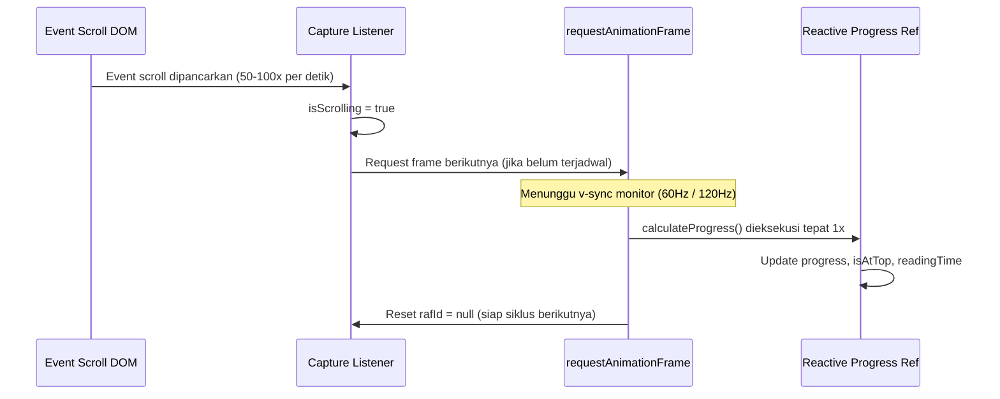

# useScrollProgress

Modul composable Vue 3 performa tinggi untuk melacak progres scroll (0–100%) jendela browser maupun kontainer elemen lokal dengan sinkronisasi `requestAnimationFrame`, estimasi sisa waktu membaca, dan helper navigasi `scrollToTop`.

---

## 01. Overview

### 1.1 Deskripsi Komponen
`useScrollProgress` adalah composable yang mendeteksi dan menghitung pergeseran scroll secara akurat. Modul ini secara cerdas mampu mendeteksi kontainer scroll aktif di dalam tata letak aplikasi (seperti tag `<main>` atau elemen dengan kelas `overflow-y-auto`) maupun scroll dokumen utama (`window`). Untuk mencegah penurunan frame rate (jank), pembaruan state dikunci menggunakan API browser `window.requestAnimationFrame`.

### 1.2 Masalah yang Diselesaikan
- Layout Thrashing & Scroll Jank: Event listener `scroll` konvensional dapat terpanggil puluhan kali dalam satu frame render monitor (terutama pada layar 120Hz/144Hz), menyebabkan reflow DOM yang membebani CPU. `useScrollProgress` membatasi kalkulasi tepat 1 kali per siklus frame.
- Inkonsistensi Kontainer Layout SPA / Inertia: Pada dashboard modern, scroll sering kali terjadi bukan di level `window`, melainkan di dalam elemen kontainer `<main class="overflow-y-auto">`. Composable ini otomatis mendeteksi kontainer aktif tanpa mengharuskan pengembang menulis selector berulang.
- Pembersihan Listener Bocor (Memory Leak): Mengotomatisasi pendaftaran dan pembersihan capture event listener pada siklus `onMounted` dan `onUnmounted`.
- Estimasi Waktu Baca Statis: Menghitung sisa menit membaca artikel secara dinamis berdasarkan persentase scroll aktual dan jumlah kata konten.

### 1.3 Kapan Harus Menggunakan
- Menampilkan bilah progres pembacaan (Reading Progress Bar) di bagian atas artikel atau dokumen panjang.
- Tombol mengapung "Kembali ke Atas" (Back to Top) yang muncul dinamis saat pengguna menggulir ke bawah (`!isAtTop`).
- Mengaktifkan animasi atau penanda navigasi bab (Scrollspy) berdasarkan persentase scroll halaman.
- Menampilkan indikator persentase penyelesaian pada formulir bertahap panjang atau syarat & ketentuan (Terms of Service).

### 1.4 Kapan TIDAK Menggunakan
- Deteksi Elemen Tertentu Masuk ke Viewport: Untuk mendeteksi apakah sebuah kartu gambar atau footer sudah terlihat di layar (Lazy Loading atau Reveal on Scroll), gunakan `IntersectionObserver` bawaan browser karena lebih hemat daya baterai.
- Infinite Scroll Pagination: Untuk memuat data tabel otomatis saat scroll mendekati bawah, gunakan composable `useServerTable`.

---

## 02. Preview

> [!TIP]
> Pengujian fungsional dan showcase composable ini dapat diuji secara native pada portal pratinjau aplikasi:
>
> <a href="/preview" target="_self" style="display: inline-flex; align-items: center; gap: 6px; padding: 6px 14px; border-radius: 8px; font-weight: 600; text-decoration: none; margin-top: 8px; background-color: var(--vp-c-brand-1, #4f46e5); color: #ffffff;">Buka Live Preview Portal Komponen &rarr;</a>

---

## 03. Installation & Import

Modul `useScrollProgress` diimpor langsung dari direktori Composables:

```javascript
import { useScrollProgress } from '@/Composables/Pack/useScrollProgress';
```

---

## 04. Anatomy

### Diagram Struktur Aliran Data
```
+-------------------------------------------------------------+
|               Event Scroll Terdeteksi di DOM                |
|             (Window, Main, atau Element Ref)                |
+-------------------------------------------------------------+
                               |
                               v
+-------------------------------------------------------------+
|                 handleCaptureScroll Listener                |
|       - Pasang isScrolling = true (debounce 350ms)          |
|       - Jadwalkan requestAnimationFrame (RAF)               |
+-------------------------------------------------------------+
                               |
                               v
+-------------------------------------------------------------+
|                    calculateProgress()                      |
|       - Baca scrollTop, clientHeight, scrollHeight          |
|       - Hitung: (scrollTop / totalScrollable) * 100         |
|       - Normalisasi batas: 0.0 sampai 100.0                 |
+-------------------------------------------------------------+
                               |
                               v
+-------------------------------------------------------------+
|                   Output State Reaktif                      |
|  { progress, isAtTop, isComplete, readingTimeRemaining, ... }|
+-------------------------------------------------------------+
```

### Mermaid Diagram Siklus requestAnimationFrame


---

## 05. Props / Options

Parameter konfigurasi yang diterima oleh fungsi `useScrollProgress(options)`:

| Parameter | Tipe | Default | Deskripsi |
| :--- | :--- | :--- | :--- |
| `options.target` | `'auto' \| 'window' \| string \| Ref<HTMLElement> \| HTMLElement` | `'auto'` | Target elemen scroll. `'auto'` mendeteksi window atau kontainer `overflow-y-auto` terdekat secara otomatis. |
| `options.threshold` | `number` | `1` | Batas toleransi persentase atas (properti `isAtTop` bernilai true jika `progress <= threshold`). |
| `options.wordsCount` | `number` | `0` | Jumlah kata konten untuk menghitung estimasi waktu membaca tersisa. |
| `options.wordsPerMinute` | `number` | `200` | Asumsi kecepatan baca kata per menit (WPM). Standar umum artikel adalah 150-250 WPM. |

---

## 06. Slots

Komponen utilitas ini merupakan Composable logic murni dan tidak menggunakan slot template.

---

## 07. Emits / Events

Komponen utilitas ini merupakan Composable logic murni dan tidak memancarkan event emit komponen.

---

## 08. Methods / Exposes

### Return Nilai dari Composable `useScrollProgress`

| Properti / Fungsi | Tipe | Deskripsi |
| :--- | :--- | :--- |
| `progress` | `Ref<number>` | Nilai persentase scroll dalam rentang `0.0` sampai `100.0` (1 digit desimal). |
| `scrollPercent` | `ComputedRef<number>` | Nilai persentase dalam format desimal `0.0` sampai `1.0`. |
| `scrollTop` | `Ref<number>` | Jarak pergeseran scroll dari posisi teratas dalam satuan pixel. |
| `scrollHeight` | `Ref<number>` | Tinggi total keseluruhan konten di dalam kontainer target (pixel). |
| `clientHeight` | `Ref<number>` | Tinggi area pandang (viewport) kontainer target yang terlihat (pixel). |
| `isScrolling` | `Ref<boolean>` | Bernilai `true` saat pengguna sedang aktif melakukan scroll (kembali false setelah 350ms idle). |
| `isAtTop` | `ComputedRef<boolean>` | Bernilai `true` jika posisi scroll berada di posisi puncak (sesuai `threshold`). |
| `isComplete` | `ComputedRef<boolean>` | Bernilai `true` jika scroll telah mencapai bagian paling bawah (`progress >= 99.5`). |
| `readingTimeRemaining` | `ComputedRef<number>` | Perkiraan sisa waktu yang dibutuhkan untuk menyelesaikan membaca konten (dalam menit). |
| `scrollToTop(behavior)` | `Function` | Menggulir kontainer target kembali ke posisi paling atas (`0px`). Default `behavior: 'smooth'`. |
| `scrollToProgress(pct, behavior)` | `Function` | Menggulir kontainer target ke persentase tertentu (`0` sampai `100`). |
| `calculateProgress()` | `Function` | Memicu kalkulasi ulang metrik scroll secara manual tanpa menunggu event scroll. |

---

## 09. Keyboard Navigation / Accessibility

Interaksi scroll memiliki aspek aksesibilitas yang perlu dipertimbangkan:
- Preferensi Gerak Berkurang (`prefers-reduced-motion`): Fungsi `scrollToTop` dan `scrollToProgress` menerima parameter `behavior`. Untuk pengguna dengan sensitivitas gerak, sesuaikan perilakunya ke `'auto'` alih-alih animasi `'smooth'`:
  ```javascript
  const prefersReducedMotion = window.matchMedia('(prefers-reduced-motion: reduce)').matches;
  scrollToTop(prefersReducedMotion ? 'auto' : 'smooth');
  ```
- Tombol Kembali ke Atas: Tombol pemicu wajib menyertakan atribut penjelas `aria-label="Kembali ke bagian atas halaman"` agar mudah dikenali oleh perangkat Screen Reader.

---

## 10. State Management & Lifecycle

- Sinkronisasi Siklus Hidup Browser: Composable mendaftarkan passive capture listener pada event `scroll` dan `resize`. Menggunakan opsi `{ passive: true }` menjamin browser bahwa event listener tidak akan memanggil `preventDefault()`, sehingga rendering scroll tetap berjalan pada thread kompositor perangkat keras secara lancar.
- Pembersihan Sumber Daya Otomatis: Saat komponen Vue di-unmount (`onUnmounted`), listener DOM dilepas, `cancelAnimationFrame` dipanggil untuk membatalkan antrean frame yang belum selesai, dan timer idle `isScrolling` dibersihkan dari memori.

---

## 11. Code Examples

### 11.1 Contoh Dasar (Bilah Progres Membaca Halaman)
```vue
<script setup>
import { useScrollProgress } from '@/Composables/Pack/useScrollProgress';

const { progress } = useScrollProgress();
</script>

<template>
  <!-- Bilah progres mengapung di paling atas jendela browser -->
  <div class="fixed top-0 left-0 right-0 h-1 bg-zinc-200 dark:bg-zinc-800 z-50">
    <div
      class="h-full bg-indigo-600 dark:bg-indigo-500 transition-all duration-100 ease-out"
      :style="{ width: `${progress}%` }"
    ></div>
  </div>
</template>
```

### 11.2 Contoh Menengah (Tombol Back to Top Melayang & Estimasi Waktu)
```vue
<script setup>
import { useScrollProgress } from '@/Composables/Pack/useScrollProgress';

const { isAtTop, progress, readingTimeRemaining, scrollToTop } = useScrollProgress({
  wordsCount: 1200,
  wordsPerMinute: 200,
  threshold: 5,
});
</script>

<template>
  <div class="relative">
    <header class="p-4 border-b text-xs text-zinc-500 flex justify-between">
      <span>Artikel Publikasi</span>
      <span v-if="readingTimeRemaining > 0">Sisa waktu baca: ~{{ readingTimeRemaining }} menit</span>
    </header>

    <!-- Tombol Mengapung Kembali ke Atas -->
    <transition
      enter-active-class="transition duration-200 ease-out"
      enter-from-class="opacity-0 translate-y-4"
      enter-to-class="opacity-100 translate-y-0"
      leave-active-class="transition duration-150 ease-in"
      leave-from-class="opacity-100 translate-y-0"
      leave-to-class="opacity-0 translate-y-4"
    >
      <button
        v-if="!isAtTop"
        type="button"
        aria-label="Kembali ke atas"
        class="fixed bottom-6 right-6 p-3 rounded-full bg-indigo-600 hover:bg-indigo-700 text-white shadow-xl transition-transform hover:scale-110 z-40 flex items-center justify-center"
        @click="scrollToTop('smooth')"
      >
        <span class="material-symbols-outlined text-lg">arrow_upward</span>
      </button>
    </transition>
  </div>
</template>
```

### 11.3 Contoh Lanjutan (Target Kontainer Scroll Kustom dalam Modal Dokumen)
```vue
<script setup>
import { ref } from 'vue';
import { useScrollProgress } from '@/Composables/Pack/useScrollProgress';

const termsContainerRef = ref(null);

const { progress, isComplete, scrollToProgress } = useScrollProgress({
  target: termsContainerRef,
  threshold: 1,
});

const isAgreed = ref(false);
</script>

<template>
  <div class="max-w-xl p-6 bg-white dark:bg-zinc-900 border border-zinc-200 dark:border-zinc-800 rounded-2xl shadow-xl space-y-4">
    <div class="flex justify-between items-center">
      <h3 class="font-bold text-zinc-900 dark:text-zinc-100">Syarat & Ketentuan Layanan</h3>
      <span class="text-xs font-mono font-semibold px-2.5 py-1 rounded-full bg-zinc-100 dark:bg-zinc-800 text-zinc-700 dark:text-zinc-300">
        {{ Math.round(progress) }}% Terbaca
      </span>
    </div>

    <!-- Kotak Scroll Khusus -->
    <div
      ref="termsContainerRef"
      class="h-60 overflow-y-auto p-4 rounded-xl border border-zinc-200 dark:border-zinc-800 bg-zinc-50 dark:bg-zinc-950 text-xs text-zinc-600 dark:text-zinc-400 space-y-3"
    >
      <p>1. Ketentuan Penggunaan Akun...</p>
      <p>2. Kebijakan Privasi dan Perlindungan Data Pribadi...</p>
      <p>3. Batasan Tanggung Jawab Hukum...</p>
      <p>4. Prosedur Pembatalan Transaksi...</p>
      <p class="font-semibold text-zinc-900 dark:text-zinc-100">5. Penutup: Harap gulir hingga bagian ini untuk mengaktifkan tombol persetujuan.</p>
    </div>

    <!-- Kontrol Persetujuan hanya aktif jika sudah di-scroll hingga tuntas -->
    <div class="flex items-center justify-between pt-2">
      <button
        type="button"
        class="text-xs text-indigo-600 dark:text-indigo-400 hover:underline"
        @click="scrollToProgress(100)"
      >
        Lompat ke Akhir Syarat
      </button>

      <button
        type="button"
        :disabled="!isComplete"
        class="px-5 py-2.5 rounded-xl bg-indigo-600 hover:bg-indigo-700 disabled:opacity-40 disabled:cursor-not-allowed text-white font-medium text-xs transition-colors"
      >
        Saya Menyetujui Ketentuan
      </button>
    </div>
  </div>
</template>
```

---

## 12. Integration with Laravel & Inertia

### 12.1 Penanganan Reset Scroll pada Navigasi Halaman Inertia
Inertia.js secara default mempertahankan atau mereset posisi scroll saat pengguna berpindah halaman. Untuk memastikan progress bar kembali ke `0%` saat halaman baru dimuat, panggil `calculateProgress()` setelah event navigasi selesai:

```vue
<script setup>
import { onMounted } from 'vue';
import { router } from '@inertiajs/vue3';
import { useScrollProgress } from '@/Composables/Pack/useScrollProgress';

const { progress, calculateProgress } = useScrollProgress();

onMounted(() => {
  // Hitung ulang progress setiap kali navigasi halaman Inertia selesai
  router.on('finish', () => {
    calculateProgress();
  });
});
</script>

<template>
  <div class="fixed top-0 left-0 right-0 h-1 z-50">
    <div class="h-full bg-indigo-600" :style="{ width: `${progress}%` }"></div>
  </div>
</template>
```

---

## 13. Styling & Customization

Penataan komponen progres scroll memanfaatkan kelas utilitas Tailwind CSS v4:

```html
<!-- Bilah Progres dengan Efek Gradien Glowing -->
<div class="fixed top-0 left-0 right-0 h-1 z-50">
  <div
    class="h-full bg-linear-to-r from-blue-600 via-indigo-500 to-purple-600 shadow-[0_0_8px_rgba(99,102,241,0.5)] transition-all duration-100 ease-out"
    :style="{ width: `${progress}%` }"
  ></div>
</div>

<!-- Lencana Persentase Mengapung Minimalis -->
<span class="inline-flex items-center px-2 py-0.5 rounded-md font-mono text-xs bg-zinc-100 dark:bg-zinc-800 text-zinc-800 dark:text-zinc-200">
  {{ Math.round(progress) }}%
</span>
```

---

## 14. Responsive Behavior

- Deteksi Penyesuaian Viewport (Resize): Composable memasang listener pada event `window.addEventListener('resize')`. Ketika orientasi smartphone berganti dari potret ke lanskap atau ukuran window desktop diubah, `calculateProgress()` dieksekusi ulang secara instan sehingga nilai persentase tetap akurat.

---

## 15. Performance Optimization & Benchmarks

1. Eliminasi Frame Drops: Pendekatan `requestAnimationFrame` memastikan kalkulasi hanya dieksekusi sebelum browser melakukan paint ke monitor, menjaga refresh rate aplikasi tetap di 60fps/120fps tanpa freeze.
2. Passive Event Listeners: Menggunakan opsi `{ passive: true }` mencegah browser menunggu apakah kode JavaScript akan membatalkan event default scroll, sehingga thread scrolling perangkat keras berjalan secara independen.

---

## 16. Security Best Practices

- Proteksi Selector DOM: Metode `document.querySelector` di dalam composable memeriksa kecocokan instance `instanceof HTMLElement` sebelum mengakses properti `scrollTop` atau `scrollHeight`, mencegah error eksepsi runtime jika selector tidak valid.

---

## 17. Troubleshooting / FAQ

### Pertanyaan 1: Mengapa nilai progress selalu bernilai 0% meskipun halaman bisa di-scroll?
Jawaban: Ini biasanya terjadi jika scroll terjadi di dalam elemen kontainer ber-CSS kustom (misal layout dashboard SPA) dan bukan di `window`. Berikan referensi elemen template (`ref`) ke opsi `target: containerRef` untuk menargetkan kontainer tersebut secara eksplisit.

### Pertanyaan 2: Mengapa `readingTimeRemaining` bernilai 0?
Jawaban: Pastikan Anda menyertakan opsi `wordsCount` dengan angka lebih besar dari 0 saat memanggil `useScrollProgress({ wordsCount: totalKata })`. Jika opsi ini diabaikan, estimasi waktu baca otomatis dinonaktifkan.

---

## 18. Comparison with Alternatives

| Fitur / Karakteristik | useScrollProgress (Pack UI) | VueUse useScroll | ScrollMagic / Waypoints |
| :--- | :--- | :--- | :--- |
| Ukuran Pustaka | < 1 KB (Zero-dependency) | ~10 KB | ~35 KB (Legacy) |
| Sinkronisasi requestAnimationFrame | Terintegrasi Bawaan | Terintegrasi | Menggunakan interval manual |
| Estimasi Waktu Baca Konten | Didukung (`readingTimeRemaining`) | Tidak Ada | Tidak Ada |
| Helper Navigasi Lompat | Bawaan (`scrollToProgress`, `scrollToTop`) | Bawaan | Rumit |
| Auto-detect Kontainer SPA | Ya (deteksi tag `<main>`) | Hanya window / ref manual | Manual selector |

---

## 19. Notes / Limitations

- Konten Dinamis yang Bertambah (Dynamic Ingestion): Jika konten di dalam kontainer bertambah secara dinamis (seperti komentar baru atau load more AJAX) tanpa memicu scroll, panggil `calculateProgress()` secara manual agar `scrollHeight` dan `progress` diperbarui.
- Server-Side Rendering (SSR): Seluruh logika yang berinteraksi dengan API browser (`window`, `document`) dibungkus dalam pengecekan `typeof window !== 'undefined'`, sehingga aman dijalankan pada lingkungan SSR Node.js tanpa memicu error `ReferenceError: window is not defined`.
