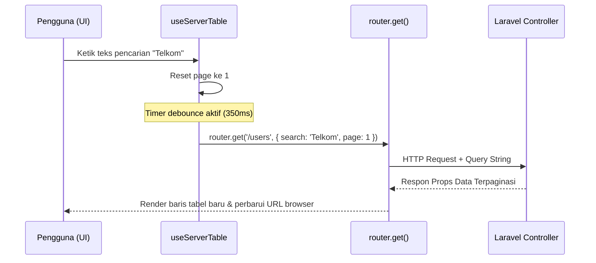

# useServerTable (`useServerTable.js`)

## 01. Overview

`useServerTable` adalah composable Vue 3 untuk mengelola dan menyinkronkan status tabel data *server-side* (pencarian debounced, pengurutan kolom, filter kustom bertingkat, dan paginasi halaman) secara dua arah (*two-way*) dengan parameter *query string* URL browser di aplikasi Laravel Inertia.

### 1.1 Apa Entitas Ini

- **Tipe Artefak**: Composable Function (Vue 3 Composition API).
- **Lokasi Berkas Sumber**: [useServerTable.js](file:///c:/SPEED/LARAVEL-PACK-UI/packages/laravel-pack-ui/resources/js/Composables/Pack/useServerTable.js).
- **Ekspor Kunci**: `useServerTable`.
- **Target Ekosistem**: Halaman tabel data master, log audit transaksi, indeks pengguna, dan antarmuka katalog produk berbasis Laravel Inertia.

### 1.2 Fungsi Utama

- Menghubungkan input pencarian secara reaktif dengan mekanisme *debounce* otomatis (default 350ms) agar tidak membanjiri server dengan request setiap penekanan tombol keyboard.
- Mengelola status pengurutan kolom (*sorting*) dua arah: klik pertama mengurutkan secara *ascending*, klik kedua membalik menjadi *descending*.
- Menyaring parameter kosong atau bernilai default sebelum dikirimkan ke URL, menjaga *query string* browser tetap bersih dan mudah dibagikan (*shareable*).
- Mendukung fitur *partial reload* Inertia (`only: ['resourceName']`) untuk memperbarui data tabel tanpa merender ulang layout shell atau header halaman.
- Membaca parameter awal secara otomatis dari URL saat halaman pertama kali dibuka atau di-refresh oleh pengguna.
- Menyediakan mode *mock* (`mock: true`) untuk pengujian komponen tanpa memicu request HTTP Inertia.

### 1.3 Kapan Digunakan

- Seluruh halaman tabel data Inertia yang datanya dipaginasi di sisi server (menggunakan Laravel `$query->paginate()`).
- Tabel data yang membutuhkan fitur bookmarking URL (pengguna dapat menyalin URL dan membagikannya ke rekan kerja dengan filter dan halaman yang sama persis).
- Antarmuka pencarian data yang membutuhkan interaksi cepat tanpa tombol "Cari" manual.

### 1.4 Karakteristik Penting

- **Integrasi History Replace**: Menggunakan opsi `replace: true` secara default sehingga pengetikan pencarian tidak mencemari riwayat navigasi tombol *Back* pada browser pengguna.
- **Preserve Scroll & State**: Menjaga posisi scroll layar pengguna (`preserveScroll: true`) agar halaman tidak melonjak ke atas saat berpindah baris atau mengubah filter.
- **Kompatibel Rute Ziggy**: Mendukung nama rute Ziggy Laravel (`routeName: 'admin.orders.index'`) maupun path URL relatif (`/admin/orders`).

---

## 02. Preview

> [!TIP]
> Pengujian fungsional dan showcase composable ini dapat diuji secara native pada portal pratinjau aplikasi:
>
> <a href="/preview" target="_self" style="display: inline-flex; align-items: center; gap: 6px; padding: 6px 14px; border-radius: 8px; font-weight: 600; text-decoration: none; margin-top: 8px; background-color: var(--vp-c-brand-1, #4f46e5); color: #ffffff;">Buka Live Preview Portal Komponen &rarr;</a>

---

## 03. Usage

### Pohon Konsep Penggunaan

```text
useServerTable
├── Input Pencarian (search)
│   └── Debounce otomatis (350ms)
│       └── Reset page = 1
│
├── Pengurutan Kolom (applySort)
│   ├── Kolom Sama  → Toggle asc / desc
│   └── Kolom Beda  → Ganti kolom & reset ke asc
│
├── Filter Kustom (filters)
│   ├── Filter Kategori / Status Dropdown
│   ├── Rentang Tanggal (Date Range)
│   └── Watcher reaktif otomatis
│
├── Paginasi (page & perPage)
│   ├── goToPage(n)
│   └── perPage selector (10, 25, 50, 100)
│
└── Siklus Navigasi Inertia
    ├── router.get(url, queryParams)
    ├── preserveState: true
    └── preserveScroll: true
```

### Matriks Keputusan: Server-side Table vs Client-side Table

| Skenario | Server-side (`useServerTable`) | Client-side Table |
| :--- | :--- | :--- |
| **Volume Data** | Ribuan hingga jutaan baris data | < 200 baris data |
| **Paginasi** | Menggunakan database `LIMIT` & `OFFSET` | Array slice di memori browser |
| **Kecepatan Awal** | Cepat (hanya menarik 10-25 data pertama) | Lambat jika seluruh data diunduh di awal |
| **Kebutuhan Bookmark URL** | Wajib (state tersimpan di URL query) | Opsional |

---

## 04. Anatomy

### Hierarki Modul Tekstual

```text
useServerTable.js
│
├── State Reader
│   └── getInitialQuery()     → Membaca window.location.search saat inisialisasi
│
├── State Reaktif
│   ├── search: Ref<string>
│   ├── sortColumn: Ref<string>
│   ├── sortDirection: Ref<'asc' | 'desc'>
│   ├── perPage: Ref<number>
│   ├── page: Ref<number>
│   ├── filters: Reactive<Object>
│   └── isLoading: Ref<boolean>
│
├── Pipeline Eksekusi
│   ├── queryParams (Computed) → Parameter bersih yang dikirim ke router
│   ├── resolveUrl()           → Resolusi Ziggy route vs path relatif
│   ├── executeVisit()         → Pemanggilan router.get() Inertia
│   └── triggerDebouncedVisit()→ Penundaan via setTimeout
│
└── Action Handlers
    ├── applySort(column)
    ├── handleSort(column)     (Alias applySort)
    ├── setFilter(key, value)
    ├── goToPage(pageNumber)
    ├── resetFilters()
    └── reload()
```

### Diagram Alur Siklus Navigasi (Mermaid)



---

## 05. Variants

Composable dapat dijalankan dalam beberapa mode integrasi:

| Mode | Konfigurasi | Karakteristik |
| :--- | :--- | :--- |
| **Inertia Ziggy Route** | `routeName: 'users.index'` | Menghubungkan secara otomatis ke helper `route()` Ziggy bawaan Laravel. |
| **Relative Path** | `routeName: '/api/v1/orders'` | Menggunakan path URL string langsung. |
| **Current URL Fallback** | `routeName: ''` | Menggunakan URL halaman aktif (`window.location.pathname`). |
| **Mock Mode** | `mock: true` | Memperbarui URL query string menggunakan `history.replaceState` tanpa mengirimkan HTTP request; ideal untuk testing dan preview UI. |

---

## 06. Sizes

Konfigurasi baris data per halaman (`perPage`) yang umum digunakan:

| Opsi `perPage` | Waktu Respon Database | Kasus Penggunaan Ideal |
| :--- | :--- | :--- |
| `10` *(Default)* | Sangat Cepat (< 20ms) | Standar tampilan mobile dan laptop standar. |
| `25` | Cepat | Tampilan tabel kerja admin pada monitor lebar. |
| `50` / `100` | Sedang | Analisis batch atau ekspor visual lokal. |

---

## 07. States

| Status Reaktif | Indikator Nilai | Dampak Antarmuka |
| :--- | :--- | :--- |
| **Idle** | `isLoading.value === false` | Tabel dalam kondisi statis menampilkan data. |
| **Loading** | `isLoading.value === true` | Request jaringan sedang berjalan; tampilkan skeleton atau overlay redup pada tabel. |

---

## 08. Props / Parameters / Attributes

### Parameter Opsi `useServerTable(options)`

| Parameter | Tipe Data | Wajib | Default | Deskripsi |
| :--- | :--- | :--- | :--- | :--- |
| `routeName` | `String` | Tidak | `''` | Nama rute Ziggy Laravel atau path URL tujuan request. |
| `routeParams` | `Object` | Tidak | `{}` | Parameter dinamis URL (misal: `{ category_id: 12 }`). |
| `defaultSort` | `Object` | Tidak | `{ column: 'id', direction: 'desc' }` | Nilai awal kolom dan arah pengurutan. |
| `defaultPerPage` | `Number` | Tidak | `10` | Jumlah baris per halaman bawaan. |
| `defaultFilters` | `Object` | Tidak | `{}` | Kamus nilai awal filter kustom. |
| `debounceMs` | `Number` | Tidak | `350` | Durasi jeda pengetikan sebelum request dikirimkan (dalam milidetik). |
| `preserveState` | `Boolean` | Tidak | `true` | Pertahankan state komponen Vue saat navigasi berlangsung. |
| `preserveScroll` | `Boolean` | Tidak | `true` | Mencegah loncatan scroll window saat data dimuat ulang. |
| `replace` | `Boolean` | Tidak | `true` | Mengganti state riwayat browser tanpa menambah entri baru. |
| `only` | `Array<string>` | Tidak | `[]` | Batasi respon hanya untuk prop tertentu (*partial reload*). |
| `mock` | `Boolean` | Tidak | `false` | Jalankan simulasi lokal tanpa memicu request HTTP router. |
| `onStart` | `Function` | Tidak | `null` | Callback yang dipanggil sesaat sebelum request dikirim. |
| `onFinish` | `Function` | Tidak | `null` | Callback yang dipanggil setelah request selesai diproses. |

---

## 09. Slots / Content

Tidak relevan untuk composable murni tanpa markup UI.

---

## 10. Events / Interactions / Returns

### Return Object `useServerTable()`

| Properti / Method | Tipe Data | Reaktif | Deskripsi |
| :--- | :--- | :--- | :--- |
| `search` | `Ref<string>` | Ya | Model v-model input kata kunci pencarian. |
| `sortColumn` | `Ref<string>` | Ya | Nama kolom basis data yang sedang aktif diurutkan. |
| `sortDirection` | `Ref<'asc'\|'desc'>` | Ya | Arah pengurutan aktif. |
| `perPage` | `Ref<number>` | Ya | Model v-model jumlah data per halaman. |
| `page` | `Ref<number>` | Ya | Nomor halaman aktif saat ini. |
| `filters` | `Reactive<Object>` | Ya | Objek reaktif berisi seluruh filter kustom. |
| `isLoading` | `Ref<boolean>` | Ya | Status penanda request jaringan sedang berjalan. |
| `queryParams` | `ComputedRef<Object>`| Ya | Objek parameter bersih yang telah disaring dari nilai kosong. |
| `applySort(column)` | `Function(column)` | Tidak | Mengubah kolom atau membalik arah sorting. |
| `handleSort(column)`| `Function(column)` | Tidak | Alias resmi dari `applySort`. |
| `setFilter(key, val)`| `Function(key, val)` | Tidak | Mengubah nilai filter kustom dan memicu reload. |
| `goToPage(newPage)` | `Function(number)` | Tidak | Berpindah ke nomor halaman tertentu. |
| `resetFilters()` | `Function()` | Tidak | Mengosongkan seluruh filter dan search kembali ke nilai awal. |
| `reload()` | `Function()` | Tidak | Memuat ulang data secara manual dengan parameter yang sama. |

---

## 11. Code Example

### 1. Penggunaan Dasar (Basic Example)

Menghubungkan tabel sederhana dengan pencarian dan sorting:

```vue
<script setup>
import { useServerTable } from '@/Composables/Pack/useServerTable';

const props = defineProps({
    users: Object, // Laravel Paginated Resource
});

const { search, sortColumn, sortDirection, applySort, isLoading } = useServerTable({
    routeName: 'users.index',
    defaultSort: { column: 'name', direction: 'asc' },
});
</script>

<template>
    <div class="space-y-4">
        <!-- Input Pencarian -->
        <input
            v-model="search"
            type="text"
            placeholder="Cari pengguna..."
            class="px-3 py-2 border rounded-lg text-sm w-72"
        />

        <!-- Tabel Data -->
        <table :class="{ 'opacity-50': isLoading }" class="w-full text-left border">
            <thead>
                <tr>
                    <th @click="applySort('name')" class="cursor-pointer p-3">
                        Nama {{ sortColumn === 'name' ? (sortDirection === 'asc' ? '↑' : '↓') : '' }}
                    </th>
                    <th @click="applySort('email')" class="cursor-pointer p-3">
                        Email {{ sortColumn === 'email' ? (sortDirection === 'asc' ? '↑' : '↓') : '' }}
                    </th>
                </tr>
            </thead>
            <tbody>
                <tr v-for="user in users.data" :key="user.id">
                    <td class="p-3">{{ user.name }}</td>
                    <td class="p-3">{{ user.email }}</td>
                </tr>
            </tbody>
        </table>
    </div>
</template>
```

### 2. Penggunaan Menengah (Variant / Intermediate Example)

Menyertakan filter status kustom, pemilih jumlah baris, dan tombol reset:

```vue
<script setup>
import { useServerTable } from '@/Composables/Pack/useServerTable';

const props = defineProps({ orders: Object });

const {
    search,
    perPage,
    filters,
    applySort,
    resetFilters,
    isLoading
} = useServerTable({
    routeName: 'orders.index',
    defaultSort: { column: 'created_at', direction: 'desc' },
    defaultPerPage: 10,
    defaultFilters: {
        status: 'all',
        payment_method: '',
    },
});
</script>

<template>
    <div class="space-y-4">
        <div class="flex items-center gap-3">
            <input v-model="search" placeholder="Cari nomor pesanan..." class="border p-2 rounded text-xs" />

            <select v-model="filters.status" class="border p-2 rounded text-xs">
                <option value="all">Semua Status</option>
                <option value="paid">Lunas</option>
                <option value="pending">Menunggu</option>
            </select>

            <select v-model="perPage" class="border p-2 rounded text-xs">
                <option :value="10">10 per halaman</option>
                <option :value="25">25 per halaman</option>
            </select>

            <button type="button" @click="resetFilters" class="text-xs text-red-600 underline">
                Reset
            </button>
        </div>
    </div>
</template>
```

### 3. Penggunaan Lanjutan (Advanced / Enterprise Example)

Integrasi penuh dengan Controller Laravel (Spatie QueryBuilder) dan Partial Reload:

```php
// app/Http/Controllers/UserController.php (Laravel Backend)
public function index(Request $request)
{
    $users = QueryBuilder::for(User::class)
        ->allowedFilters(['name', 'email', 'role', 'status'])
        ->allowedSorts(['id', 'name', 'created_at'])
        ->defaultSort('-id')
        ->paginate($request->input('per_page', 10))
        ->withQueryString();

    return Inertia::render('Admin/Users/Index', [
        'users' => $users,
    ]);
}
```

```vue
<!-- resources/js/Pages/Admin/Users/Index.vue (Vue Frontend) -->
<script setup>
import { useServerTable } from '@/Composables/Pack/useServerTable';
import TableComponent from '@/Components/Pack/TableComponent.vue';
import Pagination from '@/Components/Pack/Pagination.vue';

const props = defineProps({
    users: Object,
});

const {
    search,
    sortColumn,
    sortDirection,
    perPage,
    filters,
    applySort,
    goToPage,
    isLoading
} = useServerTable({
    routeName: 'admin.users.index',
    defaultSort: { column: 'id', direction: 'desc' },
    defaultPerPage: 10,
    only: ['users'], // Hanya muat ulang prop 'users' untuk efisiensi transfer data
});
</script>

<template>
    <div class="space-y-4">
        <!-- Toolbar & Filter -->
        <div class="flex items-center justify-between">
            <input v-model="search" type="text" placeholder="Cari pengguna..." class="input-field" />
        </div>

        <!-- Tabel Komponen -->
        <TableComponent
            :data="users.data"
            :loading="isLoading"
            :sort-column="sortColumn"
            :sort-direction="sortDirection"
            @sort="applySort"
        />

        <!-- Paginasi Komponen -->
        <Pagination
            :meta="users"
            @page-change="goToPage"
        />
    </div>
</template>
```

---

## 12. Result / Behavior

### Alur Aksi ke Reaksi

1. Pengguna mengetik di kolom pencarian atau memilih opsi dropdown filter.
2. Watcher mendeteksi mutasi state dan secara otomatis menyetel `page.value = 1` agar hasil pencarian baru dimulai dari halaman pertama.
3. Fungsi debounce menahan pengiriman selama `debounceMs` (350ms).
4. `router.get()` dieksekusi dengan payload parameter yang bersih.
5. Browser memperbarui *query string* di address bar tanpa reload halaman penuh (*full page reload*).
6. Laravel Controller memproses query database dan mengembalikan data terpaginasi terbaru ke prop Inertia.

---

## 13. Customization

### Integrasi Parameter Rute Bersarang (Nested Route Params)

Jika tabel berada di dalam URL rute dengan parameter bersarang (misal `/stores/{store}/products`):

```javascript
const { search, applySort } = useServerTable({
    routeName: 'stores.products.index',
    routeParams: { store: 42 },
});
```

---

## 14. Accessibility (a11y)

- **Status Pemuatan**: Saat `isLoading` bernilai `true`, pastikan elemen tabel dilengkapi atribut `aria-busy="true"` untuk menginformasikan teknologi asistif bahwa data sedang diperbarui.
- **Header Kolom Terurut**: Berikan atribut `aria-sort="ascending"` atau `aria-sort="descending"` pada elemen `<th>` yang sedang aktif diurutkan.

---

## 15. Responsive Behavior

Tidak relevan untuk composable logika tanpa tata letak fisik langsung.

---

## 16. Do / Don't

### Rekomendasi (Do)

- Gunakan opsi `only: ['resourceName']` pada tabel berukuran sedang hingga besar untuk memotong ukuran transfer payload HTTP Inertia.
- Selalu sambungkan method `withQueryString()` pada pemanggilan `paginate()` di controller Laravel agar tautan pagination mempertahankan filter aktif.
- Manfaatkan `resetFilters()` untuk menyediakan jalan keluar cepat bagi pengguna jika kombinasi filter menghasilkan data kosong.

### Larangan (Don't)

- Jangan mematikan debounce (`debounceMs: 0`) pada input pencarian, karena akan memicu lusinan request ke server saat pengguna mengetik cepat.
- Jangan mengatur `replace: false` untuk input pencarian, karena akan membuat riwayat history tombol Back browser penuh dengan setiap ketikan huruf.

---

## 17. Examples / Recipes

### Resep: Indikator Loading Skeleton Otomatis

```vue
<script setup>
import { useServerTable } from '@/Composables/Pack/useServerTable';
import Skeleton from '@/Components/Pack/Skeleton.vue';

const props = defineProps({ items: Object });
const { search, isLoading } = useServerTable();
</script>

<template>
    <div class="space-y-3">
        <input v-model="search" placeholder="Cari..." />

        <!-- Tampilkan skeleton saat server sedang memproses query -->
        <div v-if="isLoading" class="space-y-2">
            <Skeleton class="h-10 w-full" />
            <Skeleton class="h-10 w-full" />
            <Skeleton class="h-10 w-full" />
        </div>

        <!-- Tampilkan tabel asli jika selesai -->
        <table v-else>
            <tr v-for="item in items.data" :key="item.id">
                <td>{{ item.title }}</td>
            </tr>
        </table>
    </div>
</template>
```

---

## 18. Related Items

```text
useServerTable
├── Composables Pendukung
│   ├── useExportTable.js      → Mengekspor data tabel yang telah difilter ke CSV
│   └── useDebounce.js         → Logika dasar penundaan ketikan pencarian
│
└── Komponen Terkait
    ├── TableComponent.vue     → Komponen tabel tampilan data utama
    ├── Pagination.vue         → Komponen navigasi nomor halaman
    └── FilterToolbar.vue      → Baris input filter terintegrasi
```

---

## 19. Notes / Limitations

- **Dependensi Inertia Router**: Composable ini membutuhkan pustaka `@inertiajs/vue3`. Pada lingkungan non-Inertia murni (seperti SPA Vue biasa), aktifkan mode `mock: true` atau ganti pemanggilan `router.get()` dengan fetch API kustom.
- **Karakter Khusus pada Nilai Filter**: Nilai filter otomatis di-encode ke format URL standard (`encodeURIComponent`) oleh router Inertia. Hindari menyimpan objek bertingkat yang terlalu dalam (*deep nested objects*) di dalam query URL.
