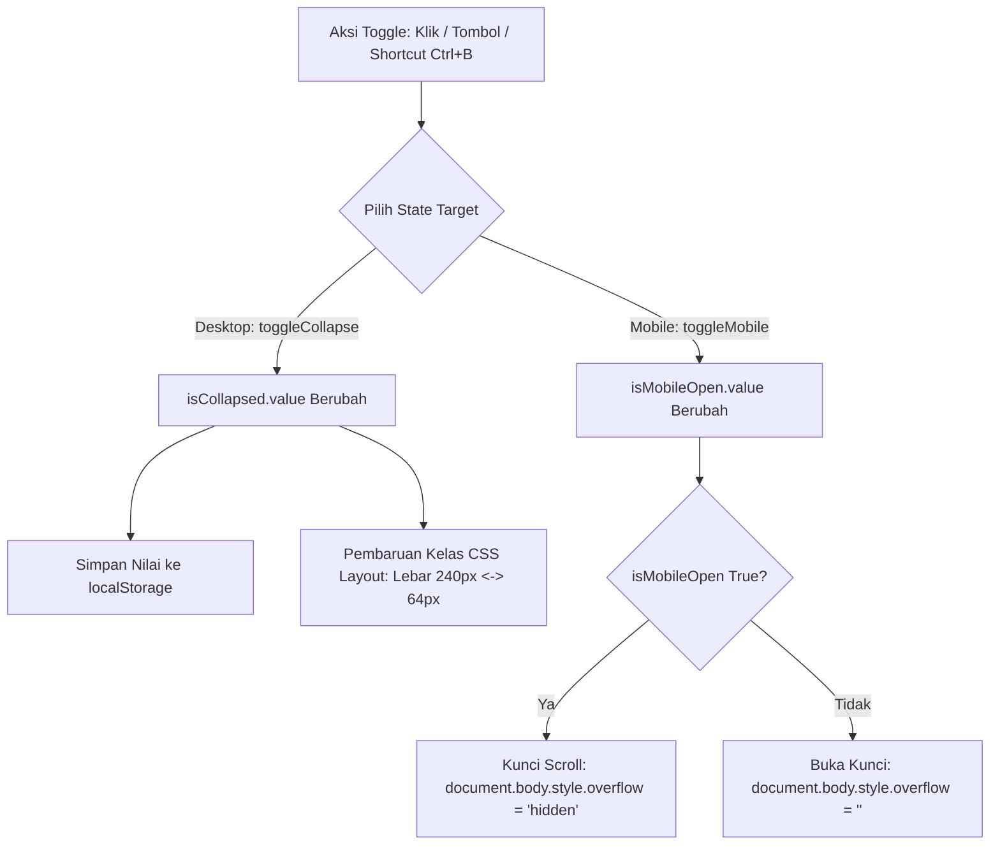

# useSidebar

Modul composable Vue 3 untuk mengelola state reaktif sidebar aplikasi, mencakup mode ciut (collapsed) pada desktop, laci mengambang (drawer) mobile, persistensi preferensi di `localStorage`, penguncian scroll latar belakang, serta pintasan keyboard global `Ctrl+B`.

---

## 01. Overview

### 1.1 Deskripsi Komponen
`useSidebar` adalah penyedia state navigasi terpusat untuk arsitektur tata letak (layout) aplikasi web. Composable ini mengelola kondisi visibilitas menu samping secara global di seluruh komponen pohon aplikasi tanpa membutuhkan library eksternal seperti Pinia atau Vuex. Modul ini secara otomatis mengingat preferensi pengguna saat halaman di-refresh menggunakan `localStorage` dan mengunci scrolling dokumen `body` saat laci mobile dibuka.

### 1.2 Masalah yang Diselesaikan
- Sinkronisasi Lintas Komponen: Tombol toggle sidebar yang berada di `Header.vue` atau `Navbar.vue` perlu mengubah ukuran kontainer di `Sidebar.vue` dan menggeser margin konten utama di `AuthenticatedLayout.vue`. State singleton global menyelesaikan komunikasi ini secara instan.
- Pengalaman Pengguna Terputus Saat Refresh: Menyimpan status ciut ke `localStorage` secara transparan sehingga pengguna yang menyukai tampilan layar luas tidak perlu menciutkan sidebar berulang kali setiap kali berpindah halaman.
- Background Scroll Leak di Ponsel: Membuka drawer mobile sering kali memungkinkan pengguna menggulir konten di belakang backdrop gelap secara tidak sengaja. `useSidebar` secara otomatis menerapkan `overflow: hidden` pada `document.body` saat drawer aktif.
- Konflik Pintasan Keyboard: Pintasan `Ctrl+B` / `Cmd+B` dilengkapi filter proteksi elemen input sehingga tidak memicu aksi toggle saat pengguna sedang mengetik teks di form atau textarea.

### 1.3 Kapan Harus Menggunakan
- Komponen navigasi samping utama (`Sidebar.vue`) pada dashboard admin atau aplikasi enterprise.
- Tombol hamburger dan tombol toggle ciut pada bilah header aplikasi (`Header.vue`).
- Komponen layout utama yang membutuhkan penyesuaian kelas lebar konten (`w-64` vs `w-16`).

### 1.4 Kapan TIDAK Menggunakan
- Menu Dropdown Sederhana: Untuk menu dropdown profil atau pilihan aksi tabel, gunakan komponen `Dropdown.vue`.
- Modal Dialog Pop-up: Untuk kotak dialog konfirmasi atau formulir pop-up, gunakan komponen `Modal.vue`.

---

## 02. Preview

> [!TIP]
> Pengujian fungsional dan showcase composable ini dapat diuji secara native pada portal pratinjau aplikasi:
>
> <a href="/preview" target="_self" style="display: inline-flex; align-items: center; gap: 6px; padding: 6px 14px; border-radius: 8px; font-weight: 600; text-decoration: none; margin-top: 8px; background-color: var(--vp-c-brand-1, #4f46e5); color: #ffffff;">Buka Live Preview Portal Komponen &rarr;</a>

---

## 03. Installation & Import

Modul `useSidebar` diimpor langsung dari direktori Composables:

```javascript
import { useSidebar } from '@/Composables/Pack/useSidebar';
```

---

## 04. Anatomy

### Diagram Struktur State Global Singleton
```
+-------------------------------------------------------------+
|                  Module Scope Global State                  |
|  - globalCollapsed = ref(false)                             |
|  - globalMobileOpen = ref(false)                            |
|  - isInitialized = false                                    |
+-------------------------------------------------------------+
          |                                   |
          v                                   v
+-----------------------+           +-----------------------+
|      Header.vue       |           |      Sidebar.vue      |
|  - toggleCollapse()   |           |  - Membaca isCollapsed|
|  - toggleMobile()     |           |  - Navigasi Menu      |
+-----------------------+           +-----------------------+
          |                                   |
          +-----------------+-----------------+
                            |
                            v
+-------------------------------------------------------------+
|                   AuthenticatedLayout.vue                   |
|   Menyesuaikan margin & lebar: :class="isCollapsed ? ..."   |
+-------------------------------------------------------------+
```

### Mermaid Diagram Alur Perubahan State


---

## 05. Props / Options

Parameter konfigurasi yang diterima oleh fungsi `useSidebar(options)`:

| Parameter | Tipe | Default | Deskripsi |
| :--- | :--- | :--- | :--- |
| `options.persistKey` | `string \| false` | `'pack_sidebar_collapsed'` | Kunci `localStorage` untuk menyimpan status ciut. Berikan `false` untuk menonaktifkan persistensi. |
| `options.defaultCollapsed` | `boolean` | `false` | Kondisi bawaan saat aplikasi pertama kali dibuka jika belum ada preferensi tersimpan di storage. |
| `options.enableShortcut` | `boolean` | `true` | Mengaktifkan listener keyboard global `Ctrl+B` (Windows/Linux) dan `Cmd+B` (macOS). |
| `options.isolated` | `boolean` | `false` | Jika `true`, membuat instance state lokal baru yang tidak terhubung dengan state global aplikasi (berguna untuk demo/preview). |

---

## 06. Slots

Komponen utilitas ini merupakan Composable logic murni dan tidak menggunakan slot template.

---

## 07. Emits / Events

Komponen utilitas ini merupakan Composable logic murni dan tidak memancarkan event emit komponen.

---

## 08. Methods / Exposes

### Return Nilai dari Composable `useSidebar`

| Properti / Fungsi | Tipe | Deskripsi |
| :--- | :--- | :--- |
| `isCollapsed` | `Ref<boolean>` | State reaktif status ciut sidebar desktop (`true` = ciut / mini, `false` = lebar). |
| `isMobileOpen` | `Ref<boolean>` | State reaktif status laci mobile (`true` = terbuka, `false` = tertutup). |
| `toggleCollapse()` | `Function` | Membalikkan nilai boolean `isCollapsed`. |
| `setCollapsed(val)` | `Function` | Mengatur nilai `isCollapsed` secara eksplisit berdasarkan parameter boolean. |
| `openMobile()` | `Function` | Membuka laci mobile dan mengunci scroll body. |
| `closeMobile()` | `Function` | Menutup laci mobile dan memulihkan scroll body. |
| `toggleMobile()` | `Function` | Membalikkan nilai boolean `isMobileOpen`. |
| `setMobileOpen(val)` | `Function` | Mengatur nilai `isMobileOpen` secara eksplisit. |

---

## 09. Keyboard Navigation / Accessibility

Penerapan sidebar responsif membutuhkan pemenuhan aksesibilitas interaksi:
- Atribut `aria-expanded` & `aria-controls`: Tombol toggle di header atau navbar wajib memiliki atribut `aria-expanded` yang terikat ke state `isCollapsed` atau `isMobileOpen`, serta `aria-controls` yang menunjuk ID elemen navigasi sidebar.
- Menutup dengan Tombol Escape: Saat laci mobile sedang terbuka, menekan tombol `Escape` otomatis memicu `closeMobile()` untuk kenyamanan pengguna keyboard.
- Proteksi Fokus Mengetik: Listener shortcut `Ctrl+B` secara otomatis mendeteksi elemen yang sedang aktif melalui `document.activeElement`. Jika pengguna sedang berada di dalam input form, shortcut tidak akan mengganggu pengetikan teks.

---

## 10. State Management & Lifecycle

- Global vs Isolated: Secara default (`isolated: false`), memanggil `useSidebar()` di banyak file komponen akan mengembalikan referensi `ref` singleton yang sama persis. Perubahan di satu komponen langsung dirasakan komponen lain tanpa prop drilling.
- Inisialisasi Storage Sekali Saja: Variabel modul `isInitialized` menjamin pembacaan `localStorage.getItem()` hanya dieksekusi satu kali saat startup aplikasi, menghemat beban I/O browser.
- Pembersihan Listener Otomatis: Saat komponen di-unmount, event listener keyboard `keydown` dibersihkan dan overflow body dipulihkan ke kondisi semula.

---

## 11. Code Examples

### 11.1 Contoh Dasar (Tombol Toggle di Header)
```vue
<script setup>
import { useSidebar } from '@/Composables/Pack/useSidebar';

const { isCollapsed, toggleCollapse, toggleMobile } = useSidebar();
</script>

<template>
  <header class="h-16 border-b border-zinc-200 dark:border-zinc-800 bg-white dark:bg-zinc-900 flex items-center justify-between px-4">
    <div class="flex items-center gap-3">
      <!-- Tombol desktop (sembunyi di mobile) -->
      <button
        type="button"
        class="hidden lg:flex p-2 rounded-xl text-zinc-600 dark:text-zinc-300 hover:bg-zinc-100 dark:hover:bg-zinc-800"
        aria-label="Alihkan lebar sidebar"
        @click="toggleCollapse"
      >
        <span class="material-symbols-outlined">{{ isCollapsed ? 'menu_open' : 'menu' }}</span>
      </button>

      <!-- Tombol mobile (hanya tampil di bawah layar lg) -->
      <button
        type="button"
        class="flex lg:hidden p-2 rounded-xl text-zinc-600 dark:text-zinc-300 hover:bg-zinc-100 dark:hover:bg-zinc-800"
        aria-label="Buka navigasi mobile"
        @click="toggleMobile"
      >
        <span class="material-symbols-outlined">menu</span>
      </button>

      <span class="font-bold text-zinc-900 dark:text-zinc-100">Portal Aplikasi</span>
    </div>
  </header>
</template>
```

### 11.2 Contoh Menengah (Sidebar Desktop dengan Transisi Tailwind)
```vue
<script setup>
import { useSidebar } from '@/Composables/Pack/useSidebar';

const { isCollapsed } = useSidebar();

const menuItems = [
  { icon: 'dashboard', label: 'Ringkasan' },
  { icon: 'receipt_long', label: 'Transaksi' },
  { icon: 'group', label: 'Pelanggan' },
  { icon: 'settings', label: 'Pengaturan' },
];
</script>

<template>
  <aside
    :class="[
      'h-screen bg-white dark:bg-zinc-900 border-r border-zinc-200 dark:border-zinc-800 transition-all duration-300 flex flex-col shrink-0',
      isCollapsed ? 'w-16' : 'w-64'
    ]"
  >
    <div class="h-16 flex items-center px-4 border-b border-zinc-100 dark:border-zinc-800">
      <div class="w-8 h-8 rounded-lg bg-indigo-600 flex items-center justify-center text-white font-bold shrink-0">
        P
      </div>
      <span v-if="!isCollapsed" class="ml-3 font-bold text-sm truncate text-zinc-900 dark:text-zinc-100">
        Pack UI Admin
      </span>
    </div>

    <nav class="flex-1 p-2 space-y-1 overflow-y-auto">
      <a
        v-for="item in menuItems"
        :key="item.label"
        href="#"
        class="flex items-center gap-3 px-3 py-2.5 rounded-xl text-zinc-600 dark:text-zinc-400 hover:bg-zinc-50 dark:hover:bg-zinc-800/50 hover:text-zinc-900 dark:hover:text-zinc-100 transition-colors"
        :title="isCollapsed ? item.label : undefined"
      >
        <span class="material-symbols-outlined text-lg shrink-0">{{ item.icon }}</span>
        <span v-if="!isCollapsed" class="text-xs font-medium truncate">{{ item.label }}</span>
      </a>
    </nav>
  </aside>
</template>
```

### 11.3 Contoh Lanjutan (Drawer Mobile dengan Backdrop & Kunci Scroll)
```vue
<script setup>
import { useSidebar } from '@/Composables/Pack/useSidebar';

const { isMobileOpen, closeMobile } = useSidebar();
</script>

<template>
  <!-- Laci Mobile Navigasi -->
  <div class="lg:hidden">
    <!-- Backdrop Overlay Gelap -->
    <transition
      enter-active-class="transition-opacity duration-300 ease-out"
      enter-from-class="opacity-0"
      enter-to-class="opacity-100"
      leave-active-class="transition-opacity duration-200 ease-in"
      leave-from-class="opacity-100"
      leave-to-class="opacity-0"
    >
      <div
        v-if="isMobileOpen"
        class="fixed inset-0 bg-black/60 backdrop-blur-xs z-40"
        @click="closeMobile"
      ></div>
    </transition>

    <!-- Kontainer Panel Menggeser -->
    <transition
      enter-active-class="transition-transform duration-300 ease-out"
      enter-from-class="-translate-x-full"
      enter-to-class="translate-x-0"
      leave-active-class="transition-transform duration-200 ease-in"
      leave-from-class="translate-x-0"
      leave-to-class="-translate-x-full"
    >
      <div
        v-if="isMobileOpen"
        class="fixed inset-y-0 left-0 w-72 bg-white dark:bg-zinc-900 shadow-2xl z-50 flex flex-col p-4"
      >
        <div class="flex items-center justify-between pb-4 border-b border-zinc-100 dark:border-zinc-800">
          <span class="font-bold text-sm">Menu Navigasi</span>
          <button type="button" class="p-1 rounded-lg hover:bg-zinc-100 dark:hover:bg-zinc-800" @click="closeMobile">
            <span class="material-symbols-outlined text-lg">close</span>
          </button>
        </div>
        <div class="py-4 text-xs space-y-2">
          <p>Tautan Halaman Utama</p>
          <p>Tautan Analitik</p>
          <p>Tautan Pengaturan Sistem</p>
        </div>
      </div>
    </transition>
  </div>
</template>
```

---

## 12. Integration with Laravel & Inertia

### 12.1 Penutupan Otomatis Drawer Saat Navigasi Halaman Inertia
Saat pengguna mengeklik tautan menu di dalam drawer mobile pada aplikasi Inertia.js, navigasi terjadi tanpa reload penuh (SPA). Penting untuk menutup laci secara otomatis begitu halaman baru berhasil dimuat:

```vue
<script setup>
import { onMounted } from 'vue';
import { router } from '@inertiajs/vue3';
import { useSidebar } from '@/Composables/Pack/useSidebar';

const { closeMobile } = useSidebar();

onMounted(() => {
  // Tutup drawer secara otomatis saat navigasi Inertia selesai
  router.on('finish', () => {
    closeMobile();
  });
});
</script>
```

---

## 13. Styling & Customization

Penataan animasi dan lebar sidebar mengandalkan kelas transisi Tailwind CSS v4:

```html
<!-- Kontainer Sidebar dengan Transisi Halus -->
<aside
  class="transition-all duration-300 ease-in-out border-r border-zinc-200 dark:border-zinc-800 bg-white dark:bg-zinc-900"
  :class="isCollapsed ? 'w-16' : 'w-64'"
>
  <!-- Konten Navigasi -->
</aside>
```

---

## 14. Responsive Behavior

- Batas Breakpoint Standar: Nilai `isCollapsed` direkomendasikan untuk layar desktop (`min-width: 1024px` atau `lg:`), sedangkan `isMobileOpen` digunakan untuk viewport di bawah breakpoint tersebut.
- Penyesuaian Flex Layout: Kontainer sidebar harus memiliki utilitas `shrink-0` agar ukurannya tidak mengecil secara paksa saat konten utama di sebelah kanannya membutuhkan ruang lebih.

---

## 15. Performance Optimization & Benchmarks

1. Zero Re-render Overhead: Variabel `isCollapsed` adalah `Ref<boolean>` primitif yang hanya memicu re-render pada komponen-komponen yang secara eksplisit menggunakannya.
2. Isolasi Keyboard Handler: Pengecekan `activeElement` dilakukan dalam operasi waktu konstan O(1) sebelum mengeksekusi toggle state.

---

## 16. Security Best Practices

- Penanganan Sandbox LocalStorage: Pemanggilan `localStorage.getItem()` dan `setItem()` dibungkus dalam blok `try...catch` untuk mengantisipasi mode penjelajahan pribadi (Incognito) dengan kuota ketat atau lingkungan iframe terproteksi sandbox.

---

## 17. Troubleshooting / FAQ

### Pertanyaan 1: Mengapa sidebar saya tidak otomatis menciut saat pertama kali membuka aplikasi?
Jawaban: Secara default, `defaultCollapsed` bernilai `false` (melebar penuh). Jika Anda ingin sidebar selalu menciut secara default saat pengguna baru mengakses aplikasi, teruskan opsi `{ defaultCollapsed: true }`.

### Pertanyaan 2: Mengapa shortcut Ctrl+B tidak berfungsi di formulir?
Jawaban: Ini adalah mekanisme pengaman yang disengaja. Jika pengguna sedang mengetik di dalam `<input>` atau `<textarea>`, penekanan tombol `Ctrl+B` diabaikan agar tidak mengganggu pintasan editing teks browser (misal bold text).

---

## 18. Comparison with Alternatives

| Fitur / Karakteristik | useSidebar (Pack UI) | Pinia Store Manual | Local State Props/Emit |
| :--- | :--- | :--- | :--- |
| Kebutuhan State Library | Nol (Bawaan Vue 3) | Wajib install Pinia | Tidak ada |
| Persistensi LocalStorage | Terintegrasi otomatis | Harus tulis plugin | Manual |
| Kunci Scroll Body Mobile | Otomatis | Harus tulis manual | Manual |
| Pintasan Keyboard Global | Bawaan (`Ctrl+B`) | Manual | Manual |

---

## 19. Notes / Limitations

- Nilai Persistensi Tersimpan: Preferensi yang tersimpan di `localStorage` akan mengambil prioritas di atas opsi `defaultCollapsed` jika pengguna sebelumnya sudah pernah melakukan toggle di peramban yang sama.
- Server-Side Rendering (SSR): Seluruh interaksi dengan objek `window`, `document`, dan `localStorage` dilindungi dengan pemeriksaan lingkungan `typeof window !== 'undefined'`, memastikan keamanan penuh saat rendering awal di server.
