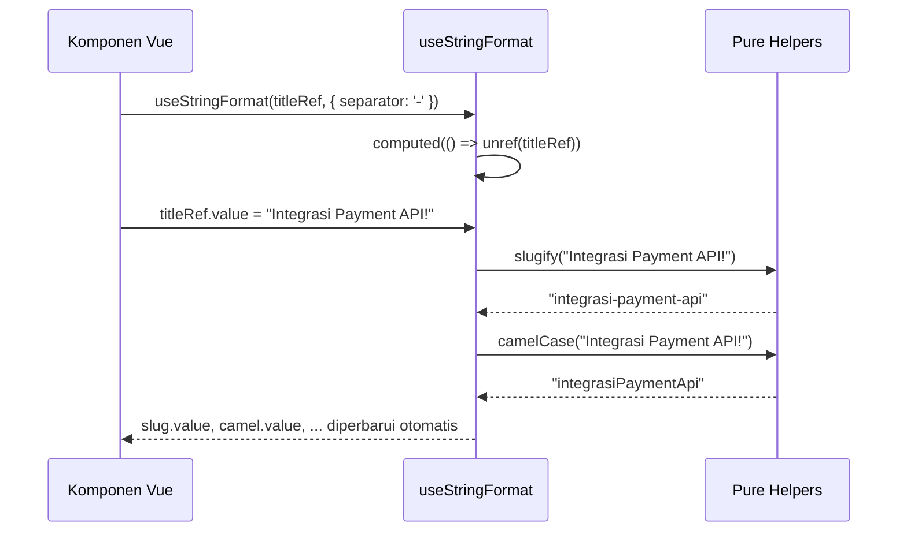

# useStringFormat (`useStringFormat.js`)

## 01. Overview

`useStringFormat` adalah kumpulan fungsi transformasi string murni untuk Vue 3. Modul ini menyediakan semua operasi manipulasi string yang umum dibutuhkan dalam aplikasi web Indonesia: pembuatan URL slug ramah SEO, pemotongan teks cerdas berbasis batas kata, konversi antar konvensi penamaan (camelCase, snake_case, kebab-case), dan pembersihan konten HTML.

### 1.1 Apa Entitas Ini

- **Tipe Artefak**: Composable Function + Pure Utility Helpers (Vue 3 Composition API).
- **Lokasi Berkas Sumber**: [useStringFormat.js](file:///c:/SPEED/LARAVEL-PACK-UI/packages/laravel-pack-ui/resources/js/Composables/Pack/useStringFormat.js).
- **Ekspor Kunci**: `useStringFormat`, `slugify`, `truncate`, `titleCase`, `camelCase`, `snakeCase`, `kebabCase`, `stripHtml`.
- **Target Ekosistem**: Komponen form input URL, preview teks artikel, konversi nama field API, dan sanitasi konten dari rich text editor.

### 1.2 Fungsi Utama

- Menghasilkan URL slug ramah SEO dari judul dengan dukungan normalisasi Unicode (accent stripping).
- Memotong teks panjang secara cerdas di batas kata terakhir untuk mencegah pemotongan di tengah kata.
- Mengonversi string antara berbagai konvensi penamaan: `titleCase`, `camelCase`, `snake_case`, `kebab-case`.
- Membersihkan tag HTML dari string konten rich text menjadi teks murni.
- Menyediakan composable `useStringFormat()` reaktif yang menghitung semua transformasi secara bersamaan dari satu `ref` input.

### 1.3 Kapan Digunakan

- Field URL slug pada form artikel, produk, atau kategori yang mengisi slug secara otomatis dari judul.
- Pratinjau kartu berita atau deskripsi produk yang perlu dibatasi panjang tampilnya.
- Integrasi dengan API backend yang mengharapkan penamaan berbeda (kebab-case untuk URL, snake_case untuk kolom database).
- Pembersihan konten dari `RichTextEditor.vue` sebelum disimpan atau ditampilkan sebagai teks biasa.

### 1.4 Karakteristik Penting

- **Tanpa Dependensi Eksternal**: Tidak membutuhkan pustaka seperti `lodash` atau `slugify`; seluruhnya ditulis dengan JavaScript modern.
- **Dukungan Unicode Penuh**: Fungsi `slugify()` menggunakan `String.normalize('NFD')` untuk menangani karakter beraksent seperti é, ü, ñ.
- **Truncate Word-Boundary**: Fungsi `truncate()` memotong di spasi terdekat sebelum batas panjang maksimum, bukan di tengah kata secara kasar.
- **Reaktif Melalui Computed**: Composable `useStringFormat()` mengembalikan `slug`, `title`, `camel`, `snake`, `kebab`, dan `clean` sebagai `ComputedRef` yang diperbarui otomatis saat input `Ref` berubah.

---

## 02. Preview

> [!TIP]
> Pengujian fungsional dan showcase composable ini dapat diuji secara native pada portal pratinjau aplikasi:
>
> <a href="/preview" target="_self" style="display: inline-flex; align-items: center; gap: 6px; padding: 6px 14px; border-radius: 8px; font-weight: 600; text-decoration: none; margin-top: 8px; background-color: var(--vp-c-brand-1, #4f46e5); color: #ffffff;">Buka Live Preview Portal Komponen &rarr;</a>

---

## 03. Usage

### Peta Penggunaan Konseptual

```text
useStringFormat Ecosystem
├── Penggunaan Reactive (dalam komponen Vue)
│   └── useStringFormat(textRef, { separator: '-' })
│       ├── slug     → computed slugify
│       ├── title    → computed titleCase
│       ├── camel    → computed camelCase
│       ├── snake    → computed snakeCase
│       ├── kebab    → computed kebabCase
│       └── clean    → computed stripHtml
│
└── Penggunaan Pure (satu kali, di luar komponen)
    ├── slugify(text, separator)
    ├── truncate(text, length, options)
    ├── titleCase(text)
    ├── camelCase(text)
    ├── snakeCase(text)
    ├── kebabCase(text)
    └── stripHtml(html)
```

### Matriks Keputusan Penggunaan

| Kondisi | Rekomendasi |
| :--- | :--- |
| Slug input berubah secara reaktif dari judul yang diketik pengguna | `useStringFormat(titleRef)` → `slug` |
| Konversi satu kali di dalam fungsi handler atau computed | Gunakan helper pure: `slugify()`, `camelCase()`, dll |
| Memotong teks di batas kata agar tidak terpotong kasar | `truncate(text, 80)` |
| Sanitasi teks dari RichTextEditor sebelum dikirim ke API | `stripHtml(htmlContent)` |

---

## 04. Anatomy

### Hierarki Modul

```text
useStringFormat.js
│
├── Helper Pure (Stateless, dapat digunakan tanpa Vue)
│   ├── slugify(text, separator)
│   │   ├── String.normalize('NFD') → Hapus aksent Unicode
│   │   ├── Konversi lowercase
│   │   ├── Hapus karakter non-alphanumeric
│   │   └── Ganti spasi/tanda hubung dengan separator
│   │
│   ├── truncate(text, length, options)
│   │   ├── Potong di targetLen = length - suffix.length
│   │   ├── Jika wordBoundary: potong di lastIndexOf(' ')
│   │   └── Tambahkan suffix (default: '...')
│   │
│   ├── titleCase(text)   → Split ' ' → capitalize each
│   ├── camelCase(text)   → Regex replace [-_\s]+(.) → uppercase
│   ├── snakeCase(text)   → Regex insert _ sebelum uppercase
│   ├── kebabCase(text)   → Regex insert - sebelum uppercase
│   └── stripHtml(html)   → Regex /<[^>]*>?/gm → remove tags
│
└── Composable useStringFormat(textInput, options)  (Reactive)
    ├── textVal  = computed(() => unref(textInput))
    ├── slug     = computed(() => slugify(textVal, separator))
    ├── title    = computed(() => titleCase(textVal))
    ├── camel    = computed(() => camelCase(textVal))
    ├── snake    = computed(() => snakeCase(textVal))
    ├── kebab    = computed(() => kebabCase(textVal))
    └── clean    = computed(() => stripHtml(textVal))
```

### Diagram Alur Data Reaktif



---

## 05. Variants

### Transformasi yang Tersedia

| Fungsi | Input | Output |
| :--- | :--- | :--- |
| `slugify` | `'Integrasi Payment Gateway v1.7!'` | `'integrasi-payment-gateway-v1-7'` |
| `slugify` (separator `_`) | `'Hello World'` | `'hello_world'` |
| `titleCase` | `'laporan transaksi harian'` | `'Laporan Transaksi Harian'` |
| `camelCase` | `'user_profile_id'` | `'userProfileId'` |
| `snakeCase` | `'userProfileId'` | `'user_profile_id'` |
| `kebabCase` | `'userProfileId'` | `'user-profile-id'` |
| `truncate` (30 char) | `'Teks yang sangat panjang...'` | `'Teks yang sangat...'` |
| `stripHtml` | `'<h1>Judul <strong>Tebal</strong></h1>'` | `'Judul Tebal'` |

---

## 06. Sizes

Tidak relevan untuk composable utility ini.

---

## 07. States

| State | Kondisi | Return Value |
| :--- | :--- | :--- |
| Input valid | String non-kosong | String hasil transformasi |
| Input kosong / falsy | `null`, `undefined`, `''` | String kosong `''` |
| Input hanya spasi | `'   '` | `''` setelah `trim()` |
| Input tanpa tag HTML | `stripHtml('Teks biasa')` | `'Teks biasa'` (tidak berubah) |
| Panjang teks `<= length` | `truncate('Pendek', 50)` | `'Pendek'` (tidak dipotong) |
| `wordBoundary = false` | `truncate(text, 10, { wordBoundary: false })` | Potong persis di karakter ke-10 |

---

## 08. Props / Parameters

### `useStringFormat(textInput, options?)`

| Parameter | Tipe | Default | Wajib | Deskripsi |
| :--- | :--- | :--- | :--- | :--- |
| `textInput` | `Ref<string> \| string` | - | Ya | Input teks yang dapat berupa Ref reaktif atau string biasa |
| `options.separator` | `string` | `'-'` | Tidak | Karakter pemisah untuk computed `slug` |

### `slugify(text, separator?)`

| Parameter | Tipe | Default | Wajib | Deskripsi |
| :--- | :--- | :--- | :--- | :--- |
| `text` | `string` | - | Ya | Teks judul sumber |
| `separator` | `string` | `'-'` | Tidak | Karakter pemisah antar kata |

### `truncate(text, length?, options?)`

| Parameter | Tipe | Default | Wajib | Deskripsi |
| :--- | :--- | :--- | :--- | :--- |
| `text` | `string` | - | Ya | Teks sumber yang akan dipotong |
| `length` | `number` | `100` | Tidak | Batas panjang karakter total (termasuk suffix) |
| `options.suffix` | `string` | `'...'` | Tidak | Karakter akhiran yang ditambahkan setelah pemotongan |
| `options.wordBoundary` | `boolean` | `true` | Tidak | Potong di batas kata terakhir, bukan di tengah kata |

---

## 09. Slots / Content

Tidak relevan. Ini adalah composable function tanpa slot template.

---

## 10. Events / Interactions / Returns

### `useStringFormat()` Return Object

| Properti / Method | Tipe | Reaktif | Deskripsi |
| :--- | :--- | :---: | :--- |
| `slug` | `ComputedRef<string>` | Ya | Hasil `slugify()` dari `textInput` dengan separator dari `options` |
| `title` | `ComputedRef<string>` | Ya | Hasil `titleCase()` dari `textInput` |
| `camel` | `ComputedRef<string>` | Ya | Hasil `camelCase()` dari `textInput` |
| `snake` | `ComputedRef<string>` | Ya | Hasil `snakeCase()` dari `textInput` |
| `kebab` | `ComputedRef<string>` | Ya | Hasil `kebabCase()` dari `textInput` |
| `clean` | `ComputedRef<string>` | Ya | Hasil `stripHtml()` dari `textInput` |
| `slugify` | `Function` | Tidak | Referensi ke fungsi pure `slugify` |
| `truncate` | `Function` | Tidak | Referensi ke fungsi pure `truncate` |
| `titleCase` | `Function` | Tidak | Referensi ke fungsi pure `titleCase` |
| `camelCase` | `Function` | Tidak | Referensi ke fungsi pure `camelCase` |
| `snakeCase` | `Function` | Tidak | Referensi ke fungsi pure `snakeCase` |
| `kebabCase` | `Function` | Tidak | Referensi ke fungsi pure `kebabCase` |
| `stripHtml` | `Function` | Tidak | Referensi ke fungsi pure `stripHtml` |

---

## 11. Code Example

### Basic: Slug Otomatis dari Judul Artikel

```vue
<script setup>
import { ref } from 'vue';
import { useStringFormat } from '@/Composables/Pack/useStringFormat';

const title = ref('');
const { slug } = useStringFormat(title);
</script>

<template>
    <div class="space-y-2">
        <label class="text-sm font-medium">Judul Artikel</label>
        <input v-model="title" type="text" class="input-base" placeholder="Masukkan judul artikel..." />

        <label class="text-sm font-medium">URL Slug</label>
        <div class="flex items-center gap-2 text-sm text-gray-500">
            <span>artikelku.com/blog/</span>
            <span class="font-mono text-blue-600">{{ slug || 'url-akan-muncul-di-sini' }}</span>
        </div>
    </div>
</template>
```

### Intermediate: Truncate Deskripsi Produk di Kartu

```vue
<script setup>
import { computed } from 'vue';
import { truncate, stripHtml } from '@/Composables/Pack/useStringFormat';

const props = defineProps({
    product: Object,
});

// Hapus HTML dari deskripsi rich text, lalu potong
const shortDescription = computed(() =>
    truncate(stripHtml(props.product.description), 120)
);
</script>

<template>
    <div class="p-4 border rounded-xl">
        <h3 class="font-semibold text-gray-900">{{ product.name }}</h3>
        <p class="mt-1 text-sm text-gray-500">{{ shortDescription }}</p>
    </div>
</template>
```

### Advanced: Konversi Nama Field API Backend

```javascript
import { camelCase, snakeCase, kebabCase } from '@/Composables/Pack/useStringFormat';

// Saat menerima respons API dengan camelCase, konversi untuk tampilan form
const transformApiResponse = (apiData) => {
    return Object.fromEntries(
        Object.entries(apiData).map(([key, value]) => [
            snakeCase(key), // 'firstName' → 'first_name' untuk key form
            value,
        ])
    );
};

// Saat mengirim request ke API yang menggunakan kebab-case header
const buildApiHeaders = (fields) => {
    return Object.fromEntries(
        fields.map((f) => [`X-${kebabCase(f)}`, 'true'])
    );
};
```

---

## 12. Result / Behavior

- Semua helper pure bersifat stateless dan mengembalikan string baru tanpa memodifikasi input asli.
- `slugify()` menghapus semua karakter selain huruf alfanumeric ASCII (`a-z`, `0-9`) dan separator setelah normalisasi Unicode. Hasilnya aman digunakan sebagai URL path segment.
- `truncate()` dengan `wordBoundary: true` akan memotong di spasi terakhir **sebelum** batas panjang `length`. Akibatnya, output aktual bisa lebih pendek dari `length` jika kata sebelum batas cukup panjang.
- `stripHtml()` menggunakan regex dan bukan DOM parser, sehingga cocok untuk lingkungan SSR. Namun, karakter HTML entity (`&amp;`, `&lt;`) tidak dikonversi menjadi karakter asli — gunakan `DOMParser` jika konversi entity dibutuhkan.

---

## 13. Customization

### Separator Kustom pada Slug

```javascript
import { slugify } from '@/Composables/Pack/useStringFormat';

// Slug dengan underscore
slugify('Integrasi Payment API', '_'); // "integrasi_payment_api"

// Slug dengan dot (untuk domain atau namespace)
slugify('My Package Name', '.'); // "my.package.name"
```

### Suffix Kustom pada Truncate

```javascript
import { truncate } from '@/Composables/Pack/useStringFormat';

truncate('Judul artikel yang sangat panjang', 25, {
    suffix: ' [baca selengkapnya]',
    wordBoundary: true,
});
```

---

## 14. Accessibility

Composable ini tidak menghasilkan elemen DOM. Hasil string yang dihasilkan digunakan di template. Pastikan:

- Teks yang dipotong (`truncate`) dilengkapi atribut `title` dengan teks penuh untuk pembaca layar dan tooltip bawaan browser.
- Slug yang ditampilkan di interface memiliki label yang jelas (misalnya `<label>URL:</label>`).

---

## 15. Responsive Behavior

Tidak ada perilaku responsif khusus. Output composable adalah string teks.

---

## 16. Do / Don't

**Lakukan:**

- Gunakan `slugify()` untuk menghasilkan URL slug dari input pengguna sebelum menyimpan ke database.
- Kombinasikan `stripHtml()` + `truncate()` saat menampilkan konten rich text dalam format kartu atau daftar ringkas.
- Gunakan `camelCase()` / `snakeCase()` untuk menormalkan nama field saat berintegrasi dengan API eksternal yang berbeda konvensi.

**Jangan:**

- Jangan mengandalkan `stripHtml()` untuk sanitasi keamanan (mencegah XSS). Gunakan pustaka sanitasi khusus seperti `DOMPurify` jika konten akan dirender sebagai HTML.
- Jangan menggunakan `slugify()` sebagai pemformat tampilan; slug tidak cocok untuk ditampilkan ke pengguna akhir (contoh: gunakan `titleCase()` untuk tampilan, `slugify()` untuk URL).
- Jangan menjalankan konversi berat di dalam watcher tanpa memoization; gunakan composable reaktif `useStringFormat()` yang sudah memanfaatkan `computed`.

---

## 17. Examples / Recipes

### Resep: Form Artikel dengan Slug Otomatis

```vue
<script setup>
import { ref } from 'vue';
import { useStringFormat } from '@/Composables/Pack/useStringFormat';
import { useForm } from '@inertiajs/vue3';

const form = useForm({ title: '', slug: '', body: '' });
const titleRef = ref(form.title);
const { slug } = useStringFormat(titleRef);

// Sync slug computed ke form saat titleRef berubah
watch(titleRef, (newTitle) => {
    form.title = newTitle;
    if (!form.slug) {
        form.slug = slug.value;
    }
});
</script>
```

### Resep: Ekspor Kolom dengan Header Standar

```javascript
import { titleCase } from '@/Composables/Pack/useStringFormat';

const headers = ['firstName', 'lastName', 'emailAddress'].map(titleCase);
// ['First Name', 'Last Name', 'Email Address']
```

---

## 18. Related Items

```text
useStringFormat
├── Composables Terkait
│   ├── useDateFormat.js    → Pasangan format untuk nilai tanggal/waktu
│   ├── useFormat.js        → Aggregator yang mengekspor ulang fungsi ini
│   ├── useNumberFormat.js  → Format angka, mata uang, persen
│   └── useMask.js          → Masking data sensitif (email, NIK, kartu)
│
└── Komponen Terkait
    ├── InputField.vue      → Field slug dengan auto-fill
    ├── RichTextEditor.vue  → Sumber konten HTML yang perlu di-strip
    └── TableComponent.vue  → Menampilkan data dengan header title-cased
```

---

## 19. Notes / Limitations

- **Batas Unicode `slugify()`**: Normalisasi NFD berfungsi untuk karakter Latin beraksent. Karakter dari alfabet non-Latin (Arabic, Chinese, Cyrillic) akan dihapus seluruhnya karena pola regex `[^a-z0-9\s-]`.
- **`stripHtml()` Tidak Menangani Entity**: String seperti `&amp;` atau `&lt;` tidak dikonversi ke karakter asli. Ini adalah perilaku yang disengaja untuk menjaga fungsi agar ringan dan aman di lingkungan SSR (tidak memerlukan `document`).
- **`camelCase()` dan `snakeCase()` Saling Invers Parsial**: `camelCase('user_id')` → `'userId'`, lalu `snakeCase('userId')` → `'user_id'`. Namun string dengan spasi atau karakter khusus tidak selalu menghasilkan round-trip yang sempurna.
- **Tanpa Auto-Save**: Composable ini tidak terintegrasi dengan `localStorage` atau API. Untuk penyimpanan draft slug, gunakan bersama `useLocalStorage` atau `useAutoSave`.
