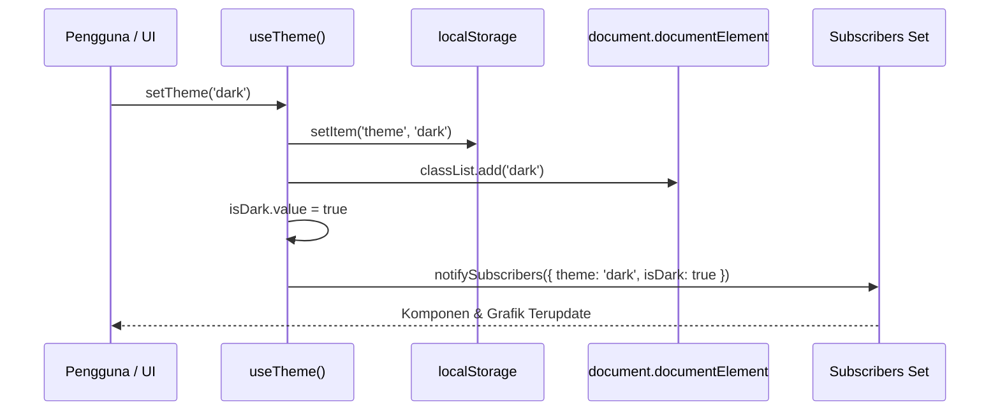

# useTheme

Modul composable Vue 3 untuk mengelola mode tema gelap (Dark Mode), terang (Light Mode), dan otomatis mengikuti sistem operasi (System Theme) dengan manipulasi kelas CSS `.dark` pada elemen root dokumen, persistensi `localStorage`, serta sinkronisasi dinamis `matchMedia`.

---

## 01. Overview

### 1.1 Deskripsi Komponen
`useTheme` menyediakan manajemen tema terpusat yang dirancang khusus untuk ekosistem Tailwind CSS v4 berbasis kelas (`darkMode: 'class'`). Composable ini menyinkronkan status tema secara instan antara state reaktif Vue, elemen root dokumen (`document.documentElement`), penyimpanan lokal peramban (`localStorage`), dan preferensi tema sistem operasi pengguna melalui media query `prefers-color-scheme`.

### 1.2 Masalah yang Diselesaikan
- Kilatan Layar Putih (Flash of Unstyled Content / FOUC): Masalah umum ketika pengguna me-refresh halaman berlatar belakang gelap, tetapi peramban sempat merender latar belakang putih sekejap sebelum JavaScript Vue selesai dimuat.
- Inkonsistensi Preferensi Antar Tab: Menggunakan state reaktif terpusat dan penyimpanan `localStorage` agar preferensi tema tetap terjaga secara konsisten di seluruh sesi dan navigasi halaman.
- Keterputusan Deteksi Sistem Operasi: Saat pengguna memilih mode `system`, antarmuka aplikasi sering kali tidak merespons ketika pengguna beralih mode gelap di pengaturan OS (misal jadwal otomatis senja ke malam). Composable ini memasang event listener `change` pada `matchMedia` untuk memastikan responsivitas real-time.
- Komunikasi dengan Library Pihak Ketiga: Menyediakan antarmuka `subscribe()` untuk memberitahu komponen eksternal (seperti library grafik Chart.js/ApexCharts atau canvas grafis) saat tema berubah.

### 1.3 Kapan Harus Menggunakan
- Tombol toggle tema (ikon matahari / bulan) di header navigasi atau navbar aplikasi.
- Halaman preferensi atau modal pengaturan akun pengguna.
- Komponen visual grafik atau peta digital yang perlu menyesuaikan palet warna latar belakangnya dengan tema aktif.

### 1.4 Kapan TIDAK Menggunakan
- Penataan Gaya Skema Multi-Warna Rumit: Jika aplikasi memerlukan lusinan tema warna kustom (misal palet tema hijau, biru, oranye, ungu kustom per tenant), gunakan token CSS kustom (CSS Variables) alih-alih saklar biner gelap/terang.

---

## 02. Preview

> [!TIP]
> Pengujian fungsional dan showcase composable ini dapat diuji secara native pada portal pratinjau aplikasi:
>
> <a href="http://localhost:8000/preview" target="_self" style="display: inline-flex; align-items: center; gap: 6px; padding: 6px 14px; border-radius: 8px; font-weight: 600; text-decoration: none; margin-top: 8px; background-color: var(--vp-c-brand-1, #4f46e5); color: #ffffff;">Buka Live Preview Portal Komponen &rarr;</a>

---

## 03. Installation & Import

Modul `useTheme` diimpor langsung dari direktori Composables:

```javascript
import { useTheme } from '@/Composables/Pack/useTheme';
```

---

## 04. Anatomy

### Diagram Struktur State & Aliran Data
```
+-------------------------------------------------------------+
|                  Module Scope Global State                  |
|  - theme: Ref<'light' | 'dark' | 'system'>                  |
|  - isDark: Ref<boolean>                                     |
|  - subscribers: Set<Function>                               |
+-------------------------------------------------------------+
                               |
                               v
+-------------------------------------------------------------+
|                 updateThemeState(targetTheme)               |
+-------------------------------------------------------------+
          |                    |                     |
    [Mode Light]          [Mode Dark]          [Mode System]
          |                    |                     |
          v                    v                     v
    isDark = false       isDark = true        isDark = matchMedia
          |                    |                     |
          +--------------------+---------------------+
                               |
                               v
+-------------------------------------------------------------+
|                       applyToDom()                          |
|  1. document.documentElement.classList.add/remove('dark')   |
|  2. Panggil seluruh callback subscriber terdaftar           |
+-------------------------------------------------------------+
```

### Mermaid Diagram Alur Perubahan Tema


---

## 05. Props / Options

Composable `useTheme()` tidak memerlukan parameter saat diinisialisasi.

Parameter untuk fungsi utilitas yang diekspos:
- `setTheme(newTheme)`: Menerima string `'light' | 'dark' | 'system'`.
- `toggleTheme(includeSystem)`: Menerima parameter boolean opsional. Jika `true`, memicu rotasi sirkular 3 state (`cycleTheme`).
- `subscribe(callback)`: Menerima fungsi callback `(payload: { theme: string, isDark: boolean }) => void` dan mengembalikan fungsi unsubscribe.

---

## 06. Slots

Komponen utilitas ini merupakan Composable logic murni dan tidak menggunakan slot template.

---

## 07. Emits / Events

Komponen utilitas ini merupakan Composable logic murni dan tidak memancarkan event emit komponen.

---

## 08. Methods / Exposes

### Return Nilai dari Composable `useTheme`

| Properti / Fungsi | Tipe | Deskripsi |
| :--- | :--- | :--- |
| `theme` | `Ref<'light' \| 'dark' \| 'system'>` | Mode tema yang sedang aktif dipilih pengguna. |
| `isDark` | `Ref<boolean>` | Nilai boolean yang menunjukkan apakah mode gelap sedang diterapkan di DOM saat ini. |
| `setTheme(theme)` | `Function` | Mengatur tema secara eksplisit ke `'light'`, `'dark'`, atau `'system'`. |
| `toggleTheme(includeSystem)` | `Function` | Membalikkan status tema gelap <-> terang. Jika parameter `includeSystem: true`, menjalankan rotasi 3 state. |
| `cycleTheme()` | `Function` | Melakukan rotasi sirkular secara berurutan: `light -> dark -> system -> light`. |
| `initTheme()` | `Function` | Membaca preferensi dari `localStorage`, memasang media query listener, dan menerapkan kelas ke DOM. |
| `cleanupTheme()` | `Function` | Melepas event listener `matchMedia` (berguna untuk lingkungan pengujian otomatis). |
| `subscribe(callback)` | `Function` | Mendaftarkan fungsi pengamat eksternal yang akan dipanggil setiap kali tema berubah. |

---

## 09. Keyboard Navigation / Accessibility

Penerapan tombol pengatur tema memiliki panduan aksesibilitas WCAG:
- Atribut `aria-label` yang Menjelaskan Aksi: Label tombol pengalih tema harus menjelaskan tindakan yang akan terjadi jika tombol ditekan, bukan status yang sedang aktif saat ini:
  ```html
  <button
    :aria-label="isDark ? 'Beralih ke mode terang' : 'Beralih ke mode gelap'"
    @click="toggleTheme()"
  >
    <!-- Ikon Matahari / Bulan -->
  </button>
  ```
- Menghindari Kilatan Cahaya Berlebih: Transisi warna antara latar belakang gelap dan terang sebaiknya diberikan jeda transisi halus menggunakan kelas CSS `transition-colors duration-200` pada kontainer root untuk mencegah ketidaknyamanan visual bagi pengguna dengan sensitivitas fotofobia.

---

## 10. State Management & Lifecycle

- Sinkronisasi `matchMedia`: Saat tema disetel ke `'system'`, listener media query `(prefers-color-scheme: dark)` akan mendeteksi perubahan tema OS secara otomatis. Jika pengguna beralih mode di pengaturan Windows, macOS, atau Android, UI akan berubah seketika tanpa perlu memuat ulang peramban.
- Mekanisme Unsubscribe Bersih: Fungsi `subscribe()` mengembalikan fungsi pembatalan (`unsubscribe`) yang aman dipanggil saat komponen Vue di-unmount, mencegah kebocoran referensi memori pada `subscribers Set`.

---

## 11. Code Examples

### 11.1 Contoh Dasar (Tombol Pengalih Tema di Navbar)
```vue
<script setup>
import { useTheme } from '@/Composables/Pack/useTheme';

const { isDark, toggleTheme } = useTheme();
</script>

<template>
  <button
    type="button"
    class="p-2 rounded-xl border border-zinc-200 dark:border-zinc-800 text-zinc-700 dark:text-zinc-200 hover:bg-zinc-100 dark:hover:bg-zinc-800 transition-colors"
    :title="isDark ? 'Beralih ke Mode Terang' : 'Beralih ke Mode Gelap'"
    @click="toggleTheme()"
  >
    <span class="material-symbols-outlined text-lg">
      {{ isDark ? 'light_mode' : 'dark_mode' }}
    </span>
  </button>
</template>
```

### 11.2 Contoh Menengah (Pemilih Mode di Pengaturan Akun)
```vue
<script setup>
import { useTheme } from '@/Composables/Pack/useTheme';

const { theme, setTheme } = useTheme();

const options = [
  { value: 'light', label: 'Terang', icon: 'light_mode' },
  { value: 'dark', label: 'Gelap', icon: 'dark_mode' },
  { value: 'system', label: 'Ikuti Sistem OS', icon: 'desktop_windows' },
];
</script>

<template>
  <div class="space-y-3">
    <label class="block text-xs font-semibold text-zinc-500 uppercase tracking-wider">
      Pilihan Tema Tampilan:
    </label>
    <div class="grid grid-cols-1 sm:grid-cols-3 gap-3">
      <button
        v-for="opt in options"
        :key="opt.value"
        type="button"
        :class="[
          'p-3.5 rounded-xl border text-left flex items-center gap-3 transition-all',
          theme === opt.value
            ? 'border-indigo-600 bg-indigo-50/50 dark:bg-indigo-950/30 text-indigo-700 dark:text-indigo-300 font-semibold ring-2 ring-indigo-500/20'
            : 'border-zinc-200 dark:border-zinc-800 bg-white dark:bg-zinc-900 text-zinc-700 dark:text-zinc-300 hover:bg-zinc-50 dark:hover:bg-zinc-800/50'
        ]"
        @click="setTheme(opt.value)"
      >
        <span class="material-symbols-outlined text-lg">{{ opt.icon }}</span>
        <span class="text-xs">{{ opt.label }}</span>
      </button>
    </div>
  </div>
</template>
```

### 11.3 Contoh Lanjutan (Integrasi Subscriber dengan Library Grafik Eksternal)
```vue
<script setup>
import { onMounted, onUnmounted, ref } from 'vue';
import { useTheme } from '@/Composables/Pack/useTheme';

const { initTheme, subscribe } = useTheme();
const chartContainerRef = ref(null);
let unsubscribeTheme = null;

onMounted(() => {
  // Inisialisasi tema awal
  initTheme();

  // Dengarkan perubahan tema untuk menyesuaikan warna grid grafik
  unsubscribeTheme = subscribe(({ isDark }) => {
    if (chartContainerRef.value) {
      console.log(`Menyesuaikan palet warna grafik ke mode: ${isDark ? 'Gelap' : 'Terang'}`);
    }
  });
});

onUnmounted(() => {
  if (unsubscribeTheme) {
    unsubscribeTheme();
  }
});
</script>

<template>
  <div ref="chartContainerRef" class="p-6 rounded-2xl border border-zinc-200 dark:border-zinc-800 bg-white dark:bg-zinc-900 shadow-sm">
    <h4 class="font-bold text-sm text-zinc-900 dark:text-zinc-100">Grafik Penjualan Bulanan</h4>
    <div class="h-48 flex items-center justify-center text-xs text-zinc-400">
      Visualisasi grafik terintegrasi subscriber tema aktif
    </div>
  </div>
</template>
```

---

## 12. Integration with Laravel & Inertia

### 12.1 Pencegahan FOUC di `app.blade.php`
Untuk mencegah kilatan putih saat aplikasi pertama kali dimuat oleh browser, letakkan skrip JavaScript inline berukuran kecil di dalam tag `<head>` file layout Blade Laravel (`resources/views/app.blade.php`), sebelum file CSS atau JS bundler dieksekusi:

```html
<!-- resources/views/app.blade.php -->
<!DOCTYPE html>
<html lang="{{ str_replace('_', '-', app()->getLocale()) }}">
<head>
    <meta charset="utf-8">
    <meta name="viewport" content="width=device-width, initial-scale=1">
    <title inertia>{{ config('app.name', 'Laravel') }}</title>

    <!-- Skrip Pencegah FOUC Inline -->
    <script>
        (function() {
            try {
                const saved = localStorage.getItem('theme');
                const systemDark = window.matchMedia('(prefers-color-scheme: dark)').matches;
                if (saved === 'dark' || (!saved && systemDark) || (saved === 'system' && systemDark)) {
                    document.documentElement.classList.add('dark');
                } else {
                    document.documentElement.classList.remove('dark');
                }
            } catch (e) {}
        })();
    </script>

    @vite(['resources/js/app.js'])
    @inertiaHead
</head>
<body class="font-sans antialiased bg-zinc-50 dark:bg-zinc-950 text-zinc-900 dark:text-zinc-100">
    @inertia
</body>
</html>
```

Di root layout Vue (`AuthenticatedLayout.vue` atau `AppLayout.vue`):
```vue
<script setup>
import { onMounted } from 'vue';
import { useTheme } from '@/Composables/Pack/useTheme';

const { initTheme } = useTheme();

onMounted(() => {
  // Pasang listener sinkronisasi media query browser
  initTheme();
});
</script>
```

---

## 13. Styling & Customization

Sistem tema ini memanfaatkan selector varian `dark:` standar Tailwind CSS v4:

```html
<!-- Elemen Kartu yang Otomatis Beradaptasi dengan Kelas .dark -->
<div class="bg-white dark:bg-zinc-900 text-zinc-900 dark:text-zinc-100 border border-zinc-200 dark:border-zinc-800 rounded-2xl p-5 shadow-sm transition-colors duration-200">
  <h3 class="font-bold text-base">Judul Adaptif</h3>
  <p class="text-zinc-500 dark:text-zinc-400 text-xs mt-1">
    Teks ini menyesuaikan kontras keterbacaan secara instan saat tema berganti.
  </p>
</div>
```

---

## 14. Responsive Behavior

Perubahan tema beroperasi di tingkat root dokumen (`<html>`) sehingga berlaku seragam dan konsisten di seluruh ukuran viewport, tanpa perbedaan aturan antara layar desktop maupun mobile.

---

## 15. Performance Optimization & Benchmarks

1. Operasi DOM Minimalis: Penambahan dan penghapusan kelas CSS dieksekusi melalui `document.documentElement.classList`, yang merupakan operasi DOM native tercepat di browser modern (kurang dari 0.05ms).
2. Penghindaran Multiple Listeners: Variabel modul `isInitialized` memastikan bahwa meskipun `initTheme()` dipanggil berulang kali di berbagai komponen anak, event listener media query `matchMedia` hanya didaftarkan satu kali saja di memori browser.

---

## 16. Security Best Practices

- Proteksi Storage Terisolasi: Interaksi dengan `localStorage` dibungkus dalam blok penanganan kesalahan `try...catch` untuk mengantisipasi batasan kebijakan cookie pada peramban berkeamanan tinggi atau mode penyamaran (Incognito).
- Sanitasi Nilai Input: Fungsi `updateThemeState` hanya menerima nilai terdaftar (`'light'`, `'dark'`, `'system'`), mencegah manipulasi string berbahaya pada atribut DOM.

---

## 17. Troubleshooting / FAQ

### Pertanyaan 1: Mengapa tampilan tidak berubah menjadi gelap saat kelas `.dark` sudah ada di tag `<html>`?
Jawaban: Pastikan file konfigurasi CSS Anda telah mengaktifkan strategi dark mode berbasis kelas. Di Tailwind CSS modern, pastikan Anda menggunakan prefix `dark:` pada elemen-elemen yang ingin diberi gaya mode gelap.

### Pertanyaan 2: Mengapa saat pengguna me-refresh halaman, tema sempat berkedip terang selama sepersekian detik?
Jawaban: Ini adalah gejala FOUC yang terjadi karena kelas `.dark` baru ditambahkan setelah bundle JavaScript Vue selesai dieksekusi. Terapkan skrip inline kecil di bagian `<head>` file `app.blade.php` seperti dijelaskan pada bagian integrasi Laravel.

---

## 18. Comparison with Alternatives

| Fitur / Karakteristik | useTheme (Pack UI) | VueUse useDark | Tailwind CSS Default Media |
| :--- | :--- | :--- | :--- |
| Ukuran Dependensi | < 1 KB (Zero-dependency) | ~12 KB | 0 KB |
| Pilihan 3 Mode (Light/Dark/System) | Bawaan Terintegrasi | Bawaan | Hanya Mode Sistem |
| Sistem Subscriber Eksternal | Bawaan (`subscribe`) | Harus via watch | Tidak Tersedia |
| Rotasi Sirkular Cepat | Bawaan (`cycleTheme`) | Manual | Tidak Tersedia |

---

## 19. Notes / Limitations

- Kunci Penyimpanan Terstandar: Secara default menggunakan kunci `'theme'` pada `localStorage`.
- Ketergantungan Ekosistem Kelas: Composable ini dirancang khusus untuk skema dark mode berbasis kelas CSS (`.dark`). Jika proyek Anda menggunakan atribut data (`data-theme="dark"`), sesuaikan fungsi `applyToDom` di file `useTheme.js`.
