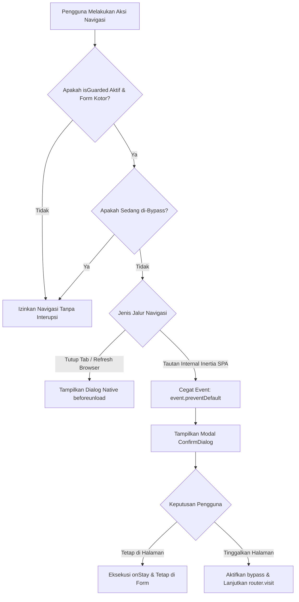

# useUnsavedChanges

Modul composable enterprise Vue 3 dan Inertia.js untuk mencegah pengguna meninggalkan halaman secara tidak sengaja ketika formulir masih memiliki perubahan yang belum disimpan (Dirty State Guard), mengintegrasikan event browser `beforeunload` dan pencegatan rute SPA Inertia.

---

## 01. Overview

### 1.1 Deskripsi Komponen
`useUnsavedChanges` adalah sistem pengaman navigasi berlapis ganda (Dual-Guard Mechanism). Composable ini memantau status kebersihan formulir (`isDirty`) dan secara otomatis mencegat dua jalur keluarnya pengguna: (1) penutupan tab atau penyegaran browser manual via event native `beforeunload`, dan (2) perpindahan rute internal aplikasi satu halaman (SPA) melalui listener siklus hidup `router.on('before')` milik Inertia.js.

### 1.2 Masalah yang Diselesaikan
- Kehilangan Draf yang Belum Disimpan: Pengguna yang tidak sengaja mengeklik tautan navigasi di sidebar atau menutup tab browser saat sedang mengisi formulir panjang sering kehilangan seluruh data yang telah diketik.
- Dialog Browser Kuno: Navigasi SPA internal sering kali terganggu oleh dialog native browser yang tidak dapat disesuaikan gayanya. `useUnsavedChanges` menampilkan modal konfirmasi kustom yang elegan (`useConfirm`) yang selaras dengan tema aplikasi.
- Penanganan Beragam Sumber Data Kotor: Mendukung pendeteksian fleksibel baik dari boolean primitif, fungsi getter, objek formulir Inertia `useForm`, maupun composable `useAutoSave`.
- Interupsi pada Submit yang Sah: Menyediakan fungsi `bypass()` agar saat pengguna mengeklik tombol "Simpan" yang sah, proses pengiriman formulir dan pengalihan halaman tidak diblokir oleh guard.

### 1.3 Kapan Harus Menggunakan
- Formulir edit artikel, manajemen profil, atau konfigurasi sistem yang memiliki banyak kolom input.
- Formulir checkout multi-tahap atau input data transaksi penting.
- Dokumen draf yang belum disinkronkan ke server backend.

### 1.4 Kapan TIDAK Menggunakan
- Formulir Pencarian atau Filter: Formulir read-only yang nilainya hanya berupa query filter tabel tidak memerlukan guard konfirmasi keluar.
- Formulir dengan Auto-Save Instan: Jika formulir langsung menyimpan perubahan setiap milidetik ke server tanpa ada kemungkinan kehilangan data, penggunaan guard dapat mengganggu alur kerja pengguna.

---

## 02. Preview

> [!TIP]
> Pengujian fungsional dan showcase composable ini dapat diuji secara native pada portal pratinjau aplikasi:
>
> <a href="http://localhost:8000/preview" target="_self" style="display: inline-flex; align-items: center; gap: 6px; padding: 6px 14px; border-radius: 8px; font-weight: 600; text-decoration: none; margin-top: 8px; background-color: var(--vp-c-brand-1, #4f46e5); color: #ffffff;">Buka Live Preview Portal Komponen &rarr;</a>

---

## 03. Installation & Import

Modul `useUnsavedChanges` diimpor langsung dari direktori Composables:

```javascript
import { useUnsavedChanges } from '@/Composables/Pack/useUnsavedChanges';
```

---

## 04. Anatomy

### Diagram Struktur Aliran Dual-Guard
```
+-------------------------------------------------------------+
|              Sumber State Formulir (isDirtyTarget)           |
|         (Ref<boolean>, Getter, useForm, useAutoSave)         |
+-------------------------------------------------------------+
                               |
                               v
+-------------------------------------------------------------+
|                 evaluateIsDirty() & isGuarded                |
+-------------------------------------------------------------+
          |                                   |
    [Jalur 1: Browser Native]           [Jalur 2: Navigasi Inertia]
          |                                   |
          v                                   v
+-----------------------+           +-----------------------+
|   window.beforeunload |           | router.on('before')   |
|   - Tutup tab         |           | - Klik tautan SPA     |
|   - Tekan F5 reload   |           | - Cegat event.prevent |
|   - Ketik URL baru    |           | - Buka ConfirmDialog  |
+-----------------------+           +-----------------------+
                                              |
                                              v
+-------------------------------------------------------------+
|                     Pilihan Pengguna                        |
|  - Tetap di Sini   -> Batalkan navigasi & jalankan onStay() |
|  - Tinggalkan      -> isBypassing = true & lanjutkan visit  |
+-------------------------------------------------------------+
```

### Mermaid Diagram Alur Pencegatan Navigasi


---

## 05. Props / Options

Parameter yang diterima oleh fungsi `useUnsavedChanges(isDirtyTarget, options)`:

| Parameter | Tipe | Default | Deskripsi |
| :--- | :--- | :--- | :--- |
| `isDirtyTarget` | `Ref<boolean> \| Function \| Object` | Wajib | Sumber status kotor. Menerima Ref boolean, fungsi getter `() => boolean`, objek `useForm`, atau objek `useAutoSave`. |
| `options.title` | `string` | `'Perubahan Belum Disimpan'` | Judul pada modal dialog konfirmasi. |
| `options.message` | `string` | `'Ada perubahan pada formulir yang belum disimpan...'` | Teks penjelasan detail konsekuensi meninggalkan halaman. |
| `options.confirmText` | `string` | `'Tinggalkan Halaman'` | Teks label tombol persetujuan keluar. |
| `options.cancelText` | `string` | `'Tetap di Sini'` | Teks label tombol pembatalan keluar. |
| `options.variant` | `'warning' \| 'danger' \| 'primary'` | `'warning'` | Gaya visual tema modal dialog konfirmasi. |
| `options.useConfirmDialog`| `boolean` | `true` | Menggunakan modal konfirmasi kustom (`useConfirm`). Jika `false`, menggunakan fallback `window.confirm`. |
| `options.enabled` | `boolean \| Ref<boolean>` | `true` | Menentukan apakah guard aktif sejak inisialisasi awal. |
| `options.onLeave` | `Function \| null` | `null` | Callback yang dipanggil saat pengguna memilih meninggalkan halaman. |
| `options.onStay` | `Function \| null` | `null` | Callback yang dipanggil saat pengguna memilih bertahan di halaman. |

---

## 06. Slots

Komponen utilitas ini merupakan Composable logic murni dan tidak menggunakan slot template.

---

## 07. Emits / Events

Komponen utilitas ini merupakan Composable logic murni dan tidak memancarkan event emit komponen.

---

## 08. Methods / Exposes

### Return Nilai dari Composable `useUnsavedChanges`

| Properti / Fungsi | Tipe | Deskripsi |
| :--- | :--- | :--- |
| `isGuarded` | `ComputedRef<boolean>` | State reaktif yang bernilai `true` jika guard aktif dan formulir sedang dalam status kotor (`isDirty`). |
| `isEnabled` | `Ref<boolean>` | State reaktif penanda status aktif atau nonaktifnya guard secara keseluruhan. |
| `isBypassing` | `Ref<boolean>` | Penanda apakah guard sedang dilewati sementara waktu. |
| `bypass()` | `Function` | Mengaktifkan mode bypass (`isBypassing = true`). Wajib dipanggil sebelum submit form yang sah. |
| `enable()` | `Function` | Mengaktifkan penjaga formulir secara programatik. |
| `disable()` | `Function` | Menonaktifkan penjaga formulir secara programatik. |
| `evaluateIsDirty()` | `Function` | Fungsi pembantu untuk memeriksa status kotor formulir saat ini secara langsung. |

---

## 09. Keyboard Navigation / Accessibility

Pencegatan navigasi yang aksesibel bagi pengguna disabilitas:
- Penguncian Fokus Modal (Focus Trap): Ketika modal `ConfirmDialog` muncul akibat navigasi yang dicegat, fokus keyboard otomatis dikunci di dalam dialog agar pengguna pembaca layar tidak dapat berinteraksi dengan elemen latar belakang.
- Tombol Pembatalan Default: Tombol "Tetap di Sini" sebaiknya menjadi elemen yang pertama kali menerima fokus agar pengguna keyboard yang menekan tombol `Enter` secara tidak sengaja tidak kehilangan data mereka.
- Penutupan dengan Tombol `Escape`: Menekan tombol `Escape` pada keyboard otomatis membatalkan navigasi dan mengembalikan fokus pengguna ke formulir asal.

---

## 10. State Management & Lifecycle

- Ekstraksi Sumber Fleksibel: Fungsi `evaluateIsDirty()` memeriksa berbagai struktur data:
  1. Jika tipe primitif boolean, langsung dikembalikan.
  2. Jika fungsi, fungsi dieksekusi `isDirtyTarget()`.
  3. Jika objek `useForm` dari Inertia, properti `target.isDirty` dibaca.
  4. Jika objek `useAutoSave`, properti `target.isDirty.value` dibaca.
- Registrasi dan Pembersihan Bersih: Event listener `beforeunload` dipasang pada `window` saat `onMounted`. Listener router Inertia (`router.on('before')`) disimpan ke referensi `removeInertiaListener` dan dilepas secara tuntas saat siklus `onUnmounted`.

---

## 11. Code Examples

### 11.1 Contoh Dasar (Integrasi dengan Formulir Inertia `useForm`)
```vue
<script setup>
import { useForm } from '@inertiajs/vue3';
import { useUnsavedChanges } from '@/Composables/Pack/useUnsavedChanges';

const form = useForm({
  title: 'Judul Draf Dokumen',
  content: 'Konten artikel awal...',
});

// Guard langsung memantau objek form Inertia
const { bypass } = useUnsavedChanges(form, {
  title: 'Perubahan Belum Tersimpan',
  message: 'Perubahan pada dokumen ini akan hilang jika Anda berpindah halaman.',
});

const handleSave = () => {
  // Panggil bypass sebelum submit yang sah agar navigasi redirect tidak dicegat
  bypass();
  form.post(route('articles.store'), {
    onError: () => {
      // Jika validasi backend gagal, guard tetap melindungi formulir
    }
  });
};
</script>

<template>
  <form @submit.prevent="handleSave" class="space-y-4 max-w-lg p-5 border rounded-2xl bg-white dark:bg-zinc-900">
    <div>
      <label class="block text-xs font-semibold mb-1">Judul Dokumen:</label>
      <input v-model="form.title" type="text" class="w-full px-3 py-2 border rounded-xl" />
    </div>

    <div>
      <label class="block text-xs font-semibold mb-1">Isi Konten:</label>
      <textarea v-model="form.content" rows="4" class="w-full px-3 py-2 border rounded-xl"></textarea>
    </div>

    <button type="submit" :disabled="form.processing" class="px-4 py-2 bg-indigo-600 text-white rounded-xl text-xs font-semibold">
      Simpan Dokumen
    </button>
  </form>
</template>
```

### 11.2 Contoh Menengah (Pemantauan Berbasis Getter Function)
```vue
<script setup>
import { ref, computed } from 'vue';
import { useUnsavedChanges } from '@/Composables/Pack/useUnsavedChanges';

const initialData = { name: 'Chandra', email: 'chandra@speedpay.id' };
const formData = ref({ ...initialData });

// Evaluasi perubahan data
const isModified = computed(() => {
  return formData.value.name !== initialData.name || formData.value.email !== initialData.email;
});

const { isGuarded } = useUnsavedChanges(() => isModified.value, {
  variant: 'danger',
  onLeave: () => {
    // Reset data jika pengguna memutuskan pergi
    Object.assign(formData.value, initialData);
  },
});
</script>

<template>
  <div class="p-4 border rounded-xl space-y-3">
    <div v-if="isGuarded" class="p-2.5 rounded-lg bg-amber-50 text-amber-800 text-xs font-semibold">
      Peringatan: Anda memiliki perubahan data yang belum disimpan.
    </div>
    <input v-model="formData.name" type="text" class="w-full px-3 py-2 border rounded-lg text-xs" />
  </div>
</template>
```

### 11.3 Contoh Lanjutan (Sinergi dengan Composable `useAutoSave`)
```vue
<script setup>
import { ref } from 'vue';
import { useAutoSave } from '@/Composables/Pack/useAutoSave';
import { useUnsavedChanges } from '@/Composables/Pack/useUnsavedChanges';

const articleForm = ref({ title: '', body: '' });

// Draf disimpan secara otomatis ke localStorage
const autoSave = useAutoSave(articleForm, {
  key: 'draft_article_session',
  interval: 3000,
});

// Guard memantau status isDirty dari autoSave
const { isGuarded, bypass } = useUnsavedChanges(autoSave, {
  title: 'Draf Belum Disinkronkan',
  message: 'Draf lokal Anda belum dikirimkan ke server utama.',
});

const handleFinalSubmit = async () => {
  bypass();
  // Simpan ke API backend
  autoSave.clearDraft();
};
</script>
```

---

## 12. Integration with Laravel & Inertia

### 12.1 Penanganan Redirect Sukses Controller Laravel
Ketika controller Laravel merespons dengan pengalihan rute (`redirect()->route(...)`), Inertia router akan mengeksekusi navigasi halaman baru. Memanggil `bypass()` sebelum `form.submit()` menjamin bahwa siklus `router.visit` yang diinisiasi oleh respon server berjalan mulus:

```php
// app/Http/Controllers/ArticleController.php
namespace App\Http\Controllers;

use App\Models\Article;
use Illuminate\Http\Request;

class ArticleController extends Controller
{
    public function update(Request $request, Article $article)
    {
        $validated = $request->validate([
            'title' => 'required|string|max:255',
            'body' => 'required|string',
        ]);

        $article->update($validated);

        return redirect()->route('articles.index')
            ->with('success', 'Artikel berhasil diperbarui tanpa hambatan guard.');
    }
}
```

Di komponen frontend:
```javascript
const submitForm = () => {
    bypass(); // Kunci penting agar redirect Inertia diizinkan
    form.put(route('articles.update', article.id));
};
```

---

## 13. Styling & Customization

Penataan status guard dan indikator form kotor memanfaatkan kelas utilitas Tailwind CSS v4:

```html
<!-- Indikator Banner Formulir Kotor Mengambang -->
<div
  v-if="isGuarded"
  class="fixed bottom-4 left-1/2 -translate-x-1/2 px-4 py-2 rounded-xl bg-amber-500 text-white font-medium text-xs shadow-lg flex items-center gap-2 z-30"
>
  <span class="material-symbols-outlined text-sm">lock_clock</span>
  <span>Ada perubahan belum tersimpan. Navigasi saat ini dilindungi.</span>
</div>
```

---

## 14. Responsive Behavior

Pencegatan navigasi beroperasi secara non-visual di latar belakang. Saat modal konfirmasi dipicu di layar smartphone (`< 640px`), modal akan otomatis beradaptasi menjadi sheet bawah (bottom sheet) atau dialog terpusat sesuai konfigurasi `ConfirmDialog.vue`.

---

## 15. Performance Optimization & Benchmarks

1. Pendekatan Berbasis Event: Guard tidak menggunakan interval polling `setInterval`. Pemeriksaan `evaluateIsDirty()` hanya dieksekusi secara instan saat ada interaksi pengguna yang memicu event navigasi browser atau router.
2. Eksekusi O(1): Evaluasi status kotor hanya membaca nilai boolean atau properti objek tunggal, dengan waktu eksekusi kurang dari 0.001ms.

---

## 16. Security Best Practices

- Pencegahan Kehilangan Data Rahasia: Memastikan data penting seperti isian kontrak hukum, catatan keuangan, atau token kunci API tidak hilang secara tidak sengaja karena ketidaksengajaan klik tautan menu navigasi samping.
- Pembatalan Transisi Rute Aman: Menggunakan `event.preventDefault()` pada event router Inertia menjamin riwayat peramban (browser history state) tidak terkorupsi saat pengguna membatalkan niat keluar halaman.

---

## 17. Troubleshooting / FAQ

### Pertanyaan 1: Mengapa teks pesan saya tidak muncul saat saya mencoba menutup tab browser?
Jawaban: Ini adalah batasan keamanan browser modern (Chrome, Firefox, Safari). Untuk mencegah pesan phishing atau penipuan dari situs berbahaya, browser mengabaikan teks kustom pada event `beforeunload` dan hanya menampilkan dialog standar bawaan browser. Pesan kustom Anda (`options.message`) akan tampil penuh pada navigasi SPA internal Inertia.

### Pertanyaan 2: Mengapa tombol submit formulir memunculkan dialog peringatan perubahan belum disimpan?
Jawaban: Pastikan Anda memanggil fungsi `bypass()` sesaat sebelum mengeksekusi `form.submit()`, `form.post()`, atau `router.visit()`. Hal ini memberitahu guard bahwa navigasi yang terjadi adalah aksi penyimpanan yang disengaja.

---

## 18. Comparison with Alternatives

| Fitur / Karakteristik | useUnsavedChanges (Pack UI) | Native beforeunload Saja | Vue Router Navigation Guard |
| :--- | :--- | :--- | :--- |
| Dukungan Navigasi SPA Inertia | Penuh (`router.on('before')`) | Tidak Ada | Hanya untuk Vue Router |
| Tampilan Modal Kustom | Elegan (`ConfirmDialog`) | Primitif Bawaan Browser | Bergantung Implementasi |
| Penutupan Tab Browser | Terproteksi (`beforeunload`) | Terproteksi | Tidak Terproteksi |
| Kompatibilitas `useForm` | Bawaan Terintegrasi | Manual | Manual |

---

## 19. Notes / Limitations

- Penugasan Langsung `window.location.href`: Jika ada script yang melakukan navigasi paksa menggunakan `window.location.href = '...'`, router Inertia tidak dapat mencegatnya secara internal, namun jalur `beforeunload` browser tetap akan menangkap dan meminta konfirmasi.
- Masa Hidup Komponen: Guard terikat pada siklus hidup komponen formulir. Jika formulir berhasil di-unmount secara sah, seluruh listener otomatis dibersihkan.
