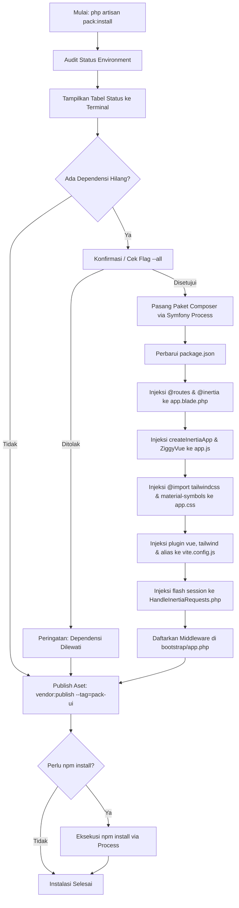

# InstallPackCommand

Command Artisan console `pack:install` yang berfungsi untuk mengotomatisasi audit lingkungan, instalasi dependensi backend dan frontend, konfigurasi berkas inti framework, serta penerbitan aset antarmuka Laravel Pack UI ke direktori proyek aplikasi.

---

## 01. Overview

`InstallPackCommand` adalah smart auto-installer yang memastikan ekosistem Laravel, Inertia.js, Vue 3, Ziggy Router, Tailwind CSS v4, Google Material Symbols, Tiptap Editor, dan Leaflet Map terkonfigurasi secara terpadu tanpa memerlukan pengaturan manual berkas demi berkas.

### 1.1 Apa Entitas Ini
Class console command Artisan beralamat di `Chandra2004\LaravelPackUi\Console\InstallPackCommand`, diwariskan dari `Illuminate\Console\Command`, dengan berkas sumber di `packages/laravel-pack-ui/src/Console/InstallPackCommand.php`. Command ini didaftarkan secara otomatis melalui `PackUiServiceProvider`.

### 1.2 Fungsi Utama
- Memindai kesiapan ekosistem proyek aplikasi target (audit environment).
- Memasang paket Composer backend (`inertiajs/inertia-laravel` dan `tightenco/ziggy`).
- Menambahkan dependensi frontend ke `package.json` dengan versi yang teruji kompatibel (termasuk penyesuaian `@vitejs/plugin-vue` untuk Vite 7+).
- Mengonfigurasi berkas root template Blade (`resources/views/app.blade.php`).
- Mengonfigurasi entrypoint Vue dan router Ziggy (`resources/js/app.js`).
- Menyiapkan styling Tailwind CSS v4 dan Material Symbols (`resources/css/app.css`).
- Mengatur bundler Vite (`vite.config.js`) lengkap dengan plugin dan path alias `@` serta `ziggy-js`.
- Menyuntikkan flash session props ke middleware `HandleInertiaRequests.php` dan mendaftarkannya ke `bootstrap/app.php`.
- Mempublikasikan seluruh berkas komponen, composables, dan layouts ke `resources/js/`.
- Menjalankan `npm install` secara otomatis.

### 1.3 Kapan Digunakan
- Sesaat setelah paket `chandra2004/laravel-pack-ui` pertama kali dipasang melalui Composer pada proyek Laravel baru atau yang sudah ada.
- Saat melakukan pembaruan versi paket mayor untuk memperbarui seluruh komponen bawaan ke versi terbaru menggunakan flag `--force`.
- Pada pipeline CI/CD atau script provisioning otomatis menggunakan flag `--all`.

### 1.4 Karakteristik Penting
- Non-Destructive by Default: Tidak menimpa berkas komponen yang telah dimodifikasi kecuali flag `--force` diberikan.
- Smart Audit dan Injeksi Cerdas: Memeriksa apakah konfigurasi sudah ada sebelumnya sehingga tidak menduplikasi baris kode pada file konfigurasi.
- Cross-Platform: Mendeteksi sistem operasi Windows (`npm.cmd`) dan Unix (`npm`) secara otomatis saat menjalankan sub-proses instalasi dependensi.

---

## 02. Preview

Representasi visual keluaran terminal saat perintah `php artisan pack:install` dieksekusi:

```text
+------------------------------------------------------------+
|             Laravel Pack UI - Smart Installer              |
+------------------------------------------------------------+

Memeriksa environment project Anda...
+----------------------------------------+------------------------------------+
| Dependensi / Fitur                     | Status                             |
+----------------------------------------+------------------------------------+
| Inertia.js (Laravel Backend)           | Belum Ada                          |
| Tighten Ziggy (Laravel Backend)        | Belum Ada                          |
| Vue 3 & Vite Plugin                    | Belum Ada                          |
| Inertia.js (Vue 3 Client)              | Belum Ada                          |
| Ziggy JS Client (route() helper)       | Belum Ada                          |
| Tailwind CSS v4 Engine                 | Belum Ada                          |
| Google Material Symbols Font           | Belum Ada                          |
| Tiptap Rich Text Editor Engine         | Belum Ada                          |
| Leaflet OpenStreetMap Map Engine       | Belum Ada                          |
| Root Layout (app.blade.php)            | Belum Ada / Kurang @routes         |
| Vue Entrypoint (app.js)                | Belum Ada / Kurang ZiggyVue        |
| Styling Import (app.css)               | Belum Dikonfigurasi                |
| Vite Config (vite.config.js)           | Belum Ada / Kurang Plugin Vue      |
| Inertia Flash Props (HandleInertia...) | Belum Ada / Kurang Session Flash   |
+----------------------------------------+------------------------------------+

Apakah Anda ingin otomatis memasang dan mengonfigurasi dependensi yang belum ada? (yes/no) [yes]:
> yes

Memasang paket Composer: inertiajs/inertia-laravel tightenco/ziggy...
  - Paket Composer berhasil dipasang.
Memperbarui dependensi di package.json...
  - package.json berhasil diperbarui dengan dependensi yang dibutuhkan.
Mengonfigurasi resources/views/app.blade.php...
  - resources/views/app.blade.php berhasil dibuat lengkap dengan @routes & @inertia.
Mengonfigurasi resources/js/app.js...
  - resources/js/app.js berhasil dikonfigurasi dengan createInertiaApp & ZiggyVue.
Mengonfigurasi resources/css/app.css...
  - resources/css/app.css berhasil dikonfigurasi.
Memeriksa & Mengonfigurasi vite.config.js...
  - vite.config.js berhasil diperbarui dengan plugin Vue, Tailwind v4, dan alias Ziggy.
Memeriksa dan mengonfigurasi HandleInertiaRequests.php...
  - Berkas HandleInertiaRequests.php berhasil dibuat dengan sharing flash session.
  - Middleware HandleInertiaRequests berhasil didaftarkan di bootstrap/app.php.

Memasang Komponen Pack UI & Composables ke resources/js...
Copied Directory [packages/laravel-pack-ui/resources/js/Components/Pack] To [resources/js/Components/Pack]
Copied Directory [packages/laravel-pack-ui/resources/js/Composables/Pack] To [resources/js/Composables/Pack]
Copied Directory [packages/laravel-pack-ui/resources/js/Layouts/Pack] To [resources/js/Layouts/Pack]
Publishing complete.

Jalankan "npm install" sekarang untuk memasang/memastikan seluruh paket Node.js terpasang? (yes/no) [yes]:
> yes

Menjalankan npm install...
  - Seluruh paket Node.js berhasil terpasang.

Instalasi selesai! Pack UI siap digunakan.
  - Komponen UI : resources/js/Components/Pack
  - Composables : resources/js/Composables/Pack
  - Layouts     : resources/js/Layouts/Pack
```

---

## 03. Usage

Konsep penggunaan dan matriks keputusan arsitektural untuk command `pack:install`:

### Pohon Konsep Penggunaan
```text
php artisan pack:install
├── Mode Penggunaan
│   ├── Interaktif (Standar pengembang)
│   ├── Otomatis Penuh (--all untuk CI/CD)
│   ├── Penimpaan Aset (--force untuk update)
│   └── Kombinasi (--all --force untuk fresh install)
└── Target Eksekusi
    ├── Verifikasi Environment (Audit)
    ├── Penyediaan Paket (Composer & NPM)
    ├── Konfigurasi Framework (Blade, JS, CSS, Vite, Middleware)
    └── Distribusi Berkas UI (Components, Composables, Layouts)
```

### Matriks Keputusan Pemilihan Opsi
| Skenario | Opsi yang Disarankan | Alasan |
| --- | --- | --- |
| Proyek Laravel Baru (Fresh) | `php artisan pack:install --all` | Menyiapkan seluruh dependensi tanpa perlu konfirmasi berulang. |
| Proyek Berjalan (Existing App) | `php artisan pack:install` | Memungkinkan pengembang mengaudit status dependensi dan menyetujui langkah per langkah. |
| Pembaruan Versi Paket UI | `php artisan pack:install --force` | Menimpa berkas komponen lama dengan versi rilis paket terbaru. |
| Docker / Otomasi Deployment | `php artisan pack:install --all --force` | Eksekusi non-interaktif dan memastikan seluruh aset sinkron dengan image build. |

---

## 04. Anatomy

Arsitektur internal class dan alur eksekusi proses instalasi:

### Struktur Hierarki Internal
```text
InstallPackCommand
├── Input Options Handler
│   ├── $force (--force flag)
│   └── $autoAll (--all flag)
├── Stage 1: Environment Audit (auditEnvironment)
│   ├── Scan Composer dependencies
│   ├── Scan NPM dependencies & check Vite 7/8 compatibility
│   ├── Scan Blade, JS, CSS, Vite configs
│   ├── Scan Inertia Middleware & flash props
│   └── Output ANSI Status Table
├── Stage 2: Missing Dependencies Provisioning
│   ├── installComposerPackages (Symfony Process)
│   ├── configureNodeDependencies (package.json manipulator)
│   ├── configureAppBlade (Directives injector)
│   ├── configureAppJs (Inertia & ZiggyVue injector)
│   ├── configureAppCss (Tailwind & font import injector)
│   ├── configureVite (Plugin & alias injector)
│   └── configureHandleInertiaRequests (Flash session injector)
│       └── registerInertiaMiddlewareInBootstrap (Laravel 11/12 bootstrap/app.php)
├── Stage 3: Asset Publishing
│   └── vendor:publish --tag=pack-ui
└── Stage 4: NPM Provisioning
    └── runNpmInstall (Windows npm.cmd / Unix npm)
```

### Diagram Alur Eksekusi (Mermaid)


---

## 05. Variants

Mode eksekusi command yang tersedia:

### 1. Mode Interaktif (Default)
```bash
php artisan pack:install
```
Menampilkan tabel status hasil audit, kemudian meminta konfirmasi pengguna sebelum melakukan modifikasi berkas atau pemasangan paket.

### 2. Mode Otomatis Penuh (`--all`)
```bash
php artisan pack:install --all
```
Menyetujui seluruh proses pemasangan dependensi dan eksekusi `npm install` secara otomatis tanpa menghentikan proses untuk menunggu input pengguna.

### 3. Mode Penimpaan Berkas (`--force`)
```bash
php artisan pack:install --force
```
Meneruskan flag `--force` ke perintah `vendor:publish`, sehingga file komponen di `resources/js/` yang sudah ada akan ditimpa dengan versi terbaru dari paket.

### 4. Mode Kombinasi (`--all --force`)
```bash
php artisan pack:install --all --force
```
Pilihan standar untuk otomasi setup proyek baru dan testing pipeline CI/CD.

---

## 06. Sizes

Spesifikasi kapasitas dan volume dependensi yang dikelola oleh installer:

| Komponen Lingkup | Jumlah / Batas | Rincian |
| --- | --- | --- |
| Paket Composer Backend | 2 paket | `inertiajs/inertia-laravel`, `tightenco/ziggy` |
| Paket Node Frontend | 9 paket utama | `vue`, `@vitejs/plugin-vue`, `@inertiajs/vue3`, `ziggy-js`, `tailwindcss`, `@tailwindcss/vite`, `material-symbols`, `@tiptap/vue-3`, `leaflet` |
| Berkas Konfigurasi Dikelola | 6 berkas | `package.json`, `app.blade.php`, `app.js`, `app.css`, `vite.config.js`, `HandleInertiaRequests.php` |
| Direktori Aset Diterbitkan | 3 direktori | `Components/Pack/`, `Composables/Pack/`, `Layouts/Pack/` |
| Batas Waktu Eksekusi (Timeout) | 300 detik | Timeout per proses eksekusi Composer dan NPM |

---

## 07. States

Siklus status eksekusi command:

| Status | Tampilan / Indikator | Aksi Sistem |
| --- | --- | --- |
| `Initializing` | Banner ASCII Laravel Pack UI | Inisialisasi properti command dan parsing opsi. |
| `Auditing` | "Memeriksa environment project Anda..." | Pembacaan konten file JSON, Blade, JS, dan PHP. |
| `Prompting` | Prompt konfirmasi terminal (yes/no) | Menunggu keputusan pengguna jika flag `--all` tidak aktif. |
| `Installing Composer` | "Memasang paket Composer..." | Eksekusi proses CLI `composer require --no-interaction`. |
| `Configuring Files` | "Mengonfigurasi [nama_file]..." | Manipulasi regex dan string replacement pada konfigurasi. |
| `Publishing` | "Memasang Komponen Pack UI & Composables..." | Panggilan internal `vendor:publish --tag=pack-ui`. |
| `Running NPM` | "Menjalankan npm install..." | Eksekusi `npm install` sesuai platform OS. |
| `Completed` | "Instalasi selesai! Pack UI siap digunakan." | Pengembalian exit code 0 (`self::SUCCESS`). |

---

## 08. Props / Parameters / Attributes

Daftar opsi dan parameter input command:

| Parameter Opsi | Tipe Data | Nilai Default | Wajib | Deskripsi |
| --- | --- | --- | --- | --- |
| `--force` | `Boolean` | `false` | Tidak | Menimpa file komponen, composables, layouts, dan konfigurasi yang sudah ada pada proyek target. |
| `--all` | `Boolean` | `false` | Tidak | Memasang seluruh dependensi yang belum ada dan menjalankan npm install secara otomatis tanpa konfirmasi interaktif. |
| `--tag` | `String` | `'pack-ui'` | Tidak | Tag penerbitan vendor spesifik (`pack-ui`, `pack-ui-components`, `pack-ui-composables`, `pack-ui-layouts`). |

---

## 09. Slots / Content

Sebagai command sistem, titik injeksi template yang disisipkan ke dalam berkas proyek target meliputi:

### 1. Injeksi Blade (`resources/views/app.blade.php`)
Menyisipkan direktif `@routes`, `@inertiaHead`, dan `@inertia` pada struktur HTML5 standar jika belum tersedia.

### 2. Injeksi JavaScript (`resources/js/app.js`)
Menyisipkan inisialisasi Inertia dan ZiggyVue:
```javascript
import './bootstrap';
import { createApp, h } from 'vue';
import { createInertiaApp } from '@inertiajs/vue3';
import { ZiggyVue } from 'ziggy-js';

createInertiaApp({
    resolve: name => {
        const pages = import.meta.glob('./Pages/**/*.vue', { eager: true });
        return pages[`./Pages/${name}.vue`];
    },
    setup({ el, App, props, plugin }) {
        createApp({ render: () => h(App, props) })
            .use(plugin)
            .use(ZiggyVue)
            .mount(el);
    },
    progress: {
        color: '#4B5563',
    },
});
```

### 3. Injeksi CSS (`resources/css/app.css`)
Menyisipkan import Tailwind CSS v4 dan Material Symbols:
```css
@import 'tailwindcss';
@import 'material-symbols';

@custom-variant dark (&:where(.dark, .dark *));
```

### 4. Injeksi Vite (`vite.config.js`)
Menyisipkan plugin `vue()`, `tailwindcss()`, path alias `'ziggy-js'` serta `'@'`, dan optimasi `build: { chunkSizeWarningLimit: 3000 }`:
```javascript
export default defineConfig({
    plugins: [
        laravel({
            input: ['resources/css/app.css', 'resources/js/app.js'],
            refresh: true,
        }),
        vue({
            template: {
                transformAssetUrls: {
                    base: null,
                    includeAbsolute: false,
                },
            },
        }),
        tailwindcss(),
    ],
    build: {
        chunkSizeWarningLimit: 3000,
    },
    resolve: {
        alias: {
            'ziggy-js': path.resolve('vendor/tightenco/ziggy'),
            '@': path.resolve(__dirname, './resources/js'),
        },
    },
});
```

### 5. Injeksi Flash Props (`HandleInertiaRequests.php`)
Menyisipkan array flash session pada method `share()`:
```php
'flash' => [
    'info'    => fn() => $request->session()->get('info'),
    'success' => fn() => $request->session()->get('success'),
    'warning' => fn() => $request->session()->get('warning'),
    'error'   => fn() => $request->session()->get('error'),
    'message' => fn() => $request->session()->get('message'),
    'alert'   => fn() => $request->session()->get('alert'),
],
```

---

## 10. Events / Interactions / Returns

### Interaksi Pengguna
- Konfirmasi pemasangan dependensi yang belum terpasang (`confirm`).
- Konfirmasi eksekusi `npm install` segera (`confirm`).

### Return Status (Exit Codes)
| Exit Code | Konstanta | Makna |
| --- | --- | --- |
| `0` | `Command::SUCCESS` | Command berhasil diselesaikan secara sempurna. |
| `1` | `Command::FAILURE` | Terjadi kegagalan fatal pada sub-proses atau eksekusi internal. |

---

## 11. Code Example

Tiga tingkatan implementasi pemanggilan command:

### 1. Penggunaan Dasar CLI
Dijalankan secara manual di root proyek:
```bash
php artisan pack:install
```

### 2. Penggunaan Otomasi Flag (Otomatis & Non-Interaktif)
Cocok untuk scripting setup proyek:
```bash
php artisan pack:install --all
```

### 3. Eksekusi Programatik di PHP (Advanced / Seeder / Deploy Script)
Dapat dipanggil dari skrip PHP atau controller internal:
```php
namespace App\Console\Commands;

use Illuminate\Console\Command;
use Illuminate\Support\Facades\Artisan;

class SetupAppEnvironment extends Command
{
    protected $signature = 'app:setup';
    protected $description = 'Setup seluruh environment aplikasi';

    public function handle(): int
    {
        $this->info('Mengonfigurasi Pack UI...');
        
        $exitCode = Artisan::call('pack:install', [
            '--all' => true,
            '--force' => true,
        ]);

        if ($exitCode === Command::SUCCESS) {
            $this->info('Pack UI berhasil dipasang secara programatik.');
        }

        return $exitCode;
    }
}
```

---

## 12. Result / Behavior

Setelah eksekusi berhasil:
- Direktori `resources/js/Components/Pack/` terisi 30+ komponen Vue 3 siap pakai.
- Direktori `resources/js/Composables/Pack/` terisi 20+ composables reaktif siap pakai.
- Direktori `resources/js/Layouts/Pack/` terisi template layout dashboard siap pakai.
- Berkas `package.json` diperbarui dengan dependensi yang diperlukan.
- Bundler Vite siap melakukan Hot Module Replacement (HMR) untuk file `.vue` dan memproses rute `route('nama.rute')`.
- Notifikasi toast frontend otomatis aktif saat backend mengirimkan redirect dengan flash session.

---

## 13. Customization

Pengembang memiliki kendali penuh untuk menyesuaikan hasil instalasi:
- **Penyesuaian Komponen**: Karena menggunakan pendekatan headless-copy, komponen di `resources/js/Components/Pack/` dapat diedit langsung sesuai kebutuhan desain proyek.
- **Penerbitan Parsial**: Jika hanya menginginkan komponen tertentu, gunakan perintah `vendor:publish` dengan tag individual (`pack-ui-components`, `pack-ui-composables`, `pack-ui-layouts`).
- **Override Template Blade / JS**: File `app.blade.php` atau `app.js` yang telah dibuat oleh installer dapat dimodifikasi bebas tanpa khawatir terhapus kembali selama tidak menjalankan `pack:install --force`.

---

## 14. Accessibility (a11y)

Standar aksesibilitas pada tingkat antarmuka CLI:
- **Teks Terminal Berkualitas ANSI**: Menggunakan kode format semantik Laravel (`<info>`, `<comment>`, `<warn>`) yang mendukung kontras warna tinggi di berbagai emulator terminal.
- **Dukungan Terminal Screen Reader**: Output disajikan dalam urutan teks linear yang ramah pembaca layar terminal.
- **Non-Interactive CI Mode**: Mendukung flag `--all` untuk lingkungan CI/CD tanpa antarmuka TTY interaktif.

---

## 15. Responsive Behavior & Cross-Platform

Adaptasi perilaku pada sistem operasi dan lingkungan yang berbeda:
- **Deteksi Binary Node.js**: Menggunakan `npm.cmd` saat dijalankan pada sistem operasi Windows (`PHP_OS_FAMILY === 'Windows'`) dan `npm` pada lingkungan Linux/macOS.
- **Deteksi Binary Composer**: Mencari binary `composer` melalui method internal `findComposerBinary()`.
- **Formatting Lebar Terminal**: Menggunakan perataan tabel bawaan Symfony Console yang otomatis menyesuaikan lebar layar terminal pengguna.

---

## 16. Do / Don't

### Rekomendasi (Do)
- Jalankan perintah ini segera setelah mengunduh paket via Composer.
- Lakukan commit git pada proyek sebelum menjalankan perintah dengan flag `--force`.
- Gunakan kombinasi `--all --force` ketika menginisialisasi starter kit aplikasi baru.

### Larangan (Don't)
- Jangan menjalankan perintah dengan opsi `--force` jika Anda telah memodifikasi berkas di `resources/js/Components/Pack/` tanpa memiliki backup atau riwayat commit git.
- Jangan mematikan paksa terminal (Ctrl+C) saat sub-proses Composer atau NPM sedang berlangsung untuk mencegah berkas lockfile corrupt.

---

## 17. Examples / Recipes

### Resep 1: Instalasi pada Proyek Laravel Baru
```bash
laravel new my-app
cd my-app
composer require chandra2004/laravel-pack-ui
php artisan pack:install --all
npm run dev
```

### Resep 2: Memperbarui Komponen setelah Upgrade Versi Paket
```bash
git add .
git commit -m "Backup sebelum upgrade pack ui"
composer update chandra2004/laravel-pack-ui
php artisan pack:install --force
npm run build
```

### Resep 3: Integrasi Otomatis pada Skrip Dockerfile
```dockerfile
RUN composer require chandra2004/laravel-pack-ui
RUN php artisan pack:install --all
RUN npm run build
```

---

## 18. Related Items

Ekosistem dan komponen yang berhubungan erat dengan command ini:
- **[PackUiServiceProvider](/pack-ui-service-provider)**: Service Provider yang mendaftarkan command ini ke framework Laravel.
- **[Panduan Setup](/setup)**: Panduan instalasi dan persiapan lingkungan awal.
- **HandleInertiaRequests**: Middleware yang menerima konfigurasi flash props untuk integrasi notifikasi.
- **useNotification**: Composable frontend yang memanfaatkan flash session hasil konfigurasi command ini.

---

## 19. Notes / Limitations

- **Kompatibilitas Framework**: Dirancang khusus untuk Laravel versi 11 dan 12 yang menggunakan arsitektur konfigurasi `bootstrap/app.php`.
- **Kompatibilitas Vite**: Mendukung Vite versi 5, 6, dan 7. Pada Vite 7+, installer secara otomatis memutakhirkan `@vitejs/plugin-vue` ke versi `^6.0.0` untuk mencegah konflik API bundler.
- **Prasyarat Lingkungan**: Memerlukan PHP versi 8.2 atau lebih tinggi serta binary `composer` dan `npm` yang terdaftar pada variabel `PATH` sistem operasi.
