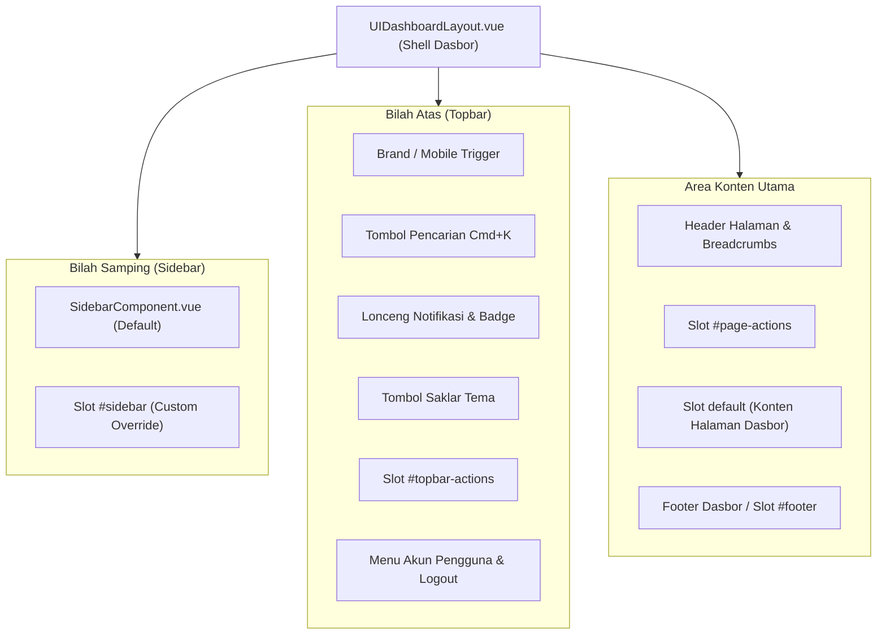

# UIDashboardLayout (`UIDashboardLayout.vue`)

`UIDashboardLayout.vue` adalah kerangka tata letak (*shell layout*) dasbor enterprise siap pakai untuk aplikasi Laravel, Inertia.js, dan Vue 3. Komponen ini mengintegrasikan navigasi samping `SidebarComponent.vue`, bilah atas (*topbar*), modal pencarian cepat `Cmd+K`, indikator notifikasi dengan lencana counter, tombol pengubah tema gelap/terang, breadcrumbs dinamis, menu profil akun pengguna, dan laci navigasi mobile (*mobile drawer*).

---

## 02. Preview

> [!TIP]
> Pengujian visual dan showcase tata letak dasbor ini tersedia secara native pada portal pratinjau aplikasi:
>
> <a href="/preview" target="_self" style="display: inline-flex; align-items: center; gap: 6px; padding: 6px 14px; border-radius: 8px; font-weight: 600; text-decoration: none; margin-top: 8px; background-color: var(--vp-c-brand-1, #4f46e5); color: #ffffff;">Buka Live Preview Portal Komponen &rarr;</a>

---

## 02. Arsitektur Tata Letak

Komponen ini membagi area tampilan dasbor menjadi beberapa zona modular yang dapat dikustomisasi secara independen:



---

## 03. Instalasi & Import

Komponen layout dapat diimpor langsung ke dalam halaman Inertia Anda:

```vue
<script setup>
import UIDashboardLayout from '@/Layouts/Pack/UIDashboardLayout.vue';
</script>

<template>
    <UIDashboardLayout title="Ringkasan Dasbor">
        <!-- Konten Halaman -->
    </UIDashboardLayout>
</template>
```

---

## 04. Props & Opsi Konfigurasi

| Nama Prop | Tipe | Default | Validasi / Pilihan | Deskripsi |
| :--- | :--- | :--- | :--- | :--- |
| `title` | `String` | `''` | - | Judul utama halaman pada topbar dan page header |
| `description` | `String` | `''` | - | Deskripsi pelengkap judul halaman |
| `breadcrumbs` | `Array` | `[]` | `Array<{ label, href?, icon? }>` | Daftar navigasi rekam jejak rute |
| `items` | `Array` | `[]` | `Array<SidebarItem>` | Daftar item navigasi sidebar bawaan |
| `sidebarItems` | `Array` | `[]` | `Array<SidebarItem>` | Alias alternatif untuk prop `items` |
| `user` | `Object` | `{ name: 'Pengguna', email: '', avatar: '', role: '' }` | - | Data identitas pengguna yang sedang login |
| `color` | `String` | `'primary'` | `'primary'`, `'blue'`, `'indigo'`, `'emerald'`, `'success'`, `'purple'`, `'violet'`, `'amber'`, `'warning'`, `'rose'`, `'danger'`, `'cyan'`, `'sky'`, `'dark'`, `'slate'` | Palet warna aksen layout dan sidebar |
| `sidebarVariant` | `String` | `'default'` | `'default'`, `'bordered'`, `'floating'` | Varian visual kontainer sidebar |
| `sidebarCollapsed` | `Boolean` | `false` | - | Status ciut awal sidebar desktop |
| `fluid` | `Boolean` | `false` | - | Lebar kontainer konten (`true` = 100% fluid, `false` = max-w-7xl) |
| `fixedHeader` | `Boolean` | `true` | - | Posisi sticky/fixed untuk bilah topbar |
| `showSearch` | `Boolean` | `true` | - | Tampilkan input/tombol pencarian global |
| `showThemeToggle` | `Boolean` | `true` | - | Tampilkan saklar mode gelap/terang di topbar |
| `showNotifications` | `Boolean` | `true` | - | Tampilkan lonceng notifikasi |
| `unreadNotifications` | `Number` | `0` | - | Angka lencana (*badge*) notifikasi belum dibaca |
| `showFooter` | `Boolean` | `true` | - | Tampilkan baris footer dasbor |
| `footerText` | `String` | `''` | - | Teks kustom hak cipta pada footer |
| `radius` | `String` | `'xl'` | `'none'`, `'sm'`, `'md'`, `'lg'`, `'xl'`, `'full'` | Kelengkungan sudut elemen layout |
| `activeRoute` | `String` | `''` | - | Identifier rute aktif untuk pencocokan item menu |

---

## 05. Events & Emits

| Nama Event | Parameter | Deskripsi |
| :--- | :--- | :--- |
| `update:sidebarCollapsed` | `(collapsed: boolean)` | Dipancarkan saat status ciut sidebar desktop berubah |
| `search` | `(query: string)` | Dipancarkan saat pengguna mengetik atau menekan enter pada input pencarian |
| `notifications-click` | `(event: MouseEvent)` | Dipancarkan saat ikon lonceng notifikasi diklik |
| `logout` | `()` | Dipancarkan saat pengguna menekan tombol Logout pada menu profil |
| `navigate` | `(item: Object)` | Dipancarkan saat item navigasi sidebar diklik |

---

## 06. Slots

| Nama Slot | Scope Props | Deskripsi |
| :--- | :--- | :--- |
| `default` | - | Konten utama halaman dasbor |
| `sidebar` | `{ collapsed, mobileOpen, toggleCollapse, openMobile, closeMobile }` | Mengganti seluruh komponen sidebar bawaan dengan implementasi kustom |
| `brand` | `{ collapsed }` | Kustomisasi logo dan nama brand di header sidebar |
| `topbar-actions` | - | Area tombol aksi tambahan di sebelah kanan bilah topbar |
| `page-actions` | - | Area tombol aksi di samping header judul halaman (misal: tombol tambah data) |
| `user-menu` | `{ user, logout }` | Kustomisasi menu dropdown profil pengguna |
| `footer` | - | Mengganti area footer standar |

---

## 07. Exposed Methods (Template Ref)

Komponen ini mengekspos fungsi pengontrol tampilan yang dapat diakses via `ref`:

```javascript
const layoutRef = ref(null);

// Membuka / menutup drawer mobile secara terprogram
layoutRef.value.openMobile();
layoutRef.value.closeMobile();

// Toggle sidebar desktop
layoutRef.value.toggleCollapse();
```

---

## 08. Contoh Penggunaan: Halaman Inertia Standar

Berikut contoh implementasi standar halaman manajemen data dengan integrasi navigasi dan aksi:

```vue
<script setup>
import { ref } from 'vue';
import { router } from '@inertiajs/vue3';
import UIDashboardLayout from '@/Layouts/Pack/UIDashboardLayout.vue';

const navigationMenu = [
    { heading: 'MANAJEMEN UTAMA' },
    { label: 'Dashboard', icon: 'dashboard', href: '/dashboard', active: true },
    { label: 'Pesanan', icon: 'receipt_long', href: '/orders', badge: '12' },
    { label: 'Pelanggan', icon: 'group', href: '/customers' },
    { separator: true },
    { heading: 'SISTEM' },
    { label: 'Pengaturan', icon: 'settings', href: '/settings' },
];

const breadcrumbs = [
    { label: 'Dasbor', href: '/dashboard' },
    { label: 'Daftar Pesanan' },
];

const handleLogout = () => {
    router.post('/logout');
};
</script>

<template>
    <UIDashboardLayout
        title="Daftar Pesanan"
        description="Kelola seluruh transaksi dan status pengiriman pelanggan."
        :items="navigationMenu"
        :breadcrumbs="breadcrumbs"
        :user="{
            name: 'Chandra Tri Antomo',
            email: 'chandra@speedpay.id',
            role: 'Super Admin'
        }"
        color="emerald"
        sidebar-variant="bordered"
        :unread-notifications="5"
        @logout="handleLogout"
    >
        <template #page-actions>
            <button
                type="button"
                class="px-4 py-2 bg-emerald-600 hover:bg-emerald-700 text-white text-xs font-semibold rounded-lg shadow-sm"
            >
                + Buat Pesanan Baru
            </button>
        </template>

        <!-- Konten Tabel Pesanan -->
        <div class="bg-white dark:bg-slate-900 border border-slate-200 dark:border-slate-800 rounded-xl p-6">
            <h3 class="text-sm font-bold text-slate-900 dark:text-white mb-4">Tabel Transaksi Masuk</h3>
            <p class="text-xs text-slate-500">Daftar transaksi tersinkronisasi secara otomatis.</p>
        </div>
    </UIDashboardLayout>
</template>
```

---

## 09. Contoh Penggunaan: Nested Persistent Layout di Inertia.js

Agar layout tidak di-mount ulang setiap kali perpindahan rute terjadi, definisikan layout persisten pada level page component:

```vue
<script>
import UIDashboardLayout from '@/Layouts/Pack/UIDashboardLayout.vue';

export default {
    layout: (h, page) => h(UIDashboardLayout, {
        title: 'Halaman Pengaturan',
        color: 'primary',
    }, () => page),
};
</script>

<script setup>
// Kode komponen halaman
</script>

<template>
    <div class="space-y-4">
        <!-- Form Pengaturan -->
    </div>
</template>
```

---

## 10. TypeScript / JSDoc Definitions

```typescript
export interface BreadcrumbItem {
    label: string;
    href?: string;
    icon?: string;
}

export interface UserProfile {
    name: string;
    email?: string;
    avatar?: string;
    role?: string;
}

export interface SidebarItem {
    heading?: string;
    separator?: boolean;
    label?: string;
    icon?: string;
    href?: string;
    active?: boolean;
    badge?: string | number;
    badgeVariant?: 'primary' | 'success' | 'warning' | 'danger' | 'info';
    children?: Array<SidebarItem>;
}

export interface UIDashboardLayoutProps {
    title?: string;
    description?: string;
    breadcrumbs?: BreadcrumbItem[];
    items?: SidebarItem[];
    sidebarItems?: SidebarItem[];
    user?: UserProfile;
    color?: 'primary' | 'blue' | 'indigo' | 'emerald' | 'success' | 'purple' | 'violet' | 'amber' | 'warning' | 'rose' | 'danger' | 'cyan' | 'sky' | 'dark' | 'slate';
    sidebarVariant?: 'default' | 'bordered' | 'floating';
    sidebarCollapsed?: boolean;
    fluid?: boolean;
    fixedHeader?: boolean;
    showSearch?: boolean;
    showThemeToggle?: boolean;
    showNotifications?: boolean;
    unreadNotifications?: number;
    showFooter?: boolean;
    footerText?: string;
    radius?: 'none' | 'sm' | 'md' | 'lg' | 'xl' | 'full';
    activeRoute?: string;
}
```

---

## 11. Penanganan Kasus Khusus & Edge Cases

1. **Layar Mobile (< 768px)**:
   - Sidebar desktop secara otomatis disembunyikan.
   - Pemicu hamburger pada header membuka *mobile drawer* dengan overlay *backdrop blur*.
   - Body scroll terkunci otomatis saat drawer terbuka guna mencegah *double scroll*.
2. **Shortcut Keyboard**:
   - Menekan `Cmd+B` atau `Ctrl+B` memicu toggle collapse sidebar.
   - Menekan `Escape` menutup drawer mobile atau modal pencarian yang sedang aktif.
3. **Persistensi State**:
   - State ciut sidebar disimpan ke `localStorage` (`pack_sidebar_collapsed`) sehingga preferensi pengguna tetap terjaga saat refresh browser.

---

## 12. Best Practices

- **Gunakan Breadcrumbs Konsisten**: Pastikan rute aktif terakhir tidak memiliki properti `href` agar rendered sebagai teks non-link.
- **Kombinasi Warna Semantik**: Pilih palet warna `color` yang konsisten dengan tema produk Anda (misal `emerald` untuk aplikasi fintech, `indigo` untuk platform SaaS).
- **Gunakan Fluid untuk Tabel Lebar**: Aktifkan `:fluid="true"` pada halaman data-dense seperti tabel log server atau spreadsheet analytics untuk memanfaatkan lebar monitor secara optimal.
