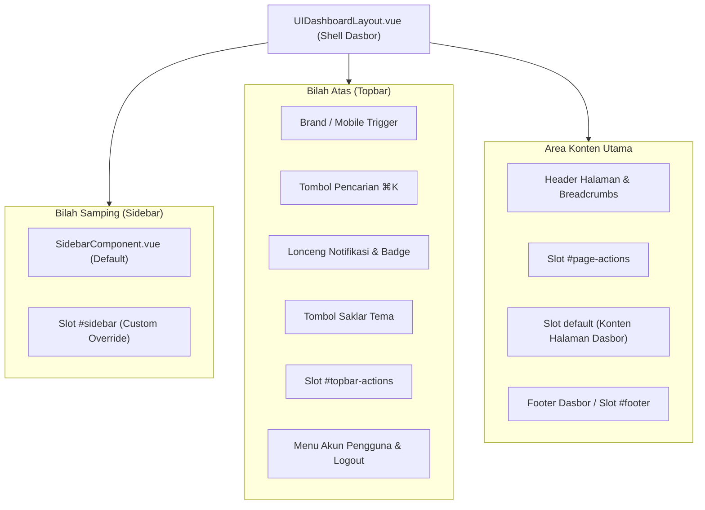

# 🖥️ UIDashboardLayout (`UIDashboardLayout.vue`)

[← Kembali ke Dokumentasi Utama](../../README.md)

`UIDashboardLayout.vue` adalah kerangka tata letak (*shell layout*) dasbor enterprise siap pakai. Komponen ini mengintegrasikan komponen navigasi samping `SidebarComponent.vue`, bilah atas (*topbar*), modal pencarian cepat `⌘K`, indikator notifikasi dengan lencana (*badge*), saklar pengubah tema gelap/terang, breadcrumbs dinamis, menu profil akun pengguna, dan laci navigasi mobile (*mobile drawer*).

---

## 📐 Arsitektur Tata Letak

Komponen ini membagi area tampilan dasbor menjadi beberapa zona modular yang dapat dikustomisasi secara independen:



---

## 🎨 5 Pilar Kustomisasi Terapan

1. **Warna Aksen (`colorTheme`)**:
   - `primary` (Default Blue), `indigo`, `emerald`, `purple`, `amber`, `rose`, `cyan`, `dark`.
   - Mengendalikan warna highlight navigasi aktif, badge, tombol aksi, dan fokus input pencarian.
2. **Bentuk & Radius Sidebar**:
   - Varian (`sidebarVariant`): `'default'`, `'bordered'`, `'floating'` (pulau melayang).
   - Radius (`sidebarRadius`): `'none'`, `'sm'`, `'md'`, `'lg'`, `'xl'`, `'full'`.
   - Gaya Item (`sidebarItemStyle`): `'soft'`, `'solid'`, `'outline'`.
   - Ukuran Navigasi (`sidebarSize`): `'sm'`, `'md'`, `'lg'`.
3. **Identitas & Teks Konten**:
   - `brandName`: Nama aplikasi (misal: `"PaymentPack"`).
   - `brandSub`: Sub-nama atau deskripsi singkat di header sidebar.
   - `breadcrumbs`: Daftar navigasi rekam jejak rute.
   - `footerText` & `footerVersion`: Hak cipta dan nomor rilis aplikasi.
4. **Ikon & Aksi Bilah Atas (Topbar)**:
   - Pencarian global `⌘K` dengan input debounced.
   - Lonceng notifikasi dengan counter badge belum terbaca.
   - Tombol saklar tema Gelap/Terang (`ButtonTheme.vue`).
5. **Pengguna & Akun (`user`)**:
   - Objek profil: `{ name, email, avatar, role }`.
   - Dropdown ringkasan profil dan tombol logout dengan event `@logout`.

---

## 🚀 Contoh Penggunaan Cepat

Gunakan `UIDashboardLayout.vue` sebagai pembungkus (*wrapper*) di halaman Inertia Anda:

```vue
<script setup>
import UIDashboardLayout from '@/Layouts/Pack/UIDashboardLayout.vue';
// Bisa juga diimpor via alias: '@/Components/Pack/UIDashboardLayout.vue' atau '@/Components/Pack/DashboardLayout.vue'

// 1. Data Navigasi Menu
const menuItems = [
    { heading: 'MENU UTAMA' },
    { 
        label: 'Dashboard', 
        icon: 'dashboard', 
        href: '/dashboard', 
        active: true 
    },
    { 
        label: 'Pesanan', 
        icon: 'shopping_bag', 
        href: '/orders', 
        badge: '12 Baru',
        badgeVariant: 'warning'
    },
    { 
        label: 'Pelanggan', 
        icon: 'group', 
        href: '/customers' 
    },
    { separator: true },
    { heading: 'PENGATURAN' },
    {
        label: 'Konfigurasi Toko',
        icon: 'settings',
        children: [
            { label: 'Metode Pembayaran', href: '/settings/payment' },
            { label: 'Integrasi Webhook', href: '/settings/webhook' },
        ]
    }
];

// 2. Breadcrumbs Halaman
const breadcrumbs = [
    { label: 'Home', href: '/' },
    { label: 'Dashboard', href: '/dashboard' },
    { label: 'Ringkasan Bisnis' }
];

// 3. Data Pengguna Login
const currentUser = {
    name: 'Budi Santoso',
    email: 'budi@tokomerchant.id',
    role: 'Merchant Admin',
    avatar: 'https://images.unsplash.com/photo-1472099645785-5658abf4ff4e?w=100'
};

const handleSearch = (query) => {
    console.log('Mencari:', query);
};

const handleLogout = () => {
    console.log('Pengguna meminta logout');
};
</script>

<template>
    <UIDashboardLayout
        :items="menuItems"
        :breadcrumbs="breadcrumbs"
        :user="currentUser"
        brand-name="MerchantPro"
        brand-sub="Panel Pengelola Toko"
        color-theme="primary"
        sidebar-variant="bordered"
        sidebar-item-style="soft"
        sidebar-radius="lg"
        :notification-count="5"
        @search="handleSearch"
        @logout="handleLogout"
    >
        <!-- Slot Aksi Tambahan di Kanan Header Halaman -->
        <template #page-actions>
            <button class="px-3 py-1.5 bg-blue-600 text-white rounded-lg text-xs font-semibold hover:bg-blue-700">
                + Buat Tagihan
            </button>
        </template>

        <!-- Slot Konten Utama Halaman -->
        <div class="grid grid-cols-1 md:grid-cols-3 gap-6">
            <div class="p-6 bg-white dark:bg-slate-900 rounded-2xl border border-slate-200 dark:border-slate-800 shadow-2xs">
                <h3 class="text-sm font-semibold text-slate-500">Total Volume Transaksi</h3>
                <p class="text-2xl font-bold mt-1 text-slate-900 dark:text-white">Rp 28.500.000</p>
            </div>
        </div>
    </UIDashboardLayout>
</template>
```

---

## 📋 Props API `<UIDashboardLayout />`

| Prop | Tipe Data | Default | Deskripsi |
| :--- | :--- | :--- | :--- |
| `items` | `Array` | `[]` | Array hierarki item navigasi menu sidebar |
| `sidebarItems` | `Array` | `[]` | Alias alternatif untuk `items` |
| `colorTheme` | `String` | `'primary'` | Tema warna aksen (`'primary'`, `'indigo'`, `'emerald'`, `'purple'`, `'amber'`, `'rose'`, `'cyan'`, `'dark'`) |
| `sidebarVariant`| `String` | `'bordered'` | Varian tampilan sidebar (`'default'`, `'bordered'`, `'floating'`) |
| `sidebarItemStyle`| `String` | `'soft'` | Gaya item navigasi aktif (`'soft'`, `'solid'`, `'outline'`) |
| `sidebarRadius` | `String` | `'lg'` | Bentuk sudut radius (`'none'`, `'sm'`, `'md'`, `'lg'`, `'xl'`, `'full'`) |
| `sidebarSize` | `String` | `'md'` | Kerapatan ukuran menu (`'sm'`, `'md'`, `'lg'`) |
| `brandName` | `String` | `'Pack UI'` | Nama judul brand di header sidebar |
| `brandSub` | `String` | `'Dashboard'` | Keterangan sub-judul di bawah brand |
| `breadcrumbs` | `Array` | `[]` | Array rute navigasi `[{ label: 'Home', href: '/' }, { label: 'Detail' }]` |
| `user` | `Object` | `{ name: 'Pengguna', email: '', avatar: '', role: '' }` | Data profil pengguna yang sedang terautentikasi |
| `title` | `String` | `''` | Judul teks halaman pada topbar/page header |
| `description` | `String` | `''` | Deskripsi teks sub-header halaman |
| `showSearch` | `Boolean` | `true` | Menampilkan tombol pencarian global `⌘K` di topbar |
| `searchPlaceholder` | `String` | `'Cari sesuatu (⌘K)...'` | Placeholder input pencarian cepat |
| `showNotifications` | `Boolean` | `true` | Menampilkan ikon lonceng notifikasi |
| `notificationCount` | `Number` | `0` | Angka lencana (*badge counter*) notifikasi belum dibaca |
| `showThemeToggle` | `Boolean` | `true` | Menampilkan saklar pengubah mode gelap/terang |
| `showFooter` | `Boolean` | `true` | Menampilkan baris footer di bagian bawah dasbor |
| `footerText` | `String` | `'© 2026 PT Payment Pack Digital Indonesia.'` | Teks hak cipta footer |
| `footerVersion` | `String` | `'v1.0.0'` | Nomor versi rilis aplikasi di footer |
| `activeRoute` | `String` | `''` | Rute URL yang sedang aktif untuk penandaan visual menu |
| `sidebarCollapsed` | `Boolean` | `false` | State reaktif status ciut sidebar (mendukung `v-model:sidebar-collapsed`) |
| `mobileOpen` | `Boolean` | `false` | State reaktif drawer mobile (mendukung `v-model:mobile-open`) |

---

## 🪟 Slots API

| Nama Slot | Parameter Slot | Deskripsi |
| :--- | :--- | :--- |
| `default` | - | Slot utama untuk menampung konten halaman dasbor |
| `#page-actions` | - | Tombol aksi cepat di sudut kanan atas header halaman (misal: tombol Ekspor, Buat Baru) |
| `#page-header` | - | Menimpa total tampilan judul halaman dan breadcrumb bawaan |
| `#topbar-actions`| - | Menyisipkan elemen atau tombol kustom di bilah atas sebelum foto profil pengguna |
| `#sidebar` | - | Menimpa sidebar bawaan dengan komponen navigasi kustom Anda sendiri |
| `#footer` | - | Menimpa area footer dasbor di bagian paling bawah |

---

## 🔔 Events API

| Nama Event | Parameter | Deskripsi |
| :--- | :--- | :--- |
| `@search` | `(query: string)` | Dipicu ketika pengguna mengetik atau menekan Enter di input pencarian `⌘K` |
| `@logout` | - | Dipicu ketika pengguna menekan opsi "Keluar / Logout" pada menu profil akun |
| `@update:sidebarCollapsed` | `(collapsed: boolean)` | Dipicu saat status ciut sidebar berubah |
| `@update:mobileOpen` | `(open: boolean)` | Dipicu saat laci navigasi mobile dibuka atau ditutup |

---

## 🎛️ Component Expose API (`defineExpose`)

Jika Anda menggunakan `ref` pada komponen `<UIDashboardLayout ref="layoutRef" />`, Anda dapat mengontrol perilakunya secara programatik:

```javascript
const layoutRef = ref(null);

// Membuka/menutup sidebar ciut secara programatik
layoutRef.value.toggleCollapse();

// Membuka drawer mobile (misal dari tombol kustom Anda di navbar luar)
layoutRef.value.openMobile();

// Menutup drawer mobile
layoutRef.value.closeMobile();
```

---

## 🧩 Struktur Objek Navigasi Menu (`items`)

Navigasi sidebar mendukung hirarki bertingkat tak terbatas (*infinite accordion*), pemisah seksi (*divider*), judul kelompok (*heading*), dan lencana varian:

```javascript
[
    // 1. Label Heading Kelompok
    { heading: 'TRANSAKSI' },
    
    // 2. Menu Tunggal dengan Badge
    { 
        label: 'Dashboard', 
        icon: 'dashboard', 
        href: '/dashboard', 
        active: true 
    },
    { 
        label: 'Mutasi Rekening', 
        icon: 'receipt_long', 
        badge: '18 Baru',
        badgeVariant: 'warning', // 'primary' | 'success' | 'warning' | 'danger' | 'info'
        href: '/mutations' 
    },
    
    // 3. Menu Accordion Bertingkat (Sub-Menu)
    {
        label: 'Virtual Account',
        icon: 'account_balance',
        children: [
            { label: 'BCA Direct', href: '/va/bca' },
            { label: 'Mandiri Multi', href: '/va/mandiri' },
            { 
                label: 'Bank Daerah',
                children: [
                    { label: 'Bank Jatim', href: '/va/jatim' },
                    { label: 'Bank BJB', href: '/va/bjb' },
                ]
            }
        ]
    },
    
    // 4. Garis Pemisah (Divider)
    { separator: true },
    
    // 5. Menu Pengaturan
    { label: 'Pengaturan Akun', icon: 'settings', href: '/settings' }
]
```
