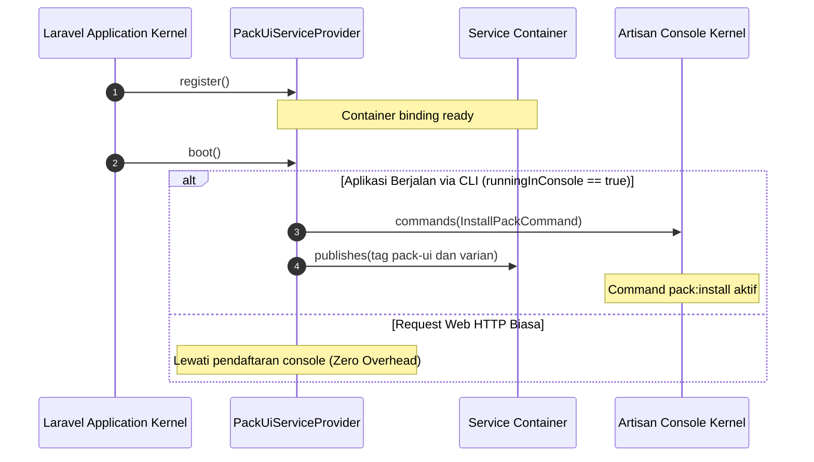

# PackUiServiceProvider

Service Provider utama dari paket `chandra2004/laravel-pack-ui` yang bertugas mendaftarkan perintah Artisan console dan mengonfigurasi tag penerbitan aset antarmuka, composables, serta layouts ke dalam siklus hidup framework Laravel.

---

## 01. Overview

`PackUiServiceProvider` adalah gerbang integrasi utama yang menghubungkan paket Laravel Pack UI dengan container dan console kernel Laravel.

### 1.1 Apa Entitas Ini
Class service provider beralamat di `Chandra2004\LaravelPackUi\PackUiServiceProvider`, diwariskan dari `Illuminate\Support\ServiceProvider`, dengan berkas sumber di `packages/laravel-pack-ui/src/PackUiServiceProvider.php`.

### 1.2 Fungsi Utama
- Mendaftarkan Artisan console command `InstallPackCommand` (`pack:install`) ke dalam console kernel Laravel.
- Mendefinisikan tag publikasi aset `pack-ui` untuk penerbitan seluruh berkas komponen, composables, dan layouts sekaligus.
- Mendefinisikan 3 tag penerbitan parsial (`pack-ui-components`, `pack-ui-composables`, `pack-ui-layouts`) untuk kebutuhan pembaruan spesifik.
- Mengisolasi seluruh proses pendaftaran console ke dalam blok `$this->app->runningInConsole()` demi efisiensi request HTTP.

### 1.3 Kapan Digunakan
- Secara otomatis dimuat oleh Laravel pada setiap booting aplikasi melalui Laravel Package Auto-Discovery.
- Dipanggil saat pengembang mengeksekusi perintah Artisan (`php artisan pack:install` atau `php artisan vendor:publish`).

### 1.4 Karakteristik Penting
- **Zero Overhead pada HTTP**: Seluruh pendaftaran command dan tag publish dibungkus dalam kondisi `runningInConsole()`, sehingga tidak menambah beban memori atau waktu bootstrap pada request web biasa.
- **Auto-Discovery Ready**: Terdaftar di `composer.json` paket, tidak memerlukan registrasi manual di konfigurasi aplikasi induk.
- **Modular Asset Tagging**: Menyediakan tag gabungan dan tag terpisah untuk fleksibilitas distribusi kode sumber.

---

## 02. Preview

Representasi visual interaksi provider pada eksekusi command Artisan `vendor:publish`:

```text
$ php artisan vendor:publish

Which provider or tag's files would you like to publish?:
  [0 ] Tag: pack-ui
  [1 ] Tag: pack-ui-components
  [2 ] Tag: pack-ui-composables
  [3 ] Tag: pack-ui-layouts
  [4 ] Provider: Chandra2004\LaravelPackUi\PackUiServiceProvider
 > 0

Publishing complete.
Copied Directory [packages/laravel-pack-ui/resources/js/Components/Pack] To [resources/js/Components/Pack]
Copied Directory [packages/laravel-pack-ui/resources/js/Composables/Pack] To [resources/js/Composables/Pack]
Copied Directory [packages/laravel-pack-ui/resources/js/Layouts/Pack] To [resources/js/Layouts/Pack]
```

---

## 03. Usage

Konsep peran arsitektural `PackUiServiceProvider` dalam framework Laravel:

### Pohon Konsep Penggunaan
```text
PackUiServiceProvider
├── Lifecycle Boot
│   ├── Register Method (Reservasi container binding)
│   └── Boot Method (Eksekusi console bootstrap)
├── Artisan Command Registration
│   └── pack:install (InstallPackCommand)
└── Asset Distribution Tags
    ├── pack-ui (Seluruh aset)
    ├── pack-ui-components (Hanya Komponen Vue)
    ├── pack-ui-composables (Hanya Fungsi Reaktif JS)
    └── pack-ui-layouts (Hanya Tata Letak Dashboard)
```

### Matriks Penggunaan Tag Publikasi
| Skenario Kebutuhan | Tag yang Digunakan | Target Berkas yang Diperbarui |
| --- | --- | --- |
| Instalasi Lengkap / Baru | `pack-ui` | `Components/Pack`, `Composables/Pack`, `Layouts/Pack` |
| Pembaruan Elemen UI Saja | `pack-ui-components` | Hanya `Components/Pack` |
| Pembaruan Logika Helper Saja | `pack-ui-composables` | Hanya `Composables/Pack` |
| Pembaruan Shell Tata Letak Saja | `pack-ui-layouts` | Hanya `Layouts/Pack` |

---

## 04. Anatomy

Arsitektur siklus hidup dan diagram alur internal class:

### Struktur Hierarki Internal
```text
PackUiServiceProvider (extends ServiceProvider)
│
├── register(): void (Dijalankan saat registrasi awal container)
│   └── [Dicadangkan untuk container bindings di masa depan]
│
└── boot(): void (Dijalankan setelah seluruh service provider terdaftar)
    └── Condition: $this->app->runningInConsole()
        ├── $this->commands([InstallPackCommand::class])
        └── $this->publishes(...)
            ├── Tag 'pack-ui' (Komponen + Composables + Layouts)
            ├── Tag 'pack-ui-components' (Komponen saja)
            ├── Tag 'pack-ui-composables' (Composables saja)
            └── Tag 'pack-ui-layouts' (Layouts saja)
```

### Diagram Alur Eksekusi (Mermaid)


---

## 05. Variants

Mode registrasi dan varian tag yang disediakan oleh provider:

### 1. Varian Registrasi Provider
- **Otomatis (Package Discovery)**: Terbaca langsung via `composer.json` tanpa penambahan konfigurasi aplikasi.
- **Manual (Standard Provider)**: Ditambahkan manual pada `bootstrap/providers.php` (Laravel 11/12) jika auto-discovery dinonaktifkan.

### 2. Varian Tag Publikasi
- `pack-ui`: Menerbitkan semua direktori aset sekaligus.
- `pack-ui-components`: Menerbitkan sub-direktori komponen UI Vue.
- `pack-ui-composables`: Menerbitkan sub-direktori fungsi reaktif JavaScript.
- `pack-ui-layouts`: Menerbitkan sub-direktori template layout.

---

## 06. Sizes

Spesifikasi volume dan lingkup direktori yang dikelola oleh provider:

| Parameter Lingkup | Nilai | Keterangan |
| --- | --- | --- |
| Jumlah Command Terdaftar | 1 command | `pack:install` |
| Jumlah Tag Publikasi | 4 tag | 1 tag agregator + 3 tag modular |
| Direktori Aset Dikelola | 3 direktori | `Components/Pack/`, `Composables/Pack/`, `Layouts/Pack/` |
| Beban Overhead Request HTTP | 0 ms / 0 KB | Karena seluruh isi `boot()` terisolasi di dalam blok `runningInConsole()` |

---

## 07. States

Siklus status eksekusi provider dalam alur bootstrap Laravel:

| Status Lifecycle | Kondisi Lingkungan | Operasi Provider |
| --- | --- | --- |
| `Registering` | Semua Environment | Method `register()` dipanggil; container diinisialisasi. |
| `Booting (HTTP)` | Web Request Browser | Method `boot()` dipanggil; kondisi console bernilai `false`, tidak ada aksi dilakukan. |
| `Booting (CLI)` | Artisan / Terminal | Kondisi console bernilai `true`; command didaftarkan dan publish tags disiapkan. |
| `Publishing` | `php artisan vendor:publish` | Salinan direktori sumber disinkronkan ke direktori tujuan aplikasi. |

---

## 08. Props / Parameters / Attributes

Spesifikasi parameter pada method internal yang dipanggil oleh provider:

### Pendaftaran Command
```php
$this->commands(array $commands): void
```
- Mendaftarkan array class command ke console application Laravel.

### Pendaftaran Tag Publikasi
```php
$this->publishes(array $paths, ?string $group = null): void
```
- `$paths`: Array pasangan `['path/sumber' => 'path/tujuan']`.
- `$group`: Nama tag string pengelompokan publikasi (misal `'pack-ui'`).

---

## 09. Slots / Content

Pemetaan path sumber di dalam paket menuju path target di proyek pengguna:

| Sumber (Package) | Target (Aplikasi Pengguna) | Tag Terkait |
| --- | --- | --- |
| `../resources/js/Components/Pack` | `resources/js/Components/Pack` | `pack-ui`, `pack-ui-components` |
| `../resources/js/Composables/Pack` | `resources/js/Composables/Pack` | `pack-ui`, `pack-ui-composables` |
| `../resources/js/Layouts/Pack` | `resources/js/Layouts/Pack` | `pack-ui`, `pack-ui-layouts` |

---

## 10. Events / Interactions / Returns

### Interaksi Framework
- **Console Application Binding**: Menghubungkan class `InstallPackCommand` dengan kernel console Laravel sehingga perintah `php artisan pack:install` dikenali.
- **Publish Repository**: Mendaftarkan array direktori ke dalam publish repository global Laravel untuk diproses oleh perintah `vendor:publish`.

### Return Value
- Seluruh method lifecycle (`register`, `boot`) bertipe pengembalian `void`.

---

## 11. Code Example

Tiga tingkatan implementasi integrasi provider:

### 1. Registrasi Otomatis via Composer (Default)
Tercantum di `packages/laravel-pack-ui/composer.json`:
```json
{
    "extra": {
        "laravel": {
            "providers": [
                "Chandra2004\\LaravelPackUi\\PackUiServiceProvider"
            ]
        }
    }
}
```

### 2. Registrasi Manual di Laravel 11/12 (Jika Auto-Discovery Dinonaktifkan)
Pada berkas `bootstrap/providers.php`:
```php
return [
    App\Providers\AppServiceProvider::class,
    Chandra2004\LaravelPackUi\PackUiServiceProvider::class,
];
```

### 3. Pemanggilan CLI Publikasi Parsial
Menerbitkan komponen saja dengan penimpaan berkas:
```bash
php artisan vendor:publish --tag=pack-ui-components --force
```

---

## 12. Result / Behavior

Setelah provider dieksekusi:
- Perintah `php artisan pack:install` muncul di daftar perintah Artisan (`php artisan list`).
- Opsi tag `pack-ui`, `pack-ui-components`, `pack-ui-composables`, dan `pack-ui-layouts` muncul di daftar pilihan `php artisan vendor:publish`.
- Direktori tujuan `resources/js/` diisi dengan salinan berkas aset tanpa merusak file lain di luar folder `Pack/`.

---

## 13. Customization

- **Isolasi Folder Kustom**: Seluruh komponen diterbitkan ke dalam sub-folder `Pack/` (`resources/js/Components/Pack/`) sehingga tidak akan bertabrakan dengan komponen internal milik aplikasi Anda di `resources/js/Components/`.
- **Ekstensi Service Provider**: Jika membuat paket turunan, Anda dapat mewarisi class `PackUiServiceProvider` dan meng-override method `boot()` untuk menambahkan tag kustom tambahan.

---

## 14. Accessibility & Resource Efficiency

- **Zero Overhead Request Web**: Penggunaan `$this->app->runningInConsole()` menjamin performa request HTTP web aplikasi tetap maksimal karena tidak ada pemindaian file atau kompilasi command yang terjadi saat runtime melayani pengguna browser.

---

## 15. Responsive Behavior & Cross-Platform

- **Resolusi Path Portabel**: Menggunakan helper standar Laravel `resource_path()` yang secara internal menangani pemisah direktori sistem operasi (forward slash `/` di Linux/macOS dan backslash `\` di Windows).

---

## 16. Do / Don't

### Rekomendasi (Do)
- Gunakan tag publikasi terpisah (`pack-ui-components`, `pack-ui-composables`, `pack-ui-layouts`) jika hanya ingin menyinkronkan salah satu folder tanpa menyentuh folder lainnya.
- Gunakan flag `--force` saat memperbarui ke versi paket terbaru setelah melakukan git commit.

### Larangan (Don't)
- Jangan menghapus deklarasi provider di `composer.json` atau `bootstrap/providers.php` jika aplikasi membutuhkan perintah `pack:install`.
- Jangan memanggil fungsi publikasi aset secara manual pada runtime web; selalu jalankan di terminal atau proses CI build.

---

## 17. Examples / Recipes

### Resep 1: Publikasi Seluruh Aset Sekaligus
```bash
php artisan vendor:publish --tag=pack-ui --force
```

### Resep 2: Publikasi Hanya File Composable
Cocok ketika Anda membutuhkan fungsi reaktif baru tanpa ingin menyalin komponen UI:
```bash
php artisan vendor:publish --tag=pack-ui-composables --force
```

### Resep 3: Publikasi Hanya Template Layout
```bash
php artisan vendor:publish --tag=pack-ui-layouts --force
```

---

## 18. Related Items

- **[InstallPackCommand](/install-pack-command)**: Command Artisan yang didaftarkan oleh provider ini.
- **[Panduan Setup](/setup)**: Panduan instalasi dan upgrade paket.
- **vendor:publish**: Command bawaan Laravel yang memproses tag publikasi provider ini.

---

## 19. Notes / Limitations

- **Kompatibilitas Framework**: Kompatibel dengan Laravel 11.0 dan 12.0 (`illuminate/support` dan `illuminate/console`).
- **Prasyarat PHP**: Membutuhkan PHP versi 8.2 atau lebih tinggi.
- **Struktur Berkas Sumber**: Mengharuskan struktur folder aset di dalam paket berada di `resources/js/Components/Pack`, `resources/js/Composables/Pack`, dan `resources/js/Layouts/Pack`.
